**English** · [简体中文](README.zh-CN.md)

# Intel Arc Local AI Handbook

Field-measured local AI on Intel Arc Pro **B50 (16 GB)**, **B60 (24 GB)**, **B65 (32 GB)** and **B70 (32 GB)** —
`llama.cpp` on SYCL, `ComfyUI` for image / video / music generation, and the power draw behind all of it.
All four cards are **GUNNIR (蓝戟) boards** (`SUBSYS_25221EF7` / `25421EF7` / `27441EF7` / `27421EF7`) —
same model name, different board vendor, and the power limit can differ; cross-card comparisons are
same-vendor vs same-vendor, and every number carries its `DEV + SUBSYS` board ID ([board identity](docs/test-rig.en.md)).

Not vendor documentation. Not a tutorial rewrite.
**Only the configurations we actually ran, and the numbers we actually measured** — with raw logs,
machine-readable data, and a test registry that states what was tested *and what was not*.

> 📄 **In a hurry? → [One page, six tables](docs/at-a-glance.en.md).** Which card to buy, what it can run,
> and what it costs in electricity — no jargon required.
>
> 🧾 **Distrust a number?** Every figure below traces to one file in [`bench/data/`](bench/data/),
> and each record carries its own evidence status.
>
> 🃏 **Only care about one card?** Per-card sheets (Chinese):
> [B50 16G](docs/cards/B50-README.en.md) · [B60 24G](docs/cards/B60-README.en.md) · [B65 32G](docs/cards/B65-README.en.md) · [B70 32G](docs/cards/B70-README.en.md)
> — this page compares all four; each card page holds its own resolution matrix, capacity limits and power.
>
> 🧩 **Two B65s — how to install them, how to run them, what it buys: published separately → [`docs/dual-b65-report.en.md`](docs/dual-b65-report.en.md).**
> Which two slots, how many watts to budget, how to pin each card and run two instances, and 1× B70 against
> 2× B65 — all in that report. **This page compares the four single cards and does not repeat the dual-card numbers.**
>
> 🔗 Repository: <https://github.com/lygsam75-buddy/intel-arc-local-ai>

**Why this exists:** Intel cards are cheap and come with plenty of VRAM, but they genuinely do not
work out of the box — the Intel backends trail upstream, ComfyUI only enables pinned memory for
NVIDIA/AMD, and new engines rarely list Intel on day one.

**You no longer have to fix that yourself.** A 6.0 GB bundle ships torch, the XPU runtime and the
patches pre-installed — unzip, double-click, generate. For chat only you don't even need Python
([what to install](docs/install.en.md)). This handbook records the configuration that actually runs, and
how fast it goes and what it draws.

## Before you start: what you have to install

**Only one thing is mandatory: the Intel Arc Pro driver.** Everything else depends on which route you take.

| Your goal | Install | Skip |
|---|---|---|
| Images today, no command line | Driver + an [all-in-one bundle](docs/install.en.md) (6.0 GB, unzip and double-click) | torch, the XPU runtime, patches, Python — **all bundled** |
| Control versions yourself, follow upstream | Driver + Python 3.13 + three `+xpu` wheels + one pinned-memory patch | — |
| Chat / coding only | Driver + one llama.cpp zip | **Python is not needed at all** |

> Exact driver version, wheel versions, the three patch sites, post-install self-checks and a
> troubleshooting table → **[`docs/install.en.md`](docs/install.en.md)**.
>
> One caveat: the widely quoted "pinned memory is 19% faster" does **not** hold here — measured at
> **±0.1%** when the model is fully resident. It only matters when weights are being evicted and
> reloaded every round. See `docs/install.md` §4.2.

## Table 1 — What you want to do, and what these cards do


> Chart note: four cards, four dimensions, one glance.

| What you want to do | B50 (¥4,499 · 16 GB) | B60 (¥6,499 · 24 GB) | B65 (¥9,999 · 32 GB) | B70 (¥18,999 · 32 GB) | Verdict |
|---|---|---|---|---|---|
| Chat with a 35B model | **37.6 tok/s** | **52.4 tok/s** | **53.1 tok/s** | **75.9 tok/s** | All four fine — pick by budget |
| Generate a 1280×720 image | **52 s** | **18 s** | **16 s** | **11 s** | B60 / B65 are already close to B70 |
| Generate a 5-second 480p video | **4.7 min** | **3.4 min** | **3.3 min** | **2.5 min** | All four can do it |
| Generate a 5-second 1080p video | **38 min** | **22 min** | **22 min** | **14 min** | All four can — you just wait |
| Generate a 2-minute music track | **3.6 min** | **2.4 min** | **2.7 min** | **1.1 min** | All four can — B70 in about a minute |

> **What is tok/s?** How many word-chunks the model emits per second. Bigger is faster.
>
> 🔴 **The B60 ships as two SKUs**: BS single slot 120 W, TF dual slot 200 W — the numbers here are the **TF**;
> same-tier comparison in [`cards/B60-README.en.md`](docs/cards/B60-README.en.md) §6.
> The two video rows are **end to end per clip** (including load); the full tier and stack matrix is in [`docs/comfyui-h3.en.md`](docs/comfyui-h3.en.md).
>
> 🔴 **The B65 column is not a copy-paste error — it really is about a B60**: both cards have the same 20 Xe2 cores,
> so the extra money buys **8 GB more VRAM**, not speed.
>
> **No ceiling has been found on B65 clip length — only a time cost.** Minutes per clip, how long a clip can be,
> how to split long takes, how to save on resolution → see **"How long a clip takes"** at the end of this section.

## Table 1b — All four cards in one place (specs + measured + money)

> **If you only want one glance, read this section.** Three small blocks together cover everything: specs from the
> vendor sheet, measurements from this rig, money at **¥0.7/kWh** and the prices checked on **2026-10-26**. **The three blocks are different
> kinds of number — do not subtract across them.** Sources for each cell are Tables 2 to 4b and the per-card sheets.

**① Specs (vendor sheet)**

| | B50 16G | B60 24G | B65 32G | B70 32G |
|---|---:|---:|---:|---:|
| Price (RMB, confirmed 2026-10-26) | ¥4,499 | ¥6,499 | ¥9,999 | **¥18,999** |
| VRAM | 16 GB | 24 GB | 32 GB | 32 GB |
| **Visible to apps** (ECC off) | 15.51 GiB | 23.33 GiB | 31.16 GiB | 31.16 GiB |
| Bandwidth | 224 GB/s | 456 GB/s | **608 GB/s** | **608 GB/s** |
| Xe2 cores | **16** | **20** | **20** | **32** |
| INT8 TOPS | 170 | 197 | 197 | **367** |
| TBP | 70 W | 200 W | 200 W | 290 W |

**② Measured (same machine, only the card swapped)**

| | B50 16G | B60 24G | B65 32G | B70 32G |
|---|---:|---:|---:|---:|
| Chat decode · 35B-A3B Q4_0 | 37.6 tok/s | 52.4 tok/s | **53.1 tok/s** | **75.9 tok/s** |
| Image · Qwen-Image 2.1 INT8 · 1280×720 | 52 s | 17.3 to 18.8 s | **16.1 s** | **10.6 s** |
| Video · 5 s · 480p | 4.7 min | 3.4 min | **3.3 min** | **2.5 min** |
| Video · 5 s · 1080p | 38 min | 22 min | **22 min** | **14 min** |
| Full-load power (measured P90) | 70 W (spec, not measured) | 151 to 154 W | **201 to 204 W** | **290 W** |
| Fits entirely in VRAM? | No (H3 moves 13 GB every sampling step) | Images yes; **H3 partial at all three sizes** | Images yes; **H3 480p / 720p yes, partial from 1080p** | Images yes; **H3 480p / 720p yes, partial from 1536×864** |

> "Swaps" = one move between DiT and text encoder per round; the B50 moves every sampling step. Evidence in each card sheet §6 / §8.
>
> 🔴 **Whether a model fits only depends on "DiT size vs the VRAM available at that moment", not on how strong the card is**
> (available VRAM is set by resolution). Two cards with the same capacity and the same `--reserve-vram` must reach the same
> verdict — B65 and B70 are not one notch apart on H3.
> ⚠️ **The 16 / 20 / 20 / 32 ladder only applies across B60–B70**: do not extrapolate the B50's 37.6 from core count
> ([B50 sheet §3](docs/cards/B50-README.en.md)).

**③ Money (¥0.7/kWh; prices = JD.com official store, checked 2026-10-26)**

| | B50 16G | B60 24G | B65 32G | B70 32G |
|---|---:|---:|---:|---:|
| Price per tok/s | **≈ ¥120** (cheapest) | ≈ ¥124 | ≈ ¥188 | ≈ ¥250 (**most expensive**) |
| One hour at full load | about 5 fen | about 10 fen | about 14 fen | about 20 fen |
| One 5-second 1080p clip | not measured | about 3.5 fen (181 kJ) | about **4.7 fen** (240 kJ) | about **4.3 fen** (218.6 kJ) |

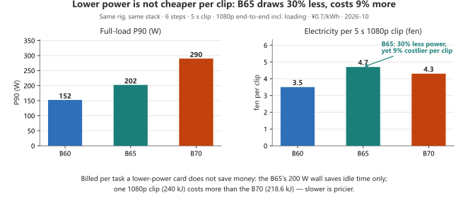

**Chart note: when billing per task, a lower-power card is not cheaper — slow is expensive; only for "always-on, never saturated" workloads does 200 W make sense.**

**Read it this way: billed per task a lower-power card does not save money — slower is pricier; the 200 W only wins if the card sits idle-loaded for long stretches.**

> ⚠️ Prices are **October 2026 list prices** and drift with platform discounts — re-check before ordering, and do not draw conclusions from old numbers.

## The order that matters: capacity first, bandwidth second

**The first gate is capacity, not peak metrics.** If the model fits in VRAM, bandwidth and compute start charging rent.
If it does not fit, the deciding factors switch immediately to **CPU, host-memory bandwidth and PCIe lanes** — the weights
live in host memory and every token drags them across the bus, at which point the card's quoted bandwidth, TOPS and
memory bus width are **all worth nothing**.

| | Fits (weights fully resident) | Does not fit (offloaded to host memory / whole-layer offload) |
|---|---|---|
| What sets the speed | The card: core count, power limit, **bandwidth only after those two** | **CPU · host-memory bandwidth · PCIe width**; the card becomes a bit player |
| Hard evidence | B65 moved to the chipset x4 slot: H3 per step **42.31 s** against 42.41 s on the x16 slot (**0.2% apart**); B65's 608 GB/s is only **32%** used | B50 16G · Q4_0 19.41 GiB: `-ncmoe 0` collapses to **4.14 tok/s** and only recovers to **37.74** at `-ncmoe 8` — **9× apart** |
| Can another backend rescue it? | Yes: Vulkan is **1.5 to 1.7×** faster than SYCL | **No**: once the experts are offloaded, Vulkan's **52.25** is digit-for-digit identical to SYCL's un-offloaded **52.25**; 1.65× collapses to 1.12× |

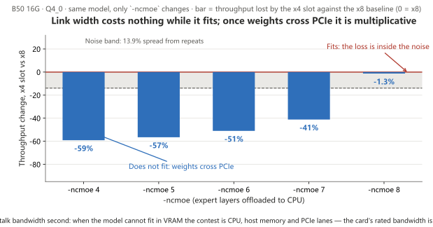

**Chart note: when it fits, the slot gap is smaller than noise; once weights cross the bus, link width becomes the multiplier — so the order is capacity → cores & power wall → bandwidth.**

**Read the chart: while it fits the slot difference is smaller than noise; the moment weights cross PCIe, link width becomes multiplicative — so the order is capacity, then cores and power wall, then bandwidth.**

5. **Once it fits, compute is still not on duty all the time.** At 480p most of the run is loading, and only
   1080p is a compute battlefield — a faster card only cashes in the sampling segment
   (share figures on the [H3 page](docs/comfyui-h3.en.md)).
   **A personal machine re-reads 34 GB of models for every clip and nobody can make that constant go away; a server keeps
   the models resident and amortises it, which is when the gap returns to "a few times"** — "not much slower" holds on a
   personal machine and does not hold on a server.

> **In one line**: **the B series solves "it fits" first, not "the spec sheet leads".** When it fits, the 16 / 24 / 32 GB
> tiers and a ¥4,499 entry price drag you off the offload treadmill; when it does not fit, the most advanced chip and
> bandwidth fail together and all you can buy is CPU, memory and PCIe lanes — a bigger bill that has nothing to do with
> how good the GPU is.

## Table 2 — Which card to buy

| You are | Buy |
|---|---|
| On a ¥3,500 budget: chat + images + occasional 480p / 720p video | **B50 16 GB** |
| Around ¥6,000, want chat and images a step faster, more VRAM headroom | **B60 24 GB** |
| Want 2 to 5× the speed, need 1080p, do not want to count VRAM | **B70 32 GB** |
| Need to run something bigger than 35B | **B60 / B65 and up** (24 to 32 GB tier) |
| Want two cards on one job | **Never tested. No answer.** |

## Table 3 — Electricity

| | B50 16 GB | B60 24 GB | B65 32 GB | B70 32 GB |
|---|---:|---:|---:|---:|
| Idle | not measured | not measured | not measured | **51 W** (like a light bulb) |
| Full load | 70 W (spec sheet, not measured) | **150.5 to 154.3 W** (H3 P90; TBP 200 W, **never hits the wall**) | **201 to 204 W** (P90, **pinned to the 200 W wall** — only 0.4 to 1.8% above `defaultLimit`) | **290 W** (measured, holds steady) |
| One hour at full load | about **¥0.05** | about **¥0.10** | about **¥0.14** | about **¥0.20** |
| One 5-second 720p video | not measured | about **¥0.01** (50 kJ) | about **¥0.01** (65 kJ) | about **¥0.01** (58 kJ) |

At **¥0.7 per kWh** — the reference rate from **China Southern Power Grid's residential tariff**. Real rates
vary by province, tier and time of day — **use your own bill**. **Electricity is not the cost — the PSU and cooling are.** For a 290 W card,
budget a 550 W PSU or better.

## Table 4 — All four cards, one table

| Workload | B50 16 GB | B60 24 GB | B65 32 GB | B70 32 GB | B70 vs B50 |
|---|---:|---:|---:|---:|---:|
| LLM decode · Qwen3.6-35B-A3B Q4_0 | 37.6 tok/s | 52.43 tok/s | **53.09 tok/s** | 75.92 tok/s | **2.0×** |
| Video · MiniMax H3, 864×480 · 6 steps, end to end | 399 s | **203.03 s** | **198.1 s** | 152.5 s | **2.6×** |
| Image · Qwen-Image 2.1 INT8, 1280×720 | 51.75 s | 17.3 to 18.8 s | **16.1 s** | 10.62 s | **4.87×** |
| Music · MiniMax Music 3, 120 s · 30 steps · DiT+TE all INT8 | 216.8 s | **144.9 to 145.8 s** | 164.6 s | 61.4 to 66.7 s | **≈3.3×** |

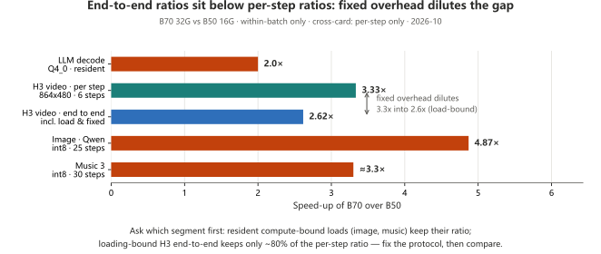

**Chart note: always ask "which segment" — H3 per-step is 3.3× but end-to-end drops to 2.6× (loading-dominated dilution); image/music steady-state is compute-dominated and keeps the full ratio.**

**Read it this way: always ask which segment — H3's 3.3× per step dilutes to 2.6× end to end (loading-bound), while image and music are compute-bound in steady state and keep their ratio.**

> ⚠️ The four columns are different batches (dates in the video section); B70 / B65 are fresh single runs, B60 / B50 are 4-run means — **do not subtract across columns**.  
> 🔴 In the music cell B65 is 14% slower: no single-variable comparison was run, **no cause given** (breakdowns on the card sheets and in `docs/comfyui-h3.md`).

## Table 4b — Price per tok/s

Divide the price by the decode speed from Table 4. This number is meaningful **only for chat / decode** —
it says nothing about image or video generation.

| | Price | Decode | Price per tok/s | vs cheapest |
|---|---:|---:|---:|---:|
| **B50 16G** | ¥4,499 | 37.60 tok/s | **≈ ¥120** | 1.00× |
| **B60 24G** | ¥6,499 | 52.43 tok/s | **≈ ¥124** | 1.04× |
| **B65 32G** | ¥9,999 | 53.09 tok/s | **≈ ¥188** | 1.57× |
| **B70 32G** | ¥18,999 | 75.92 tok/s | **≈ ¥250** | 2.09× |

> 🔴 This table answers one question: for faster chat alone, **B50** is the best value. The B65's premium buys VRAM, not speed (see the Table 1 note). Capacity is a separate ledger — see "what fits" on each card sheet in `docs/cards/`.

## Per-card sheets: four pages, one per card

This page (the summary) answers only **"how do the four compare, and which one do I buy"**. **Everything
about a single card lives on its own page** — resolution matrix, what fits and what does not, the limits,
power, and the collection date and driver behind every number.

**No number is written twice**: cross-card comparison lives on this page only; each card page carries only
that card's own figures.

| Model | Card sheet | What that page answers |
|---|---|---|
| **Arc Pro B50 16G** ¥4,499 | [**B50-README.en.md**](docs/cards/B50-README.en.md) | What "budgeting VRAM on 16 GB" really means: a 260K-context depth curve, `-ncmoe` being 6× wrong if you skip it, 1080p video in 38 minutes |
| **Arc Pro B60 24G** ¥6,499 | [**B60-README.en.md**](docs/cards/B60-README.en.md) | 24 GB is the "it fits" watershed: Q4_0 fully resident at 52.4 tok/s, `-c` up to 256K for free; but Krea-2 is the counter-example (62 to 66 s) |
| **Arc Pro B65 32G** ¥9,999 | [**B65-README.en.md**](docs/cards/B65-README.en.md) | The cheap one in the 32 GB tier: decode 53.1 tok/s **level with the B60**, P90 pinned to the 200 W wall, 480p video 3.3 min, 720p 6.6 min — **it sells VRAM, not speed** |
| **Arc Pro B70 32G** ¥18,999 | [**B70-README.en.md**](docs/cards/B70-README.en.md) | "Stop budgeting VRAM" on 32 GB: images in 10.6 s, 1080p video in 14 min, Vulkan 1.50×, a flat 290 W under load |

> Every card sheet carries its own **"where the data comes from"** section — collection date, driver,
> software stack and llama.cpp build. **Do not set two card sheets' seconds side by side**: each page has its
> own `--reserve-vram` value and its own batch. Cross-card numbers are compared on this page only, and the
> preconditions are written under each table.

## Hardware actually tested

| Card | VRAM visible | Bandwidth | INT8 TOPS | TBP | Price (CN) | Chip DEV | Board |
|---|---:|---:|---:|---:|---:|---|---|
| Arc Pro **B50** LP 16G | 15.51 GiB | 224 GB/s | 170 | 70 W | ¥4,499 | `E212` | GUNNIR `SUBSYS_25221EF7` |
| Arc Pro **B60** 24G | 23.33 GiB | 456 GB/s | 197 | 200 W | ¥6,499 | `E211` | GUNNIR `SUBSYS_25421EF7` |
| Arc Pro **B65** 32G | 31.16 GiB | 608 GB/s | 197 | 200 W | ¥9,999 | `E222` | GUNNIR `SUBSYS_27441EF7` |
| Arc Pro **B70** 32G | 31.16 GiB | 608 GB/s | 367 | 290 W | **¥18,999** | `E223` | GUNNIR `SUBSYS_27421EF7` |

🔴 **"Same bandwidth means same decode" is wrong — decode follows core count and the power wall** (cores in Table 1b ①); full comparison in [B65 card sheet §3.2](docs/cards/B65-README.en.md).

> **Price (2026-10-26)**: B60 also has a TF SKU at **¥6,599** (same performance as BS; pick by chassis room). Prices move; re-check the store page before quoting.

### VRAM accounting (read this before recording any number)

**The B70 is a 32 GB card. With ECC on, applications see only 27.25 GB.**
Turn ECC off (IGS → Graphics → ECC → off → reboot) → **31 GB usable** (measured 31,920.4 MB / 31.16 GiB).

**Decide "does it fit" on the visible-VRAM column above, never on 32 / 24 / 16** — the gap between nominal and usable is 0.7 to 0.9 GiB, and on the 16 GB tier the whole verdict hangs on exactly that half gigabyte.

| Item | Rule |
|---|---|
| ECC factory state | ⭐ **Off by default in the Intel driver; it has to be switched on manually in IGS.** So "27.25 GB is all you get" is not the default state — it means ECC was turned on |
| Does ECC change compute? | **No — capacity only.** Every measured difference stayed inside 6%, and ECC-off was marginally *faster* |
| Self-check | `torch.xpu.get_device_properties(0).total_memory` → ECC off reports ≈31.16 GiB (B70 / B65) / ≈23.33 GiB (B60) / ≈15.51 GiB (B50) |
| Reading ECC state | `python bench/harness/gpu_sysman.py` (Level Zero Sysman). ⚠️ The enum values are inverted between the two generations — **trust the physical capacity, not the enum value** |
| **iGPU vs discrete** | **Recommended: plug the monitor into the motherboard (iGPU) and leave the whole card to compute.** Measured: the iGPU drives 2560×1440, the B70's display field is empty, and only one process sits on the B70 (70 MB, ComfyUI) with all 31.16 GiB free. The cost is that the iGPU uses system RAM as VRAM (≈0.9 GB at desktop load), so that comes out of "32 GB". See [`test-rig.en.md`](docs/test-rig.en.md) |

> Register the VRAM accounting before recording any performance number — otherwise the records are not
> comparable across batches.


## Chat and text: `llama-bench -p 512 -n 128 -r 3`

> ⚠️ **The two protocols are not comparable.** `llama-bench` and `llama-server /completion` time
> differently (batch size, whether sampling overhead is included, warmup policy) — the same card can
> differ by several times. Check which one a number came from before reading it.

| Card | Model | Quant | Size | Decode | Prefill | Notes | Date |
|---|---|---|---:|---:|---:|---|---|
| B70 32G | Qwen3.6-35B-A3B | Q4_0 | 19.41 GiB | **75.92 tok/s** | 1341.36 tok/s | primary slot ×16 | 2026-10-15 |
| **B60 24G** | Qwen3.6-35B-A3B | Q4_0 | 19.41 GiB | **52.43 tok/s** | 961.22 tok/s | primary slot, `-ncmoe 0` (**fully resident**) | 2026-10-20 |
| **B60 24G** | Qwen3.6-35B-A3B | Q3_K_S | 14.30 GiB | **52.09 tok/s** | 730.55 tok/s | fully resident | 2026-10-20 |
| **B60 24G** | Qwen3.6-35B-A3B | IQ2_M | 10.73 GiB | **62.69 tok/s** | 771.07 tok/s | fully resident | 2026-10-20 |
| **B65 32G** | Qwen3.6-35B-A3B | Q4_0 | 19.41 GiB | **53.09 tok/s** | 670.06 tok/s | primary slot, `-ncmoe 0` (**fully resident**) | 2026-10-21 |
| **B65 32G** | Qwen3.6-35B-A3B | Q3_K_S | 14.30 GiB | **59.36 tok/s** | 646.37 tok/s | fully resident | 2026-10-21 |
| **B65 32G** | Qwen3.6-35B-A3B | IQ2_M | 10.73 GiB | **63.96 tok/s** | 636.93 tok/s | fully resident | 2026-10-21 |
| **B65 32G** | Qwen3.6-35B-A3B | Q4_0 | 19.41 GiB | **45.84 tok/s** | 300.42 tok/s | `-ncmoe 8` (8 layers forced off) | 2026-10-21 |
| B50 16G | Qwen3.6-35B-A3B | Q4_0 | 19.41 GiB | **37.6 tok/s** | ≈425 tok/s | primary slot ×8, `-ncmoe 8` (offloaded) | 2026-10-15 |
| B50 16G | Qwen3.6-35B-A3B | Q4_0 | 19.41 GiB | **35.89 tok/s** | 371.41 tok/s | second slot ×4 (exclusive), `-ncmoe 8` | 2026-10-15 |
| B50 16G | Qwen3.6-35B-A3B | **Q3_K_S** | 14.30 GiB | **37.99 tok/s** | 589.57 tok/s | primary slot ×8, `-ncmoe 0` (**fully resident**) | 2026-10-15 |
| B50 16G | Qwen3.6-35B-A3B | **IQ2_M** | 10.73 GiB | **45.99 tok/s** | 551.95 tok/s | primary slot ×8, `-ncmoe 0` (**fully resident**) | 2026-10-15 |
| B50 16G | Qwen3-VL-4B | Q4_0 | 2.21 GiB | **63.99 tok/s** | 1457.02 tok/s | primary slot ×8, fully resident (dense) | 2026-10-15 |

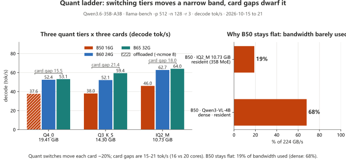

**Chart note: each card's quant switch stays within a narrow ±20% band; the 15–21 tok/s inter-card gap is cores; B50 gains nothing from quant because bandwidth is only 19% used — quant tiers trade quality and VRAM headroom, not speed.**

**Read it this way: each card's three tiers sit in a ~20% band (B60 52.1-62.7, B65 53.1-64.0, B50 37.7-46.0) while card-to-card gaps are 15-21 tok/s (16 vs 20 cores); B50 stays flat because it uses 19% of bandwidth, where the same card runs a dense model at 68% — pick a quant for quality and VRAM headroom, not for speed.**
(Die and core differences: see "Xe2 cores" above; full comparison in [B65 card sheet §3.2](docs/cards/B65-README.en.md).)

Two settings that are not optional on 16 GB:

| Setting | Effect | Why |
|---|---|---|
| Sampling and KV | `-ngl 999 -fa on -ctk q8_0 -ctv q8_0` | |
| When it does **not** fit (Q4_0 19.41 GiB) | add `-ncmoe 8` | **Skipping it is the worst configuration**: same card, same slot, `-ncmoe 4` gives only 6.08 tok/s vs 36.66 at `-ncmoe 8` — a 6× gap |
| When it **does** fit (Q3_K_S / IQ2_M) | `-ncmoe 0` | Offloading anyway only makes it slower (gentle slope, up to −29%); the bottleneck is not bandwidth there |
| The rule | **weight size vs 15.51 GiB** | One rule, nothing else to memorise |
| `ONEAPI_DEVICE_SELECTOR=opencl:0` | required | With two cards present, an unqualified selector triggers an OpenCL adapter P2P crash |
| `SYCL_CACHE_PERSISTENT=1` / `OMP_NUM_THREADS=8` | | Kernel cache reuse, thread count |

Launch line: `-ngl 999 -fa on -ctk q8_0 -ctv q8_0`. Env: `SYCL_CACHE_PERSISTENT=1`,
`OMP_NUM_THREADS=8`, `ONEAPI_DEVICE_SELECTOR=opencl:0`.

> **Why `-ncmoe` is the dividing line**: when `-ngl 999` does not fit, llama.cpp degrades to **whole-layer** offload (weights shuttle back and forth); `-ncmoe` moves only experts, an order of magnitude less traffic.

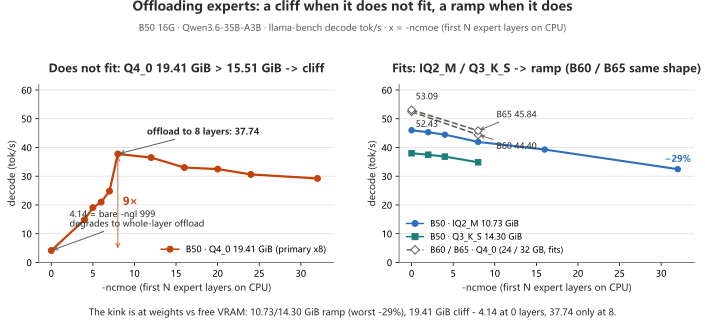

**Chart note: the turning point is set by "does it fit" — a cliff when it does not, a gentle ramp when it does.**

**Read it this way: the kink is set by "does it fit" — B50's Q4_0 (19.41 GiB) with bare `-ngl 999` runs at 4.14 tok/s and only recovers to 37.74 at 8 layers offloaded; tiers that fit (IQ2_M / Q3_K_S) ramp gently (worst −29%), and forcing `-ncmoe 8` on B60 / B65 is a pure loss (−15% / −14%).**

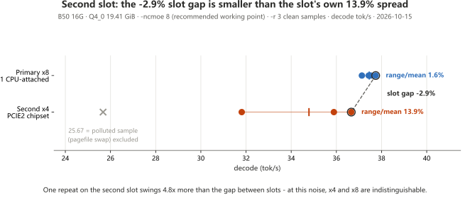

**Chart note: beyond `-ncmoe ≥ 12` the second slot swings between −3.5% and +6.3%; at the recommended operating point the slot's own variance is 4.8× the slot gap.**

**Read it this way: above `-ncmoe 12` the second slot swings −3.5% to +6.3% against the primary, flipping sign; at the recommended working point (`-ncmoe 8`) the second slot's own 13.9% spread is 4.8× the 2.9% slot gap — statistically indistinguishable, not "a bit slower but acceptable".**

### Protocol B: `llama-server` `/completion` (single request)

Same model — **Qwen3.6-35B-A3B · Q4_0 · 19.41 GiB**. Each row is **that tier's own delivery
configuration**: the command line a customer can copy and get the same number out, not a lab setting.

| Card | Visible VRAM | `-ncmoe` | Context | Residency | Shared spill | Decode | Prefill | Samples |
| --- | ---: | ---: | ---: | --- | ---: | ---: | ---: | --- |
| B50 16G | 15.51 GiB | 8 (does not fit) | 16384 | partial | 3,848 MB | 35.55 to 37.55 tok/s | 46.5 to 48.6 | 4 × 3 sessions |
| **B60 24G** | 23.33 GiB | **0 (fits)** | 16384 | **fully resident** | **326 MB** | **50.94 tok/s** | 52.34 | 4 |
| **B65 32G** | 31.16 GiB | **0 (fits)** | 16384 | **fully resident** (42/42 layers on card) | **273 MB** | **52.10 tok/s** | 62.21 | 10 |
| B70 32G | 31.16 GiB | 0 | 8192 | fully resident | — | 39.8 to 45.1 tok/s | 118 to 128 | 2 (early run) |

> **The gap from B50 to B60 is not a compute gap — it is "does it fit".** The B50's 3,848 MB spill makes every token
> read expert weights back over PCIe, which eats the bandwidth advantage.
>
> A strict same-setting comparison holds between the B50 and B60 rows; the B65 row's "shared spill" comes from a log-mapped buffer, a different counter from the other two rows — compare magnitudes only.


**Chart note: B60 stays flat across all five tiers (1.6% range); B50 collapses from 64K as shared memory spills to 7,160 MB — what matters is the spill, not `-c`.**

**Read the chart: B60 spans 1.6% across five tiers — `-c` is a capacity knob; B50 collapses from 64K as shared spill grows to 7,160 MB — what decides speed is the spill, not `-c`.**
Same for the vision tower: `--mmproj` is +0.6% (free) on the B60 and −11.5% on the B50; image tokens travel the prefill phase, so the first image waits 17 s or 103 s (both cold) on the same spill logic. Details: [`docs/server-config.en.md` §7](docs/server-config.en.md).

### Long context: allocating is free, filling is what you pay for

Two separate questions: what *allocating* 262,144 tokens of KV costs, and what a given *filled depth* costs.
The first is nearly free. The second is the bill.

**① Allocation — `-c` up to 262,144 costs nothing**

| Card | Quant | Method | Result |
|---|---|---|---|
| B50 16G | IQ2_M 10.73 GiB | six `-c` steps, shallow prompt | 45.21 / 45.07 / 45.07 / 44.47 / 44.75 / **44.93**, spread 1.6% |
| **B65 32G** | Q4_0 19.41 GiB | same prompt, same script, only `-c` differs | **52.42 (`-c 16384`) → 51.29 (`-c 262144`), −2.2%** |
| B60 24G | Q4_0 19.41 GiB | five `-c` steps, shallow prompt | 50.94 / 50.73 / 51.54 / 50.94 / **51.35**, spread 1.6% |

`-c 262144` loads in **17.6 s** on B65 (`-c 16384` takes 18.1 s on the same card — no measurable difference);
the same script on B50 took 13.1 s. Allocating is free — but "it fits" is not the same as
"long context is usable". See the second table.

**② Filled — KV fed to N tokens, then generate**

| Filled depth | 508 | 31,323 | 62,673 | 125,375 | 188,104 | 250,948 |
|---:|---:|---:|---:|---:|---:|---:|
| **B65 32G · Q4_0** decode | **51.29** | **37.20** | **30.02** | **21.73** | **17.81** | **14.24** |
| B65 32G prefill | 366.97 | 569.88 | 547.19 | 507.60 | 472.47 | 440.77 |
| **B50 16G · IQ2_M** decode | **44.35** | **30.82** | **24.26** | **17.02** | **13.01** | **10.48** |
| B50 16G prefill | 414.91 | 427.53 | 385.95 | 330.04 | 285.82 | 254.76 |

⚠️ These two rows are **not a same-weights comparison**. They are the delivery configuration each card can
actually hold: 16 GB only fits IQ2_M (10.73 GiB), 32 GB runs Q4_0 (19.41 GiB). The depth points follow each
run's own request sequence (512 / 32768 / 65536 / 131072 / 196608 / 262144), so the measured `prompt_n` values
differ slightly — read the header row.

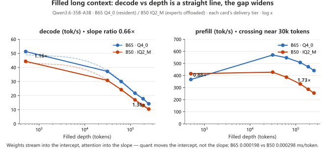

**Chart note: quantization moves the intercept; the attention cost lives in the slope — decode gaps widen with depth; prefill crosses over near 30K tokens.**

**Read the chart: changing quant moves the intercept, attention owns the slope — the decode gap widens with depth, and prefill flips past ~30k tokens.**
> One line: **the gap widening with depth is attention arithmetic, not a broken card**; only a quarter of this model's layers carry KV — a fully-attention model of the same size would slope roughly 4× steeper (an estimate, not measured).

> ⚠️ **IQ2_M, not Q3_K_S, for long context on 16 GB.** IQ2_M (10.73 GiB) at `-c 262144` totals
> 15,540 MB and never spills; Q3_K_S (14.30 GiB) spills **2,332 MB and loses 58% decode**
> (15.74 tok/s). Spilling is not an OOM — Windows lets you over-subscribe, silently, and charges you in
> speed. The tell is **prefill and decode falling together**.

**B60 has only the allocation half** (the five `-c` tiers in the server section above); the depth sweep was not run, so no numbers for 24 GB.

## Swap the backend: same command line, Vulkan is 1.5 to 1.7× faster

This is the **single biggest win in the whole handbook**: **same llama.cpp build (11753), same delivery command line — only the binary changes**.
How much you gain depends on one thing — **whether the weights stay resident in VRAM**:

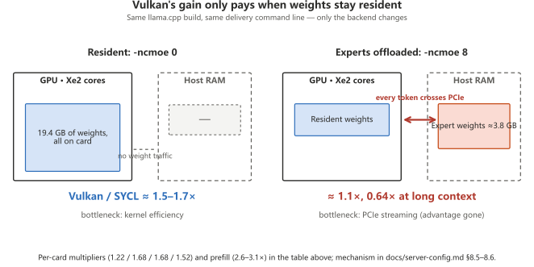

**Chart note: when weights are fully resident the kernel gain pays 1.5–1.7×; once experts spill, both backends hit the same PCIe wall and the ratio collapses to 1.1×.**

**Read the chart: fully resident, kernel efficiency converts directly into 1.5–1.7×; with experts offloaded, every token crosses PCIe, both backends hit the same bottleneck, and the ratio collapses to ~1.1×.**

| Card | Backend | Delivery-config decode | Prefill | Multimodal first image (warm) |
| --- | --- | ---: | ---: | ---: |
| B60 24G | SYCL | 51.79 tok/s | 670 tok/s | 7.0 s |
| **B60 24G** | **Vulkan** | **85.59 tok/s (1.65×)** | **1934 tok/s (2.9×)** | **4.8 s (1.45×)** |
| B65 32G *( `llama-bench` protocol )* | *SYCL* | *53.09 tok/s* | *670 tok/s* | *8.0 s* |
| **B65 32G** *( `llama-bench` protocol )* | **Vulkan** | ***89.27 tok/s (1.68×)*** | ***2014 tok/s (3.0×)*** | ***6.5 s (1.23×)*** |
| B65 32G (Q3_K_S, resident) | SYCL | 57.62 tok/s | 58.67 tok/s | not measured |
| **B65 32G (Q3_K_S, resident)** | **Vulkan** | **71.36 tok/s (1.24×)** | **80.21 tok/s (1.37×)** | not measured |
| B70 32G | SYCL | 75.23 tok/s | 1010 tok/s | 7.59 s |
| **B70 32G** | **Vulkan** | **113.18 tok/s (1.50×)** | **3165 tok/s (3.1×)** | **4.15 s (1.83×)** |
| B50 16G (IQ2_M, resident) | SYCL | 46.25 tok/s | 495 tok/s | 10.0 s |
| **B50 16G (IQ2_M, resident)** | **Vulkan** | **56.69 tok/s (1.23×)** | **1283 tok/s (2.6×)** | **9.7 s (1.04×)** |
| B50 16G (Q4_0 · 8 expert layers offloaded) | SYCL | 38.08 tok/s | — | **75.5 s** |
| **B50 16G (Q4_0 · 8 expert layers offloaded)** | **Vulkan** | **41.81 tok/s (1.10×)** | — | **9.0 s (8.4×)** |
| B50 16G (Q3_K_S · 514 MB spill) | SYCL | 39.73 tok/s | 49.55 tok/s | not measured |
| **B50 16G (Q3_K_S · 514 MB spill)** | **Vulkan** | **47.55 tok/s (1.20×)** | **75.05 tok/s (1.51×)** | not measured |

> ⚠️ The two B65 IQ2_M rows are **`llama-bench`** figures, the other eight are **delivery command line** figures — compare within a protocol, never across; the multimodal cells mix resident and expert-offloaded tiers, not side by side; "—" means **withheld** (sampling spread 40%+, `docs/server-config.md` §8.5).  
> 🔴 **The multiplier is measured per card and per phase (see the table's multiplier column)**; prefill goes the other way, climbing with core count — **report per card, per phase; do not extrapolate**. The gain comes from backend kernel efficiency, not spill amount (`docs/server-config.md` §8.6).  
>
> - On Vulkan you **must pin the device**: card 0 as enumerated is the iGPU (bogus 16 GB) — use `-dev Vulkan1`.  
> - On Arc, Vulkan reports **`bf16: 0`, `fp4: 0`** (fp16 available); bf16-weight models need their own check.

## Video generation — ComfyUI, MiniMax H3

Fixed workload: **864×480 · 124 frames @ 24 fps (5.17 s) · 6 steps**. All four columns run ComfyUI 0.39.0
+ `torch 2.12` + the int8fix stack, but they are **different batches**: **B50 2026-10-16 / B60 10-20 /
B65 10-21 / B70 10-19**. The B70 and B65 columns are warm runs; the B60 and B50 columns are all 4 runs of
their own batch.

| Item | B70 32G | B65 32G | B60 24G | B50 16G |
|---|---:|---:|---:|---:|
| DiT (19.53 GB) loading | **fully resident** 19,996 MB | **fully resident** 19,996 MB | **partial** + **3,728 MB offloaded** | **partial** 7,010 MB + **12,985 MB offloaded** |
| End-to-end (6 steps) | **152.5 s** | **198.1 s** (warm; cold start 227.7 s) | **203.0 s** (4 runs 203 to 261) | **399 s** (4 runs 391 to 410, 4.7% spread) |
| Sampling / per step | **39.8 s / 6.6 s** | 63.9 s / 10.65 s | **71.2 s / 11.9 s** | 164 s / **22 s** (first step 54 s) |
| Load + encode + decode (fixed) | **112.7 s** | 134 s | **131.9 s** | 234 s |
| Sampling share of end-to-end | **26%** | **32%** | **35%** | **41%** |

> ⚠️ The B70's cold first clip is 191 s (cold → warm gap 28 s); the 10-17 batch on a different stack did 283.82 s in a single B50 run — not side-by-side. **Cross-card multipliers are order-of-magnitude only**; breakdown in [`bench/notes/comfyui-h3-internals.md`](bench/notes/comfyui-h3-internals.md) §7.8.

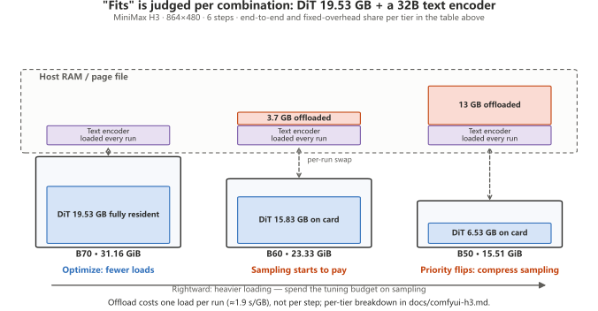

**Chart note: "does it fit" is per combination — DiT 19.53 GB plus the 32B text encoder: 32 GB fully resident, 24 GB offloads 3.7 GB, 16 GB offloads 13 GB.**

**Read the chart: "it fits" is judged per combination — DiT 19.53 GB plus a 32B text encoder: 32 GB fully resident, 24 GB offloads 3.7 GB, 16 GB offloads 13 GB; offload costs one load per run (≈1.9 s/GB), and the fixed-overhead share sets the optimization direction.**

**What separates the tiers is not "who is faster" but "how much of the run is fixed overhead"** — 32 GB is still loading-dominated (**"a 2-step turbo LoRA is not a compromise"**), at 16 GB the 13 GB of weights stay in host memory and the optimization priority flips to sampling, with 24 GB as the middle state.  
🔴 "24 GB fits too" is an illusion: the DiT plus the 32B text encoder already exceeds 23.33 GiB, and offloading rises to 10.8 GB at 1080p; ⚠️ a pure card difference requires both cards fully resident — impossible at 16 / 24 GB, so this section reports numbers only ([`docs/comfyui-h3.en.md`](docs/comfyui-h3.en.md)).


| Knob | Result |
|---|---|
| Disable OmniXPU (`OMNIXPU_ENABLE=0`) | kernel **drops `sdp`**, **+6.2 s per sampling step** |
| Pinned memory on/off | ±0.1% — no difference, do not bother |
| Steps 2 → 12 (6×, B70) | total time only **+24%** |
| Same card, later software stack (B70) | **+14.6%**, all of it in the loading segment (sampling unchanged) |

### How long a clip takes, and how long a clip can be (mainstream tiers · four cards)

| Wait per 5 s clip (end to end · 6 steps · 124 frames) | B50 16G | B60 24G | B65 32G | B70 32G |
| --- | ---: | ---: | ---: | ---: |
| 864×480 | 4.7 min\* | 3.4 min | 3.3 min | **2.5 min** |
| 1280×720 | 11.2 min\* | 7.1 min | 6.6 min | **4.6 min** |
| 1920×1088 | 37.7 min\* | 22.1 min | 22.1 min | **14.0 min** |
| **Longest clip tested** | 480p ≤ 20 s / 720p ≤ 5 s | 480p ≤ 20 s / 720p ≤ 15 s / 1080p ≤ 5 s | 480p ≤ 50 s / 720p ≤ 24 s / 1080p ≤ 10 s / 1440p ≤ 5 s | 480p ≤ 50 s / 720p ≤ 24 s |

\* B50 figures are cold first clips from the 10-17 batch on a different stack — not side-by-side with the 480p breakdown table (10-16 batch, 4-run mean, 6.7 min); B60 / B65 / B70 are steady state. Full six-tier ladder and per-step numbers in [`docs/comfyui-h3.en.md`](docs/comfyui-h3.en.md); duration ladders per card sheet §6.

> ⚠️ Running H3 requires CUTE off — it is hard-coded in `bench_f_h3.py`'s `BASE_ENV`;
> exporting it from the shell does nothing.

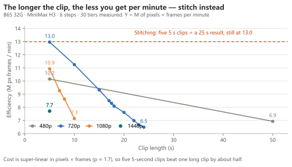

> Chart note: look at the efficiency curve — the longer the clip, the less you get per minute.

**Long clips**: stitching segments is about **1.9× faster** than one long take, and a bad segment only costs one segment. Rungs that do not fit are not slow — **VRAM cannot hold that rung's peak transient allocation**.

## Image and music generation — Qwen-Image 2.1 / Krea-2 / Music 3

Same card, same stack, three request types: **`first`** (model just swapped in, includes loading) ·
**`resident`** (same prompt, new seed → steady state) · **`newprompt`** (different prompt).

### One table, four cards (steady state · delivery tier)

All four batches (2026-10-16 to 22) ran the same ComfyUI 0.39.0 + `comfy_kitchen` 0.2.37 + XPU provider 0.2.33 + torch 2.12.0+xpu + kernel `torch212.bmg` + `omni_int8fix.py`. **Only delivery tiers with numbers are listed**: OOM, untested and no-number cells stay empty, with no remark — full per-card, per-tier data lives in the four card pages §4 / §5; collection conditions and attribution in [`docs/comfyui-image.en.md`](docs/comfyui-image.en.md).

| Workload (resident steady state) | B50 16G | B60 24G | B65 32G | B70 32G |
|---|---:|---:|---:|---:|
| **Qwen-Image 2.1** · int8 · 1280×720 · 25 steps | **51.75 s** | **18.06 s** | **16.16 s** | **10.62 s** |
| same · `bf16` | 87.34 s | — | 22.91 s | 13.82 s |
| 　of which sampling | 29 s | 16 s | 15.0 s | 9 s |
| 　evicted per round | 3,837.8 MB | 0 | 0 | 0 |
| **Krea-2 Turbo** · int8 · 8 steps | 57.3 to 58.5 s* | 62.3 to 66.0 s | **8.73 s** | **6.04 s** |
| same · `bf16` | — | — | 167.4 to 167.6 s | — |
| **Music 3** · int8 · 120 s · 30 steps | **216.82 s** | **144.9 to 145.8 s** | **180.2 to 180.9 s**† | **61.95 s** |
| 　of which sampling | 165 s | 93 s | 82 s | 54 s |

\* The B50 run is 1024×1024 (its 16 GB delivery form); the other three are 1280×720.
† The B65 figure is at `--reserve-vram 2` (`reserve 4` did not converge); Music 3 TE tiers differ per card (int8 TE on B50 / B60, bf16 TE on B65 / B70), **with no material effect on steady state** (0.6% between the two tiers on B70).

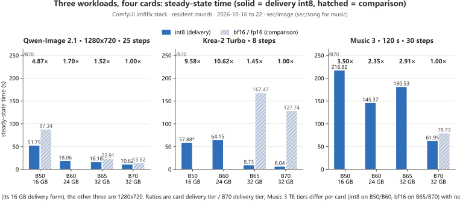

**Chart note: B70 leads on every workload — on Qwen, B50 is 4.87×; on Krea-2, B60 is 10.6×; on Music 3, B50 is 3.50×.**

**Read it this way: on the same workload B70 leads across the board — B50 is 4.87× on Qwen, B60 10.6× on Krea-2, B50 3.50× on Music 3; the comparison tiers (bf16 / fp16 DiT) are only slower, the sole exception being the mis-built old kernel.**

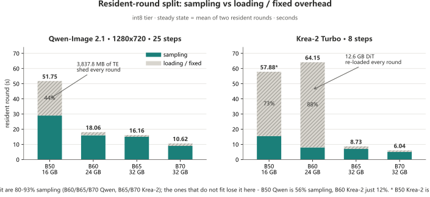

**Chart note: cards that fit spend 80–93% of time sampling; the gap comes from loading — B50 offloads 3,837.8 MB per round (sampling only 56%), B60 reloads the 12.6 GB DiT every round.**

**Read it this way: cards that fit are 80-93% sampling; the ones that do not fit lose it here — B50's Qwen sheds 3,837.8 MB of text encoder every round (only 56% sampling) and B60's Krea-2 re-loads a 12.6 GB DiT every round (only 12%).**

### The summary: three conclusions

1. **Image generation is compute-dominated; video is loading-dominated**: step count pays off proportionally (25 steps to 10 cuts about 60% of the time); H3 is 26-51% sampling at 480p and 81-90% at 1080p, higher on smaller cards.
2. **On 16 GB, quantization is a VRAM tool first and a speed tool second**: bf16's DiT offloads 608 MB while int8 is fully resident (Qwen steady state is four tenths apart — see the table); Krea-2 and Music 3 **only run int8 on 16 GB**.
3. **Music 3: the DiT quant is the performance lever, the TE quant only a capacity lever**: fp16 DiT 78.7 s → int8 61.95 s (**−21%**), while the TE tier does not move steady state (footnote †); **the criterion is how many components reload per round, not the quant tier.**

> ⚠️ The cross-card per-step ratios **1.81× / 1.78×** match no single spec ratio (bandwidth 2.04× / 1.33×, INT8 TOPS 1.16× / 1.86×) — **no attribution extrapolated**; the B60 / B65 batches also ran a different driver than B50 / B70 (9150 vs 8976), so the Qwen row is not a pure card-to-card read. Details in [`docs/comfyui-image.en.md`](docs/comfyui-image.en.md).

> 🔴 **"INT8 is slower than bf16" is a kernel artifact, not the card** — with the right kernel (`torch212.bmg` + int8fix) the sign flips (B70: Qwen +23%, Krea-2 sampling +32%, Music 3 int8 DiT 16-21% faster than fp16). **Numbers from before and after a stack change are not side-by-side comparable**; the 2026-10-14 B70 image batch predates the kernel swap (see [`docs/comfyui-image.en.md`](docs/comfyui-image.en.md) §0).

> **Cost is super-linear in pixels** (measured on B50): pixels 1.00× / 1.44× / 4.55× → sampling 1.00× / 1.55× / 7.38× — **budget by area, not by "a bit bigger"**; higher resolutions in the [B50 card page](docs/cards/B50-README.en.md).

Full per-card, per-tier data (first round / new prompt / song swap / power / resolution ladder) is in the four card pages §4 / §5; collection conditions, attribution and counter-examples in [`docs/comfyui-image.en.md`](docs/comfyui-image.en.md); the three-question summary ("how big a model fits · video · image") is in [`docs/comfyui-capability.en.md`](docs/comfyui-capability.en.md).

## Power — whole-card energy counter, 1 s integration

| | B50 16G | B60 24G | B65 32G | B70 32G |
|---|---:|---:|---:|---:|
| Idle | not readable | not measured | not measured | **51.0 W** (fluctuation < 0.3 W) |
| H3 full load (P90) | not readable | **150.5 to 154.3 W** (75 to 77% of the 200 W wall) | **200.8 to 203.7 W** (pinned to the 200 W wall) | **290.3 to 291.1 W** (1 W across five resolutions, right at TBP) |
| Image / music (P90) | not readable | **137.8 to 150.0 W** (none of the three models touched the wall) | **195.4 to 208.2 W** (images at the wall, music 49% duty) | 290 W class (exception: Krea-2 `bf16` sat at **93.1 W**) |
| 1 s peak | not readable | **147.2 to 168.9 W** | **207.0 to 223.5 W** | **291.5 to 327.1 W** (Music 3 highest; domain ceiling 348 W) |
| One 5 s / 720p clip | not readable | **50 kJ ≈ ¥0.010** | **64 to 68 kJ ≈ ¥0.013** | **58 kJ ≈ ¥0.011** |
| One 5 s / 1080p clip | not readable | **181 kJ ≈ ¥0.035** | **240 kJ ≈ ¥0.047** | **218.6 kJ ≈ ¥0.043** |

**The whole B50 column reads "not readable"**: the card is in the machine but its whole-card power domain
cannot be read (Sysman reports `defaultLimit = -1 mW`), and the sampled watts clearly contradict the 70 W
spec — **so no watts, no electricity cost. Nothing measured means nothing invented.**

> **How to size cooling**: B70 at **290 W sustained + 325 W transient** (PSU ≥ 550 W); B65 at **200 W
> sustained + 224 W transient** (measured max 223.5 W); B60 measured max **169 W**, so **170 W sustained +
> 200 W transient** leaves enough margin. ⚠️ **Do not size off TBP**, and **we have no > 1 h sustained
> full-load data.**

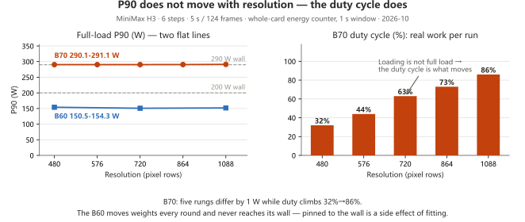

**Chart note: three conclusions that change how to read power — ① B70's full-load power is task-independent; what varies is duty cycle; ② "sitting on the wall" is itself a side effect of "it fits"; ③ to detect "does not fit", look for a duty-cycle collapse.**

**Read it this way: three findings that change how you read a power spec — ① on the B70 full-load wattage is independent of the task, what changes is the duty cycle (how much of the run is real work); ② "pinned to the wall" is itself a side effect of "it fits" — the B60 does not fit and never reaches the wall; ③ quantization does not change power, it changes time — the energy saved equals the time saved, it is not "more efficient per watt".**

Full watt/joule/thermal math: [`docs/comfyui-power.en.md`](docs/comfyui-power.en.md).

## Reference figures (not from this machine — source stated)

| Platform | Model | Decode | Source |
|---|---|---:|---|
| Arc Pro B50 16 GB | Qwen3.8-Flash-Next (125B MoE), Coder IQ1_M | ≈23 tok/s | Strata's own `docs/INTEL_ARC.md` (community measurement) |
| Arc Pro B50 16 GB | same, IQ2_XS | 25 to 27 tok/s | same |
| Arc Pro B70 32 GB | same, Coder IQ1_M | 70 to 78 tok/s | same |
| Arc Pro B70 32 GB | same, Flash-Next IQ3_S | 30 to 41 tok/s | same |

> Someone else measured these; **they have not been reproduced on this rig**, so they are listed
> separately. Once reproduced here they move into the tables above.

## Documentation map

**Every page ships in both languages.** The Chinese file is the original (each number was recorded there
first); the English file is a full translation, not a summary — same tables, same figures, same caveats.
Numbers, tables and code are language-independent, so the two versions can be read side by side.

| # | Page | English | What's in it |
|---|---|---|---|
| 1 | [`docs/at-a-glance.en.md`](docs/at-a-glance.en.md) | [EN](docs/at-a-glance.en.md) | **One page, six tables** — the plain-language summary |
| 2 | [`README.zh-CN.md`](README.zh-CN.md) | this page | The full front page: every measured number, every tier |
| 2a | [`docs/cards/B70-README.en.md`](docs/cards/B70-README.en.md) | [EN](docs/cards/B70-README.en.md) | **Per-card sheet · B70 32G** — image 10.6 s, 1080p video 14 min, Vulkan 1.50×, held at 290 W |
| 2b | [`docs/cards/B65-README.en.md`](docs/cards/B65-README.en.md) | [EN](docs/cards/B65-README.en.md) | **Per-card sheet · B65 32G** — same bandwidth as B70, not the same speed; 200 W at the wall; H3 still offloads each round |
| 2c | [`docs/cards/B60-README.en.md`](docs/cards/B60-README.en.md) | [EN](docs/cards/B60-README.en.md) | **Per-card sheet · B60 24G** — the "it fits" dividing line, plus the Krea-2 counter-example |
| 2d | [`docs/cards/B50-README.en.md`](docs/cards/B50-README.en.md) | [EN](docs/cards/B50-README.en.md) | **Per-card sheet · B50 16G** — 16 GB capacity limits, `-ncmoe` knee, long-context depth curve |
| 3 | [`docs/vram-16gb.en.md`](docs/vram-16gb.en.md) | [EN](docs/vram-16gb.en.md) | **16 GB tier tuning** — quant selection, `-ncmoe`, context |
| 4 | [`docs/server-config.en.md`](docs/server-config.en.md) | [EN](docs/server-config.en.md) | **Delivery-ready server config** — without `-ncmoe` it is 15× worse |
| 5 | [`docs/slot-comparison.en.md`](docs/slot-comparison.en.md) | [EN](docs/slot-comparison.en.md) | PCIe slot A/B — slot penalty (−2.9%) is smaller than slot noise (13.9%) |
| 6 | [`docs/test-rig.en.md`](docs/test-rig.en.md) | [EN](docs/test-rig.en.md) | Test platform spec, AIB identity table, what must be recorded |
| 7 | [`docs/build.en.md`](docs/build.en.md) | [EN](docs/build.en.md) | **The machine itself** — full parts list, before/after, why only one route out of four |
| 8 | [`docs/install.en.md`](docs/install.en.md) | [EN](docs/install.en.md) | **What to install** — three routes, drivers and ECC, the three patch sites, self-checks |
| 9 | [`docs/comfyui-capability.en.md`](docs/comfyui-capability.en.md) | [EN](docs/comfyui-capability.en.md) | **Capability matrix**: how big a model fits, video, image — three questions, one page |
| 10 | [`docs/comfyui-h3.en.md`](docs/comfyui-h3.en.md) | [EN](docs/comfyui-h3.en.md) | H3 video: **four cards × six resolutions in one table** (720p: 4.6 / 6.6 / 7.1 / 11.2 min), plus duration and power cost |
| 11 | [`docs/comfyui-image.en.md`](docs/comfyui-image.en.md) | [EN](docs/comfyui-image.en.md) | Qwen-Image 2.1 / Krea-2 / Music 3, including the kernel-variant A/B |
| 12 | [`docs/comfyui-power.en.md`](docs/comfyui-power.en.md) | [EN](docs/comfyui-power.en.md) | **Power and energy** — watts, joules per job, cost and cooling |
| 12a | [`docs/dual-b65-report.en.md`](docs/dual-b65-report.en.md) | [EN](docs/dual-b65-report.en.md) | **Dual-card report (2× B65)** — published separately: how to install and run two cards, what two cards buy and what they do not, 1× B70 against 2× B65 |
| 13 | [`docs/pitfalls.en.md`](docs/pitfalls.en.md) | [EN](docs/pitfalls.en.md) | **900+ lines of pits**: symptom → root cause → fix |
| 14 | [`docs/test-registry.en.md`](docs/test-registry.en.md) | [EN](docs/test-registry.en.md) | **Test registry** — every item: status, data location, reproduction entry, predictions vs. actuals |
| 15 | [`docs/strata-b50-linux-prep.en.md`](docs/strata-b50-linux-prep.en.md) | [EN](docs/strata-b50-linux-prep.en.md) | Reproducing B50 on Ubuntu — disk / kernel / RAM blockers |
| 16 | [`docs/publish-checklist.en.md`](docs/publish-checklist.en.md) | [EN](docs/publish-checklist.en.md) | What ships, what does not, and how untested items are labelled |
| 17 | [`bench/README.md`](bench/README.md) | — | **Measurement definitions** — what makes two numbers comparable |
| 18 | [`bench/logs/`](bench/logs/) | — | 336 raw `llama-server` logs (path-scrubbed, otherwise byte-identical) |
| 19 | [`bench/data/`](bench/data/) | — | **399** machine-readable JSON records |
| 20 | [`CONTRIBUTING.md`](CONTRIBUTING.md) | — | Format required for submitting measurements |

**If you only read three pages:**

- **"Can this card run X?"** → [`docs/comfyui-capability.en.md`](docs/comfyui-capability.en.md) · [EN](docs/comfyui-capability.en.md)
- **"Why is my server slow?"** → [`docs/pitfalls.en.md`](docs/pitfalls.en.md) · [EN](docs/pitfalls.en.md) + [`docs/server-config.en.md`](docs/server-config.en.md) · [EN](docs/server-config.en.md)
- **"Is this number trustworthy?"** → [`docs/test-registry.en.md`](docs/test-registry.en.md) · [EN](docs/test-registry.en.md)

## Reproducing

```bash
python bench/harness/registry_audit.py        # count / schema / evidence coverage, one command
ls bench/harness/                             # collectors, matchers, and migrators
```

Every record carries `log_evidence` with `status ∈ {annotated, missing, pending}` — so you can tell, per
record, whether its timing breakdown was backed by a log, lost, or never attempted. A `missing` record
says so out loud instead of pretending the decomposition exists.

Two historical gaps are annotated rather than back-filled: one B50 864×480 record lost its log to a
later batch (record exists, timing breakdown permanently missing), and the 2026-10-14 B70 image batch
was captured on a **pre-kernel-swap** stack — **do not compare it side by side** with anything after
10-17 (see [`docs/comfyui-image.en.md`](docs/comfyui-image.en.md) §0).

Measurement philosophy, in one line: **the number has to be measured on your own machine, and negative
results get recorded too.**

## License

MIT — see [LICENSE](LICENSE). Text may be reproduced freely with attribution.

Author: 林永刚 (Yonggang Lin) · `lygsam75@gmail.com`