**English** · [简体中文](README.zh-CN.md)

# Intel Arc Local AI Handbook

Field-measured local AI on Intel Arc Pro **B50 (16 GB)**, **B60 (24 GB)**, **B65 (32 GB)** and **B70 (32 GB)** —
`llama.cpp` on SYCL, `ComfyUI` for image / video / music generation, and the power draw behind all of it.

Not vendor documentation. Not a tutorial rewrite.
**Only the configurations we actually ran, and the numbers we actually measured** — with raw logs,
machine-readable data, and a test registry that states what was tested *and what was not*.

> 📄 **In a hurry? → [One page, six tables](docs/at-a-glance.en.md).** Which card to buy, what it can run,
> and what it costs in electricity — no jargon required.
>
> 🧾 **Distrust a number?** Every figure below traces to one file in [`bench/data/`](bench/data/),
> and each record carries its own evidence status.
>
> 🃏 **Only care about one card?** Per-card sheets (Chinese):
> [B50 16G](docs/cards/B50-README.md) · [B60 24G](docs/cards/B60-README.md) · [B65 32G](docs/cards/B65-README.md) · [B70 32G](docs/cards/B70-README.md)
> — this page compares all four; each card page holds its own resolution matrix, capacity limits and power.
>
> 🔗 Repository: <https://github.com/lygsam75-buddy/intel-arc-local-ai>

**Why this exists:** Intel cards are cheap and come with plenty of VRAM, but they genuinely do not
work out of the box — the Intel backends trail upstream, ComfyUI only enables pinned memory for
NVIDIA/AMD, and new engines rarely list Intel on day one.

**You no longer have to fix that yourself.** A 6.0 GB bundle ships torch, the XPU runtime and the
patches pre-installed — unzip, double-click, generate. For chat only you don't even need Python
([what to install](docs/install.md)). This handbook records the configuration that actually runs, and
how fast it goes and what it draws.

---

## Table 1 — What you want to do, and what these cards do



| What you want to do | B50 (¥3,499 · 16 GB) | B60 (¥6,099 · 24 GB) | B65 (¥9,499 · 32 GB) | B70 (¥18,999 · 32 GB) | Verdict |
|---|---|---|---|---|---|
| Chat with a 35B model | **37.6 tok/s** | **52.4 tok/s** | **53.1 tok/s** | **75.9 tok/s** | All four fine — pick by budget |
| Generate a 1280×720 image | **52 s** | **18 s** | **16 s** | **11 s** | B60 / B65 are already close to B70 |
| Generate a 5-second 480p video | **4.7 min** | **3.4 min** | **3.3 min** | **2.5 min** | All four can do it |
| Generate a 5-second 1080p video | **38 min** | **22 min** | **22 min** | **14 min** | All four can — you just wait |
| Generate a 2-minute music track | **3.6 min** | **2.4 min** | **2.7 min** | **1.1 min** | All four can — B70 in about a minute |

> **What is tok/s?** How many word-chunks the model emits per second. Bigger is faster.
> 37 is already faster than most people read; 75 is roughly double that.
>
> 🔴 **The B65 column is not a copy-paste error — it really is about a B60**: 53.1 vs 52.4 tok/s,
> 22.1 vs 22.3 min at 1080p. Both cards have the **same 20 Xe2 cores** (B60 is BMG-G21, B65 is BMG-G31 —
> different dies, same core count), so the extra ¥3,400 buys **8 GB more VRAM (24 → 32 GB)**, not speed.
> Its three video figures are warm runs (198.12 / 394.06 / 1,326.17 s), the 16.1 s image figure is the
> resident steady state, and 53.09 tok/s is the `llama-bench` figure — **the seven-prompt
> `llama-server` delivery table was not run on B65**.
---

## Table 1b — All four cards in one place (specs + measured + money)

> **If you only want one glance, read this section.** Three small blocks together cover everything: specs from the
> vendor sheet, measurements from this rig, money at **¥0.7/kWh** and today's prices. **The three blocks are different
> kinds of number — do not subtract across them.** Sources for each cell are Tables 2–4b and the per-card sheets.

**① Specs (vendor sheet)**

| | B50 16G | B60 24G | B65 32G | B70 32G |
|---|---:|---:|---:|---:|
| Price (2026-10-21) | ¥3,499 | ¥6,099 | ¥9,499 | **¥18,999** |
| VRAM | 16 GB | 24 GB | 32 GB | 32 GB |
| **Visible to apps** (ECC off) | 15.51 GiB | 23.33 GiB | 31.16 GiB | 31.16 GiB |
| Bandwidth | 224 GB/s | 456 GB/s | **608 GB/s** | **608 GB/s** |
| Xe2 cores | **16** | **20** | **20** | **32** |
| INT8 TOPS | 170 | 197 | 197 | **367** |
| TBP | 70 W | 200 W | 200 W | 290 W |

**② Measured (same machine, only the card swapped)**

| | B50 16G | B60 24G | B65 32G | B70 32G |
|---|---:|---:|---:|---:|
| Chat decode · 35B-A3B Q4_0 | 37.6 tok/s | 52.4 tok/s | **53.1 tok/s** | **75.9 tok/s** |
| Image · Qwen-Image 2.1 INT8 · 1280×720 | 52 s | 17.3–18.8 s | **16.1 s** | **10.6 s** |
| Video · 5 s · 480p | 4.7 min | 3.4 min | **3.3 min** | **2.5 min** |
| Video · 5 s · 1080p | 38 min | 22 min | **22 min** | **14 min** |
| Full-load power (measured P90) | 70 W (spec, not measured) | 151–154 W | **201–204 W** | **290 W** |
| Fits entirely in VRAM? | No (H3 moves 13 GB every sampling step) | Images yes; **H3 partial at all three sizes** | Images yes; **H3 480p / 720p yes, partial from 1080p** | Images yes; **H3 480p / 720p yes, partial from 1536×864** |

> "Swaps" = one move between DiT and text encoder per round; the B50 moves every sampling step. Evidence in each card sheet §6 / §8.
>
> 🔴 **Whether a model fits does not depend on how strong the card is — only on "DiT size vs the VRAM available at that moment."**
> And available VRAM is set by **resolution** (1080p activations and VAE buffers eat about half of it). So **two cards with the same
> capacity and the same `--reserve-vram` must reach the same verdict**: B65 and B70 are both 31.16 GiB, and their measured usable
> VRAM is **bit-for-bit identical** at every size — `24500.72 MB` at 864×480, `20491.93 → 20441.81 MB` at 1280×720, and
> `12762.74 MB` at 1920×1088 (`7564.24 MB` offloaded). **B65 is not one notch worse than B70 on H3**; its 1080p run is 1.58× slower
> because of **20 vs 32 cores**, not because the model does not fit.
> ⚠️ **The 16 / 20 / 20 / 32 ladder only applies across B60–B70**: the B50's usual setting cannot hold Q4_0 and
> runs with `-ncmoe 8`, and even the resident IQ2_M build only reaches **46 tok/s (+22%)** — so **do not
> extrapolate its 37.6 from the core count.** Details in the [B50 sheet §3](docs/cards/B50-README.md).

> Same bar, one look (same model, same quant):

```
B50  37.6 tok/s  ████████
B60  52.4 tok/s  ███████████
B65  53.1 tok/s  ███████████
B70  75.9 tok/s  ████████████████
```

**③ Money (¥0.7/kWh, prices as of 2026-10-21)**

| | B50 16G | B60 24G | B65 32G | B70 32G |
|---|---:|---:|---:|---:|
| Price per tok/s | **≈ ¥93** (cheapest) | ≈ ¥116 | ≈ ¥179 | ≈ ¥250 (**most expensive after the hike**) |
| One hour at full load | about 5 fen | about 10 fen | about 14 fen | about 20 fen |
| One 5-second 1080p clip | not measured | about 3.5 fen (181 kJ) | about **4.7 fen** (240 kJ) | about **4.3 fen** (218.6 kJ) |

> 🔴 **The last row is the counter-intuitive one**: B65 draws 30% less power than B70 yet **costs more per 1080p
> clip** (240 vs 219 kJ) — because it is slower (1,326 s vs 842 s). **Per task, a lower-power card does not save
> money.** The 200 W only wins if the card sits idle-loaded for long stretches.
>
> ⚠️ **Price per tok/s flipped completely when the price moved**: at the old ¥11,999 street price B70 was ≈ ¥158
> (cheaper than B65); after the 2026-10-21 official hike to ¥18,999 it is ≈ ¥250, 40% above B65. **Re-read this
> table before quoting a price.**

---

## Table 2 — Which card to buy

| You are | Buy |
|---|---|
| On a ¥3,500 budget: chat + images + occasional 480p / 720p video | **B50 16 GB** |
| Around ¥6,000, want chat and images a step faster, more VRAM headroom | **B60 24 GB** |
| Want 2–5× the speed, need 1080p, do not want to count VRAM | **B70 32 GB** |
| Need to run something bigger than 35B | **B60 / B65 and up** (24–32 GB tier) |
| Want two cards on one job | **Never tested. No answer.** |

## Table 3 — Electricity

| | B50 16 GB | B60 24 GB | B65 32 GB | B70 32 GB |
|---|---:|---:|---:|---:|
| Idle | not measured | not measured | not measured | **51 W** (like a light bulb) |
| Full load | 70 W (spec sheet, not measured) | **150.5–154.3 W** (H3 P90; TBP 200 W, **never hits the wall**) | **201–204 W** (P90, **pinned to the 200 W wall** — only 0.4–1.8% above `defaultLimit`) | **290 W** (measured, holds steady) |
| One hour at full load | about **¥0.05** | about **¥0.10** | about **¥0.14** | about **¥0.20** |
| One 5-second 720p video | not measured | about **¥0.01** (50 kJ) | about **¥0.01** (65 kJ) | about **¥0.01** (58 kJ) |

At **¥0.7 per kWh**. **Electricity is not the cost — the PSU and cooling are.** For a 290 W card,
budget a 550 W PSU or better.

## Table 4 — All four cards, one table

| Workload | B50 16 GB | B60 24 GB | B65 32 GB | B70 32 GB | B70 vs B50 |
|---|---:|---:|---:|---:|---:|
| LLM decode · Qwen3.6-35B-A3B Q4_0 | 37.6 tok/s | 52.43 tok/s | **53.09 tok/s** | 75.92 tok/s | **2.0×** |
| Video · MiniMax H3, 864×480 · 6 steps, end to end | 399 s | **203.03 s** | **198.1 s** | 152.5 s | **2.6×** |
| Image · Qwen-Image 2.1 INT8, 1280×720 | 51.75 s | 17.3–18.8 s | **16.1 s** | 10.62 s | **4.87×** |

> 🔴 **What the B65 column really says is "it is almost a B60"**: decode 53.09 vs 52.43, video 198.1 vs
> 203 s — because **both have the same 20 Xe2 cores**. B65 costs ¥3,400 more and has 33% more
> bandwidth; **you are buying VRAM (24 → 32 GB), not speed**. The image cell is **16.1 s**
> (measured 2026-10-21): **1.52× slower than B70**, a little less than the 1.60× core-count reciprocal,
> because **7–22% of end-to-end is loading and scheduling** and that part does not scale with cores. It is
> even marginally faster than **B60's 17.3–18.8 s**, but both have 20 cores and no paired comparison was
> run — **no cause given**.
>
> **The video row is loading-dominated, so its ratio is the smallest.** All columns are the same
> 864×480 · 6 steps · 5 s on one software stack (B50 on 10-16, B60 / B70 on 10-19 / 10-20; B60 and B70 are
 fresh single runs, B50 a cold one).
> Broken out: B50 fixed 231–241 s + sampling 158–169 s (DiT partially loaded, 12,985 MB offloaded);
> B60 fixed 146–177 s + sampling 71–84 s (3,728 MB offloaded); B70 fixed ~148 s + sampling 39–41 s
> (**fully resident, 0 offloaded**). → **All three are fixed-cost dominated at this size** (sampling is
> 41% / 33% / 21%), which dilutes the end-to-end ratio: B70/B50 is 3.6× per step but only 2.6× end to end.
> **Pick the workload first, then read the ratio.**

---

## Hardware actually tested

| Card | VRAM visible | Bandwidth | INT8 TOPS | TBP | Price (CN) | Chip DEV | Board |
|---|---:|---:|---:|---:|---:|---|---|
| Arc Pro **B50** LP 16G | 15.51 GiB | 224 GB/s | 170 | 70 W | ¥3,499 | `E212` | GUNNIR `SUBSYS_25221EF7` |
| Arc Pro **B60** 24G | 23.33 GiB | 456 GB/s | 197 | 200 W | ¥6,099 | `E211` | GUNNIR `SUBSYS_25421EF7` |
| Arc Pro **B65** 32G | 31.16 GiB | 608 GB/s | 197 | 200 W | ¥9,499 | `E222` | GUNNIR `SUBSYS_27441EF7` |
| Arc Pro **B70** 32G | 31.16 GiB | 608 GB/s | 367 | 290 W | **¥18,999** | `E223` | GUNNIR `SUBSYS_27421EF7` |

All four cards above have been measured on this rig. 🔴 **B65 shares B70's 608 GB/s but not its speed** —
same llama.cpp build (11753, `d8d92973c`), same flags, only the card swapped: **B70 75.97 tok/s,
B65 53.09, B60 52.25** (prefill 1,010 / 670 / 670). **The reason is the core count**: B65 and B70 are the
same BMG-G31 die with **20 vs 32 Xe2 cores** (0.625), and the measured ratios are **0.66× prefill /
0.70× decode** — same order, nothing left to explain. The old claim was wrong because it treated
**memory bandwidth as a compute ceiling**: 608 GB/s is how fast data moves, the Xe2 cores are how fast it
computes, and MoE decode at this size is core-limited. The **¥9,500** gap (B70's official price moved to
¥18,999 on 2026-10-21) buys **12 cores and a 90 W higher wall**, not "a cheaper B70 with the same
bandwidth". See [B65 card sheet §3.2](docs/cards/B65-README.md).

> **Price basis (2026-10-21):** B70 = **¥18,999 official** (the earlier ¥11,999 street figure is void);
> B50 / B60 are JD street prices; B65 is Intel's official price. **Overseas:** launch MSRP **$949**
> (2026-03); by 2026-08 street prices were ~**$1,299** for ASRock variants and ~**$1,779** for the
> Intel-branded reference design (third-party trackers, not measured here — taxes and channels differ,
> so do not convert and compare directly).

> VRAM figures assume **ECC off** (Intel's default; ECC is opt-in via IGS and costs ~4 GB of capacity).
> With ECC on, B70 shows **27.25 GB** to applications. ECC does not change compute — measured
> difference stayed inside 6%, and ECC-off was marginally *faster*.

---

## Why the board matters: this is a GUNNIR (蓝戟) board, and the power limit is the real spec

**Intel cards are built by board partners (AIB), exactly like NVIDIA's.** Same chip, same model name,
different vendor — and the VBIOS, power limit, memory vendor and cooler can all differ, so performance
need not match.

**The number that actually decides performance is the power limit, and it is readable in one command:**

```bash
python bench/harness/gpu_sysman.py     # prints defaultLimit (mW) for the whole-card power domain
```

On our B70 it reads **290 W** (`290000 mW`, whole-card domain, range ceiling 348 W) — matching the
spec sheet. On a lower-clocked board with a tighter limit, the same chip holds back
**because the power limit, not the model name, caps the throughput ceiling**. A board that lets the chip
breathe runs the same workload faster.

| Rule | Why |
|---|---|
| Quote `DEV` + `SUBSYS` + VBIOS along with every number | A model name alone does not identify a board |
| **Re-read `defaultLimit` whenever you change boards** | It is the direct read of the power wall — more reliable than the spec sheet |
| Say which board a power figure came from | **All power data here is from GUNNIR boards** (`SUBSYS_27421EF7` / `25221EF7`) |
| B50 vs B70 comparisons stay honest | Both cards are GUNNIR → same-vendor vs same-vendor, no AIB difference mixed in |

> ⚠️ **We measured GUNNIR boards only.** We have **not** measured a reference-design or
> second-vendor card side by side, so we publish no "board X is N% faster" claim. What we publish is the
> method: read the limit, record the board, and re-measure when the board changes.
> Detailed watt/energy/cooling math: [`docs/comfyui-power.md`](docs/comfyui-power.md).

---

## Chat and text: `llama-bench -p 512 -n 128 -r 3`

| Card | Model | Quant | Size | Decode | Prefill | Notes |
|---|---|---|---:|---:|---:|---|
| B70 32G | Qwen3.6-35B-A3B | Q4_0 | 19.41 GiB | **75.92 tok/s** | 1341 tok/s | primary slot ×16 |
| B50 16G | Qwen3.6-35B-A3B | Q4_0 | 19.41 GiB | **37.6 tok/s** | ~425 tok/s | `-ncmoe 8` (experts offloaded) |
| B50 16G | Qwen3.6-35B-A3B | Q3_K_S | 14.30 GiB | **37.99 tok/s** | 590 tok/s | fully resident |
| B50 16G | Qwen3.6-35B-A3B | IQ2_M | 10.73 GiB | **45.99 tok/s** | 552 tok/s | fully resident |
| B50 16G | Qwen3-VL-4B | Q4_0 | 2.21 GiB | **63.99 tok/s** | 1457 tok/s | dense, fully resident |

**On 16 GB, changing the quant does not buy speed.** Three quant levels all land in a
37.7 – 46.0 tok/s band: shrinking weights from 19.41 to 10.73 GiB *and* moving everything into VRAM
buys only **+22%**. The B50 is compute-bound at this size, not bandwidth-bound — the fully resident
IQ2_M uses 19% of 224 GB/s, while the same card running a dense 4B model uses 68%.
**Pick a quant for quality and VRAM headroom, not for speed.**

Two settings that are not optional on 16 GB:

| Setting | Effect | Why |
|---|---|---|
| `-ncmoe 8` when the model does **not** fit | 6.08 → 36.66 tok/s (**6×**) | Without it, `-ngl 999` degrades to whole-layer offload — weights shuttle every step. `-ncmoe` moves experts only, an order of magnitude less traffic |
| `-ncmoe 0` when the model **does** fit | up to −29% if you offload anyway | The bottleneck is not bandwidth there. **One rule: weight size vs 15.51 GiB** |
| `ONEAPI_DEVICE_SELECTOR=opencl:0` | avoids an OpenCL P2P crash | With two cards present, an unqualified selector crashed |

Launch line: `-ngl 999 -fa on -ctk q8_0 -ctv q8_0`. Env: `SYCL_CACHE_PERSISTENT=1`,
`OMP_NUM_THREADS=8`, `ONEAPI_DEVICE_SELECTOR=opencl:0`.

### Long context on a ~¥3,500 16 GB card

A 16 GB card runs the model's native **262,144** context, and *allocating* it is nearly free —
**−1.6% decode across a 64× context range**, 10.5 s to load:

| `-c` | 4096 | 16384 | 32768 | 65536 | 131072 | **262144** |
|---|---:|---:|---:|---:|---:|---:|
| decode tok/s (shallow prompt) | 45.21 | 45.07 | 45.07 | 44.47 | 44.75 | **44.93** |

What actually costs is how deep the context gets *filled*:

| Filled depth (tokens) | 508 | 31,323 | 59,918 | 119,902 | 181,454 | 244,098 |
|---|---:|---:|---:|---:|---:|---:|
| **decode tok/s** | **44.35** | **30.82** | **24.26** | **17.02** | **13.01** | **10.48** |
| prefill tok/s | 414.91 | 427.53 | 385.95 | 330.04 | 285.82 | 254.76 |

Fit (max residual 2.4%): `decode_ms ≈ 22.95 + 0.000298 × depth`. The intercept is a 43.6 tok/s ceiling;
the slope is the cost of attention. At 262k the model is still usable at ~10 tok/s — that is attention
arithmetic, not a broken card. (Only a quarter of this model's layers carry KV; a fully-attention model
of the same size would slope roughly 4× steeper — an estimate from layer ratio, not a measurement.)

> ⚠️ **IQ2_M, not Q3_K_S, for long context on 16 GB.** IQ2_M (10.73 GiB) at `-c 262144` totals
> 15,540 MB and never spills; Q3_K_S (14.30 GiB) spills **2,332 MB and loses 58% decode**
> (15.74 tok/s). Spilling is not an OOM — Windows lets you over-subscribe, silently, and charges you in
> speed. The tell is **prefill and decode falling together**.

---

## Video generation — ComfyUI, MiniMax H3

Fixed workload: 864×480 · 124 frames @ 24 fps · 6 steps · fresh.

| | B70 32G | B50 16G |
|---|---:|---:|
| DiT (19.53 GB) loading | **fully resident** 19,996 MB | **partial** 7,010 MB + 12,985 MB offloaded |
| End-to-end | **318 s** | **399 s** (4 runs, 391–410, spread 4.7%) |
| Sampling (steady / first step) | **7 s/step** / 8 s | **22 s/step** / **54 s** |
| Fixed overhead (load, encode, decode) | 233–275 s | 234 s |
| Sampling share of end-to-end | 14% | **41%** |

**The two tiers fail in opposite ways** — B70 is *loading*-dominated (87–95% fixed overhead, so adding
steps is almost free in relative terms), B50 is not (13 GB of weights live in host memory and get
shuttled every step), which flips the whole optimization priority.

| Knob | Result |
|---|---|
| Disable OmniXPU (`OMNIXPU_ENABLE=0`) | kernel **drops `sdp`**, **+6.2 s per sampling step** |
| Pinned memory on/off | ±0.1% — no difference, do not bother |
| Steps 2 → 12 (6×, B70) | total time only **+24%** |
| Same card, later software stack (B70) | **+14.6%**, all of it in the loading segment (sampling unchanged) |

**B50 resolution ceiling** — cold single run, 6 steps, 5-second clip:

| Resolution | End-to-end | Sampling | Per step |
|---|---:|---:|---:|
| 864×480 | 283.82 s | 144 s | 24.00 s |
| 1024×576 | 375.18 s | 238 s | 39.68 s |
| 1152×648 | 487.22 s | 344 s | 57.25 s |
| **1280×720** | **669.19 s** (11.2 min) | 503 s | 83.95 s |
| **1536×864** | **1,268.67 s** (21.1 min) | 1,078 s | 179.82 s |
| **1920×1088** | **2,259.86 s** (**37.7 min**) | 2,022 s | 337.02 s |

Cost is super-linear in pixels: **exponent p ≈ 1.7** (5.04× the pixels → 14.04× the sampling time).
Fixed overhead stays nearly flat (137–238 s), so the sampling share climbs 51% → 89%.
**1080p is reachable at 16 GB — it just takes 37.7 minutes for a 5-second clip.**
**Above 1920×1088 we have no data and give no numbers.**

> ⚠️ Running H3 requires CUTE off — it is hard-coded in `bench_f_h3.py`'s `BASE_ENV`;
> exporting it from the shell does nothing.

---

## Image and music generation — Qwen-Image 2.1 / Krea-2 / Music 3

Same card, same stack, three request types: **`first`** (model just swapped in, includes loading) ·
**`resident`** (same prompt, new seed → steady state) · **`newprompt`** (different prompt).

### B70 (32 GB)

| Workload | DiT | First (incl. load) | **Steady ×2** | New prompt | Sampling (steady) |
|---|---|---:|---:|---:|---:|
| **Qwen-Image 2.1** 1280×720 · 25 steps | `bf16` | 96.66 s | **13.69 / 13.77 s** | 14.31 s | 12 s (0.48 s/step) |
| same | `int8_convrot` | 28.04 s | 18.87 / 18.83 s | 19.27 s | 17 s (0.68 s/step) |
| **Krea-2 Turbo** 1024×1024 · 8 steps | `bf16` | 173.74 s | **9.33 / 9.26 s** | 21.70 s | 7 s (0.88 s/step) |
| same | `int8_convrot` | 41.90 s | 11.60 / 11.57 s | 11.70 s | 9 s (1.12 s/step) |
| **Music 3** 120 s · 30 steps | `fp16` | 214.40 s | **105.54 s** | 127.90 s | 69 s (2.30 s/step) |
| same | `int8_convrot` | 166.79 s | 163.96 s | 190.02 s | 131 s (4.37 s/step) |

### B50 (15.51 GiB) — torch 2.12 stack, `reserve-vram 2`

> ⚠️ **Different stack from the B70 table above** (that one is torch 2.13 / kernel `torch213`).
> Do not mix rows across the two tables.

| Workload | DiT | First | **Steady** | New prompt | Sampling | Loading |
|---|---|---:|---:|---:|---:|---|
| **Qwen-Image 2.1** 1280×720 · 25 steps | `bf16` | 122.75 s | 93.63 / 81.06 s | 73.52 s | **45 s (1.80 s/step)** | 12,963 MB + **608 MB offload** |
| same | `int8_convrot` | 84.83 s | 50.52 / 52.98 s | **47.11 s** | **29 s (1.16 s/step)** | 6,921 MB fully resident |
| same **1536×864** | `int8_convrot` | 94.24 s | 64.12 / 64.99 s | 64.54 s | **45 s (1.80 s/step)** | same |
| same **2048×2048** | `int8_convrot` | 275.20 s | **246.50 / 246.74 s** | 245.09 s | **214 s (8.54 s/step)** | same |
| **Krea-2 Turbo** 1024×1024 · 8 steps | `int8_convrot` | 86.88 s | 58.47 / 57.30 s | 58.03 s | 16 s (2.00 s/step) | 12,866 MB fully resident |
| same | `bf16` | first 88.31 s, **then device lost** | — | — | — | 12,822 MB + **11,628 MB offload** |
| **Music 3** 120 s · 30 steps | `int8` + int8 TE | 285.74 s | **216.82 s** | **OOM** | 165 s (5.50 s/step) | DiT 2,386 + TE 8,760 MB, both resident |

The Krea-2 bf16 failure is `UR_RESULT_ERROR_DEVICE_LOST`, reproduced twice at different `reserve` values:
**11.6 GB of DiT living in host memory and shuttled every step** is the mechanism, not a bad model.
**On 16 GB, Krea-2 must run INT8.**

### Cross-card, same code, same shim — the cleanest comparison in this repo

| Qwen-Image 2.1 INT8 | B50 16G | B70 32G | Ratio |
|---|---:|---:|---:|
| Steady state (1280×720, 25 steps) | **51.75 s** | **10.62 s** | **4.87×** |
| Sampling segment | 29 s (1.16 s/step) | 9 s (0.36 s/step) | **3.2×** |
| Sampling-external fixed part | **21.5–24.0 s** | **1.6 s** | — |
| DiT resident | 6,921 MB | 6,920 MB | identical |
| **Evicted and re-read every round** | **3,837.8 MB (4/4 rounds)** | **0** | — |

The gap is **not** all compute — the B50 column is **not** "model resident". 15.51 GiB cannot hold
DiT 6,920 + TE 8,709 + VAE 629 MB, so **every round evicts 3,837.8 MB and reads it back from disk**
(`Unloaded partially: 3837.80 MB freed, 5079.68 MB remains loaded`, 4 of 4 rounds): only 29 s of the
51.75 s is sampling. **So 4.87× = 3.22× compute/bandwidth × 1.51× per-round reload.** The 32 GB card has
nothing to reload, which is why its advantage grows with capacity. Do not decompose the 3.22× itself:
the cards differ in bandwidth *and* INT8 TOPS at once.

### What the numbers actually say

| Finding | Evidence | What to do |
|---|---|---|
| **Image generation is compute-dominated** (video is loading-dominated) | Model resident → sampling is **78–90%** of end-to-end (H3: 14–16%) | Tuning step count pays off proportionally |
| **INT8 vs bf16 on 16 GB** | 87.34 → **51.75 s** steady (**−41%**), sampling 45 → 29 s (**−36%**) | Use INT8: faster *and* it removes the offload |
| **Quantization on 16 GB is a VRAM tool first, a speed tool second** | bf16 offloads 608 MB; int8 is fully resident | Count VRAM, not just seconds |
| **The two models bottleneck differently** | Qwen-Image sampling = 56% of steady; Krea-2 = 28% with 42 s fixed cost | Krea-2 re-uploads its 12.6 GB DiT per prompt change → **loading-dominated on 16 GB** |
| **Cost is super-linear in pixels** | 1.00× → 1.44× → 4.55× pixels ⇒ sampling **1.00× → 1.55× → 7.38×** | Budget by area, not by "a bit bigger" |

> 🔴 **A widely repeated claim is a kernel artifact, not the card.** An earlier batch measured INT8 as
> *37% slower* than bf16 on B70. After switching to the `torch212.bmg` kernel with `int8fix`, INT8 is
> **23% faster** — the sign of the result flipped. That batch was measuring the kernel
> (see [`docs/comfyui-image.md`](docs/comfyui-image.md) §0). **Numbers from before 2026-10-17 are not
> side-by-side comparable with anything after it.**
>
> The same trap in the other direction: `OMNIXPU_INT8_COMPUTE=1` gave Krea-2 **−40%** and Music 3
> **−40%** on B70 — but a 2×2 check on B50 across three models put the capability declaration at
> **≈0% / 4–5% / 2%**. **That percentage does not travel between machines.**

### Music 3 text encoder — capacity decides whether it runs, "first run" decides how slow

| TE variant | B50 (16 GB) | B70 (32 GB) |
|---|---|---|
| `bf16` TE | 15.56 GiB > 15.51 GiB → **partial offload** (12,866 + 3,056 MB); first run **+84%** (524.20 vs 285.74 s), steady only **−0.6%** | **15,921 MB fully resident, zero offload**; first run +16–21 s; steady 61.95 / 61.97 / 61.83 s (spread 0.24 s) — no real difference from int8 |
| `int8` TE | reference configuration | reference configuration |

**On both cards the TE tier only affects the loading segment; steady state is set by DiT sampling.**
But "does it fit" must be computed on DiT + TE together: on B70, `fp16` DiT + `bf16` TE = **20,608 MB
→ OOM** (`UR_RESULT_ERROR_OUT_OF_RESOURCES`); INT8 DiT brings the pair to 18,307 MB and it passes.
With INT8 DiT, B70 steady state is 62–67 s vs 78.7 s on fp16 DiT (**16–21% faster**) — same direction as
the 23% seen on B50. **The DiT quant is the real performance lever for Music 3; the TE quant is a
capacity lever.**

---

## Power — whole-card energy counter, 1 s integration

| | Value |
|---|---|
| Idle | **51.0 W** (fluctuation < 0.3 W) |
| H3 full load | **P90 = 290.3 – 291.1 W** across all five resolutions |
| 1 s peak | **291.5 – 325.6 W** (H3); Music 3 reached **327.1 W**; domain ceiling 348 W |
| Energy per job | 5 s / 720p video **58 kJ ≈ ¥0.011**; 5 s / 1080p **218.6 kJ ≈ ¥0.043**; one image **≈ ¥0.0008** |
| Do **not** use TBP for cooling sizing | single-task peaks only — **no > 1 h sustained data** |

Two findings that change how you read a power spec:

1. **Load wattage is independent of the task.** P90 stays at 290.3–291.1 W whether the card is rendering
   864×480 or 1920×1088 — a 5.04× pixel range, 1 W of drift. What changes with resolution is the *duty
   cycle* (32% → 86%), i.e. **how much of the run the card is actually busy** versus loading from disk.
2. **Quantization does not change power; it changes time.** INT8 and bf16 share the same 290 W, so the
   energy saving equals the time saving. INT8 finishes sooner and therefore spends less electricity per
   job — it is not "more efficient per watt".

Full watt/joule/thermal math: [`docs/comfyui-power.md`](docs/comfyui-power.md).

---

## Documentation map

The deep documentation is written in Chinese (the authoritative source); numbers, tables and code are
language-independent. Two English entry points exist: this page and
[`docs/at-a-glance.en.md`](docs/at-a-glance.en.md).

| # | File | What's in it |
|---|---|---|
| 1 | [`docs/at-a-glance.md`](docs/at-a-glance.md) · [EN](docs/at-a-glance.en.md) | **One page, six tables** — the plain-language summary |
| 2 | [`README.zh-CN.md`](README.zh-CN.md) | The full Chinese front page: every measured number, every tier |
| 2a | [`docs/cards/B70-README.md`](docs/cards/B70-README.md) | **Per-card sheet · B70 32G** — image 10.6 s, 1080p video 14 min, Vulkan 1.50×, held at 290 W |
| 2b | [`docs/cards/B60-README.md`](docs/cards/B60-README.md) | **Per-card sheet · B60 24G** — the "it fits" dividing line, plus the Krea-2 counter-example |
| 2d | [`docs/cards/B65-README.md`](docs/cards/B65-README.md) | **Per-card sheet · B65 32G** — same bandwidth as B70, not the same speed; 200 W at the wall; H3 still offloads each round |
| 2c | [`docs/cards/B50-README.md`](docs/cards/B50-README.md) | **Per-card sheet · B50 16G** — 16 GB capacity limits, `-ncmoe` knee, long-context depth curve |
| 3 | [`docs/vram-16gb.md`](docs/vram-16gb.md) | **16 GB tier tuning** — quant selection, `-ncmoe`, context |
| 4 | [`docs/server-config.md`](docs/server-config.md) | **Delivery-ready server config** — without `-ncmoe` it is 15× worse |
| 5 | [`docs/slot-comparison.md`](docs/slot-comparison.md) | PCIe slot A/B — slot penalty (−2.9%) is smaller than slot noise (13.9%) |
| 6 | [`docs/test-rig.md`](docs/test-rig.md) | Test platform spec, AIB identity table, what must be recorded |
| 7 | [`docs/comfyui-capability.md`](docs/comfyui-capability.md) | **Capability matrix**: how big a model fits, video, image — three questions, one page |
| 8 | [`docs/comfyui-h3.md`](docs/comfyui-h3.md) | H3 video: **four cards × six resolutions in one table** (720p: 4.6 / 6.6 / 7.1 / 11.2 min), plus duration and power cost |
| 9 | [`docs/comfyui-image.md`](docs/comfyui-image.md) | Qwen-Image 2.1 / Krea-2 / Music 3, including the kernel-variant A/B |
| 10 | [`docs/comfyui-power.md`](docs/comfyui-power.md) | **Power and energy** — watts, joules per job, cost and cooling |
| 11 | [`docs/pitfalls.md`](docs/pitfalls.md) | **900+ lines of pits**: symptom → root cause → fix |
| 12 | [`docs/test-registry.md`](docs/test-registry.md) | **Test registry** — every item: status, data location, reproduction entry, predictions vs. actuals |
| 13 | [`docs/strata-b50-linux-prep.md`](docs/strata-b50-linux-prep.md) | Reproducing B50 on Ubuntu — disk / kernel / RAM blockers |
| 14 | [`docs/publish-checklist.md`](docs/publish-checklist.md) | What ships, what does not, and how untested items are labelled |
| 15 | [`bench/README.md`](bench/README.md) | **Measurement definitions** — what makes two numbers comparable |
| 16 | [`bench/logs/`](bench/logs/) | 33 raw `llama-server` logs (path-scrubbed, otherwise byte-identical) |
| 17 | [`bench/data/`](bench/data/) | 207 machine-readable JSON records |
| 18 | [`CONTRIBUTING.md`](CONTRIBUTING.md) | Format required for submitting measurements |

**If you only read three pages:**

- **"Can this card run X?"** → [`docs/comfyui-capability.md`](docs/comfyui-capability.md)
- **"Why is my server slow?"** → [`docs/pitfalls.md`](docs/pitfalls.md) + [`docs/server-config.md`](docs/server-config.md)
- **"Is this number trustworthy?"** → [`docs/test-registry.md`](docs/test-registry.md)

---

## What was NOT tested

We state the boundary instead of extrapolating into it.

| Not tested | Why | What we say |
|---|---|---|
| **B65 on the delivered `llama-server` command line** | Only `llama-bench` was run on B65 | "B65 decode 53.09 tok/s is bench-only; no delivery table" |
| **Dual-card concurrency** | Measured on 2× B65 (2026-10-23): simultaneous full load = H3 end-to-end +6.0%, Qwen decode −0.2%; image generation 2 instances = zero loss (16.00~16.18 s/image vs 16.20 / 16.31 single); **two video pipelines at once does not work** — 2/2 crashed with `0xC0000005`, pagefile peak 48.7 GB, one H3 instance needs ~25 GB of virtual memory; both cards at full load = **P90 400.8 W / peak 406.5 W total**, each card's P90 unchanged vs solo (206.0 vs 205.5 / 201.3 vs 200.0) → no downclocking; vision Q&A on one card while the other renders H3: 12/12 correct, decode −0.2%, H3 step time −0.14%; **context capacity 1M → 3M tokens** (Qwen3.6-35B-A3B Q4_0, KV q8_0): one card really holds 1M tokens (4 full-length sessions, 0.03 GiB left), two cards with an explicit `--parallel = ctx / 262144` hold 3M (12 sessions, 0.19 / 0.22 GiB left) — **3×, not 2×**, because each card carries only ~9.7 GiB of weights and the freed VRAM goes to KV; without `--parallel` it is 1.75× and 2M OOMs outright. Single-request limit stays 262144 (the training context); 1M / 3M are concurrent-session totals | "Two cards buy throughput and capacity, not single-task speed" |
| **2560×1440 and above** | Cost too high; video stops at 1920×1088 | "Video measured up to 1920×1088" |
| **Sustained load (> 1 h)** | Single-task peaks only | "290 W P90 on a single task; long-run untested" |
| **Vulkan on B65's delivered command line** | B60 / B70 have `llama-server` runs (1.65× / 1.50×); B65 only `llama-bench` | "Vulkan 1.50–1.68× SYCL decode on `llama-bench`; B65 delivery untested" |
| **Strata / other backends** | Not run | "SYCL V2 measured; Strata untested" |
| **A non-GUNNIR board** | Not available | "GUNNIR firmware only" |

Two historical gaps are annotated rather than back-filled: one B50 864×480 record lost its log to a
later batch (record exists, timing breakdown permanently missing), and the 2026-10-14 B70 image batch
was captured on a **pre-kernel-swap** stack — **do not compare it side by side** with anything after
10-17 (see [`docs/comfyui-image.md`](docs/comfyui-image.md) §0).

---

## Reproducing

```bash
python bench/harness/registry_audit.py        # count / schema / evidence coverage, one command
ls bench/harness/                             # collectors, matchers, and migrators
```

Every record carries `log_evidence` with `status ∈ {annotated, missing, pending}` — so you can tell, per
record, whether its timing breakdown was backed by a log, lost, or never attempted. A `missing` record
says so out loud instead of pretending the decomposition exists.

Measurement philosophy, in one line: **the number has to be measured on your own machine, and negative
results get recorded too.**

---

## License

MIT — see [LICENSE](LICENSE). Text may be reproduced freely with attribution.

Author: 林永刚 (Yonggang Lin) · `lygsam75@gmail.com`
