[English](README.md) · **简体中文**

# Intel Arc 本地 AI 实战手册

**Intel Arc Local AI Handbook** —— 在 Intel Arc Pro **B50（16 GB）**、**B60（24 GB）**、**B65（32 GB）** 与 **B70（32 GB）** 上跑本地 AI
的**实战记录**：`llama.cpp` on SYCL、`ComfyUI` 出图 / 出视频 / 出音乐，以及背后真实的功耗。
**所有数字来自同一台机器 —— 一台 2025 年的主流游戏机，只换了显卡（[测试机配置](docs/build.md)）。**

不是厂商文档，也不是教程复述。**只记录自己跑通了的配置和实测结果**，原始日志、machine-readable 数据、
测试项台账都在库里。

> 📄 **懒得看长文档 → [一页纸六张表](docs/at-a-glance.md)。** 该买哪张、能跑什么、电费多少，全在里面，
> 不用懂任何术语。
>
> 🧾 **怀疑某个数字 →** 本文每个数都能追到 [`bench/data/`](bench/data/) 里的一个文件，
> 每条记录自带取证状态。
>
> 🖥️ **这些数字是哪台机器跑的 → [测试机配置](docs/build.md)。** 一台 2025 年的主流游戏机，
> 受内存涨价与主板扩展限制，不换不扩充，只换了一块 32 GB 的卡。
>
> 🃏 **只想看一张卡 → [B50 16G](docs/cards/B50-README.md) · [B60 24G](docs/cards/B60-README.md) · [B65 32G](docs/cards/B65-README.md) · [B70 32G](docs/cards/B70-README.md)**——四份单卡实测页。本页只做**多卡并排与选购**，一张卡自己的分辨率矩阵、容量边界、功耗全在它自己那页。
>
> 🔗 仓库：<https://github.com/lygsam75-buddy/intel-arc-local-ai>

**为什么会有这份手册**：Intel 卡便宜、显存大，但开箱确实不能直接用——`llama.cpp` 的 Intel 后端比上游慢一拍、
`ComfyUI` 原生只给 NVIDIA/AMD 开锁页内存、新引擎首发的支持列表里通常没有 Intel。

**现在这几件事不用你自己动手了。** 一张 6.0 GB 的整合包把 torch、XPU 运行库和补丁全部预装好，
**解压双击就能出图**；只聊天连 Python 都不用装（[装什么](docs/install.md)）。
这份手册记的是填平之后**真正跑得通的那套配置**，以及它跑多快、耗多少电。

---

## 开始之前：要装什么

**唯一必装的只有一样——Intel Arc Pro 驱动。** 其余按你走哪条路决定：

| 你的目标 | 要装 | 不用装 |
|---|---|---|
| 当天就出图，不想碰命令行 | 驱动 + 一个[整合包](docs/install.md#3-路-a整合包省事那条)（6.0 GB，解压双击即用） | torch、XPU 运行库、补丁、Python——**包里全自带** |
| 自己控版本、跟着上游走 | 驱动 + Python 3.13 + 3 个 `+xpu` 轮子 + 一个锁页内存补丁 | — |
| 只用大模型聊天 / 写代码 | 驱动 + 一个 llama.cpp 压缩包 | **Python 完全不用装** |

> 驱动版本、轮子的确切版本号、补丁改哪三处、装完怎么自检、装不上对照表 →
> **[`docs/install.md`](docs/install.md)**。
>
> 顺带一句：那个「锁页内存提速 19%」的说法**别照抄**——实测在模型整驻显存时只有 **±0.1%**，
> 只有需要反复卸载权重时才有意义。见 `docs/install.md` §4.2。

---

## 表 1 · 你想干的事，这四张卡干得怎么样



| 你想干什么 | B50（¥3,499 · 16G） | B60（¥6,099 · 24G） | B65（¥9,499 · 32G） | B70（¥18,999 · 32G） | 结论 |
|---|---|---|---|---|---|
| 跟 35B 大模型聊天 | **37.6 tok/s** | **52.4 tok/s** | **53.1 tok/s** | **75.9 tok/s** | 四张都够用，按预算挑 |
| 画一张 1280×720 的图 | **52 秒** | **18 秒** | **16 秒** | **11 秒** | B60 / B65 已经接近 B70 |
| 生成 5 秒 480p 视频 | **4.7 分钟** | **3.4 分钟** | **3.3 分钟** | **2.5 分钟** | 一张都跑得动 |
| 生成 5 秒 1080p 视频 | **38 分钟** | **22 分钟** | **22 分钟** | **14 分钟** | 都能出，就是要等 |
| 生成一首 2 分钟的曲子 | **3.6 分钟** | **2.4 分钟** | **2.7 分钟** | **1.1 分钟** | 都能出，B70 一分多钟 |

> **tok/s 是什么**：模型每秒钟吐出多少个「字块」，数字越大越快。37 已经比大多数人看书快，75 是翻着倍往上。
>
> 视频两行是**每条视频的端到端**（含装载）。B50 一列采于 10-16/10-17 批次，B60 / B70 两列采于
> 10-19 / 10-20 的**同一套软件栈**；B70 更早那批（10-05）同档是 5.3 分钟，**栈不同，不与上表并排**。
> 换档位、换栈的完整矩阵在 [`docs/comfyui-h3.md`](docs/comfyui-h3.md)。
>
> 🔴 **B65 那一列和 B60 几乎一样，不是抄错了**：聊天 53.1 vs 52.4 tok/s、1080p 22.1 vs 22.3 分钟 ——
> 两张卡**同为 20 个 Xe2 核心**（B60 是 BMG-G21、B65 是 BMG-G31，芯片不同但核心数相同），
> B65 贵出来的 ¥3,400 买的是 **8 GB 显存（24 → 32 GB）**，不是速度。
> 它的视频三档都是**热态**（198.12 / 394.06 / 1,326.17 s），出图 16.1 s 是**稳态**（模型完整驻留），
> 出音乐 2.7 分钟是 **164.6 s**（DiT + TE 全 INT8）—— 这一项它比 B60 的 2.4 分钟**慢**，原因没做对照、不给，
> 聊天 53.09 tok/s 是 `llama-bench` 口径（交付命令行 `llama-server` 那七组**没跑**）。
---

## 表 1b · 四张卡一张表（规格 + 实测 + 钱）

> **只想「一目了然」就看这一节。** 下面三小块合起来就是四张卡的全部对照——规格是厂商参数、实测是本机跑出来的、
> 钱按 **0.7 元/度** 与当日价格算。**三块的口径不同，别跨块相减**；每一格的出处见 表 2~表 4b 与[各单卡页](#按型号看四份单卡实测页)。

**① 规格（厂商参数）**

| | B50 16G | B60 24G | B65 32G | B70 32G |
|---|---:|---:|---:|---:|
| 参考价（2026-10-21） | ¥3,499 | ¥6,099 | ¥9,499 | **¥18,999** |
| 显存 | 16 GB | 24 GB | 32 GB | 32 GB |
| **应用可见显存**（关 ECC） | 15.51 GiB | 23.33 GiB | 31.16 GiB | 31.16 GiB |
| 带宽 | 224 GB/s | 456 GB/s | **608 GB/s** | **608 GB/s** |
| Xe2 核心 | **16** | **20** | **20** | **32** |
| INT8 TOPS | 170 | 197 | 197 | **367** |
| 整卡功耗 TBP | 70 W | 200 W | 200 W | 290 W |

**② 实测（同一台机器，只换卡）**

| | B50 16G | B60 24G | B65 32G | B70 32G |
|---|---:|---:|---:|---:|
| 聊天解码 · 35B-A3B Q4_0 | 37.6 tok/s | 52.4 tok/s | **53.1 tok/s** | **75.9 tok/s** |
| 出图 · Qwen-Image 2.1 INT8 · 1280×720 | 52 s | 17.3~18.8 s | **16.1 s** | **10.6 s** |
| 出视频 · 5 秒 · 480p | 4.7 min | 3.4 min | **3.3 min** | **2.5 min** |
| 出视频 · 5 秒 · 1080p | 38 min | 22 min | **22 min** | **14 min** |
| 满载功耗（实测 P90） | 70 W（规格值，没实测） | 151~154 W | **201~204 W** | **290 W** |
| 模型能不能整驻显存 | 不能（H3 每步搬 13 GB） | 出图能；**H3 三档全部部分装载** | 出图能；**H3 480p / 720p 能，1080p 起部分** | 出图能；**H3 480p / 720p 能，1536×864 起部分** |

> 「换页」= 每轮仍要在 DiT 与文本编码器之间挪一次显存；**B50 是每个采样步都要搬**。判定依据见各单卡页 §6 / §8。
>
> 🔴 **「能不能整驻」跟卡的强弱无关，只看「DiT 体积 vs 那一刻的可用显存」。** 而可用显存由**分辨率**决定
> （1080p 的激活与 VAE buffer 要吃掉一半）。所以**同容量、同 `--reserve-vram` 的两张卡，判决必然一样**：
> B65 与 B70 同为 31.16 GiB，同一档实测的可用显存**逐位相同**——864×480 都是 `24500.72 MB`、
> 1280×720 都是 `20491.93 → 20441.81 MB`、1920×1088 都是 `12762.74 MB`（卸载 `7564.24 MB`）。
> **B65 在 H3 上不比 B70 差一格**；它 1080p 慢 1.58×，是**核心数 20 vs 32**，不是装不下。
> ⚠️ **16 / 20 / 20 / 32 只能拿来比 B60~B70**：B50 的常用配置是 Q4_0 装不下、靠 `-ncmoe 8` 卸专家，
> 而且它换成**装得下的 IQ2_M 全驻**也只到 **46 tok/s（+22%）**——所以**它的 37.6 不能按核心数外推**，
> 具体见 [B50 页 §3](docs/cards/B50-README.md)。

> 解码同样长一条，看一眼就懂（同模型同参数量化）：

```
B50  37.6 tok/s  ████████
B60  52.4 tok/s  ███████████
B65  53.1 tok/s  ███████████
B70  75.9 tok/s  ████████████████
```

**③ 钱（0.7 元/度；价按 2026-10-21）**

| | B50 16G | B60 24G | B65 32G | B70 32G |
|---|---:|---:|---:|---:|
| 每 tok/s 的买价 | **≈ ¥93**（最便宜） | ≈ ¥116 | ≈ ¥179 | ≈ ¥250（**涨价后最贵**） |
| 满载一小时电费 | 约 5 分钱 | 约 1 毛钱 | 约 1 毛 4 | 约 2 毛钱 |
| 出一条 5 秒 1080p 视频 | 没测 | 约 3.5 分钱（181 kJ） | 约 **4.7 分钱**（240 kJ） | 约 **4.3 分钱**（218.6 kJ） |

> 🔴 **最后一行最反直觉**：B65 的功耗比 B70 低 30%，但**出一条 1080p 视频反而更贵**（240 vs 219 kJ）——
> 因为它慢（1,326 s vs 842 s）。**按任务计费时，低功耗卡不省钱。** 只有在「长时间挂着不跑满」的场合，200 W 才划算。
>
> ⚠️ **每 tok/s 的买价在涨价前后完全反过来**：B70 京东 ¥11,999 时期是 ≈ ¥158（比 B65 还便宜），
> 2026-10-21 官方价上调到 ¥18,999 后变成 ≈ ¥250，反超 B65 四成。**价格变了先看这张表，别用旧数字下结论。**

---

## 表 2 · 该买哪张

| 你是 | 建议 |
|---|---|
| 预算三千五，跑大模型聊天 + 出图 + 偶尔出 480p/720p 视频 | **B50 16G** |
| 预算六千，要大模型 + 出图都快一截，显存宽裕点 | **B60 24G** |
| 要快 2~5 倍，要出 1080p，显存不想算着用 | **B70 32G** |
| 要跑比 35B 更大的模型 | B60/B65 起（32G 档） |
| 要两张卡一起跑一个任务 | **没测过**，不给结论 |

## 表 3 · 电费

| | B50 16G | B60 24G | B65 32G | B70 32G |
|---|---|---|---|---|
| 待机 | 没测 | 没测 | 没测 | **51 W**（像一个灯泡） |
| 满载 | 70 W（规格值，没实测） | **150.5~154.3 W**（H3 实测 P90，TBP 200 W，**没触墙**） | **201~204 W**（实测 P90，**贴着 200 W 功耗墙**，只超 `defaultLimit` 0.4~1.8%） | **290 W**（实测，一直稳在这） |
| 满载开一小时 | 约 **5 分钱** | 约 **1 毛钱** | 约 **1 毛 4** | 约 **2 毛钱** |
| 出一条 5 秒 720p 视频 | 没测 | 约 **1 分钱**（50 kJ） | 约 **1 分钱**（65 kJ） | 约 **1 分钱**（58 kJ） |

按 **0.7 元/度** 算。**电费不是成本项，电源和散热才是**——290 W 的卡，电源至少配 550 W。

## 表 4 · 四张卡放一起，看同一件事

| 负载 | B50 16G | B60 24G | B65 32G | B70 32G | B70 相对 B50 |
|---|---:|---:|---:|---:|---:|
| 大模型解码 · Qwen3.6-35B-A3B Q4_0 | 37.6 tok/s | 52.43 tok/s | **53.09 tok/s** | 75.92 tok/s | **2.0×** |
| 出视频 · MiniMax H3，864×480 · 6 步 · 每条端到端 | 399 s | **203.03 s** | **198.1 s** | 152.5 s | **2.6×** |
| 出图 · Qwen-Image 2.1 INT8，1280×720 | 51.75 s | 17.3~18.8 s | **16.1 s** | 10.62 s | **4.87×** |
| 出音乐 · MiniMax Music 3，120 s · 30 步 · DiT+TE 全 INT8 | 216.8 s | **144.9~145.8 s** | 164.6 s | 61.4~66.7 s | **≈3.3×** |

> 🔴 **B65 那一列最该被记住的是「它和 B60 几乎一样」**：解码 53.09 vs 52.43、视频 198.1 vs 203 s，
> 因为**核心数一样（20 个 Xe2）**；而 B65 比 B60 贵 ¥3,400、带宽高 33%。**它的钱买的是显存（24→32 GB），不是速度。**
> 视频那两格都是 **fresh 单轮**（同一服务第 2 条起），B60 的 203.03 s 与 B65 的 198.12 s 只差 **2.5%**。
> 出图那格 B65 是 **16.1 s**（2026-10-21 实测）：**比 B70 慢 1.52×**，比「核心数倒数」的 1.60× 略小
> （端到端里有 **7~22%** 是装载与调度，不随核心数变）；**比 B60 的 17.3~18.8 s 还略快**，
> 但两者同为 20 核，差异来源没做对照、不给原因。
> 音乐那格反过来：**B65 164.6 s 比 B60 144.9 s 慢 14%** —— 唯一「B65 比 B60 慢」的负载，
> 同驱动、同「DiT+TE 全 INT8」组合，**没做单变量对照，不给原因**。

> **出视频那一行是加载主导，所以倍数最小。** 四列同为 864×480 · 6 步 · 5 秒、同一套软件栈
> （B50 采于 10-16，B60 采于 10-20，B65 采于 10-21，B70 采于 10-19）。
> 🔴 **四列的口径不同，别直接相减**：B70 / B65 取 **fresh 单轮**（152.5 / 198.1 s），
> B60 取该批 **4 轮均值 223.94 s**（fresh 单轮是 **203.03 s**），B50 取 4 轮均值 **399 s**
> （fresh 轮必然 `DEVICE_LOST`，只剩均值可报）。拆开看：
> B50 固定开销 231~241 s + 采样 158~169 s（DiT 部分装载、卸载 12,985 MB）；
> B60 固定 146~177 s + 采样 71~84 s（卸载 3,728 MB）；
> B65 固定 134 s + 采样 63.9 s（DiT 单件完整驻留 19,996 MB · 0 卸载）；
> B70 固定约 148 s + 采样 39~41 s（**完全驻留、0 卸载**）。
> → **三张卡在这一档都是固定开销占大头**（采样占比 41% / 33% / 21%），
> 所以端到端倍数被摊薄：B70/B50 单步 3.6×、端到端只有 2.6×。
> **先选负载，再看倍数。**

## 表 4b · 按「每 tok/s 花多少钱」排

拿表 4 的解码速度去除价格，得到**买速度的单价**。这个数只对**聊天/解码**有意义，出图出视频不适用。

| | 价格 | 解码 | 每 tok/s 花多少钱 | 相对最便宜 |
|---|---:|---:|---:|---:|
| **B50 16G** | ¥3,499 | 37.60 tok/s | **≈ ¥93** | 1.00× |
| **B60 24G** | ¥6,099 | 52.43 tok/s | **≈ ¥116** | 1.25× |
| **B65 32G** | ¥9,499 | 53.09 tok/s | **≈ ¥179** | 1.92× |
| **B70 32G** | ¥18,999 | 75.92 tok/s | **≈ ¥250** | 2.69× |

> 🔴 **这张表只回答一件事：纯粹为了「聊得更快」，钱花在哪张卡上最划算。**
> 答案是 **B50**，但它只有 16 GB；**B65 是四张里单价最贵的第二张**（比 B60 贵 54%，速度却一样），
> 因为它卖的是 32 GB 显存，不是速度。**容量是另一笔账，见 `docs/cards/` 各页的「装得下什么」。**
>
> ⚠️ **B70 那一格是涨价后的价**。京东参考价 ¥11,999 时期是 **≈ ¥158**（比 B65 的 ¥179 还便宜），
> **2026-10-21 官方价上调到 ¥18,999 之后变成 ≈ ¥250，反超 B65 四成**。
> → **涨价前 B70 是「又快要又划算」；涨价后它卖的是「32 个核心 + 32 GB 这个上限」，
> 论每 tok/s 的单价，它已经是四张里最贵的。**

---

## 按型号看：四份单卡实测页

本页（汇总）只回答**「四张卡放一起怎么比、该买哪张」**。**一张卡自己的全部细节在它自己的页里**——
分辨率矩阵、装得下什么装不下什么、边界、功耗、每个数字的采集日期与驱动。

**两处不重复写同一组数字**：跨卡对照只在本页，单卡页只放这张卡自己的数。

| 型号 | 单卡实测页 | 那一页回答什么 |
|---|---|---|
| **Arc Pro B50 16G** ¥3,499 | [**B50-README.md**](docs/cards/B50-README.md) | 16 GB 上「算着显存用」到底怎么算：26 万上下文深度曲线、`-ncmoe` 漏掉差 6 倍、1080p 视频 38 分钟 |
| **Arc Pro B60 24G** ¥6,099 | [**B60-README.md**](docs/cards/B60-README.md) | 24 GB 是「装得下」的分水岭：Q4_0 全驻留 52.4 tok/s、`-c` 到 256K 不花钱；但 Krea-2 是反例（62~66 s） |
| **Arc Pro B65 32G** ¥9,499 | [**B65-README.md**](docs/cards/B65-README.md) | 32 GB 档里便宜的那个：解码 53.1 tok/s **与 B60 持平**、P90 贴 200 W 墙、480p 视频 3.3 分钟、720p 6.6 分钟——**它卖显存，不卖速度** |
| **Arc Pro B70 32G** ¥18,999 | [**B70-README.md**](docs/cards/B70-README.md) | 32 GB 上「不用算显存」：出图 10.6 s、1080p 视频 14 分钟、Vulkan 1.50×、满载一直稳在 290 W |

> 每份单卡页都自带 **§「数据从哪来」**——采集日期、驱动、软件栈、llama.cpp build 都写在里面。
> **别把两份单卡页的秒数直接并排**：B60 那批是驱动 9150，B50 / B70 的出图与视频数据是 8976。
> 跨卡比数字只在本页做，而且本页已经把前提写在表下。

---

## 硬件参考（2026-10 口径）

| 型号 | 显存 | 带宽 | INT8 TOPS | 功耗 | 参考价（¥） | 芯片 DEV |
|---|---:|---:|---:|---:|---:|---|
| Arc Pro B50 | 16 GB | 224 GB/s | 170 | 70 W | 3,499 | `E212` |
| Arc Pro B60 | 24 GB | 456 GB/s | 197 | 200 W | 6,099 | `E211` |
| Arc Pro B65 | 32 GB | 608 GB/s | 197 | 200 W | 9,499 | `E222` |
| Arc Pro B70 | 32 GB | 608 GB/s | 367 | 290 W | **18,999** | `E223` |

> **价格口径（2026-10-21 更新）**：**B70 官方价 ¥18,999**（此前京东参考价 ¥11,999 已上调，**旧价作废**）；B50 / B60 为京东渠道价；
> B65 为 Intel 官方定价。**海外**：首发 MSRP **$949**（2026-03），2026-08 街价 ASRock 变体约 **$1,299**、**Intel 公版参考设计约 $1,779**
> （第三方汇总，非本机实测；含税与渠道不同，**不要和国内价直接换算比**）。
> **Xe2 核心数（四张排序：16 / 20 / 20 / 32）**：B65 与 B70 同为 **BMG-G31**，核心 **20 vs 32**；**B60 是另一颗 BMG-G21**，核心数也正好 **20 个**；**B50 是 16 个**（2026-10-21 补，厂家参数）。
> 🔴 **「B65 与 B70 同带宽 → 解码相同」这条预判已被实测推翻，原因在核心数**（2026-10-21 四卡齐，同 build 11753、同参数，只换卡）：
> 解码 **B70 75.97 / B65 53.09 / B60 52.25 tok/s**，预填充 **1,010.38 / 670.06 / 670.47**。
> **B65 与 B70 是同一颗 BMG-G31，只是核心开了 20 个而不是 32 个**（B60 是另一颗 **BMG-G21**、核心数恰好也是 20）——
> 核心数比 **20/32 = 0.625**，实测预填充 **0.66×**、解码 **0.70×**，**同向同量级**。
> → 错在把**显存带宽当成了算力上限**：608 GB/s 管「搬得快不快」，Xe2 核心数管「算得快不快」。
> 那 **¥9,500** 差价（B70 官方价 2026-10-21 已上调到 ¥18,999）买的是**12 个核心 + 90 W 的墙**，
> **不是「同带宽的便宜版 B70」**。详见 [B65 单卡页 §3.2](docs/cards/B65-README.md)。
>
> ⚠️ **四张卡都已实测（B65 于 2026-10-21 上机）。** B65 的出图 **16 秒**、出音乐 **3 分钟**、
> 1080p 视频 **22.1 分钟**、Vulkan 解码 **89.27 tok/s** 都已落地 —— 见
> [B65 单卡页](docs/cards/B65-README.md) 与 [`docs/at-a-glance.md`](docs/at-a-glance.md)。
> Vulkan 那格 **0.70× 已由核心数解释掉**，它只用来补「带宽权重」。
> 本机的 B60 同为**蓝戟 GUNNIR** 板（`SUBSYS_25421EF7`），功耗墙实测读数 **200 W**（`200000 mW`）。

---

## 我们跑测的这台机器

**一台 2025 年的主流游戏机，没换平台、没加内存，只换了一块显卡。**

| 部件 | 型号 / 规格 |
|---|---|
| CPU | AMD **Ryzen 5 9600X**（6C/12T · 带核显 · AVX-512） |
| 主板 | 技嘉 **B850M FORCE WIFI6E**（AM5 · mATX） |
| 内存 | **2 × 16 GB DDR5-6400**（**两条槽已插满**，想加只能整对换掉） |
| 显卡 | **Intel Arc Pro B70 32 GB**（蓝戟 GUNNIR · ECC 关 · 可用 31.16 GiB）· 驱动 **32.0.101.9150** |
| 显示输出 | **由核显负责**（2560×1440），独显不驱动显示、显存全给模型 |
| 系统 | **Windows 11 专业版 26H2 · Build 26300** · 页面文件 **64 / 128 GB** |

为什么不动内存、也不换平台 —— 因为**能改变「能不能用」的只有显存容量这一个变量**。
完整配置、改造前后、四条路为什么只走这一条 → **[`docs/build.md`](docs/build.md)**

---

## 这块卡是蓝戟 GUNNIR 做的，而真正决定性能的是**功耗墙**

Intel 的 AI 加速卡同样是**板卡伙伴（AIB）**做板——本机的 B50、B60 与 B70 都是 **蓝戟 GUNNIR** 板
（`SUBSYS_25221EF7` / `SUBSYS_25421EF7` / `SUBSYS_27421EF7`）。

**同一颗芯片、同一个型号名，不同板厂的 VBIOS、功耗墙、显存颗粒、散热都可能不同，性能未必一致。**
而其中最关键的一项，规格书上写得不老实——**功耗上限写在 VBIOS 里，一条命令就能读**：

```bash
python bench/harness/gpu_sysman.py     # 看整卡功耗域的 defaultLimit（mW）
```

本机 B70 读到 **290 W**（`290000 mW`，整卡域，量程上限 348 W），与规格书一致；**B60 读到 200 W**（`200000 mW`）。

**功耗墙低，意味着长任务先撞墙降频，实测吞吐跟着掉——「同型号」不等于「同性能」。**
板厂正是通过放功耗墙来做差异化的：散热与供电给得足，就把墙抬上去，同样的芯片能一直跑在更高频率上。
**所以本项目的功耗数据不是附赠指标，它是性能上限的直接依据。**

| 要做的事 | 为什么 |
|---|---|
| 记录里必须带 `DEV` + `SUBSYS` + VBIOS | 光写型号名，别人无法判断你测的是哪块板 |
| **换板子必须重读 `defaultLimit`** | 它是功耗墙的直接读数，比规格书可靠 |
| 引用功耗数字时说明是哪块板 | 本文所有功耗数据来自**蓝戟 GUNNIR 板**（`SUBSYS_27421EF7` / `25421EF7` / `27441EF7` / `25221EF7`） |
| 跨卡对比要同厂对同厂 | B50 / B60 / B65 / B70 都是蓝戟板 → 倍数里没混入板厂差异 |

> ⚠️ **本机只测过蓝戟板，没有把别家同型号卡拿来并排测**，所以本文不给「某板比某板快 N%」的结论。
> 给的是方法：读功耗墙、记板号、换板重测。
> 整卡功耗、能量与散热算法见 [`docs/comfyui-power.md`](docs/comfyui-power.md)，板卡身份表见
> [`docs/test-rig.md`](docs/test-rig.md)。

### 显存口径（必读）

**Arc Pro B70 本体 32 GB。ECC 开着时应用只可见 27.25 GB。**
关掉 ECC（IGS → Graphics → ECC → 关闭 → 重启）→ 可用 **31 GB**（实测 31,920.4 MB / 31.16 GiB）。

**四张卡的可见容量**（ECC 全关）：B70 **31.16 GiB**（31,920.4 MB）· B65 **31.16 GiB**（31,907 MB，同容量）·
B60 **23.33 GiB**（23,894 MB）· B50 **15.51 GiB**（15,882 MB）。
**判断「装不装得下」一律拿这几个数，别用 32 / 24 / 16 这种标称值**——标称与可用之间差 0.7~0.9 GiB，而 16 GB 档的生死线正好卡在这半 GiB 上。

| 事项 | 口径 |
|---|---|
| ECC 出厂状态 | ★ **Intel 驱动里默认关闭，要人工到 IGS 打开**。所以「只认 27.25 GB」不是默认态，而是 ECC 被开过 |
| ECC 开关是否影响算力 | **不影响，只影响容量**。实测差异都在 6% 内，关 ECC 反而略快 |
| 怎么自检 | `torch.xpu.get_device_properties(0).total_memory` → 关 ECC 应报 ~31.16 GiB（B70 / B65）/ ~23.33 GiB（B60）/ ~15.51 GiB（B50） |
| 怎么读 ECC 状态 | `python bench/harness/gpu_sysman.py`（Level Zero Sysman）。⚠️ 枚举值两代编号相反，**定论看物理容量，不看枚举值** |
| **核显与独显** | **推荐配置：显示器插主板（核显）口，独显整块留给计算。** 实测核显在输出 2560×1440、B70 的分辨率字段为空，B70 上只有 ComfyUI 一个进程占 70 MB、显存满额 31.16 GiB。代价是核显拿系统内存当显存（桌面负载下约 0.9 GB），所以「32 GB 内存」要扣这一块。见 [`test-rig.md`](docs/test-rig.md) |

> 做任何性能记录前先登记显存口径，否则跨记录无法比较。

---

## 聊天与文本：`llama-bench -p 512 -n 128 -r 3`

> ⚠️ **两套口径不可混比。** `llama-bench` 与 `llama-server /completion` 的计时方式不同
> （batch 大小、是否含采样开销、warmup 策略），同一张卡能差出数倍。看数字前先确认是哪一套。

| 显卡 | 模型 | 量化 | 体积 | 解码 | 预填充 | 备注 | 日期 |
|---|---|---|---:|---:|---:|---|---|
| B70 32G | Qwen3.6-35B-A3B | Q4_0 | 19.41 GiB | **75.92 tok/s** | 1341.36 tok/s | 主槽 x16 | 2026-10-15 |
| **B60 24G** | Qwen3.6-35B-A3B | Q4_0 | 19.41 GiB | **52.43 tok/s** | 961.22 tok/s | 主槽，`-ncmoe 0`（**全驻留**） | 2026-10-20 |
| **B60 24G** | Qwen3.6-35B-A3B | Q3_K_S | 14.30 GiB | **52.09 tok/s** | 730.55 tok/s | 全驻留 | 2026-10-20 |
| **B60 24G** | Qwen3.6-35B-A3B | IQ2_M | 10.73 GiB | **62.69 tok/s** | 771.07 tok/s | 全驻留 | 2026-10-20 |
| **B65 32G** | Qwen3.6-35B-A3B | Q4_0 | 19.41 GiB | **53.09 tok/s** | 670.06 tok/s | 主槽，`-ncmoe 0`（**全驻留**） | 2026-10-21 |
| **B65 32G** | Qwen3.6-35B-A3B | Q3_K_S | 14.30 GiB | **59.36 tok/s** | 646.37 tok/s | 全驻留 | 2026-10-21 |
| **B65 32G** | Qwen3.6-35B-A3B | IQ2_M | 10.73 GiB | **63.96 tok/s** | 636.93 tok/s | 全驻留 | 2026-10-21 |
| **B65 32G** | Qwen3.6-35B-A3B | Q4_0 | 19.41 GiB | **45.84 tok/s** | 300.42 tok/s | `-ncmoe 8`（人为卸 8 层） | 2026-10-21 |
| B50 16G | Qwen3.6-35B-A3B | Q4_0 | 19.41 GiB | **37.6 tok/s** | ~425 tok/s | 主槽 x8，`-ncmoe 8`（卸载） | 2026-10-15 |
| B50 16G | Qwen3.6-35B-A3B | Q4_0 | 19.41 GiB | **35.89 tok/s** | 371.41 tok/s | 第二槽 x4（独占），`-ncmoe 8` | 2026-10-15 |
| B50 16G | Qwen3.6-35B-A3B | **Q3_K_S** | 14.30 GiB | **37.99 tok/s** | 589.57 tok/s | 主槽 x8，`-ncmoe 0`（**全驻留**） | 2026-10-15 |
| B50 16G | Qwen3.6-35B-A3B | **IQ2_M** | 10.73 GiB | **45.99 tok/s** | 551.95 tok/s | 主槽 x8，`-ncmoe 0`（**全驻留**） | 2026-10-15 |
| B50 16G | Qwen3-VL-4B | Q4_0 | 2.21 GiB | **63.99 tok/s** | 1457.02 tok/s | 主槽 x8，全驻留（稠密） | 2026-10-15 |

**24 GB 档（B60）确认了「装得下就不卸」**：Q4_0 19.41 GiB 全驻留时 `-ncmoe 0` 最优（52.43 tok/s），
改成 `-ncmoe 8` 反而掉到 44.40（**−15%**）——拐点由「装不装得下」决定，与 B50（装不下、必须卸）形态相反。
B60 上三档量化落在 52.1~62.7 的窄带里，**换量化档同样主要是选质量与余量，不是选速度**。

🔴 **32 GB 档（B65）和 B70 是同一颗 BMG-G31，差别在 Xe2 核心数：B65 开 20 个、B70 开 32 个（核心比 0.625）。**
**B60 是另一颗芯片（BMG-G21），核心数同样是 20 个** —— 同核心数、不同芯片，所以它到 456 GB/s 而不是 608 GB/s：
**拿 B60 当「B65 的小显存版」不成立，拿 B65 当「B70 的 20 核版」才成立。**
实测解码 53.09 / 75.97 = **0.70×**、预填充 670.06 / 1,010.38 = **0.66×** —— **同向、同量级，就是规格本身**。
它和 B60（52.43，同为 20 核）几乎重合：四卡解码序列 37.6 / 52.4 / **53.1** / 75.9 对应 70 / 200 / **200** / 290 W，
**跟着核心数与功耗走，不跟带宽走**（B65 与 B70 带宽同为 608 GB/s，B60 只有 456）。
解码比 0.625 高出的那一截，正好由「B65 与 B70 同带宽」承担。→ **B65 = B70 的 20/32 版**；
B65 单卡页 §3.2 有同 build、同参数、只换卡的完整对照。

**B65 的量化阶梯和 B60 同形**：Q4_0 53.09 / Q3_K_S 59.36 / IQ2_M 63.96，对 B60 的 52.43 / 52.09 / 62.69
—— **每档差 1~1.3 tok/s，说明这两张卡的解码确实由「20 个核心」决定**。32 GB 上 `-ncmoe 8` 是纯亏（45.84）。

**16 GB 档上换量化档不提速。** 三档的最优解码全落在 **37.7 ~ 46.0** 这条窄带里：把权重从 19.41 GiB
缩到 10.73 GiB 并全部搬进显存，只换来 **+22%**（37.74 → 45.99）。原因是 **B50 在这个尺寸上算力受限、
不是带宽受限**——全驻留的 IQ2_M 只用到 224 GB/s 的 **19%**，而同一张卡跑稠密 Qwen3-VL-4B 能用掉 **68%**。
→ **选量化档是选「质量」和「显存余量」，不是选「速度」。**

| 启动参数 / 环境变量 | 值 | 说明 |
|---|---|---|
| 采样与 KV | `-ngl 999 -fa on -ctk q8_0 -ctv q8_0` | |
| 装不下时（Q4_0 19.41 GiB） | 追加 `-ncmoe 8` | **不加就是最差配置**：同一张卡同一槽 `-ncmoe 4` 只有 6.08 tok/s，`-ncmoe 8` 是 36.66——差 6 倍 |
| 装得下时（Q3_K_S / IQ2_M） | `-ncmoe 0` | 此时卸载只会变慢（缓坡，最多 −29%），瓶颈不在带宽 |
| 判断规则 | **权重体积 vs 15.51 GiB** | 一条规则，不用记别的 |
| `ONEAPI_DEVICE_SELECTOR=opencl:0` | 必填 | 双卡共存时不限定单卡会触发 OpenCL adapter 的 P2P 崩溃 |
| `SYCL_CACHE_PERSISTENT=1` / `OMP_NUM_THREADS=8` | | 缓存复用、线程数 |

> **为什么 `-ncmoe` 是分界线**：`-ngl 999` 在 16 GB 放不下时会退化为**整层**卸载（权重来回搬）；
> `-ncmoe` 只搬专家，通信量小一个量级。

**槽位结论（容易被误读）**：副槽比主槽慢 2.9%，但副槽自己重复测的极差是 13.9%——
**槽位差比噪声还小 4.8 倍，统计上分不出差别**，不是「慢一点但能接受」。前提是 `-ncmoe ≥ 8`；
参数没调对时同一个副槽能差 6 倍。副槽出现过的 25.67 这类低读数是**测量污染**（prefill 掉 15 倍
= 页面文件换入），不采用。

### 口径 B：llama-server `/completion`（单次请求）

同一模型 **Qwen3.6-35B-A3B · Q4_0 · 19.41 GiB**。每行的配置是**该档自己的交付配置**
（客户照着抄就能跑出来的那条命令行，不是实验室参数）：

| 卡 | 可见显存 | `-ncmoe` | 上下文 | 模型驻留 | 共享溢出 | 解码 | 预填充 | 采样 |
| --- | ---: | ---: | ---: | --- | ---: | ---: | ---: | --- |
| B50 16G | 15.51 GiB | 8（装不下） | 16384 | 部分 | 3,848 MB | 35.55 – 37.55 tok/s | 46.5 – 48.6 | 4 × 3 会话 |
| **B60 24G** | 23.33 GiB | **0（装得下）** | 16384 | **全驻留** | **326 MB** | **50.94 tok/s** | 52.34 | 4 |
| B70 32G | 31.16 GiB | 0 | 8192 | 全驻留 | — | 39.8 – 45.1 tok/s | 118 – 128 | 2（初测） |

> **B50 → B60 的 1.36~1.43× 不是算力差，是「装不装得下」**：带宽只差 2.04×（456 / 224 GB/s），
> 但 B50 那 3,848 MB 溢出让每个 token 都要跨 PCIe 回读专家权重，带宽优势被吃掉了。
>
> ⚠️ **B70 那行不能与另外两行并排**：条件不同（`-c 8192` / `n_predict 512` / prompt 48 token /
> 驱动 8976 / 2 个样本极差 13%），只作「这台机器跑过」的记录保留。
> 严格对照只成立在 B50 与 B60 之间（同 harness、同 llama.cpp build 11431、同参数、4 次采样）。
> B65 的交付口径首测是 **Q3_K_S** 档（71.36 tok/s Vulkan / 57.62 SYCL，见「换后端」一节）；本表的 Q4_0 档在 B65 上为全驻，数字在 B65 单卡页 §3.4（口径不同，不并排）。

**B60 上 `-c` 到 256K 不花钱**：16384 / 32768 / 65536 / 131072 / 262144 五档解码
50.94 / 50.73 / 51.54 / 50.94 / 51.35（全距 1.6%，在会话内极差之内），代价只有显存 19.2 → 22.5 GB。
对照 B50 从 64K 起塌（26.62 → 10.35，共享溢出 4,206 → 7,160 MB）——
**决定速度的是溢出量，不是 `-c` 这个数字**。视觉塔同理：B60 上 `--mmproj` 是 +0.6%（免费），
B50 上是 −11.5%。

**多模态真跑**（送一张答案唯一的图，核对回答而不是只看服务起没起来）：两张卡都答对了，
差别在等待——**B60 首图 17.3 秒**、同图追问 0.24 秒；**B50 首图 103 秒**、追问 0.44 秒。
图像 token 走的是预填充相位，16 GB 档每次都要跨 PCIe 回读权重。
（这两个数都是「第一次跑」的冷态；B60 连跑第二次首图降到 7.0 秒，见 `docs/server-config.md` §8.3。）
详见 [`docs/server-config.md` §7](docs/server-config.md)。

---

### 长上下文：一张 3,499 元的 16 GB 卡能跑 26 万上下文

模型原生的 **262,144** 上下文，而且**「分配」几乎不要钱**——跨 64 倍上下文只掉 1.6%，
`-c 262144` 加载 10.5 秒：

| `-c` | 4096 | 16384 | 32768 | 65536 | 131072 | **262144** |
|---|---:|---:|---:|---:|---:|---:|
| decode tok/s（浅 prompt） | 45.21 | 45.07 | 45.07 | 44.47 | 44.75 | **44.93** |

**真正花钱的是「上下文实际塞满到多深」**（同模型，把 KV 真填到 N 个 token 再生成）：

| 实测深度 | 508 | 31,323 | 59,918 | 119,902 | 181,454 | 244,098 |
|---|---:|---:|---:|---:|---:|---:|
| **decode tok/s** | **44.35** | **30.82** | **24.26** | **17.02** | **13.01** | **10.48** |
| prefill tok/s | 414.91 | 427.53 | 385.95 | 330.04 | 285.82 | 254.76 |

拟合（最大残差 2.4%）：**`decode 耗时(ms) ≈ 22.95 + 0.000298 × 深度`**
—— 固定项对应 43.6 tok/s 上限，斜率就是注意力的成本。

> 一句话：**「19 万 token 深度时约 12~13 tok/s，26 万时约 10 tok/s。这不是卡不行，是注意力的
> 固有成本——而且这个模型只有 1/4 的层带 KV，换成全注意力的同尺寸模型，这条线会陡约 4 倍
> （按层数比例的推算，非实测）。」**

> 🔴 **16 GB 上要用 IQ2_M 跑长上下文，不是 Q3_K_S。** IQ2_M（10.73 GiB）`-c 262144` 总占用
> 15,540 MB **不溢出**；Q3_K_S（14.30 GiB）要**溢出 2,332 MB，解码掉 58%**（15.74 tok/s）。
>
> ⚠️ 溢出不等于 OOM。**Windows 允许显存超额订阅**：超了不报错，驱动把页换成主机内存，代价是速度。
> 判据是 **prefill 与 decode 一起掉**。
>
> **B60 只做了「分配」这一半**：`-c` 五档（16,384 → 262,144）解码 **50.94 / 50.73 / 51.54 / 50.94 / 51.35**，全距 1.6%，显存 19.2 → 22.5 GB —— 同样不花钱。**逐深度填充没做**，24 GB 档的深度曲线**不给数字**。

---

## 换后端：命令一行不改，Vulkan 比 SYCL 快 1.5~1.7 倍

这是目前**单项收益最大**的一条，比调 `-ncmoe`、调 `-c`、挂视觉塔三项加起来都大。
**同一个 llama.cpp build（11753）**、同一条交付命令行，只换二进制：

| 卡 | 后端 | 交付配置解码 | 预填充 | 多模态首图（暖态） |
| --- | --- | ---: | ---: | ---: |
| B60 24G | SYCL | 51.79 tok/s | 670 tok/s | 7.0 s |
| **B60 24G** | **Vulkan** | **85.59 tok/s（1.65×）** | **1934 tok/s（2.9×）** | **4.8 s（1.45×）** |
| B65 32G *（`llama-bench` 口径）* | *SYCL* | *53.09 tok/s* | *670 tok/s* | *8.0 s* |
| **B65 32G** *（`llama-bench` 口径）* | **Vulkan** | ***89.27 tok/s（1.68×）*** | ***2014 tok/s（3.0×）*** | ***6.5 s（1.23×）*** |
| B65 32G（Q3_K_S 全驻） | SYCL | 57.62 tok/s | 58.67 tok/s | 未测 |
| **B65 32G（Q3_K_S 全驻）** | **Vulkan** | **71.36 tok/s（1.24×）** | **80.21 tok/s（1.37×）** | 未测 |
| B70 32G | SYCL | 75.23 tok/s | 1010 tok/s | 7.59 s |
| **B70 32G** | **Vulkan** | **113.18 tok/s（1.50×）** | **3165 tok/s（3.1×）** | **4.15 s（1.83×）** |
| B50 16G（IQ2_M 全驻） | SYCL | 46.25 tok/s | 495 tok/s | 10.0 s |
| **B50 16G（IQ2_M 全驻）** | **Vulkan** | **56.69 tok/s（1.23×）** | **1283 tok/s（2.6×）** | **9.7 s（1.04×）** |
| B50 16G（Q4_0 · 卸 8 层专家） | SYCL | 38.08 tok/s | — | **75.5 s** |
| **B50 16G（Q4_0 · 卸 8 层专家）** | **Vulkan** | **41.81 tok/s（1.10×）** | — | **9.0 s（8.4×）** |
| B50 16G（Q3_K_S · 溢 514 MB） | SYCL | 39.73 tok/s | 49.55 tok/s | 未测 |
| **B50 16G（Q3_K_S · 溢 514 MB）** | **Vulkan** | **47.55 tok/s（1.20×）** | **75.05 tok/s（1.51×）** | 未测 |

⚠️ B65 的 IQ2_M 两行是 **`llama-bench`** 口径，其余八行是**交付命令行**口径 —— 只能同口径横比，不能跨口径相减。**B65 的多模态格是全驻数字**（Q4_0 与 IQ2_M 在 31.16 GiB 上都全驻，首图差 1.23~1.4×）；B50 那格的 8.4× 是卸专家档——**两格不并排**。
表格里「—」是**弃用**：卸专家后 prompt 三次采样极差 40% 以上，按纪律不引用（见 `docs/server-config.md` §8.5）。

- 🔴 **1.65× 的前提是「权重全驻显存」（`-ncmoe 0`）。** 一旦要往 CPU 卸专家就塌掉：
  Vulkan `-ncmoe 8` 剩 **52.25**（自己掉 39.5%），而 SYCL 卸同样 8 层还有 **46.78**（掉 10.5%）
  → 比值只剩 **1.12×**；而 Vulkan 卸专家后的 52.25 与 **SYCL 不卸专家的 52.25 逐位相同**。
  **B50 实测同向**：`-c 16384` 只剩 **1.10×**，`-c 65536` 更是 **0.64×（Vulkan 反而慢）** —— 别按 1.65× 报。
- 🔴 **倍数是逐张卡量出来的：1.22×（B50）/ 1.68×（B60）/ 1.68×（B65）/ 1.52×（B70）。**
  B60 与 B65 同为 20 个 Xe2 核心 → 一模一样（1.68×），尽管带宽差 33%；
  但 **B50 只有 16 个核心、带宽 224 GB/s，倍数掉到 1.22×** —— 「核越多倍数越大」在它身上不成立。
  预填充相反，它是算力受限，比值随核数涨：**2.6× → 2.9× → 3.0× → 3.1×**。
  **别把一个卡的倍数当成「Vulkan 的能力」，按卡报、按相位报**（四张卡的表在 `docs/server-config.md` §8.6）。
- **B50 已实测（2026-10-22）。** 装得下（IQ2_M 全驻）**1.23×**；必须卸专家的 Q4_0 档只剩 **1.05~1.10×**，
  长上下文 `-c 65536` 甚至反向 **0.64×**；Q3_K_S（近全驻，溢 514 MB）**1.20×**。
  **图生文例外只在卸专家时成立**：Q4_0 · `-ncmoe 8` 暖态首图 **8.4×**（75.5 → 9.0 s）、
  连问 5 张一条序列 **7.7×**（77.1 → 10.1 s）；IQ2_M 全驻首图只 **1.04×**。
  **判据是权重驻不驻留，不是负载类型。**
  ⭐ **三次预判全错了一次**：B65 实测 1.68×（不是预期的 1.50×）、B50 实测 1.22×（不是预期的 1.12×，
  也不是 1.65×）—— **同显存档位、同核数都不能外推倍数。**
- Vulkan 下**必须钉设备**：枚举到的第 0 张卡是本机核显（报 16 GB 假容量），
  要 `-dev Vulkan1`。不钉会跑到核显上，日志照样完整、速度照样有值。
- Arc 上 Vulkan 报 **`bf16: 0`、`fp4: 0`**（fp16 可用）→ bf16 权重模型的用法要单独验。
- 加速来自后端内核效率，**不是**显存溢出量（那次的对照正好否掉这个解释），见 `docs/server-config.md` §8。

## 出视频：ComfyUI · MiniMax H3（32 / 24 / 16 GB · 四张卡）

工作负载固定：**864×480 · 124 帧 @ 24 fps（5.17 s）· 6 步**。四列都是 ComfyUI 0.39.0 + `torch 2.12` + int8fix 栈，
但**批次不同**：**B50 2026-10-16 / B60 10-20 / B65 10-21 / B70 10-19**；B70 与 B65 取热态轮，B60 与 B50 取该批 4 轮。

| 项 | B70 32G | B65 32G | B60 24G | B50 16G |
|---|---:|---:|---:|
| DiT（19.53 GB）装载 | **完全驻留** 19,996 MB | **完全驻留** 19,996 MB | **部分** + 卸载 **3,728 MB** | **部分** 7,010 MB + 卸载 **12,985 MB** |
| 端到端（6 步） | **152.5 s** | **198.1 s**（热态轮；冷启 227.7 s） | **203.0 s**（4 轮 203 ~ 261） | **399 s**（4 轮 391 ~ 410，极差 4.7%） |
| 采样 / 单步 | **39.8 s / 6.6 s** | 63.9 s / 10.65 s | **71.2 s / 11.9 s** | 164 s / **22 s**（首步 54 s） |
| 加载编码解码（固定开销） | **112.7 s** | 134 s | **131.9 s** | 234 s |
| 采样占端到端 | **26%** | **32%** | **35%** | **41%** |

> 🔴 **B70 那一格的 152.5 s 是「同一服务第 2 条」**（`fresh` 轮）；冷启动第 1 条是 **191 s**（2026-10-21 复测，同机同栈）。
> 固定开销对「第几条」很敏感——**冷 → 热差 28 s**，把文本编码器放到主机内存再涨 **40 s**。
> 另两列取该批 4 轮均值（含第 1 条），**所以这张表的跨卡倍数只能当量级看**。
> 拆解见 [`bench/notes/comfyui-h3-internals.md`](bench/notes/comfyui-h3-internals.md) §7.8。

> ⚠️ **B50 那一列有一处没解开的批次差，照实写在这里**：同一张卡、同分辨率、同 6 步，
> **2026-10-17 那批单轮只要 283.82 s**，而 10-16 这批 4 轮是 391 ~ 410 s（**差 29%**）。
> 两批驱动相同（8976），**差别在栈**（10-17 是打完 `int8fix` 补丁之后）。**n=1 对 n=4，不并排**，
> 表里取 4 轮那批。**没做同批对照，不给谁对谁错**。

**三档的差别不是「谁快」，是「固定开销占多少」**——这才是优化优先级的分水岭：

| 档位 | 形态 | 推论 |
|---|---|---|
| **32 GB** | 完全驻留，固定开销 **74%** | 仍是加载主导 → **「2 步 turbo LoRA 不是妥协」**。旧栈上这一档占到 87~95%（固定 232.9 s，但那是「冷启动 + 文本编码器在主机内存」，不是同一个条件），比现在还极端 |
| **24 GB** | 卸 3.7 GB，固定 **65%** | 中间态：装载不再压倒一切，**采样开始值钱** |
| **16 GB** | 卸 13 GB，固定 **59%**、采样 **41%** | 13 GB 权重留在主机内存、每步搬运 → **优化优先级整个翻转**，压采样有意义 |

> 🔴 **B60 这一列否掉了「24 GB 也装得下」的错觉**：H3 的 DiT 19.53 GB 加上 32B 文本编码器就超过 23.33 GiB，
> 所以它**不是完全驻留**——每轮卸 3.7 GB，1080p 时涨到 10.8 GB（见 [`docs/comfyui-h3.md`](docs/comfyui-h3.md)）。
> **「装得下」是按组合算的，不是按卡型算的**；这也解释了为什么 B60 全程没触到 200 W 功耗墙（见下）。

> ⚠️ **这一节没有「干净的可比项」，说清楚为什么**：端到端里混着装载（113 / 132 / 234 s，逐批不同，
> **不是卡的属性**）；单步里混着 B50 每步搬 13 GB 的代价。**要纯卡差，得两张卡都「完全驻留」才成立**——
> 而 H3 在 16 GB 和 24 GB 上都做不到，所以本节只报数、**不给「纯算力快几倍」的结论**。

| 调参项（除最后一行外都在 B70 旧栈上做的） | 结果 |
|---|---|
| 关 OmniXPU（`OMNIXPU_ENABLE=0`） | 内核 **丢 `sdp`**，**每个采样步多 6.2 s** |
| 锁页内存开关 | ±0.1% —— 无差别，不必开 |
| 步数 2 → 12（6 倍） | 总时长只涨 **24%** —— 那批固定开销占 86%，所以步数权重小；新栈的 74% 下**没重扫这一步数区间** |
| 软件栈漂移（同卡跨日期） | **+14.6%**，且**全部落在加载段**（采样不变） |

**16 GB 档出视频的分辨率天花板**（B50 实测 · cold 单轮 · 6 步 · 5 s · **2026-10-17 批**）：

> ⚠️ **这张表只能内部横着读，不能和上面那张表竖着对**：它的 864×480 是 **283.82 s**（10-17 批），
> 上面那张表用的是 10-16 批的 **399 s**。**两批不同栈**，见本节开头的脚注。

| 分辨率 | 端到端 | 采样 | 单步 |
|---|---:|---:|---:|
| 864×480 | 283.82 s | 144 s | 24.00 s/步 |
| 1024×576 | 375.18 s | 238 s | 39.68 s/步 |
| 1152×648 | 487.22 s | 344 s | 57.25 s/步 |
| **1280×720** | **669.19 s**（11.2 min） | **503 s** | 83.95 s/步 |
| **1536×864** | **1,268.67 s**（21.1 min） | **1,078 s** | **179.82 s/步** |
| **1920×1088** | **2,259.86 s**（**37.7 min**） | **2,022 s** | **337.02 s/步** |

⭐ **两条实测规律**：① **成本对像素超线性，指数 p ≈ 1.7**（像素 5.04× → 采样 **14.04×**）；
② **固定开销近似恒定**（137~238 s，像素涨 5 倍只涨 70%）→ **采样占比 51% → 89%**。
**16 GB 档能出到 1080p，代价是一条 5 秒片段 37.7 分钟。**
**2560×1440 及以上本项目未测，不给数字。**

> ⚠️ 跑 H3 必须关 CUTE（`bench_f_h3.py` 的 `BASE_ENV` 里硬编码，在 shell 里 export 无效）。
> 完整分析见 [`docs/comfyui-h3.md`](docs/comfyui-h3.md)。

---

## 出图 / 出音乐（Qwen-Image 2.1 / Krea-2 / Music 3）

三种角色：**`first`** 模型刚换上来（含加载）· **`resident`** 同提示词换种子（稳态）·
**`newprompt`** 换提示词。

### B70 32G（torch 2.12 + `torch212.bmg` + `omni_int8fix` 栈）

> 只用 **2026-10-17 及以后**的批次。10-14 那批是换内核之前的栈，`int8` 反而比 `bf16` 慢 37%，
> **那些数字不可与本节并排**（见 [`docs/comfyui-image.md`](docs/comfyui-image.md) §0）。

| 工作负载 | DiT 档 | 首轮（含加载） | **稳态 ×2** | 换提示词 | 其中采样 |
|---|---|---:|---:|---:|---:|
| **Qwen-Image 2.1** 1280×720 · 25 步 | `bf16` | 76.67 / 79.03 s | **13.80 / 13.84 s** | 14.31 s | 12 s（0.48 s/步） |
| 同上 | `int8_convrot` | **52.94 s** | **10.61 / 10.64 s** | 11.03 s | **9 s（0.36 s/步）** |
| **Krea-2 Turbo** 1280×720 · 8 步 | `int8_convrot` | 42.59 ~ 60.24 s | **6.03 / 6.04 / 6.05 s** | 6.16 ~ 6.29 s | — |
| 同上 | `bf16` | — | ❌ **不给数字**：三批差 **4~14 倍**（9.29 / 34.97~45.68 / 116.92~130.21） | — | — |
| **Music 3** 120 s · 30 步 | `int8` DiT + **bf16 TE** | 142.94 / 148.93 s | **61.83 / 61.95 / 61.97 s**（极差 0.24 s） | 换整首歌失败 | — |
| 同上 | `int8` DiT + `int8` TE | 127.11 / 128.51 s | **64.02 / 66.74 s** | 换整首歌失败 | — |
| 同上 | `fp16` DiT + `int8` TE | 139.51 s | **78.70 / 78.76 s** | 换整首歌失败 | — |
| 同上 | `fp16` DiT + `bf16` TE | ❌ **OOM**（20,608 MB > 31.16 GiB） | — | — | — |

⭐ **这张卡上 `int8` 比 `bf16` 快 23%**（13.80 → 10.61 s）。**Music 3 反过来：DiT 量化是性能杠杆**
（`int8` 61.95 vs `fp16` 78.70 s，快 21%），而 **TE 从 `bf16` 换 `int8` 只差 0.6%**——TE 只是容量杠杆。

### B60 24G（23.33 GiB · 同栈 · `reserve-vram 4`）

| 工作负载 | DiT 档 | 首轮（含加载） | **稳态** | 换提示词 | 其中采样 | 每轮卸载 |
|---|---|---:|---:|---:|---:|---:|
| **Qwen-Image 2.1** 1280×720 · 25 步 | `int8_convrot` | 62.03 s | **18.80 / 17.33 s** | 22.67 s | **16 s（0.64 s/步）** | **0** |
| **Krea-2 Turbo** 1280×720 · 8 步 | `int8_convrot` | 94.69 s | **66.00 / 62.30 s** | 60.08 s | —（固定开销占 61%） | ⚠️ **每轮重搬 12.6 GB** |
| **Music 3** 120 s · 30 步 | `int8` DiT + `int8` TE | 279.52 s | **144.89 / 145.84 s** | 198.43 s | **93 s（3.11 s/步）** | 0 |

⭐ **24 GB 不是「什么都装得下」**：同一个容量档上，Qwen-Image 全驻留（0 卸载、18 s），
**Krea-2 却每轮重搬 12.6 GB DiT、稳态 62~66 s** —— 拿到 B70 上是 **6.04 s，快 10 倍**。
**「够用」要按模型分开说。**

> ⚠️ B60 只跑了 `int8` 档（三个模型），**bf16 档没跑**；Krea-2 bf16 组合 32.98 GiB > 23.33 GiB，按容量判定装不下。

### B65 32G（31.16 GiB · 同栈 · `reserve-vram 4`）

| 工作负载 | DiT 档 | 首轮 | **稳态** | 换提示词 / 歌词 | 每轮装载 | 每轮卸载 |
|---|---|---:|---:|---:|---:|---:|
| **Qwen-Image 2.1** 1280×720 · 25 步 | `int8_convrot` | 62.08 s | **16.13 / 16.19 s** | 16.85 s | 3 → **0 / 0** | **0** |
| **Krea-2 Turbo** 1280×720 · 8 步 | `int8_convrot` | 68.52 s | **8.74 / 8.73 s** | 9.01 s | 3 → **0 / 0** | **0** |
| **Music 3** 120 s · 30 步 | `int8` DiT + **`bf16` TE** | 309.96 s | 301.14 / 236.51 s ⚠️ **未收敛** | 225.08 s | **3 / 3 / 3 / 3** | **0** |

⭐ **同样叫「Krea-2 int8 · 1280×720 · 8 步」，B65 是 8.74 s、B60 是 62~66 s —— 差 7 倍，但差在装载不在算力。**
B60 那 62~66 s 里只有 **8.0 s**（1.00 s/步 × 8 步）是采样，剩下 54~58 s 是每轮重装三件：
`23.33 − 4 = 19.33 GiB` 装不下 `12.57 + 8.27 + 0.24 = 21.07 GiB` 的组合；
B65 是 `31.16 − 4 = 27.16 GiB`，装得下，`loads` 从第 2 轮起就是 0。**这就是那 8 GB 显存买到的东西。**

🔴 **Music 3 那一列在 `reserve-vram 4` 下不存在「稳态」**：两轮 resident 差 **27%**、每轮 `loads=3`（三件全重装），
角色名写着 resident、实际每轮把模型全装一遍。**判据永远是 `loads`，不是 `role`。**

> ⭐ **换一个 `--reserve-vram` 档位，同一个模型快 24%**：`reserve 2` 下 `loads` 降到 1、
> 两轮 **180.85 / 180.21 s（差 0.4%）**，比 `reserve 4` 下最快那一轮（236.51 s）还快 24%。
> **报音乐耗时必须带上这一项**，否则两个数没法对。机制没做对照，不给原因 —— 见
> [`docs/comfyui-image.md`](docs/comfyui-image.md) §3.6a。

> ⚠️ B65 只跑了出图的 `int8` 档（`bf16` 没跑）与音乐的 `int8` DiT + `bf16` TE 档。

### B50 16G（15.51 GiB · 同栈 · `reserve-vram 2`）

> ⚠️ **栈相同，差别在 `--reserve-vram` 与驱动**：B50 这批 `reserve-vram 2` / 驱动 **8976**，
> B60 那批 **4 / 9150**。`reserve-vram` 决定「模型认为还有多少显存可用」，**在 16 GB 那一列不是无关项**。

| 工作负载 | DiT 档 | 首轮 | **稳态** | 换提示词 | 采样 | 装载 |
|---|---|---:|---:|---:|---:|---|
| **Qwen-Image 2.1** 1280×720 · 25 步 | `bf16` | 122.75 s | 93.63 / 81.06 s | 73.52 s | **45 s（1.80 s/步）** | 12,963 MB + **608 MB 卸载** |
| 同上 | `int8_convrot` | 84.83 s | 50.52 / 52.98 s | **47.11 s** | **29 s（1.16 s/步）** | 6,921 MB 完整 |
| 同上 **1536×864** | `int8_convrot` | 94.24 s | 64.12 / 64.99 s | 64.54 s | **45 s（1.80 s/步）** | 同上 |
| 同上 **2048×2048** | `int8_convrot` | 275.20 s | **246.50 / 246.74 s** | 245.09 s | **214 s（8.54 s/步）** | 同上 |
| **Krea-2 Turbo** 1024×1024 · 8 步 | `int8_convrot` | 86.88 s | 58.47 / 57.30 s | 58.03 s | 16 s（2.00 s/步） | 12,866 MB 完整（offload 0） |
| 同上 | `bf16` | 首轮 88.31 s，**之后设备失联** | — | — | — | 12,822 MB + **11,628 MB 卸载** |
| **Music 3** 120 s · 30 步 | `int8` + **int8 TE** | 285.74 s | **216.82 s** | **OOM** | 165 s（5.50 s/步） | DiT 2,386 + TE 8,760 MB 均完整 |

Krea-2 的 bf16 挂掉是 `UR_RESULT_ERROR_DEVICE_LOST`，两种 `reserve` 下都复现：**11.6 GB 的 DiT
常驻主机内存、每步都要搬**——这才是机制，不是模型不行。**16 GB 档上 Krea-2 必须用 int8。**

### 同代码跨卡对照（四张卡、同一套代码、同一份 shim）

四张卡跑同一套 ComfyUI 0.39.0 + `comfy_kitchen` 0.2.37 + XPU provider 0.2.33 +
torch **2.12.0+xpu** + 内核 `torch212.bmg`，同一个 `omni_int8fix.py`，
同一个负载（Qwen-Image 2.1 int8 · 1280×720 · 25 步 · cfg 1.0）。**四列的差别只剩卡本身**——两处例外：
① 驱动：B50 / B70 是 **8976**，B60 / B65 是 **9150**；② `--reserve-vram` 逐批取值不同（B60 / B65 那批 4、B70 那批 2，
B50 那批的实参没有记录——记录里那个 `reserve_vram_gb: 4` 是迁移脚本的写死默认值，字段本身标着 `inferred`）
——它决定「模型认为有多少显存可用」，**在 B50 那一列不是无关项**。

| Qwen-Image 2.1 int8 · 1280×720 · 25 步 | B50 16G | B60 24G | **B65 32G** | B70 32G |
|---|---:|---:|---:|---:|
| **稳态**（两次 resident 的均值） | **51.75 s** | **18.06 s** | **16.16 s** | **10.62 s** |
| **其中采样段** | 29 s（**1.16 s/步**） | 16 s（**0.64 s/步**） | **15.0 s（0.60 s/步）** | 9 s（**0.36 s/步**） |
| **采样以外** | **21.5 ~ 24.0 s** | 1.3 ~ 2.8 s | **1.1 s** | **1.6 s** |
| DiT 装载 | 6,921 MB | 6,920 MB | 6,920 MB | 6,920 MB |
| **每轮部分卸载** | **3,837.8 MB（4/4 轮）** | **0** | **0** | **0** |
| 首轮（含装载） | 84.83 s | 62.03 s | **62.08 s** | 52.94 s |
| 换提示词 | 47.11 s | 22.67 s | **16.85 s** | 11.03 s |

| 对照 | 稳态 | 采样段 |
|---|---:|---:|
| **B70 / B50** | **4.87×** | **3.22×** |
| **B65 / B50** | **3.20×** | **1.92×** |
| **B60 / B50** | **2.86×** | **1.81×** |
| **B70 / B65** | **1.52×** | **1.68×** |
| **B70 / B60** | **1.70×** | **1.78×** |

⭐ **B50 那一列不是「模型驻留」。** 15.51 GiB 装不下 DiT 6,920 + TE 8,709 + VAE 629 MB，
所以**每一轮都先踢掉 3,837.8 MB、再从磁盘读回来**——日志里是
`Unloaded partially: 3837.80 MB freed, 5079.68 MB remains loaded`，4 轮出现 4 次。
**51.75 s 里有 21.5~24 s 不是采样。** B60 / B70 装得下，卸载 0 次，这一段只有 1.3~2.8 s。

→ **所以 4.87× 要拆成两截**：采样段 **3.22×**（纯算力 / 带宽），剩下 **1.51×** 来自 B50 每轮那 3.8 GB 的重载。
对外讲「同一个出图负载上 B70 快 4.87×」没问题，**但别把 4.87× 全算成算力**。
→ **B70 / B60 那一行正好反过来**：采样快 1.78×，稳态只快 1.70×——因为 B60 本来就没有重载可省。
**卡越大，能靠「装得下」赚到的那一段越少。**

**⚠️ 三处不拆解 / 不外推**：

1. 单步比 **1.81× / 1.78×** 对不上任何一个单一规格比（带宽 2.04× / 1.33×，INT8 算力 1.16× / 1.86×）
   → 不给归因。
2. B50 的日志**每轮**出现两次 `attention fallback: cute_unsupported=dim128,q3600,kv3649`，
   B60 / B70 的日志 **0 次**。它与单步差距有没有因果关系，**未查清**——没做关闭回退的对照。
3. B60 那一列的驱动与另两卡不同（9150 vs 8976），**不能当纯卡间对照读**。

> 批次：B50 采于 2026-10-16、B70 采于 2026-10-17、B60 采于 2026-10-20。
> 三批日志的 `Total VRAM` 各自只有一个取值（15,882 / 23,894 / 31,907 MB）→ 无残留服务污染。

### 这张表到底说了什么

| 结论 | 凭据 | 该怎么做 |
|---|---|---|
| **出图是计算主导**（出视频是加载主导） | 模型驻留时采样占端到端 **78~90%**（H3 只有 **26~41%**，卡越小越高） | **出图调步数直接按比例见效** |
| **16 GB 上 int8 比 bf16 快 41%** | 稳态 87.34 → **51.75 s**；采样 45 → 29 s（−36%） | 用 int8：又快，DiT 才能完整驻留 |
| **量化在 16 GB 上首先是「显存」手段** | bf16 的 DiT 有 608 MB 卸载；int8 的 DiT 完整驻留（但 TE 每轮仍换出 3,837.8 MB） | 先算显存，再算秒 |
| **两个模型瓶颈形态不同** | Qwen-Image 采样占稳态 **56%**；Krea-2 只有 **28%**，固定开销 42 s | Krea-2 每换提示词要整块重搬 12.6 GB DiT → **16 GB 上是加载主导** |
| **成本对像素超线性** | 像素 1.00× / 1.44× / 4.55× → 采样 **1.00× / 1.55× / 7.38×** | 按面积预算，别按「就大一点点」 |

> 🔴 **「int8 比 bf16 慢」是内核配错的产物，不是卡。** 早一批（B70 · `torch213.bmg` 内核 ·
> 无 int8fix）量到 int8 比 bf16 慢 37%。**换 `torch212.bmg` 内核 + int8fix 后，Qwen-Image 2.1 的
> int8 稳态 10.63 s、比 bf16 快 23%** —— 符号直接翻过来了。**那一组数反映内核，不是卡**
> （见 [`docs/comfyui-image.md`](docs/comfyui-image.md) §0）。**2026-10-17 之前的数据不能与之后并排引用。**
>
> 反方向的坑同样存在：`OMNIXPU_INT8_COMPUTE=1` 在 B70 上让 Krea-2 **−40%**、Music 3 **−40%**，
> 但同机 B50 的三模型 2×2 对照显示这个能力声明只值 **≈0% / 4~5% / 2%**。
> **那个百分比不可移植。**

### Music 3 的文本编码器：能不能跑看容量，慢不慢只看「首次」

| TE 档位 | B50（16 GB） | B70（32 GB） |
|---|---|---|
| `bf16` TE | 15.56 GiB > 整卡 15.51 GiB → **部分卸载**（12,866 + 3,056 MB）；首轮 **+84%**（524.20 vs 285.74 s），**稳态只差 0.6%** | **15,921 MB 完整驻留、0 卸载**；首轮 +16~21 s；稳态 61.95 / 61.97 / 61.83 s（极差 0.24 s）→ 与 int8 TE 无实质差异 |
| `int8` TE | 参考配置 | 参考配置 |

**两卡一致的结论：TE 档位只影响装载段，稳态由 DiT 采样决定；是否必须用 int8 取决于显存够不够。**

> ⚠️ **B60 没做 TE 对照**（只跑了 `int8` DiT + `int8` TE，稳态 144.89 / 145.84 s）。
> 按容量它装得下 `bf16` TE（15.56 GiB + int8 DiT ≈ 2.4 GB ≈ 18 GB < 23.33 GiB），**预期与 B70 同向**——
> **这是推断，不给数字。**

⚠️ **但「够不够」要连 DiT 一起算**：B70 上 `fp16` DiT + `bf16` TE 合计 **20,608 MB → OOM**
（`UR_RESULT_ERROR_OUT_OF_RESOURCES`）；DiT 换 INT8 后降到 18,307 MB 就通过。
→ **Music 3 的 DiT 量化才是真正的性能杠杆**：B70 上 int8 DiT 稳态 62~67 s vs fp16 DiT 78.7 s
（**快 16~21%**），与 B50 上 23% 同方向。**TE 量化是容量杠杆，不是性能杠杆。**

### INT8 常见两问

| 问题 | 答案 |
|---|---|
| Qwen-Image 2.1 为什么跑不起来 | **不是模型不支持，是接口版本没对齐**：ComfyUI 0.39 按 12 参契约调 `ck.int8_linear`，XPU provider 里 vendored 的 comfy_kitchen 只有 8 参 → `TypeError`。**签名适配后 B50 上 4/4 端到端跑通**（74.93 / 47.93 / 47.42 / 46.95 s）。kernel 白名单含该模型用的 `swiglu`，缺的参数本就是空值 → **语义等价、零代价** |
| 「XPU 不支持 INT8」是谁说的 | **ComfyUI 上游 PR #16130**（commit `313a76fb8`，2026-09-08）在 `supports_int8_compute()` 里加的一行 `if is_intel_xpu(): return False`。**不是 Intel 官方声明**；同一套硬件在 ComfyUI 0.34（秋叶生产栈）上没有这道门禁，int8 天然走原生 |

> **「模型能装多大 · 出视频 · 出图片」三问总表见
> [`docs/comfyui-capability.md`](docs/comfyui-capability.md)。**
> 完整分析见 [`docs/comfyui-image.md`](docs/comfyui-image.md)。

---

## 功耗：整卡电源域能耗计数器，1 s 窗口积分

| | B50 16G | B60 24G | B65 32G | B70 32G |
|---|---:|---:|---:|---:|
| 空载 | 读不出 | 没测 | 没测 | **51.0 W**（波动 < 0.3 W） |
| H3 满载（P90） | 读不出 | **150.5 – 154.3 W**（200 W 墙的 75~77%） | **200.8 – 203.7 W**（贴满 200 W 墙） | **290.3 – 291.1 W**（五档差 1 W，贴着 TBP） |
| 出图 / 出音乐（P90） | 读不出 | **137.8 – 150.0 W**（三模型都没触墙） | **195.4 – 208.2 W**（出图贴墙、音乐占空比 49%） | 290 W 级（例外：Krea-2 bf16 那档只有 93.1 W） |
| 1 s 峰值 | 读不出 | **147.2 – 168.9 W** | **207.0 – 223.5 W** | **291.5 – 327.1 W**（Music 3 最高，整卡域量程上限 348 W） |
| 一条 5 s / 720p 视频 | 读不出 | **50 kJ ≈ ¥0.010** | **64 – 68 kJ ≈ ¥0.013** | **58 kJ ≈ ¥0.011** |
| 一条 5 s / 1080p 视频 | 读不出 | **181 kJ ≈ ¥0.035** | **240 kJ ≈ ¥0.047** | **218.6 kJ ≈ ¥0.043** |

**B50 一列全是「读不出」**：卡在机，但整卡功耗域读不到（Sysman 报 `defaultLimit = -1 mW`），
采出的瓦数与 70 W 的规格明显不符——**不给瓦特数、不给电费，没有实测就不编**。

> **散热怎么设计**：B70 按 **290 W 持续 + 325 W 瞬态**（电源 ≥ 550 W）；B65 按 **200 W 持续 + 224 W 瞬态**
> （实测最高 223.5 W）；B60 实测最高 **169 W**，按 **170 W 持续 + 200 W 瞬态**留余量就够。
> ⚠️ **别拿 TBP 直接算**，且**没有 > 1 h 长期满载数据**。

三条改变「怎么看功耗」的结论：

1. **B70：满载功率与任务无关**——不管 864×480 还是 1920×1088（像素差 5.04×），P90 都是 290 W 级，
   五档差 1 W。变的是**占空比**（32% → 86%）：卡有多少时间真在干活、多少时间在装载。
2. **B60：贴不上墙，因为装不下。** 同样是 H3 满载，它的 P90 只有 **150 W 级（墙的 75~77%）**，
   而且**分辨率越高 P90 反而略降**（153.7 → 151.4 W）——涨的是整轮均值（86 → 136 W）。
   原因就是上面那张表：**每轮要卸 3.7~10.8 GB，装载段不在满载**。→ **「满载贴墙」本身是「装得下」的副作用。**
3. **量化不改功耗，改时间**（B70 上实测）：int8 与 bf16 共用同一个 290 W，所以省的电 ≈ 省的时间。
   int8 更快收工，于是每条任务更省电——**不是「每瓦更高效」**。

完整的瓦特 / 焦耳 / 散热算法与对外数字见 [`docs/comfyui-power.md`](docs/comfyui-power.md)。

---

## 参考数据（非本机，标注来源）

| 平台 | 模型 | 解码 | 来源 |
|---|---|---:|---|
| Arc Pro B50 16 GB | Qwen3.8-Flash-Next (125B MoE)，Coder IQ1_M | ~23 tok/s | Strata 官方 `docs/INTEL_ARC.md`（社区实测） |
| Arc Pro B50 16 GB | 同上，IQ2_XS | 25 – 27 tok/s | 同上 |
| Arc Pro B70 32 GB | 同上，Coder IQ1_M | 70 – 78 tok/s | 同上 |
| Arc Pro B70 32 GB | 同上，Flash-Next IQ3_S | 30 – 41 tok/s | 同上 |

> 这些是别人量出来的，**未经本机复现**，单独标注。本机复现后会移入上表。

---

## 目录

| 路径 | 内容 |
|---|---|
| [`docs/cards/B70-README.md`](docs/cards/B70-README.md) | **单卡实测页 · B70 32G**——32 GB 不用算显存：出图 / 视频 / 聊天 / 功耗一页看完 |
| [`docs/cards/B65-README.md`](docs/cards/B65-README.md) | **单卡实测页 · B65 32G**——32 GB 里便宜的那档：**同带宽不等于同速度**、200 W 贴墙、H3 每轮仍在卸载 |
| [`docs/cards/B60-README.md`](docs/cards/B60-README.md) | **单卡实测页 · B60 24G**——「装得下」的分水岭，含 Krea-2 那个反例 |
| [`docs/cards/B50-README.md`](docs/cards/B50-README.md) | **单卡实测页 · B50 16G**——16 GB 档的容量边界、`-ncmoe` 拐点、长上下文深度曲线 |
| [`docs/at-a-glance.md`](docs/at-a-glance.md) · [EN](docs/at-a-glance.en.md) | **一页纸六张表**——小白向汇总，不用术语 |
| [`docs/install.md`](docs/install.md) | **开始之前：要装什么**——三条路（整合包 / 官方 ComfyUI + XPU 轮子 / 只跑 llama.cpp）+ Linux 上的 Docker 镜像、驱动与 ECC、补丁改哪三处、装完自检 |
| [`docs/build.md`](docs/build.md) | **我们跑测的这台机器**——完整配置（逐项取证）、从游戏机改造过来只换了显卡、四条路为什么只走这一条 |
| [`docs/pitfalls.md`](docs/pitfalls.md) | 坑清单——每个坑的现象、根因、修法 |
| [`docs/vram-16gb.md`](docs/vram-16gb.md) | **16 GB 档（B50）参数优化**——主力档位 |
| [`docs/server-config.md`](docs/server-config.md) | **server 交付配置**——16 GB 档不加 `-ncmoe` 就是最差配置（实测差 15×）；24 GB 档只差「装得下」 |
| [`docs/slot-comparison.md`](docs/slot-comparison.md) | **PCIe 槽位对照**——槽位差 −2.9% 小于副槽自身噪声 13.9%，**测不出损失** |
| [`docs/test-registry.md`](docs/test-registry.md) | **测试项备案台账**——编号/状态/数据位置/复现入口，B60/B65 按同表填 |
| [`docs/test-rig.md`](docs/test-rig.md) | 测试平台规格——载板槽位带宽、AIB 身份表、采集环境必填项 |
| [`docs/comfyui-h3.md`](docs/comfyui-h3.md) | H3 视频实测——**四张卡 × 六个分辨率一张表**（720p：4.6 / 6.6 / 7.1 / 11.2 分钟），另有时长与电费 |
| [`docs/comfyui-image.md`](docs/comfyui-image.md) | 出图 / 出音乐实测——**出图是计算主导**；含上游那行 XPU 硬编码 |
| [`docs/comfyui-capability.md`](docs/comfyui-capability.md) | **能力总表**——「能装多大 · 出视频 · 出图片」三问一页答完 |
| [`docs/comfyui-power.md`](docs/comfyui-power.md) | **功耗与能量**——满载多少 W、一条任务多少焦耳、电费与散热怎么算 |
| [`docs/strata-b50-linux-prep.md`](docs/strata-b50-linux-prep.md) | Ubuntu 上复现 B50 的 Strata——磁盘/内核/内存三个卡点 |
| [`docs/publish-checklist.md`](docs/publish-checklist.md) | 上线作业单——放什么、不放什么、未测项怎么标注 |
| [`bench/README.md`](bench/README.md) | 基准口径定义（跨机型可比的前提） |
| [`bench/harness/`](bench/harness/) | 采集与对照脚本 |
| [`bench/data/`](bench/data/) | machine-readable 实测数据 |
| [`CONTRIBUTING.md`](CONTRIBUTING.md) | 提交实测数据的格式要求 |

---

## 双卡（2× B65）实测

两卡各跑一个模型，同时满载：**H3 端到端 417.78 s（比单卡 +6.0%）· Qwen 解码 50.47 tok/s（比单跑 −0.2%）**。
所有轮次采样单步都在 42.3~42.7 s/it，与单卡 42.30 一致 —— **并发不掉算力**，代价只在每轮重读文本编码器的固定开销。
第二张卡插在芯片组 x4 槽，解码只损 4.8%（50.56 vs 53.09）。

- **出图并发零损失**：两卡各跑一个实例，稳态 **16.00~16.18 s/张**，单卡基线 16.20 / 16.31 s。
- **两条视频线同时跑不成立**：2/2 在装载第二个组件后崩（`0xC0000005`），页面文件峰值 48.7 GB ——
  单个 H3 实例约需 25 GB 虚拟内存，两个 50 GB，**32 GB 机器顶不住**。
- **功耗是叠加的，不互压**：两卡同时满载合计 **P90 400.8 W / 峰值 406.5 W**，各自 P90 与单跑持平（206.0 vs 205.5 / 201.3 vs 200.0）。
  → 850 W 电源够，但显卡侧要按 **400 W 级**算，不是两张卡的 200 W 相加后打折。
- **一张卡出片、一张卡陪聊成立**：卡 1 挂 `mmproj` 看图问答，卡 0 同时跑 H3 ——
  问答 decode **−0.2%**、H3 单步 **−0.14%**，12/12 答对（`docs/slot-comparison.md` §6.7）。
- **买容量：上下文从 1M 涨到 3M token**（同一模型 Qwen3.6-35B-A3B · Q4_0 · KV q8_0）：
  单卡能真吃进 **1M token**（4 条满长对话，卡上只剩 0.03 GiB）；双卡显式写 `--parallel = ctx / 262144` 后到
  **3M token**（12 条满长对话，剩 0.19 / 0.22 GiB）。**是 3 倍不是 2 倍** —— 双卡每卡只摊 ~9.7 GiB 权重，
  腾出来的显存全给了 KV。不写 `--parallel` 只有 1.75 倍，而且 2M 直接 OOM。
  ⚠️ 单请求上限仍是 262144（模型训练上下文），1M / 3M 指的是**并发会话总量**。
- **大权重模型：双卡装得下，但层切分赔速度**（Qwen3.6-35B-A3B Q8_0，权重 34.37 GiB）：
  单卡 31 GB 装不下，可 llama.cpp 照样起得来（余下层放 CPU，解码 12.98 tok/s）；
  双卡 `-sm layer` 能把整个模型装进显存（33.5 GiB），但**解码只剩 6.37 tok/s**，
  是单卡最快一档（`-ngl 37`，30.83）的 **1/4.8**。→ **要同时跑两个模型，用两卡各一个实例，别把一个模型切两张卡。**
- **双卡不等于双机**：32 GB 上只能是「一条视频 + 一条轻任务」。

**「双卡是不是算力翻倍」—— 不是。** 同一条 H3 的单步耗时单卡 42.30 s/it、双卡同时满载 42.41 s/it；
双卡买到的是产能与容量，不是单任务速度。完整版（含单卡能不能单独做 H3、一片 B70 与两片 B65 怎么选、
跑通的参数与 14 条坑）见 **[`docs/dual-b65-report.md`](docs/dual-b65-report.md)**。

详见 [`docs/slot-comparison.md`](docs/slot-comparison.md) §6。

## 没测什么（先说清楚）

**只写实测到的边界，不用推算值填表。**

| 没测的 | 原因 | 一句话 |
|---|---|---|
| **2560×1440 及以上视频** | 显存与时间成本过高 | 「分辨率测到 1920×1088 为止」 |
| **长期满载（> 1 h）稳定性** | 只做了单任务峰值 | 「单任务 P90 稳定 290 W，长时未测」 |
| **Vulkan 后端（B50）** | 2026-10-22 已实测（装得下 1.22× / 卸专家 1.05~1.10× / 图生文 8.4×） | 「Vulkan 快 **1.22×（B50）/ 1.65×（B60）/ 1.68×（B65，bench）/ 1.50×（B70）**；B50 长上下文反向」 |
| **Vulkan 上的 bf16 权重** | Arc 的 Vulkan 报 `bf16: 0`，只在 Q4_0 上验过 | 「Vulkan 只验证过 Q4_0」 |
| **Strata 实跑** | 依赖 Linux 环境 | 「Strata 未跑，只有准备记录」 |
| **非蓝戟（GUNNIR）板** | 手上没有 | 「只测过蓝戟板」 |
| **B60 的 bf16 档** | 只跑了 int8 三模型（Qwen bf16 21.5 GiB 装得下、属漏排；Krea bf16 组件 32.2 GiB 装不下）；B60 已拆 | 「B60 上只测了 int8」 |
| **H3 视频的 4 档** | B70 缺 1152×648；B60 缺 1024×576 / 1152×648 / 1536×864 —— 在机那几天没排进队列，两卡已拆 | 「B70 测 5 档、B60 测 3 档，其余四格空着」 |
| **B60 的长上下文深度曲线** | 只做了 `-c` 五档 | 「B60 的 `-c` 到 256K 不花钱；深度未测」 |
| **B60 的 H3 时长维度（10 / 15 s）** | B70 做了 720p 三点、B65 五点（**17 s 过** 2,689 s；20 s 服务卡死 2/2 判必然；18/19 未测）、B50 做了 480p 四点（推到 20 秒）；B60 已拆卡 | 「B60 只有 5 秒那一档」 |
| **Linux / Docker 镜像路线** | 本机是 Windows，没有 Docker 环境 | 「Intel 官方 `llm-scaler-omni` 与第三方再打包的镜像未在本机跑过，只作来源引用」 |

**2026-10-14 那批 B70 出图数据来自换内核之前的栈**，与 10-17 之后的数字**不可并排引用**（见 `docs/comfyui-image.md` §0）。

---

## 许可

MIT · 见 [LICENSE](LICENSE)。

手册内容可自由转载，注明出处即可。

作者：林永刚（Yonggang Lin）· `lygsam75@gmail.com`