[English](README.md) · **简体中文**

# Intel Arc local AI cookbook

**Intel Arc Local AI Handbook** —— 在 Intel Arc Pro **B50（16 GB）**、**B60（24 GB）**、**B65（32 GB）** 与 **B70（32 GB）** 上跑本地 AI  
的**实战记录**：`llama.cpp` on SYCL、`ComfyUI` 出图 / 出视频 / 出音乐，以及背后真实的功耗。  
**所有数字来自同一台机器 —— 一台 2025 年的主流游戏机，只换了显卡（[测试机配置](docs/build.md)）。**
四张卡全是**蓝戟 GUNNIR 板**（`SUBSYS_25221EF7` / `25421EF7` / `27441EF7` / `27421EF7`）——同型号不同板厂，功耗墙可能不同；  
跨卡对比是同厂对同厂，每条数据都带 `DEV + SUBSYS` 板号（[板卡身份](docs/test-rig.md)）。

不是厂商文档，也不是教程复述。**只记录自己跑通了的配置和实测结果**，原始日志、machine-readable 数据、  
测试项台账都在库里。

> 📄 **懒得看长文档 → [一页纸六张表](docs/at-a-glance.md)。** 该买哪张、能跑什么、电费多少，全在里面，  
> 不用懂任何术语。
>
> 🧾 **怀疑某个数字 →** 本文每个数都能追到 [`bench/data/`](bench/data/) 里的一个文件，  
> 每条记录自带取证状态。
>
> 🖥️ **这些数字是哪台机器跑的 → [测试机配置](docs/build.md)。** 一台 2025 年的主流游戏机，  
> 受内存涨价与主板扩展限制，不换不扩充，只换了一块 32 GB 的卡。
>
> 🃏 **只想看一张卡 → [B50 16G](docs/cards/B50-README.md) · [B60 24G](docs/cards/B60-README.md) · [B65 32G](docs/cards/B65-README.md) · [B70 32G](docs/cards/B70-README.md)**——四份单卡实测页。本页只做**多卡并排与选购**，一张卡自己的分辨率矩阵、容量边界、功耗全在它自己那页。
>
> 🧩 **双卡（2× B65）怎么装、怎么跑、买到什么 —— 另文刊出 → [`docs/dual-b65-report.md`](docs/dual-b65-report.md)。**  
> 两张卡插哪两个槽、电源按多少瓦算、钉卡与双实例怎么起、一片 B70 对两片 B65 怎么选，  
> 全在那篇；**本页只做四张卡的并排比较，不再重复双卡**。
>
> 🔗 仓库：<https://github.com/lygsam75-buddy/intel-arc-local-ai>

**为什么会有这份手册**：Intel 卡便宜、显存大，但开箱确实不能直接用——`llama.cpp` 的 Intel 后端比上游慢一拍、  
`ComfyUI` 原生只给 NVIDIA/AMD 开锁页内存、新引擎首发的支持列表里通常没有 Intel。

**现在这几件事不用你自己动手了。** 一张 6.0 GB 的整合包把 torch、XPU 运行库和补丁全部预装好，  
**解压双击就能出图**；只聊天连 Python 都不用装（[装什么](docs/install.md)）。  
这份手册记的是填平之后**真正跑得通的那套配置**，以及它跑多快、耗多少电。

## 开始之前：要装什么

**唯一必装的只有一样——Intel Arc Pro 驱动。** 其余按你走哪条路决定：

| 你的目标          | 要装                                                        | 不用装                                |
| ------------- | --------------------------------------------------------- | ---------------------------------- |
| 当天就出图，不想碰命令行  | 驱动 + 一个[整合包](docs/install.md#3-路-a整合包省事那条)（6.0 GB，解压双击即用） | torch、XPU 运行库、补丁、Python——**包里全自带** |
| 自己控版本、跟着上游走   | 驱动 + Python 3.13 + 3 个 `+xpu` 轮子 + 一个锁页内存补丁               | —                                  |
| 只用大模型聊天 / 写代码 | 驱动 + 一个 llama.cpp 压缩包                                     | **Python 完全不用装**                   |

> 驱动版本、轮子的确切版本号、补丁改哪三处、装完怎么自检、装不上对照表 →  
> **[`docs/install.md`](docs/install.md)**。
>
> 顺带一句：那个「锁页内存提速 19%」的说法**别照抄**——实测在模型整驻显存时只有 **±0.1%**，  
> 只有需要反复卸载权重时才有意义。见 `docs/install.md` §4.2。

## 表 1 · 你想干的事，这四张卡干得怎么样


> 图注：四张卡、四个维度，一眼比完。

| 你想干什么           | B50（¥4,499 · 16G） | B60（¥6,499 · 24G） | B65（¥9,999 · 32G） | B70（¥18,999 · 32G） | 结论                 |
| --------------- | ----------------- | ----------------- | ----------------- | ------------------ | ------------------ |
| 跟 35B 大模型聊天     | **37.6 tok/s**    | **52.4 tok/s**    | **53.1 tok/s**    | **75.9 tok/s**     | 四张都够用，按预算挑         |
| 画一张 1280×720 的图 | **52 秒**          | **18 秒**          | **16 秒**          | **11 秒**           | B60 / B65 已经接近 B70 |
| 生成 5 秒 480p 视频  | **4.7 分钟**        | **3.4 分钟**        | **3.3 分钟**        | **2.5 分钟**         | 一张都跑得动             |
| 生成 5 秒 1080p 视频 | **38 分钟**         | **22 分钟**         | **22 分钟**         | **14 分钟**          | 都能出，就是要等           |
| 生成一首 2 分钟的曲子    | **3.6 分钟**        | **2.4 分钟**        | **2.7 分钟**        | **1.1 分钟**         | 都能出，B70 一分多钟       |

> **tok/s 是什么**：模型每秒钟吐出多少个「字块」，数字越大越快。
>
> 🔴 **B60 有两个 SKU**：BS 单槽 120 W、TF 双槽 200 W —— 本表数字来自 TF，同档对照见 [`cards/B60-README.md`](docs/cards/B60-README.md) §6。  
> 视频两行是**每条视频的端到端**（含装载）；换档位、换栈的完整矩阵在 [`docs/comfyui-h3.md`](docs/comfyui-h3.md)。
>
> 🔴 **B65 那一列和 B60 几乎一样，不是抄错了**：两张卡同为 **20 个 Xe2 核心**，B65 贵出来的钱买的是 **8 GB 显存**，不是速度。
>
> **B65 能出多长没有已知天花板，只有时间成本。** 一条要等多久、能出多长、长片怎么拆、高分辨率怎么省 →  
> 见本节末尾的 **「一条片子要等多久、能出多长」** 那张表。

## 表 1b · 四张卡一张表（规格 + 实测 + 钱）

> **只想「一目了然」就看这一节。** 下面三小块合起来就是四张卡的全部对照——规格是厂商参数、实测是本机跑出来的、  
> 钱按 **0.7 元/度** 与 **2026-10-26 核对的价格**算。**三块的口径不同，别跨块相减**；每一格的出处见 表 2–表 4b 与[各单卡页](#按型号看四份单卡实测页)。

**① 规格（厂商参数）**

|                        |   B50 16G |   B60 24G |      B65 32G |      B70 32G |
| ---------------------- | --------: | --------: | -----------: | -----------: |
| 参考价（人民币，2026-10-26 确认） |    ¥4,499 |    ¥6,499 |       ¥9,999 |  **¥18,999** |
| 显存                     |     16 GB |     24 GB |        32 GB |        32 GB |
| **应用可见显存**（关 ECC）      | 15.51 GiB | 23.33 GiB |    31.16 GiB |    31.16 GiB |
| 带宽                     |  224 GB/s |  456 GB/s | **608 GB/s** | **608 GB/s** |
| Xe2 核心                 |    **16** |    **20** |       **20** |       **32** |
| INT8 TOPS              |       170 |       197 |          197 |      **367** |
| 整卡功耗 TBP               |      70 W |     200 W |        200 W |        290 W |

**② 实测（同一台机器，只换卡）**

|                                     |              B50 16G |             B60 24G |                            B65 32G |                               B70 32G |
| ----------------------------------- | -------------------: | ------------------: | ---------------------------------: | ------------------------------------: |
| 聊天解码 · 35B-A3B Q4_0                 |           37.6 tok/s |          52.4 tok/s |                     **53.1 tok/s** |                        **75.9 tok/s** |
| 出图 · Qwen-Image 2.1 INT8 · 1280×720 |                 52 s |       17.3 至 18.8 s |                         **16.1 s** |                            **10.6 s** |
| 出视频 · 5 秒 · 480p                    |              4.7 min |             3.4 min |                        **3.3 min** |                           **2.5 min** |
| 出视频 · 5 秒 · 1080p                   |               38 min |              22 min |                         **22 min** |                            **14 min** |
| 满载功耗（实测 P90）                        |        70 W（规格值，没实测） |         151 至 154 W |                    **201 至 204 W** |                             **290 W** |
| 模型能不能整驻显存                           | 不能（H3 卸 13 GB 到主机内存） | 出图能；**H3 三档全部部分装载** | 出图能；**H3 480p / 720p 能，1080p 起部分** | 出图能；**H3 480p / 720p 能，1536×864 起部分** |

> 「换页」= 每轮仍要在 DiT 与文本编码器之间挪一次显存；**B50 是每个采样步都要搬**。判定依据见各单卡页 §6 / §8。
>
> 🔴 **「能不能整驻」只看「DiT 体积 vs 那一刻的可用显存」，与卡的强弱无关**（可用显存由分辨率决定）。同容量、同 `--reserve-vram` 的两张卡判决必然一样——B65 与 B70 在 H3 上一格不差。  
> ⚠️ **16 / 20 / 20 / 32 只能拿来比 B60–B70**：B50 的 37.6 **不能按核心数外推**（[B50 页 §3](docs/cards/B50-README.md)）。

**③ 钱（0.7 元/度；价按中国京东官方店 2026-10-26 核对）**

|                  |         B50 16G |          B60 24G |              B65 32G |                B70 32G |
| ---------------- | --------------: | ---------------: | -------------------: | ---------------------: |
| 每 tok/s 的买价      | **≈ ¥120**（最便宜） |           ≈ ¥124 |               ≈ ¥188 |         ≈ ¥250（**最贵**） |
| 满载一小时电费          |          约 5 分钱 |           约 1 毛钱 |              约 1 毛 4 |                 约 2 毛钱 |
| 出一条 5 秒 1080p 视频 |              没测 | 约 3.5 分钱（181 kJ） | 约 **4.7 分钱**（240 kJ） | 约 **4.3 分钱**（218.6 kJ） |

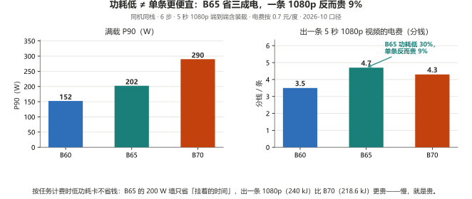

**看图：按任务计费时低功耗卡不省钱——慢，就是贵；只有「长时间挂着不跑满」的场合，200 W 才划算。**

> ⚠️ 价格是 **2026-10 的挂牌价**，会随平台优惠漂 —— 下单前现查，别拿旧数字下结论。

## 一条硬顺序：先装得下，再谈带宽

**买卡的第一道门是容量，不是峰值指标。** 模型装得进显存，带宽和算力才开始计费；装不进去，比的立刻换成  
**CPU、内存带宽和 PCIe 通道** —— 权重躺在主机内存里，每个 token 都要跨总线拉回来，这时卡片标称的带宽、  
TOPS、显存位宽**一个都用不上**。

|        | 装得下（权重全驻显存）                                                                            | 装不下（卸到主机内存 / 整层 offload）                                                                       |
| ------ | -------------------------------------------------------------------------------------- | ---------------------------------------------------------------------------------------------- |
| 谁决定速度  | 卡自己：核心数、功耗墙，**带宽排在这两个后面**                                                              | **CPU · 内存带宽 · PCIe 宽度**，卡退成配角                                                                 |
| 硬证据    | B65 换到副槽 x4，H3 单步 **42.31 s** 对主槽 x16 的 42.41 s（**差 0.2%**）；B65 的 608 GB/s 只吃到 **32%** | B50 16G · Q4_0 19.41 GiB：`-ncmoe 0` 崩到 **4.14 tok/s**，卸到 `-ncmoe 8` 才回到 **37.74** —— **差 9 倍** |
| 换后端能救吗 | 能：Vulkan 比 SYCL 快 **1.5 至 1.7 倍**                                                      | **不能**：同一张卡卸了专家后，Vulkan 的 **52.25** 与 SYCL 不卸专家的 **52.25** 逐位相同，1.65× 塌成 1.12×                 |

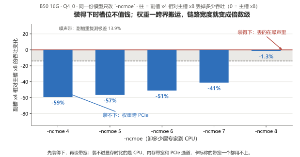

**看图：装得下时槽位差比噪声还小，权重一跨界搬运，链路宽度立刻变成倍数级 —— 所以顺序是容量 → 核心数与功耗墙 → 带宽。**

1. **装得下之后，算力也不是全时段有效。** 480p 里时间大半花在装载、1080p 才是算力的战场——换多快的卡也只兑现采样那一段  
   （占比数字见 [H3 页](docs/comfyui-h3.md)）。**个人机每条片子都要重读 34 GB 模型，这笔常数省不掉；服务器上模型常驻、一次装载连出多条，常数被摊薄，  
   差距才回到「几倍」本身** —— 所以「差不了太多」在个人机上成立，在服务器上不成立。

> **一句话**：**B 系列先解决的是「装得下」，不是「指标领先」。** 装得下，它靠 16 / 24 / 32 GB 三档和  
> ¥4,499 起的价位把你从「卸权重」那条路上拽出来；装不下，再先进的芯片和带宽一起失效，你只能去堆 CPU、  
> 内存和 PCIe 通道 —— 那是另一笔更贵的钱，而且跟显卡本身好不好无关。

## 表 2 · 该买哪张

| 你是                                   | 建议                      |
| ------------------------------------ | ----------------------- |
| 预算三千五，跑大模型聊天 + 出图 + 偶尔出 480p/720p 视频 | **B50 16G**             |
| 预算六千，要大模型 + 出图都快一截，显存宽裕点             | **B60 24G**             |
| 要快 2 至 5 倍，要出 1080p，显存不想算着用          | **B70 32G**             |
| 要跑比 35B 更大的模型                        | B60/B65 起（24 至 32 GB 档） |
| 要两张卡一起跑一个任务                          | **没测过**，不给结论            |

## 表 3 · 电费

|                 | B50 16G       | B60 24G                                          | B65 32G                                                               | B70 32G             |
| --------------- | ------------- | ------------------------------------------------ | --------------------------------------------------------------------- | ------------------- |
| 待机              | 没测            | 没测                                               | 没测                                                                    | **51 W**（像一个灯泡）     |
| 满载              | 70 W（规格值，没实测） | **150.5 至 154.3 W**（H3 实测 P90，TBP 200 W，**没触墙**） | **201 至 204 W**（实测 P90，**贴着 200 W 功耗墙**，只超 `defaultLimit` 0.4 至 1.8%） | **290 W**（实测，一直稳在这） |
| 满载开一小时          | 约 **5 分钱**    | 约 **1 毛钱**                                       | 约 **1 毛 4**                                                           | 约 **2 毛钱**          |
| 出一条 5 秒 720p 视频 | 没测            | 约 **1 分钱**（50 kJ）                                | 约 **1 分钱**（65 kJ）                                                     | 约 **1 分钱**（58 kJ）   |

按 **0.7 元/度** 算 —— 这是**中国南方电网居民电价的参考值**，各地实际电价（含阶梯与峰谷）不同，**以本地电费单为准**。  
**电费不是成本项，电源和散热才是**——290 W 的卡，电源至少配 550 W。

## 表 4 · 四张卡放一起，看同一件事

| 负载                                                 |    B50 16G |             B60 24G |         B65 32G |       B70 32G | B70 相对 B50 |
| -------------------------------------------------- | ---------: | ------------------: | --------------: | ------------: | ---------: |
| 大模型解码 · Qwen3.6-35B-A3B Q4_0                       | 37.6 tok/s |         52.43 tok/s | **53.09 tok/s** |   75.92 tok/s |   **2.0×** |
| 出视频 · MiniMax H3，864×480 · 6 步 · 每条端到端             |      399 s |        **203.03 s** |     **198.1 s** |       152.5 s |   **2.6×** |
| 出图 · Qwen-Image 2.1 INT8，1280×720                  |    51.75 s |       17.3 至 18.8 s |      **16.1 s** |       10.62 s |  **4.87×** |
| 出音乐 · MiniMax Music 3，120 s · 30 步 · DiT+TE 全 INT8 |    216.8 s | **144.9 至 145.8 s** |         164.6 s | 61.4 至 66.7 s |  **≈3.3×** |

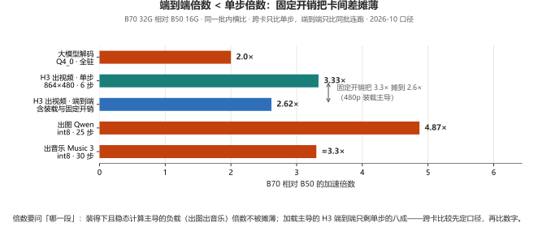

**看图：倍数要问「哪一段」——H3 单步 3.3× 到端到端只剩 2.6×（装载主导被摊薄），出图出音乐稳态计算主导、倍数不被摊薄。**

> ⚠️ 四列批次不同（日期见「出视频」节），B70 / B65 取 fresh 单轮、B60 / B50 取 4 轮均值——**别直接相减**。  
> 🔴 出音乐一格 B65 反而慢 14%：没做单变量对照，**不给原因**（拆解见各单卡页与 `docs/comfyui-h3.md`）。

## 表 4b · 按「每 tok/s 花多少钱」排

拿表 4 的解码速度去除价格，得到**买速度的单价**。这个数只对**聊天/解码**有意义，出图出视频不适用。

|             |      价格 |          解码 | 每 tok/s 花多少钱 | 相对最便宜 |
| ----------- | ------: | ----------: | -----------: | ----: |
| **B50 16G** |  ¥4,499 | 37.60 tok/s |   **≈ ¥120** | 1.00× |
| **B60 24G** |  ¥6,499 | 52.43 tok/s |   **≈ ¥124** | 1.04× |
| **B65 32G** |  ¥9,999 | 53.09 tok/s |   **≈ ¥188** | 1.57× |
| **B70 32G** | ¥18,999 | 75.92 tok/s |   **≈ ¥250** | 2.09× |

> 🔴 这张表只回答一件事：纯为「聊得更快」，钱花在 **B50** 最划算。B65 的溢价买的是显存，不是速度（见表 1 注）；容量是另一笔账，见 `docs/cards/` 各页的「装得下什么」。

## 按型号看：四份单卡实测页

本页（汇总）只回&#x7B54;**「四张卡放一起怎么比、该买哪张」**。**一张卡自己的全部细节在它自己的页里**——  
分辨率矩阵、装得下什么装不下什么、边界、功耗、每个数字的采集日期与驱动。

**两处不重复写同一组数字**：跨卡对照只在本页，单卡页只放这张卡自己的数。

| 型号                          | 单卡实测页                                         | 那一页回答什么                                                                                          |
| --------------------------- | --------------------------------------------- | ------------------------------------------------------------------------------------------------ |
| **Arc Pro B50 16G** ¥4,499  | [**B50-README.md**](docs/cards/B50-README.md) | 16 GB 上「算着显存用」到底怎么算：26 万上下文深度曲线、`-ncmoe` 漏掉差 6 倍、1080p 视频 38 分钟                                  |
| **Arc Pro B60 24G** ¥6,499  | [**B60-README.md**](docs/cards/B60-README.md) | 24 GB 是「装得下」的分水岭：Q4_0 全驻留 52.4 tok/s、`-c` 到 256K 不花钱；但 Krea-2 是反例（62 至 66 s）                     |
| **Arc Pro B65 32G** ¥9,999  | [**B65-README.md**](docs/cards/B65-README.md) | 32 GB 档里便宜的那个：解码 53.1 tok/s **与 B60 持平**、P90 贴 200 W 墙、480p 视频 3.3 分钟、720p 6.6 分钟——**它卖显存，不卖速度** |
| **Arc Pro B70 32G** ¥18,999 | [**B70-README.md**](docs/cards/B70-README.md) | 32 GB 上「不用算显存」：出图 10.6 s、1080p 视频 14 分钟、Vulkan 1.50×、满载一直稳在 290 W                                |


> 每份单卡页都自带 **§「数据从哪来」**——采集日期、驱动、软件栈、llama.cpp build 都写在里面。  
> **别把两份单卡页的秒数直接并排**：各页的 `--reserve-vram` 取值和采集批次不同。  
> 跨卡比数字只在本页做，而且本页已经把前提写在表下。

## 硬件参考（2026-10 口径）

| 型号          | 可用显存（ECC 关） |       带宽 | INT8 TOPS |    功耗 |     参考价（¥） | 芯片 DEV | 板卡                       |
| ----------- | ----------: | -------: | --------: | ----: | ---------: | ------ | ------------------------ |
| Arc Pro B50 |   15.51 GiB | 224 GB/s |       170 |  70 W |      4,499 | `E212` | GUNNIR `SUBSYS_25221EF7` |
| Arc Pro B60 |   23.33 GiB | 456 GB/s |       197 | 200 W |      6,499 | `E211` | GUNNIR `SUBSYS_25421EF7` |
| Arc Pro B65 |   31.16 GiB | 608 GB/s |       197 | 200 W |      9,999 | `E222` | GUNNIR `SUBSYS_27441EF7` |
| Arc Pro B70 |   31.16 GiB | 608 GB/s |       367 | 290 W | **18,999** | `E223` | GUNNIR `SUBSYS_27421EF7` |

> **价格（2026-10-26）**：B60 另有 TF SKU **¥6,599**（与 BS 同性能，按机箱空间选）；价格会变，下单以店铺页面为准。  
> **「同带宽 → 解码相同」不成立：解码跟核心数与功耗墙走**（核心数见表 1b ①；完整对照见 [B65 单卡页 §3.2](docs/cards/B65-README.md)）。

### 显存口径（必读）

**Arc Pro B70 本体 32 GB。ECC 开着时应用只可见 27.25 GB。**  
关掉 ECC（IGS → Graphics → ECC → 关闭 → 重启）→ 可用 **31 GB**（实测 31,920.4 MB / 31.16 GiB）。

**判断「装不装得下」一律用上表的可用显存值，别用 32 / 24 / 16 这种标称**——标称与可用差 0.7 至 0.9 GiB，而 16 GB 档的生死线正好卡在这半 GiB 上。

| 事项           | 口径                                                                                                                                                                                          |
| ------------ | ------------------------------------------------------------------------------------------------------------------------------------------------------------------------------------------- |
| ECC 出厂状态     | ★ **Intel 驱动里默认关闭，要人工到 IGS 打开**。所以「只认 27.25 GB」不是默认态，而是 ECC 被开过                                                                                                                             |
| ECC 开关是否影响算力 | **不影响，只影响容量**。实测差异都在 6% 内，关 ECC 反而略快                                                                                                                                                        |
| 怎么自检         | `torch.xpu.get_device_properties(0).total_memory` → 关 ECC 应报 ≈31.16 GiB（B70 / B65）/ ≈23.33 GiB（B60）/ ≈15.51 GiB（B50）                                                                        |
| 怎么读 ECC 状态   | `python bench/harness/gpu_sysman.py`（Level Zero Sysman）。⚠️ 枚举值两代编号相反，**定论看物理容量，不看枚举值**                                                                                                      |
| **核显与独显**    | **推荐配置：显示器插主板（核显）口，独显整块留给计算。** 实测核显在输出 2560×1440、B70 的分辨率字段为空，B70 上只有 ComfyUI 一个进程占 70 MB、显存满额 31.16 GiB。代价是核显拿系统内存当显存（桌面负载下约 0.9 GB），所以「32 GB 内存」要扣这一块。见 [`test-rig.md`](docs/test-rig.md) |

> 做任何性能记录前先登记显存口径，否则跨记录无法比较。


## 聊天与文本：`llama-bench -p 512 -n 128 -r 3`

> ⚠️ **两套口径不可混比。** `llama-bench` 与 `llama-server /completion` 的计时方式不同  
> （batch 大小、是否含采样开销、warmup 策略），同一张卡能差出数倍。看数字前先确认是哪一套。

| 显卡          | 模型              | 量化         |        体积 |              解码 |           预填充 | 备注                        | 日期         |
| ----------- | --------------- | ---------- | --------: | --------------: | ------------: | ------------------------- | ---------- |
| B70 32G     | Qwen3.6-35B-A3B | Q4_0       | 19.41 GiB | **75.92 tok/s** | 1341.36 tok/s | 主槽 x16                    | 2026-10-15 |
| **B60 24G** | Qwen3.6-35B-A3B | Q4_0       | 19.41 GiB | **52.43 tok/s** |  961.22 tok/s | 主槽，`-ncmoe 0`（**全驻留**）    | 2026-10-20 |
| **B60 24G** | Qwen3.6-35B-A3B | Q3_K_S     | 14.30 GiB | **52.09 tok/s** |  730.55 tok/s | 全驻留                       | 2026-10-20 |
| **B60 24G** | Qwen3.6-35B-A3B | IQ2_M      | 10.73 GiB | **62.69 tok/s** |  771.07 tok/s | 全驻留                       | 2026-10-20 |
| **B65 32G** | Qwen3.6-35B-A3B | Q4_0       | 19.41 GiB | **53.09 tok/s** |  670.06 tok/s | 主槽，`-ncmoe 0`（**全驻留**）    | 2026-10-21 |
| **B65 32G** | Qwen3.6-35B-A3B | Q3_K_S     | 14.30 GiB | **59.36 tok/s** |  646.37 tok/s | 全驻留                       | 2026-10-21 |
| **B65 32G** | Qwen3.6-35B-A3B | IQ2_M      | 10.73 GiB | **63.96 tok/s** |  636.93 tok/s | 全驻留                       | 2026-10-21 |
| **B65 32G** | Qwen3.6-35B-A3B | Q4_0       | 19.41 GiB | **45.84 tok/s** |  300.42 tok/s | `-ncmoe 8`（人为卸 8 层）       | 2026-10-21 |
| B50 16G     | Qwen3.6-35B-A3B | Q4_0       | 19.41 GiB |  **37.6 tok/s** |    ≈425 tok/s | 主槽 x8，`-ncmoe 8`（卸载）      | 2026-10-15 |
| B50 16G     | Qwen3.6-35B-A3B | Q4_0       | 19.41 GiB | **35.89 tok/s** |  371.41 tok/s | 第二槽 x4（独占），`-ncmoe 8`     | 2026-10-15 |
| B50 16G     | Qwen3.6-35B-A3B | **Q3_K_S** | 14.30 GiB | **37.99 tok/s** |  589.57 tok/s | 主槽 x8，`-ncmoe 0`（**全驻留**） | 2026-10-15 |
| B50 16G     | Qwen3.6-35B-A3B | **IQ2_M**  | 10.73 GiB | **45.99 tok/s** |  551.95 tok/s | 主槽 x8，`-ncmoe 0`（**全驻留**） | 2026-10-15 |
| B50 16G     | Qwen3-VL-4B     | Q4_0       |  2.21 GiB | **63.99 tok/s** | 1457.02 tok/s | 主槽 x8，全驻留（稠密）             | 2026-10-15 |

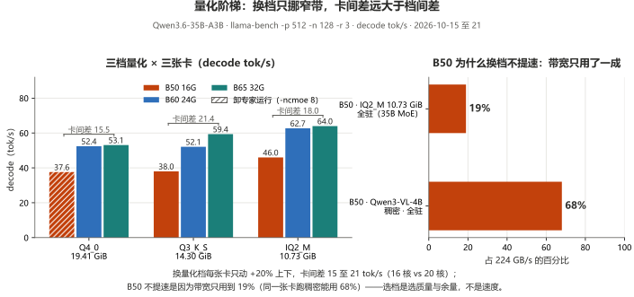

**看图：三张卡各自换档都落在 +20% 上下的窄带里（B60 52.1 至 62.7、B65 53.1 至 64.0、B50 37.7 至 46.0），卡间差 15 至 21 tok/s（16 核 vs 20 核）；B50 换档不提速是因为带宽只用到 19%，同一张卡跑稠密能用 68%——选量化档是选「质量」和「显存余量」，不是选「速度」。**
（芯片与核心的差别见上文「Xe2 核心数」那条，完整对照见 [B65 单卡页 §3.2](docs/cards/B65-README.md)。）

| 启动参数 / 环境变量                                     | 值                                     | 说明                                                                      |
| ----------------------------------------------- | ------------------------------------- | ----------------------------------------------------------------------- |
| 采样与 KV                                          | `-ngl 999 -fa on -ctk q8_0 -ctv q8_0` |                                                                         |
| 装不下时（Q4_0 19.41 GiB）                            | 追加 `-ncmoe 8`                         | **不加就是最差配置**：同一张卡同一槽 `-ncmoe 4` 只有 6.08 tok/s，`-ncmoe 8` 是 36.66——差 6 倍 |
| 装得下时（Q3_K_S / IQ2_M）                            | `-ncmoe 0`                            | 此时卸载只会变慢（缓坡，最多 −29%），瓶颈不在带宽                                             |
| 判断规则                                            | **权重体积 vs 15.51 GiB**                 | 一条规则，不用记别的                                                              |
| `ONEAPI_DEVICE_SELECTOR=opencl:0`               | 必填                                    | 双卡共存时不限定单卡会触发 OpenCL adapter 的 P2P 崩溃                                   |
| `SYCL_CACHE_PERSISTENT=1` / `OMP_NUM_THREADS=8` |                                       | 缓存复用、线程数                                                                |

> **为什么 `-ncmoe` 是分界线**：`-ngl 999` 放不下时会退化成**整层**卸载（权重来回搬），`-ncmoe` 只搬专家，通信量小一个量级。

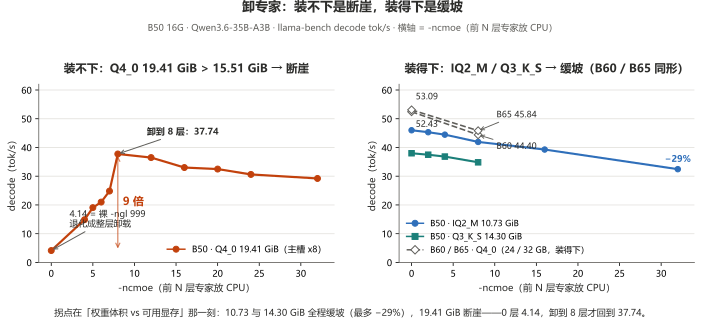

**看图：拐点由「装不装得下」决定——B50 的 Q4_0（19.41 GiB）裸 `-ngl 999` 只有 4.14 tok/s，卸到 8 层才回到 37.74；装得下的 IQ2_M / Q3_K_S 全程缓坡（最多 −29%），B60 / B65 卸 8 层也是纯亏（−15% / −14%）。**

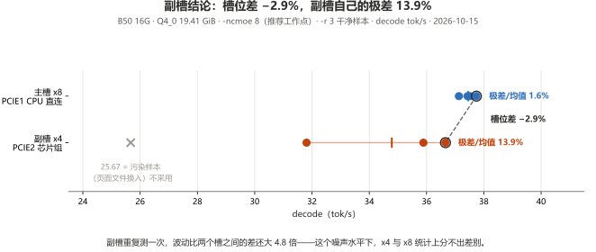

**看图：`-ncmoe ≥ 12` 之后副槽相对主槽在 −3.5% 至 +6.3% 间摆动、符号都变来变去；推荐工作点（`-ncmoe 8`）上副槽自身的极差 13.9% 比槽位差 2.9% 还大 4.8 倍——统计上分不出差别，不是「慢一点但能接受」。**

### 口径 B：llama-server `/completion`（单次请求）

同一模型 **Qwen3.6-35B-A3B · Q4_0 · 19.41 GiB**。每行的配置是**该档自己的交付配置**  
（客户照着抄就能跑出来的那条命令行，不是实验室参数）：

| 卡           |      可见显存 |   `-ncmoe` |   上下文 | 模型驻留               |       共享溢出 |                  解码 |         预填充 | 采样       |
| ----------- | --------: | ---------: | ----: | ------------------ | ---------: | ------------------: | ----------: | -------- |
| B50 16G     | 15.51 GiB |     8（装不下） | 16384 | 部分                 |   3,848 MB | 35.55 至 37.55 tok/s | 46.5 至 48.6 | 4 × 3 会话 |
| **B60 24G** | 23.33 GiB | **0（装得下）** | 16384 | **全驻留**            | **326 MB** |     **50.94 tok/s** |       52.34 | 4        |
| **B65 32G** | 31.16 GiB | **0（装得下）** | 16384 | **全驻留**（42/42 层上卡） | **273 MB** |     **52.10 tok/s** |       62.21 | 10       |
| B70 32G     | 31.16 GiB |          0 |  8192 | 全驻留                |          — |   39.8 至 45.1 tok/s |   118 至 128 | 2（初测）    |

> **B50 → B60 的差距不是算力差，是「装不装得下」**：B50 那 3,848 MB 溢出让每个 token 都要跨 PCIe 回读专家权重，带宽优势被吃掉了。
>
> 严格同参数对照是 B50 与 B60 两行；B65 行的「共享溢出」取自日志映射量，与另两行计数器不同，只比量级。


**看图：B60 五档全距 1.6%，`-c` 只是容量旋钮；B50 从 64K 起塌，共享溢出涨到 7,160 MB——决定速度的是溢出量，不是 `-c`。**
视觉塔同理：`--mmproj` 在 B60 是 +0.6%（免费）、B50 是 −11.5%；图像 token 走预填充相位，首图等 17 秒还是 103 秒（均为冷态），差的也是这口溢出。详见 [`docs/server-config.md` §7](docs/server-config.md)。

### 长上下文：分配不要钱，真填满才花钱

能不能吃长上下文要分两件事看：**KV 分配**和**实际深度**。前者几乎免费，后者才是账单。

**① 分配 —— `-c` 拉到 262144，三张卡都没掉速**

| 卡           | 量化              | 量法                   | 结果                                                        |
| ----------- | --------------- | -------------------- | --------------------------------------------------------- |
| B50 16G     | IQ2_M 10.73 GiB | `-c` 六档、浅 prompt     | 45.21 / 45.07 / 45.07 / 44.47 / 44.75 / **44.93**，全距 1.6% |
| **B65 32G** | Q4_0 19.41 GiB  | 同 prompt、同脚本，只差 `-c` | **52.42（`-c 16384`）→ 51.29（`-c 262144`），−2.2%**           |
| B60 24G     | Q4_0 19.41 GiB  | `-c` 五档、浅 prompt     | 50.94 / 50.73 / 51.54 / 50.94 / **51.35**，全距 1.6%         |

`-c 262144` 加载 **17.6 s**（B65）—— 同卡 `-c 16384` 是 18.1 s，差别在噪声内；B50 同脚本那一轮是 13.1 s。**分配不要钱，但「分配得下」不等于「长上下文能用」**——看第二张表。

**② 真填满 —— 把 KV 喂到 N 个 token 再生成**

|                       实测深度 |       508 |    31,323 |    62,673 |   125,375 |   188,104 |   250,948 |
| -------------------------: | --------: | --------: | --------: | --------: | --------: | --------: |
|  **B65 32G · Q4_0** decode | **51.29** | **37.20** | **30.02** | **21.73** | **17.81** | **14.24** |
|            B65 32G prefill |    366.97 |    569.88 |    547.19 |    507.60 |    472.47 |    440.77 |
| **B50 16G · IQ2_M** decode | **44.35** | **30.82** | **24.26** | **17.02** | **13.01** | **10.48** |
|            B50 16G prefill |    414.91 |    427.53 |    385.95 |    330.04 |    285.82 |    254.76 |


⚠️ 两行**不是同权重对照**，是**各自装得下的那一档的交付形态**：16 GB 只有 IQ2_M（10.73 GiB）装得下，32 GB 用 Q4_0（19.41 GiB）。  
深度点也各按自己的请求序列排（512 / 32768 / 65536 / 131072 / 196608 / 262144），实际 `prompt_n` 有偏差，以表头为准。

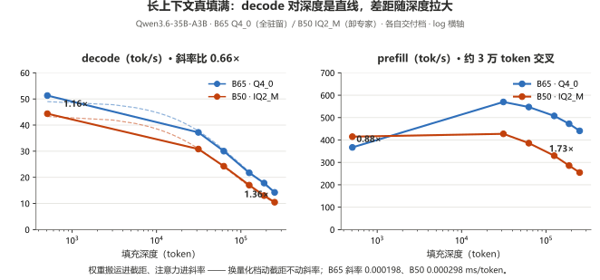

**看图：换量化档动的是截距，注意力成本全在斜率里——decode 差距随深度拉大，prefill 在 3 万 token 附近反超。**
> 一句话：**差距随深度拉大不是卡不行，是注意力的固有成本**；这个模型只有 1/4 的层带 KV，换全注意力同尺寸模型这条线约陡 4 倍（推算，非实测）。

> 🔴 **16 GB 上要用 IQ2_M 跑长上下文，不是 Q3_K_S。** IQ2_M（10.73 GiB）`-c 262144` 总占用  
> 15,540 MB **不溢出**；Q3_K_S（14.30 GiB）要**溢出 2,332 MB，解码掉 58%**（15.74 tok/s）。
>
> ⚠️ 溢出不等于 OOM。**Windows 允许显存超额订阅**：超了不报错，驱动把页换成主机内存，代价是速度。  
> 判据是 **prefill 与 decode 一起掉**。

**B60 只做了「分配」那一半**（就是上面口径 B 的 `-c` 五档）；逐深度填充没做，24 GB 档的深度曲线不给数字。

## 换后端：命令一行不改，Vulkan 比 SYCL 快 1.5 至 1.7 倍

这是目前**单项收益最大**的一条：**同一个 llama.cpp build（11753）、同一条交付命令行，只换二进制**。  
收益多少只取决于一件事——**权重驻不驻留在显存里**：

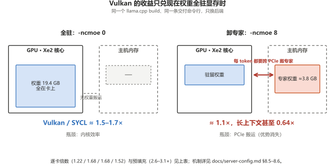

**看图：全驻时内核效率直接兑现成 1.5 至 1.7×；卸专家后每 token 都要跨 PCIe 搬权重，两个后端掉进同一条瓶颈，倍数塌回 1.1×。**

| 卡                                | 后端         |                   交付配置解码 |                    预填充 |          多模态首图（暖态） |
| -------------------------------- | ---------- | -----------------------: | ---------------------: | -----------------: |
| B60 24G                          | SYCL       |              51.79 tok/s |              670 tok/s |              7.0 s |
| **B60 24G**                      | **Vulkan** |   **85.59 tok/s（1.65×）** |   **1934 tok/s（2.9×）** |   **4.8 s（1.45×）** |
| B65 32G *（`llama-bench` 口径）*     | *SYCL*     |            *53.09 tok/s* |            *670 tok/s* |            *8.0 s* |
| **B65 32G** *（`llama-bench` 口径）* | **Vulkan** | ***89.27 tok/s（1.68×）*** | ***2014 tok/s（3.0×）*** | ***6.5 s（1.23×）*** |
| B65 32G（Q3_K_S 全驻）               | SYCL       |              57.62 tok/s |            58.67 tok/s |                 未测 |
| **B65 32G（Q3_K_S 全驻）**           | **Vulkan** |   **71.36 tok/s（1.24×）** | **80.21 tok/s（1.37×）** |                 未测 |
| B70 32G                          | SYCL       |              75.23 tok/s |             1010 tok/s |             7.59 s |
| **B70 32G**                      | **Vulkan** |  **113.18 tok/s（1.50×）** |   **3165 tok/s（3.1×）** |  **4.15 s（1.83×）** |
| B50 16G（IQ2_M 全驻）                | SYCL       |              46.25 tok/s |              495 tok/s |             10.0 s |
| **B50 16G（IQ2_M 全驻）**            | **Vulkan** |   **56.69 tok/s（1.23×）** |   **1283 tok/s（2.6×）** |   **9.7 s（1.04×）** |
| B50 16G（Q4_0 · 卸 8 层专家）          | SYCL       |              38.08 tok/s |                      — |         **75.5 s** |
| **B50 16G（Q4_0 · 卸 8 层专家）**      | **Vulkan** |   **41.81 tok/s（1.10×）** |                      — |    **9.0 s（8.4×）** |
| B50 16G（Q3_K_S · 溢 514 MB）       | SYCL       |              39.73 tok/s |            49.55 tok/s |                 未测 |
| **B50 16G（Q3_K_S · 溢 514 MB）**   | **Vulkan** |   **47.55 tok/s（1.20×）** | **75.05 tok/s（1.51×）** |                 未测 |

> ⚠️ B65 的 IQ2_M 两行是 **`llama-bench`** 口径，其余八行是**交付命令行**口径——只同口径横比；多模态格混着全驻与卸专家档，两格不并排；「—」是弃用（采样极差 40%+，见 `docs/server-config.md` §8.5）。  
> 🔴 **倍数逐张卡、逐相位量出来（见表内倍数列）**，预填充反而随核数涨——**按卡报、按相位报，别外推**；加速来自后端内核效率，不是溢出量（`docs/server-config.md` §8.6）。  
>
> - Vulkan 必须钉设备：枚举到的第 0 张是核显（假 16 GB），要 `-dev Vulkan1`。  
> - Arc 上 Vulkan 报 **`bf16: 0`、`fp4: 0`**（fp16 可用），bf16 权重模型要单独验。

## 出视频：ComfyUI · MiniMax H3（32 / 24 / 16 GB · 四张卡）

工作负载固定：**864×480 · 124 帧 @ 24 fps（5.17 s）· 6 步**。四列都是 ComfyUI 0.39.0 + `torch 2.12` + int8fix 栈，  
但**批次不同**：**B50 2026-10-16 / B60 10-20 / B65 10-21 / B70 10-19**；B70 与 B65 取热态轮，B60 与 B50 取该批 4 轮。

| 项               |            B70 32G |                     B65 32G |                    B60 24G |                            B50 16G |
| --------------- | -----------------: | --------------------------: | -------------------------: | ---------------------------------: |
| DiT（19.53 GB）装载 | **完全驻留** 19,996 MB |          **完全驻留** 19,996 MB |   **部分** + 卸载 **3,728 MB** | **部分** 7,010 MB + 卸载 **12,985 MB** |
| 端到端（6 步）        |        **152.5 s** | **198.1 s**（热态轮；冷启 227.7 s） | **203.0 s**（4 轮 203 至 261） |   **399 s**（4 轮 391 至 410，极差 4.7%） |
| 采样 / 单步         | **39.8 s / 6.6 s** |            63.9 s / 10.65 s |        **71.2 s / 11.9 s** |          164 s / **22 s**（首步 54 s） |
| 加载编码解码（固定开销）    |        **112.7 s** |                       134 s |                **131.9 s** |                              234 s |
| 采样占端到端          |            **26%** |                     **32%** |                    **35%** |                            **41%** |

> ⚠️ B70 冷启第 1 条 191 s（冷 → 热差 28 s）；10-17 批另一栈的 B50 单轮 283.82 s，不并排。**跨卡倍数只当量级看**，拆解见 [`bench/notes/comfyui-h3-internals.md`](bench/notes/comfyui-h3-internals.md) §7.8。

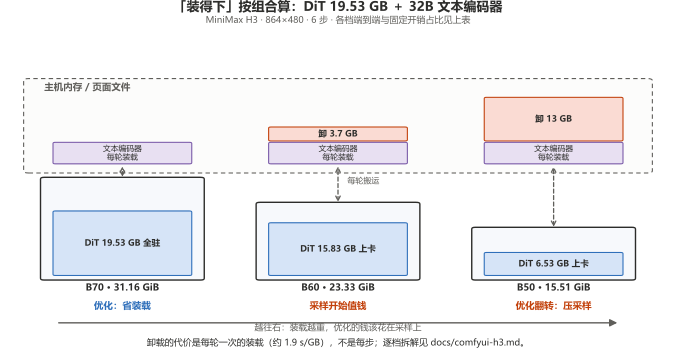

**看图：「装得下」按组合算——DiT 19.53 GB 加上 32B 文本编码器，32 GB 全驻、24 GB 卸 3.7 GB、16 GB 卸 13 GB；卸载的代价是每轮一次的装载（约 1.9 s/GB），固定开销占比决定优化方向。**

**三档的差别不是「谁快」，是「固定开销占多少」**——32 GB 仍是加载主导（**「2 步 turbo LoRA 不是妥协」**），16 GB 的 13 GB 权重留在主机内存、优化优先级整个翻转到采样，24 GB 是中间态。  
🔴 「24 GB 也装得下」是错觉：DiT + 32B 文本编码器就超过 23.33 GiB，1080p 时卸载涨到 10.8 GB；⚠️ 要纯卡差得两张卡都完全驻留——16 / 24 GB 档都做不到，本节只报数（[`docs/comfyui-h3.md`](docs/comfyui-h3.md)）。

| 调参项（除最后一行外都在 B70 旧栈上做的）       | 结果                              |
| ----------------------------- | ------------------------------- |
| 关 OmniXPU（`OMNIXPU_ENABLE=0`） | 内核 **丢 `sdp`**，**每个采样步多 6.2 s** |
| 锁页内存开关                        | ±0.1% —— 无差别，不必开                |
| 步数 2 → 12（6 倍）                | 总时长只涨 **24%** —— 固定开销占大头，步数权重小  |
| 软件栈漂移（同卡跨日期）                  | **+14.6%**，且**全部落在加载段**（采样不变）   |

### 一条片子要等多久、能出多长（主流分辨率 · 四张卡）

| 一条 5 秒片要等多久（端到端 · 6 步 · 124 帧） | B50 16G | B60 24G | B65 32G | B70 32G |
| --- | ---: | ---: | ---: | ---: |
| 864×480 | 4.7 分\* | 3.4 分 | 3.3 分 | **2.5 分** |
| 1280×720 | 11.2 分\* | 7.1 分 | 6.6 分 | **4.6 分** |
| 1920×1088 | 37.7 分\* | 22.1 分 | 22.1 分 | **14.0 分** |
| **能出多长**（实测） | 480p ≤ 20 s / 720p ≤ 5 s | 480p ≤ 20 s / 720p ≤ 15 s / 1080p ≤ 5 s | 480p ≤ 50 s / 720p ≤ 24 s / 1080p ≤ 10 s / 1440p ≤ 5 s | 480p ≤ 50 s / 720p ≤ 24 s |

\* B50 为 **10-17 批另一栈冷启首条**，与 480p 拆解表（10-16 批 4 轮均值 6.7 分）不同栈，别相减；B60 / B65 / B70 为稳态。576p / 648p / 864p 中间档、1440p 全档与逐档单步见 [`docs/comfyui-h3.md`](docs/comfyui-h3.md)；时长阶梯逐档见各单卡页 §6。

> ⚠️ 跑 H3 必须关 CUTE（`bench_f_h3.py` 的 `BASE_ENV` 里硬编码，在 shell 里 export 无效）。

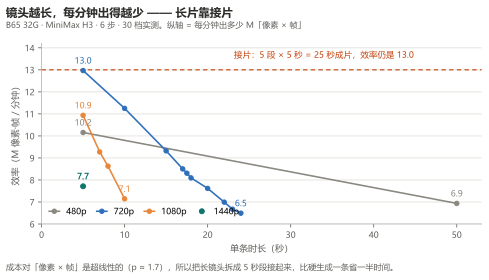

> 图注：看效率曲线——镜头越长，每分钟出得越少。

**长片怎么拍**：拆段接片比硬拉一条快约 **1.9 倍**，坏一段只废一段；装不下的档不是慢，是**显存装不下那一档的瞬时峰值**。

## 出图 / 出音乐（Qwen-Image 2.1 / Krea-2 / Music 3）

三种角色：**`first`** 模型刚换上来（含加载）· **`resident`** 同提示词换种子（稳态）· **`newprompt`** 换提示词。

### 四张卡一张表（稳态 · 交付档）

四批采集（2026-10-16 至 22）跑的是同一套 ComfyUI 0.39.0 + `comfy_kitchen` 0.2.37 + XPU provider 0.2.33 + torch 2.12.0+xpu + `torch212.bmg` 内核 + `omni_int8fix.py`。**只列有数字的交付档**：OOM、未测、不给数字的格一律留空、不配注——逐卡逐档的完整数据在四张单卡页 §4 / §5，采集条件与归因在 [`docs/comfyui-image.md`](docs/comfyui-image.md)。

| 负载（resident 稳态）                       |      B50 16G |      B60 24G |      B65 32G |      B70 32G |
| ---------------------------------------- | -----------: | -----------: | -----------: | -----------: |
| **Qwen-Image 2.1** · int8 · 1280×720 · 25 步 | **51.75 s** | **18.06 s** | **16.16 s** | **10.62 s** |
| 同上 · `bf16`                               |     87.34 s |           — |     22.91 s |     13.82 s |
| 　其中采样段                                   |      29 s |      16 s |     15.0 s |       9 s |
| 　每轮部分卸载                                  | 3,837.8 MB |           0 |           0 |           0 |
| **Krea-2 Turbo** · int8 · 8 步                | 57.3 至 58.5 s* | 62.3 至 66.0 s |    **8.73 s** |    **6.04 s** |
| 同上 · `bf16`                               |           — |           — | 167.4 至 167.6 s |           — |
| **Music 3** · int8 · 120 s · 30 步            | **216.82 s** | **144.9 至 145.8 s** | **180.2 至 180.9 s**† | **61.95 s** |
| 　其中采样段                                   |     165 s |       93 s |       82 s |       54 s |

\* B50 那档是 1024×1024（16 GB 档的交付形态），其余三卡是 1280×720。
† B65 是 `--reserve-vram 2` 下的读数（`reserve 4` 没收敛）；Music 3 的 TE 档位逐卡不同（B50 / B60 为 int8 TE，B65 / B70 为 bf16 TE），**对稳态无实质影响**（B70 同卡两档差 0.6%）。

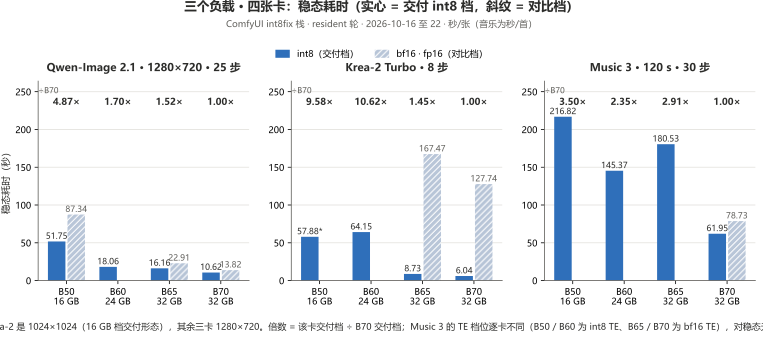

**看图：同负载 B70 全线最快——Qwen 上 B50 是它 4.87×、Krea-2 上 B60 是 10.6×、Music 3 上 B50 是 3.50×；对比档（bf16 / fp16 DiT）只会更慢，唯一例外是内核配错的旧栈。**

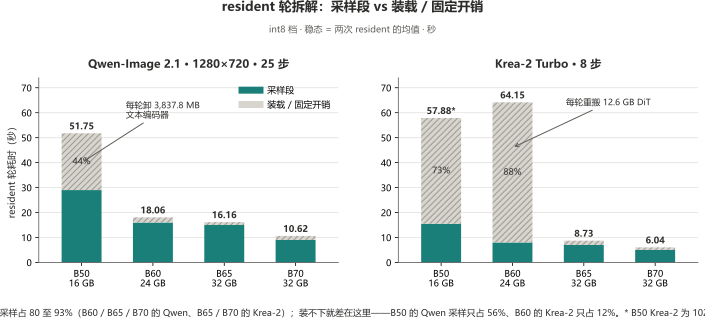

**看图：装得下的卡采样占 80 至 93%；装不下就差在这里——B50 的 Qwen 每轮卸 3,837.8 MB 文本编码器（采样只占 56%）、B60 的 Krea-2 每轮重搬 12.6 GB DiT（只占 12%）。**

### 汇总叙述：三条结论

1. **出图是计算主导，出视频是加载主导**：驻留时调步数按比例见效（25 步砍到 10 步，时间砍掉六成）；H3 480p 采样只占 26 至 51%、1080p 升到 81 至 90%，卡越小越高。
2. **16 GB 上量化首先是显存手段，然后才是速度手段**：bf16 的 DiT 要卸 608 MB、int8 完整驻留（Qwen 稳态差四成，见表）；Krea-2 与 Music 3 在 16 GB 上**只有 int8 档能跑**。
3. **Music 3：DiT 量化是性能杠杆，TE 量化只是容量杠杆**：fp16 DiT 78.7 s → int8 61.95 s（**−21%**），TE 换档对稳态无实质影响（脚注 †）；**判据是每轮重装几件，不是量化档位**。

> ⚠️ 跨卡单步比 **1.81× / 1.78×** 对不上任何一个单一规格比（带宽 2.04× / 1.33×，INT8 算力 1.16× / 1.86×）——**不外推归因**；B60 / B65 那两批的驱动也与 B50 / B70 不同（9150 对 8976），Qwen 那一行不是纯卡间对照。细节在 [`docs/comfyui-image.md`](docs/comfyui-image.md)。

> 🔴 **「int8 比 bf16 慢」是内核配错的产物，不是卡** —— 换对内核（`torch212.bmg` + int8fix）符号就翻过来（B70：Qwen +23%、Krea-2 采样 +32%、Music 3 的 int8 DiT 比 fp16 快 16 至 21%）。**换栈前后的数据不能并排引用**；2026-10-14 那批 B70 出图数据来自换内核之前的栈（见 [`docs/comfyui-image.md`](docs/comfyui-image.md) §0）。

> **成本对像素超线性**（B50 实测）：像素 1.00× / 1.44× / 4.55× → 采样 1.00× / 1.55× / 7.38× —— **按面积预算，别按「就大一点点」**；更高分辨率见 [B50 单卡页](docs/cards/B50-README.md)。

逐卡逐档完整数据（首轮 / 换提示词 / 换歌 / 功耗 / 分辨率阶梯）见四张单卡页 §4 / §5；采集条件、归因与反例见 [`docs/comfyui-image.md`](docs/comfyui-image.md)；「模型能装多大 · 出视频 · 出图片」三问总表见 [`docs/comfyui-capability.md`](docs/comfyui-capability.md)。

## 功耗：整卡电源域能耗计数器，1 s 窗口积分

|                   | B50 16G |                                B60 24G |                             B65 32G |                                       B70 32G |
| ----------------- | ------: | -------------------------------------: | ----------------------------------: | --------------------------------------------: |
| 空载                |     读不出 |                                     没测 |                                  没测 |                        **51.0 W**（波动 < 0.3 W） |
| H3 满载（P90）        |     读不出 | **150.5 至 154.3 W**（200 W 墙的 75 至 77%） |     **200.8 至 203.7 W**（贴满 200 W 墙） |           **290.3 至 291.1 W**（五档差 1 W，贴着 TBP） |
| 出图 / 出音乐（P90）     |     读不出 |           **137.8 至 150.0 W**（三模型都没触墙） | **195.4 至 208.2 W**（出图贴墙、音乐占空比 49%） |           290 W 级（例外：Krea-2 bf16 那档只有 93.1 W） |
| 1 s 峰值            |     读不出 |                    **147.2 至 168.9 W** |                 **207.0 至 223.5 W** | **291.5 至 327.1 W**（Music 3 最高，整卡域量程上限 348 W） |
| 一条 5 s / 720p 视频  |     读不出 |                     **50 kJ ≈ ¥0.010** |             **64 至 68 kJ ≈ ¥0.013** |                            **58 kJ ≈ ¥0.011** |
| 一条 5 s / 1080p 视频 |     读不出 |                    **181 kJ ≈ ¥0.035** |                 **240 kJ ≈ ¥0.047** |                         **218.6 kJ ≈ ¥0.043** |

**B50 一列全是「读不出」**：卡在机，但整卡功耗域读不到（Sysman 报 `defaultLimit = -1 mW`），  
采出的瓦数与 70 W 的规格明显不符——**不给瓦特数、不给电费，没有实测就不编**。

> **散热怎么设计**：B70 按 **290 W 持续 + 325 W 瞬态**（电源 ≥ 550 W）；B65 按 **200 W 持续 + 224 W 瞬态**  
> （实测最高 223.5 W）；B60 实测最高 **169 W**，按 **170 W 持续 + 200 W 瞬态**留余量就够。  
> ⚠️ **别拿 TBP 直接算**，且**没有 > 1 h 长期满载数据**。

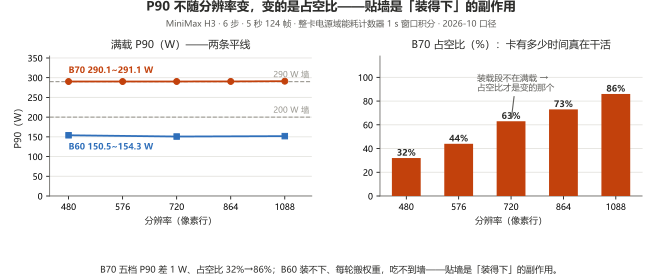

**看图：三条改变「怎么看功耗」的结论——① B70 满载功率与任务无关，变的是占空比（卡有多少时间真在干活）；② 「满载贴墙」本身是「装得下」的副作用，B60 装不下、吃不到墙；③ 量化不改功耗、改时间——省的电 ≈ 省的时间，不是「每瓦更高效」。**

完整的瓦特 / 焦耳 / 散热算法与对外数字见 [`docs/comfyui-power.md`](docs/comfyui-power.md)。

## 参考数据（非本机，标注来源）

| 平台                | 模型                                        |            解码 | 来源                                  |
| ----------------- | ----------------------------------------- | ------------: | ----------------------------------- |
| Arc Pro B50 16 GB | Qwen3.8-Flash-Next (125B MoE)，Coder IQ1_M |     ≈23 tok/s | Strata 官方 `docs/INTEL_ARC.md`（社区实测） |
| Arc Pro B50 16 GB | 同上，IQ2_XS                                 | 25 至 27 tok/s | 同上                                  |
| Arc Pro B70 32 GB | 同上，Coder IQ1_M                            | 70 至 78 tok/s | 同上                                  |
| Arc Pro B70 32 GB | 同上，Flash-Next IQ3_S                       | 30 至 41 tok/s | 同上                                  |

> 这些是别人量出来的，**未经本机复现**，单独标注。本机复现后会移入上表。

## 目录

**每一篇都有中英两份。** 中文是原件（每个数都是先记录在这边），英文是全文翻译 —— 不是摘要，表格、数字、  
限定条件都一样多。数字、表格和代码与语言无关，两份可以对着读。

**如果只读三篇：**

- **「这张卡能不能跑 X？」** → [`docs/comfyui-capability.md`](docs/comfyui-capability.md) · [EN](docs/comfyui-capability.en.md)
- **「我的 server 为什么慢？」** → [`docs/pitfalls.md`](docs/pitfalls.md) · [EN](docs/pitfalls.en.md) + [`docs/server-config.md`](docs/server-config.md) · [EN](docs/server-config.en.md)
- **「这个数可信吗？」** → [`docs/test-registry.md`](docs/test-registry.md) · [EN](docs/test-registry.en.md)

| 路径                                   | 中文                                  | English                                | 内容                                       |
| ------------------------------------ | ----------------------------------- | -------------------------------------- | ---------------------------------------- |
| `docs/at-a-glance.md`                | [中文](docs/at-a-glance.md)           | [EN](docs/at-a-glance.en.md)           | **一页纸六张表**（小白向汇总）                        |
| `README.zh-CN.md`                    | 本页                                  | [EN](README.md)                        | **英文完整版** —— 与这一页同等内容                    |
| `docs/cards/B70-README.md`           | [中文](docs/cards/B70-README.md)      | [EN](docs/cards/B70-README.en.md)      | **单卡实测页 · B70 32G** —— 32 GB 不用算显存       |
| `docs/cards/B65-README.md`           | [中文](docs/cards/B65-README.md)      | [EN](docs/cards/B65-README.en.md)      | **单卡实测页 · B65 32G** —— 同带宽不等于同速度         |
| `docs/cards/B60-README.md`           | [中文](docs/cards/B60-README.md)      | [EN](docs/cards/B60-README.en.md)      | **单卡实测页 · B60 24G** —— 「装得下」的分水岭         |
| `docs/cards/B50-README.md`           | [中文](docs/cards/B50-README.md)      | [EN](docs/cards/B50-README.en.md)      | **单卡实测页 · B50 16G** —— 16 GB 的容量边界       |
| `docs/vram-16gb.md`                  | [中文](docs/vram-16gb.md)             | [EN](docs/vram-16gb.en.md)             | **16 GB 档参数优化**                          |
| `docs/server-config.md`              | [中文](docs/server-config.md)         | [EN](docs/server-config.en.md)         | **server 交付配置** —— 不加 `-ncmoe` 差 15×     |
| `docs/slot-comparison.md`            | [中文](docs/slot-comparison.md)       | [EN](docs/slot-comparison.en.md)       | **PCIe 槽位对照** —— 槽位差小于噪声                 |
| `docs/test-rig.md`                   | [中文](docs/test-rig.md)              | [EN](docs/test-rig.en.md)              | 测试平台规格、AIB 身份表、必填项                       |
| `docs/build.md`                      | [中文](docs/build.md)                 | [EN](docs/build.en.md)                 | **我们跑测的这台机器** —— 完整配置、只换显卡               |
| `docs/install.md`                    | [中文](docs/install.md)               | [EN](docs/install.en.md)               | **开始之前：要装什么** —— 三条路 + 补丁 + 自检           |
| `docs/comfyui-capability.md`         | [中文](docs/comfyui-capability.md)    | [EN](docs/comfyui-capability.en.md)    | **能力总表** —— 三问一页答完                       |
| `docs/comfyui-h3.md`                 | [中文](docs/comfyui-h3.md)            | [EN](docs/comfyui-h3.en.md)            | H3 视频 —— 四张卡 × 六个分辨率                     |
| `docs/comfyui-image.md`              | [中文](docs/comfyui-image.md)         | [EN](docs/comfyui-image.en.md)         | 出图 / 出音乐实测                               |
| `docs/comfyui-power.md`              | [中文](docs/comfyui-power.md)         | [EN](docs/comfyui-power.en.md)         | **功耗与能量** —— 焦耳、电费、散热                    |
| `docs/dual-b65-report.md`            | [中文](docs/dual-b65-report.md)       | [EN](docs/dual-b65-report.en.md)       | **双卡（2× B65）实战报告** —— 另文刊出               |
| `docs/pitfalls.md`                   | [中文](docs/pitfalls.md)              | [EN](docs/pitfalls.en.md)              | 坑清单 —— 现象、根因、修法                          |
| `docs/test-registry.md`              | [中文](docs/test-registry.md)         | [EN](docs/test-registry.en.md)         | **测试项备案台账**                              |
| `docs/strata-b50-linux-prep.md`      | [中文](docs/strata-b50-linux-prep.md) | [EN](docs/strata-b50-linux-prep.en.md) | Ubuntu 上复现 B50 的准备工作                     |
| `docs/publish-checklist.md`          | [中文](docs/publish-checklist.md)     | [EN](docs/publish-checklist.en.md)     | 上线作业单                                    |
| `bench/README.md`                    | [中文](bench/README.md)               | —                                      | 基准口径定义                                   |
| [`bench/logs/`](bench/logs/)         | —                                   | —                                      | 336 份 `llama-server` 原始日志（路径已脱敏，其余逐字节相同） |
| `bench/data/`                        | —                                   | —                                      | machine-readable 实测数据 · **399 条**        |
| [`CONTRIBUTING.md`](CONTRIBUTING.md) | —                                   | —                                      | 提交实测数据的格式要求                              |

## 复现

```bash
python bench/harness/registry_audit.py        # 条数 / 结构 / 证据覆盖，一条命令跑完
ls bench/harness/                             # 采集器、比对器、迁移脚本
```

每条记录都带 `log_evidence`，`status ∈ {annotated, missing, pending}` —— 逐条看得出它的耗时拆解是有日志撑着、日志丢了、还是压根没尝试。标 `missing` 的就明说丢了，不会假装拆解还在。

两处历史缺口是**标注**而不是回填：一条 B50 864×480 的记录，日志被后面的批次冲掉了（记录还在，耗时拆解永久缺失）；2026-10-14 那批 B70 出图是在**换内核之前**的栈上采的 —— **不要**和 10-17 之后的任何数字并排比（见 [`docs/comfyui-image.md`](docs/comfyui-image.md) §0）。

测量原则一句话：**数字必须是在你自己机器上测出来的，负结果也照记。**

## 许可

MIT · 见 [LICENSE](LICENSE)。

手册内容可自由转载，注明出处即可。

作者：林永刚（Yonggang Lin）· `lygsam75@gmail.com`
