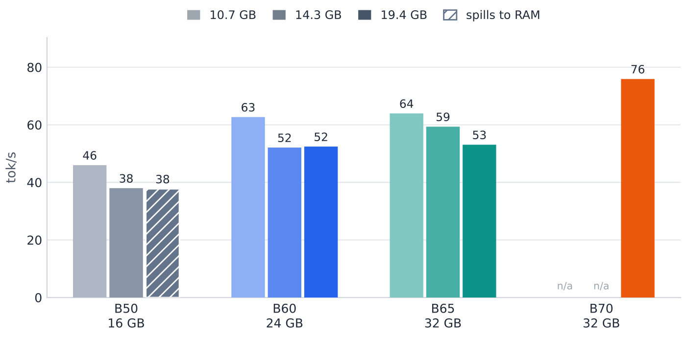
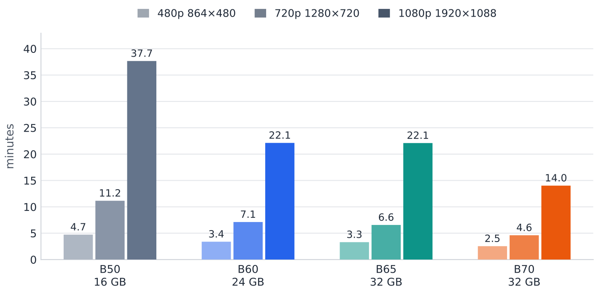

**English** · [简体中文](at-a-glance.md)

# At a glance: what these four cards can actually do

Skip the long docs. **Six tables and two charts below tell you which card to buy and what it can run.**

Every number was measured on our own machines. Raw data lives in [`../bench/data/`](../bench/data/).

---

## 1. The four questions everyone asks

| What you want to do | B50 (¥3,499 · 16 GB) | B60 (¥6,099 · 24 GB) | B65 (¥9,499 · 32 GB) | B70 (¥18,999 · 32 GB) | Verdict |
|---|---|---|---|---|---|
| Chat with a 35B model | **37.6 tok/s** | **52.4 tok/s** | **53.1 tok/s** | **75.9 tok/s** | All four fine, pick by budget |
| Generate a 1280×720 image | **52 s** | **18 s** | **16 s** | **11 s** | B60 / B65 are close to B70 |
| Generate a 5-second 480p video | **4.7 min** | **3.4 min** | **3.3 min** | **2.5 min** | All four can do it |
| Generate a 5-second 1080p video | **38 min** | **22 min** | **22 min** | **14 min** | All four can, just slowly |

> **What is tok/s?** How many "word chunks" the model spits out per second. Bigger is faster.
> 37 is already faster than most people read; 75 is double that.

> **B65 column:** chat **53.1 tok/s**, image **16 s**, music (120 s) **2.7 min**, 480p **3.3 min**,
> 720p **6.6 min**, 1080p **22.1 min** (all warm runs). It sits next to B60 for a reason —
> both have **20 Xe2 cores**, so the extra money buys VRAM, not speed.

---

## 2. Electricity: cheaper than you think

| | B50 16 GB | B60 24 GB | B65 32 GB | B70 32 GB |
|---|---|---|---|---|
| Idle | not measured | not measured | not measured | **51 W** (like a light bulb) |
| Full load | 70 W (spec sheet, not measured) | **151–154 W** (P90, TBP 200 W) | **201–204 W** (P90, pinned to the 200 W wall) | **290 W** (measured, holds steady) |
| One hour at full load | about **¥0.05** | about **¥0.10** | about **¥0.14** | about **¥0.20** |
| One 5-second 720p video | not measured | about **¥0.01** (50 kJ) | about **¥0.01** (65 kJ) | about **¥0.01** (58 kJ) |

At **¥0.7 per kWh**.

> **Electricity is not the problem — the PSU and cooling are.** For a 290 W card, use at least a 550 W PSU.

---

## 3. How big a model fits in VRAM

The same model (Qwen3.6-35B-A3B) at three quant levels, on all four cards
(`llama-bench` · SYCL · clean loop):

**Darker = bigger model** (10.7 / 14.3 / 19.4 GB). The **hatched** bar is B50, which cannot hold the
19.4 GB model and spills to system RAM. **`n/a`** marks the two B70 entries we never measured.
The chart shows the gap; the table below has the exact numbers.

| Model size | B50 16 GB | B60 24 GB | B65 32 GB | B70 32 GB |
|---|---:|---:|---:|---:|
| **10.7 GB** (IQ2_M) | **46 tok/s** | **62.7 tok/s** | **64.0 tok/s** | not measured |
| **14.3 GB** (Q3_K_S) | **38 tok/s** | **52.1 tok/s** | **59.4 tok/s** | not measured |
| **19.4 GB** (Q4_0) | **37.6 tok/s** does not fit, spills | **52.4 tok/s** fully resident | **53.1 tok/s** fully resident | **76.0 tok/s** fully resident |

> **Three counter-intuitive facts, all measured:**
>
> 1. **It still runs when it does not fit** — just slower. Windows moves the excess to RAM without an error.
>    Of the four cards only **B50 at 19.4 GB** hits this (16 GB of VRAM); the 24 / 32 GB cards keep it whole.
> 2. **A smaller model is not faster.** Halving the size (19.4 → 10.7 GB) buys only about **20%**
>    on the three cards we measured (B50 +22% / B60 +20% / B65 +20%).
>    **Pick the small quant to save VRAM, not to go faster.**
> 3. **B70's two smaller quants are not measured** — Q4_0 is already fully resident on 32 GB, so the
>    upside is the smallest of the four. No measurement, no extrapolated number.

---

## 4. How long a 5-second video takes

124 frames @ 24 fps · 6 steps · end to end (model loading included):

**Darker = higher resolution**; the vertical axis is minutes, and the number on each bar is the cell
in the table below. **The B50 group is a cold single shot**, so it sits higher than its neighbours —
do not subtract it cell by cell.

| Resolution | B50 16 GB | B60 24 GB | B65 32 GB | B70 32 GB | In human terms |
|---|---:|---:|---:|---:|---|
| 480p (864×480) | 4.7 min | 3.4 min | 3.3 min | 2.5 min | time for a coffee |
| 720p (1280×720) | 11.2 min | 7.1 min | 6.6 min | 4.6 min | a quick errand |
| 1080p (1920×1088) | **37.7 min** | 22.1 min | 22.1 min | 14.0 min | a proper meal |

> **The rule is simple: 5× the pixels, 4–8× the time** (B70 5.5× / B65 6.7× / B60 6.5× / B50 8.0×) —
> the higher the resolution, the more the bottleneck moves to compute, and **the more a faster card helps**.
> At low resolution most of the time goes into loading the model, so a faster card barely matters.
>
> Basis: **the B50 column is a cold single shot** (a 16 GB card loses the device on the second
> back-to-back run), the other three are steady state.

---

## 5. Which one to buy

| You are | Buy |
|---|---|
| On a ¥3,500 budget: chat + images + occasional 480p/720p video | **B50 16 GB** |
| On a ¥6,000 budget: noticeably faster chat, more VRAM headroom | **B60 24 GB** (measured: 52.4 tok/s) |
| Want 32 GB of VRAM for under ¥10,000 | **B65 32 GB** (¥9,499) — same die as B70 with 20 of 32 Xe2 cores, so **chat speed equals B60**; you pay for VRAM, not speed |
| Want 2–5× the speed, need 1080p, do not want to count VRAM | **B70 32 GB** (¥18,999 after the 2026-10-21 price rise) |
| Want two cards on one job | **Never tested. No answer.** |

> **Cheapest speed per tok/s** (chat only): B50 **¥93** · B60 **¥116** · B65 **¥179** · B70 **¥250**.
> After the price rise B70 has the highest cost per tok/s of the four — what it sells is the ceiling.

---

## 6. Three words and you are done

| Term | Plain English |
|---|---|
| **tok/s** | Word chunks per second. Bigger is faster — that is all you need |
| **Quantization** (Q4_0 / INT8 …) | Shrinking the model. More shrink = less VRAM, possibly dumber |
| **P90 / full load** | 90% of the time it stays under this wattage. Think "normal full load" |

---

## Two things we will not fake

**Not tested:** two cards on one job, above 1440p, sustained runs over one hour, music on B50, and the vision tower on B65.
**No guesses, no invented numbers.**

**Where to verify:** every number traces back to a file in [`../bench/data/`](../bench/data/). Status, data
location and reproduction steps for each test item are in [`test-registry.md`](test-registry.md).
