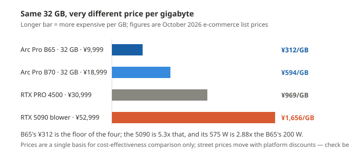

**English** · [简体中文](at-a-glance.md)

# At a glance: what the Arc Pro B family can do

Skip the long docs. **Six tables and three charts below, and you know which card to buy and what it can run.**

Every number here was measured on our own machines. Raw data lives in [`../bench/data/`](../bench/data/).

---

## 1. The four questions everyone asks

| What you want to do | B50 (¥4,499 · 16 GB) | B60 (¥6,499 · 24 GB) | B65 (¥9,999 · 32 GB) | B70 (¥18,999 · 32 GB) | Verdict |
|---|---|---|---|---|---|
| Chat with a 35B model | **37.6 tok/s** | **52.4 tok/s** | **53.1 tok/s** | **75.9 tok/s** | All four are fine, pick by budget |
| Generate a 1280×720 image | **52 s** | **18 s** | **16 s** | **11 s** | B60 / B65 are close to B70 |
| Generate a 5-second 480p video | **4.7 min** | **3.4 min** | **3.3 min** | **2.5 min** | All four can do it |
| Generate a 5-second 1080p video | **38 min** | **22 min** | **22 min** | **14 min** | All four can, you just wait |

> **What is tok/s?** How many "word chunks" the model spits out per second. Bigger is faster.
> 37 is already quicker than most people read; 75 is double that.
>
> The chat row is a benchmark number: a clean `llama-bench` loop, **same build and same parameters on
> all four cards**. A real llama-server delivery configuration lands lower — **B50 35.6 to 37.6 tok/s**
> (15.51 GiB visible, so experts have to be offloaded), **B60 50.9 tok/s** (23.33 GiB visible, fully
> resident). **B65 / B70 have not been re-run at those parameters**, so they do not sit side by side
> with these two.
>
> The two video rows are end-to-end per video, loading included. The B50 column comes from the
> 10-16/10-17 batch; the B60 and B70 columns from 10-19 / 10-20 and B65 from 10-21 — all on one
> software stack. B70's earlier batch (10-05) gave 5.3 min on the same tier — **different stack, not
> comparable with the table above**.
>
> 🔴 **The B65 column is not a bad copy of B60**: chat 53.1 vs 52.4 tok/s, 1080p 22.1 vs 22.3 min.
> Both cards carry **20 Xe2 cores** (B60 is BMG-G21 and B65 is BMG-G31 — different dies, same core
> count), so B65's **¥3,100** premium buys **8 GB of VRAM (24 → 32 GB), not speed**.
> All three of its video tiers are **warm runs** (198.12 / 394.06 / 1,326.17 s), image generation is
> **16.1 s** at steady state, and a 120-second music track takes **2.7 min** (164.6 s, DiT + TE all
> INT8) — **slower** than B60's 2.4 min. No single-variable control was run, so no cause is given.

---

## 2. Electricity: cheaper than you think

| | B50 16 GB | B60 24 GB | B65 32 GB | B70 32 GB |
|---|---|---|---|---|
| Idle | not measured | not measured | not measured | **51 W** (about one light bulb) |
| Full load | 70 W (spec sheet, not measured) | **151 to 154 W** (measured P90 on a 200 W TBP) | **201 to 204 W** (measured P90 right against the 200 W power wall) | **290 W** (measured, holds there the whole time) |
| One hour at full load | about **5 fen** | about **1 jiao** | about **1 jiao 4 fen** | about **2 jiao** |
| One 5-second 720p video | not measured | about **1 fen** (50 kJ) | about **1 fen** (65 kJ) | about **1 fen** (58 kJ) |

At **¥0.7 per kWh** — the reference rate from **China Southern Power Grid's residential tariff**; real rates vary by province — **use your own bill**.

> **Electricity is not the problem — the PSU and the cooling are.** A 290 W card wants at least a 550 W PSU.

---

## 3. How big a model fits in VRAM

One model (Qwen3.6-35B-A3B) at three quant levels, on all four cards (`llama-bench` · SYCL · clean loop):

**Darker = bigger model** (10.7 / 14.3 / 19.4 GB); the **hatched** bar is the B50 spilling into
system RAM; **`n/a`** is the two B70 cells with no measurement. The chart shows the gap; the table
below has the exact numbers.

| Model size | B50 16 GB | B60 24 GB | B65 32 GB | B70 32 GB |
|---|---:|---:|---:|---:|
| **10.7 GB** (IQ2_M) | **46 tok/s** | **62.7 tok/s** | **64.0 tok/s** | not measured |
| **14.3 GB** (Q3_K_S) | **38 tok/s** | **52.1 tok/s** | **59.4 tok/s** | not measured |
| **19.4 GB** (Q4_0) | **37.6 tok/s** does not fit, spills | **52.4 tok/s** fully resident | **53.1 tok/s** fully resident | **76.0 tok/s** fully resident |

> **Three points, counter-intuitive but measured:**
>
> 1. **It still runs when it does not fit** — just slower. Windows moves the part that does not fit
>    into RAM and raises no error. Of the four cards only **the B50 cell at 19.4 GB** triggers this
>    (16 GB of VRAM); the 24 / 32 GB cards hold the model whole.
> 2. **A smaller model is not faster.** Halve the size (19.4 → 10.7 GB) and the three cards with
>    numbers gain only about **20%** (B50 +22% / B60 +20% / B65 +20%).
>    **The small quant is for saving VRAM, not for speed.**
> 3. **B70's two smaller quants are not measured** — Q4_0 is already fully resident on 32 GB, so
>    shrinking buys the least of the four cards. No measurement, no extrapolated number.

---

## 4. How long a 5-second video takes

124 frames @ 24 fps · 6 steps · end to end (loading included):

**Darker = higher resolution**, the vertical axis is minutes, and the number on each bar is the cell
in the table below. **The B50 group is a one-off cold start** and sits higher than its three
neighbours — do not subtract cell by cell.

| Resolution | B50 16 GB | B60 24 GB | B65 32 GB | B70 32 GB | In human terms |
|---|---:|---:|---:|---:|---|
| 480p (864×480) | 4.7 min | 3.4 min | 3.3 min | 2.5 min | time for a coffee |
| 720p (1280×720) | 11.2 min | 7.1 min | 6.6 min | 4.6 min | a quick errand |
| 1080p (1920×1088) | **37.7 min** | 22.1 min | 22.1 min | 14.0 min | a proper meal |

> **The rule is simple: 5× the pixels, 4 to 8× the time** (B70 5.5× / B65 6.7× / B60 6.5× / B50 8.0×) —
> the higher the resolution, the further the bottleneck moves toward compute, and **the more a faster
> card helps**. At the low resolution most of the time goes into loading the model, so a faster card
> barely matters.
>
> **The B50 column is a one-off cold start** — a 16 GB card drops the device on the 2nd back-to-back
> run on the same server, so only the first video can be reported; the other three columns are steady
> state.
>
> 🔴 **How far past 5 seconds can it go?** Only B65 was pushed that far — **no known ceiling, only a
> time cost.** 30 rungs measured, 22 completed:
> **480p 5 s = 5 min / 50 s = 72.5 min**; 720p 5 s = 9 min / 10 s = 20 min / 17 s = 45 min /
> 18 s = 51 min / 20 s = 58 min / 22 s = 70 min / 23 s = 78 min / **24 s = 82.7 min**;
> 1080p 5 s = 24 min / 7 s = 39 min / 8 s = 46 min / 10 s = 71 min;
> 1440p 3 s = 26 min / 4 s = 45 min / 5 s = 59 min.
> **Duration limits: 480p ≤ 50 s / 720p ≤ 24 s / 1080p ≤ 10 s / 1440p ≤ 5 s — every tier measured.**
> The eight failures left (573 / 578 / 582 / 584 / 614 / 685 / 721 / 756 M, of which 582 M is
> 1440p · 6 s, 573 M is 480p · 57 s and 584 M is 720p · 26 s) are **all `XPU out of memory` — VRAM,
> not the host and not compute**. The **mean power** of the card tells you where a run died: every
> completed tier sits at **187 to 188 W** (≥150 W for 95%+ of the time); the 578 / 582 / 614 M tiers
> pull **171 to 173 W** and really do run for 16 to 18 min before dying in the attention allocation
> (2.25 to 2.38 GiB); from 685 M up the card draws only **62 to 81 W**, because the step 1 int8 output
> buffer (10.6 to 11.2 GiB) will not allocate.
> **Conclusion: 31.16 GiB of VRAM on this card cannot hold the peak transient allocation above
> 578 M** — it is not "this box cannot hold it" (host commit peaked at 111.58 / 127.11 GiB), not "the
> card cannot run it", and not a question of the wait limit.
> **B50 / B60 / B70 past 5 s: not measured.** Chart and numbers in §6 of [`cards/B65-README.md`](cards/B65-README.en.md).

---

## 5. Which one to buy

| You are | Buy |
|---|---|
| Budget around three and a half thousand yuan: chat + images + the occasional 480p/720p video | **B50 16 GB** |
| Budget around six thousand yuan: chat and images both noticeably faster, more VRAM headroom | **B60 24 GB** |
| Want 32 GB of VRAM but the budget is under ten thousand yuan | **B65 32 GB** (¥9,999) — same die as B70 with only 20 cores enabled, so **chat speed matches B60**; the money goes into VRAM |
| Want 2 to 5× the speed, need 1080p, do not want to budget VRAM | **B70 32 GB** (¥18,999 after the 2026-10-21 price rise) |
| Want two cards on one job | **Not tested**, no conclusion |

> **Ranked by money per tok/s** (chat only): B50 **¥120** · B60 **¥124** · B65 **¥188** · B70 **¥250**.
> **After the price rise B70 carries the highest unit price of the four** — what it sells is the
> ceiling: **32 cores + 32 GB**.
>
> Prices are October 2026 e-commerce list prices, used as a single basis for cost-effectiveness comparison. **Street prices move with platform discounts — check before ordering.**

> Per model: [B50 16 GB](cards/B50-README.en.md) · [B60 24 GB](cards/B60-README.en.md) · [B65 32 GB](cards/B65-README.en.md) · [B70 32 GB](cards/B70-README.en.md) — one page per card, covering what fits, what does not, and how many seconds.

---

## 6. Three words and you are done

| Term | Plain English |
|---|---|
| **tok/s** | Word chunks per second. Bigger is faster — that is all you need |
| **Quantization** (Q4_0 / INT8 and the like) | Shrinking the model. More shrink = less VRAM, possibly dumber |
| **P90 / full load** | 90% of the time it stays under this wattage. Think "normal full load" |

---

## Two more things, up front

**Not measured:** two cards on one job, above 1440p, stability over runs longer than an hour,
multimodality (the vision tower) on B65 plus the llama-server delivery configuration for B65 / B70 —
all still open.

**None of it is guessed, none of it gets an invented number.**

**Where to check:** every number traces back to one file in [`../bench/data/`](../bench/data/).
To audit, open [`test-registry.md`](test-registry.en.md) — status, data location and reproduction steps
for every test item live there.
