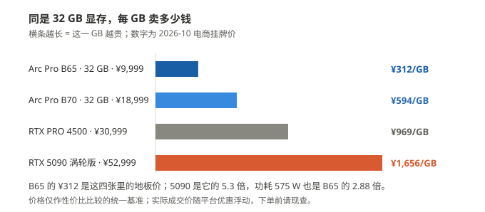

[English](at-a-glance.en.md) · **简体中文**

# At a glance: what the Arc Pro B family can do

不用看长文档。**下面六张表、三张图，看完你就知道自己该买哪张、能跑什么。**

所有数字都是本机实测的，原始数据在 [`../bench/data/`](../bench/data/)。

---

## 1. 最常问的四件事

| 你想干什么 | B50（¥4,499 · 16G） | B60（¥6,499 · 24G） | B65（¥9,999 · 32G） | B70（¥18,999 · 32G） | 结论 |
|---|---|---|---|---|---|
| 跟 35B 大模型聊天 | **37.6 tok/s** | **52.4 tok/s** | **53.1 tok/s** | **75.9 tok/s** | 四张都够用，按预算挑 |
| 画一张 1280×720 的图 | **52 秒** | **18 秒** | **16 秒** | **11 秒** | B60 / B65 已经接近 B70 |
| 生成 5 秒 480p 视频 | **4.7 分钟** | **3.4 分钟** | **3.3 分钟** | **2.5 分钟** | 一张都跑得动 |
| 生成 5 秒 1080p 视频 | **38 分钟** | **22 分钟** | **22 分钟** | **14 分钟** | 都能出，就是要等 |

> **tok/s 是什么**：模型每秒钟吐出多少个"字块"，数字越大越快。
> 37 已经比大多数人看书的速度快，75 是翻着倍往上。
>
> 表里这一行是**基准口径**（`llama-bench` 干净循环，**四张卡同 build、同参数**）。真实 llama-server
> 交付配置实测会再低一点：**B50 35.6 至 37.6 tok/s**（15.51 GiB 可见，装不下要卸专家）、
> **B60 50.9 tok/s**（23.33 GiB 可见，全驻留）。**B65 / B70 那两档还没按同参数补**，不与这两张并排。
>
> 视频两行是每条视频的端到端（含装载）。B50 一列采于 10-16/10-17 批次，B60 / B70 两列采于
> 10-19 / 10-20、B65 一列采于 10-21 的同一套软件栈；B70 更早那批（10-05）同档是 5.3 分钟，
> **栈不同，不与上表并排**。
>
> 🔴 **B65 那一列不是把 B60 抄错了**：聊天 53.1 vs 52.4 tok/s、1080p 22.1 vs 22.3 分钟——
> 两张卡**都是 20 个 Xe2 核心**（B60 是 BMG-G21、B65 是 BMG-G31，芯片不同但核心数相同），
> B65 贵出来的 **¥3,100 买的是 8 GB 显存（24 → 32 GB），不是速度**。
> 它的视频三档都是**热态**（198.12 / 394.06 / 1,326.17 s），出图 **16.1 s** 是稳态，
> 出一首 120 秒音乐 **2.7 分钟**（164.6 s，DiT + TE 全 INT8）——
> 音乐这一项它比 B60 的 2.4 分钟**慢**，没做单变量对照，不给原因。

---

## 2. 电费：比你想的便宜

| | B50 16G | B60 24G | B65 32G | B70 32G |
|---|---|---|---|---|
| 待机 | 没测 | 没测 | 没测 | **51 W**（像一个灯泡） |
| 满载 | 70 W（规格值，没实测） | **151 至 154 W**（实测 P90，TBP 200 W） | **201 至 204 W**（实测 P90，贴着 200 W 功耗墙） | **290 W**（实测，一直稳在这） |
| 满载开一小时 | 约 **5 分钱** | 约 **1 毛钱** | 约 **1 毛 4** | 约 **2 毛钱** |
| 出一条 5 秒 720p 视频 | 没测 | 约 **1 分钱**（50 kJ） | 约 **1 分钱**（65 kJ） | 约 **1 分钱**（58 kJ） |

按 **0.7 元/度** 算 —— **中国南方电网居民电价的参考值**，各地实际电价不同，**以本地电费单为准**。

> **结论：电费不是问题，电源和散热才是。** 290 W 的卡，电源至少配 550 W。

---

## 3. 多大的模型装得进显存

同一个模型（Qwen3.6-35B-A3B）压成三档，在四张卡上分别多快（`llama-bench` · SYCL · 干净循环）：

**颜色越深＝模型越大**（10.7 / 14.3 / 19.4 GB）；**斜纹**那根是 B50 装不下、要靠系统挪到内存；
**`n/a`** 那两格 B70 没测。图看落差，逐格的准确数字在下表。

| 模型大小 | B50 16G | B60 24G | B65 32G | B70 32G |
|---|---:|---:|---:|---:|
| **10.7 GB**（IQ2_M） | **46 tok/s** | **62.7 tok/s** | **64.0 tok/s** | 未测 |
| **14.3 GB**（Q3_K_S） | **38 tok/s** | **52.1 tok/s** | **59.4 tok/s** | 未测 |
| **19.4 GB**（Q4_0） | **37.6 tok/s** 装不下，要卸 | **52.4 tok/s** 全驻留 | **53.1 tok/s** 全驻留 | **76.0 tok/s** 全驻留 |

> **三个要点，反直觉但实测如此：**
>
> 1. **装不下也能跑**，只是慢。Windows 会自己把放不下的部分挪到内存，不报错。
>    四张卡里只有 **B50 的 19.4 GB 这一格**会触发它（16 GB 显存），24 / 32 GB 三张全是整块驻留。
> 2. **换小的模型不会更快。** 体积砍一半（19.4 → 10.7 GB），三张有数的卡都只快 **20% 左右**
>    （B50 +22% / B60 +20% / B65 +20%）。**选小模型是为了省显存，不是为了提速。**
> 3. **B70 的两档小模型没测** —— 32 GB 上 Q4_0 本来就整块驻留，压小的收益在四张卡里最小，
>    没有实测就不给推算值。

---

## 4. 出一条 5 秒视频要等多久

124 帧 @ 24 fps · 6 步 · 端到端（含装载）：

**颜色越深＝分辨率越高**，纵轴是分钟，柱顶的数字就是下表那一格。**B50 那组是冷启动单次**，
比旁边三组偏高，别逐格相减。

| 分辨率 | B50 16G | B60 24G | B65 32G | B70 32G | 换算 |
|---|---:|---:|---:|---:|---|
| 480p（864×480） | 4.7 分钟 | 3.4 分钟 | 3.3 分钟 | 2.5 分钟 | 泡杯茶回来就好 |
| 720p（1280×720） | 11.2 分钟 | 7.1 分钟 | 6.6 分钟 | 4.6 分钟 | 能去趟洗手间 |
| 1080p（1920×1088） | **37.7 分钟** | 22.1 分钟 | 22.1 分钟 | 14.0 分钟 | 够吃一顿饭 |

> **规律很简单：像素涨 5 倍，时间涨 4 至 8 倍**（B70 5.5× / B65 6.7× / B60 6.5× / B50 8.0×）——
> 分辨率越高，瓶颈越往算力走，**换卡才越有用**。低分辨率那档时间大半花在读模型上，换卡几乎没用。
>
> 口径：**B50 一列是冷启动单次**——16 GB 卡在同一服务连跑第 2 条会掉设备，只能报首条；其余三列是稳态。
>
> 🔴 **5 秒往上还能出多长？** 只有 B65 被推到那么远 —— **没有已知天花板，只有时间成本**。
> 实测 30 档、22 档跑完：**480p 5 秒 5 分钟 / 50 秒 72.5 分钟**；
> 720p 5 秒 9 分钟 / 10 秒 20 分钟 / 17 秒 45 分钟 / 18 秒 51 分钟 / 20 秒 58 分钟 /
> 22 秒 70 分钟 / 23 秒 78 分钟 / **24 秒 82.7 分钟**；1080p 5 秒 24 分钟 / 7 秒 39 分钟 / 8 秒 46 分钟 / 10 秒 71 分钟；
> 1440p 3 秒 26 分钟 / 4 秒 45 分钟 / 5 秒 59 分钟**。
> **时长上限：480p ≤ 50 秒 / 720p ≤ 24 秒 / 1080p ≤ 10 秒 / 1440p ≤ 5 秒，每一档都是实测。**
> 剩下八档失败（573 / 578 / 582 / 584 / 614 / 685 / 721 / 756 M，其中 582 M 是 1440p·6 秒、573 M 是 480p·57 秒、584 M 是 720p·26 秒），**全部是 `XPU out of memory`（显存不够），不是主机、也不是算力**：
> 看被测卡**功耗均值**就知道死在哪 —— 通过档全在 **187 至 188 W**（95%+ 的时间 ≥150 W）；
> 578 / 582 / 614 M 三档 **171 至 173 W**、真跑了 16 至 18 分钟，死在注意力申请（2.25 至 2.38 GiB）；685 M 起只有 **62 至 81 W**，因为第 1 步的 int8 输出缓冲（10.6 至 11.2 GiB）分配不下。
> **结论：这张卡 31.16 GiB 显存装不下 578 M 以上的瞬时峰值** —— 不是「这台机装不下」（主机提交峰值 111.58 / 127.11 GiB），也不是「卡跑不动」，也不是等待上限的问题。
> **B50 / B60 / B70 的 5 秒以上：没测。** 图与数字见 [`cards/B65-README.md`](cards/B65-README.md) §6。

---

## 5. 该买哪张

| 你是 | 建议 |
|---|---|
| 预算三千五，跑大模型聊天 + 出图 + 偶尔出 480p/720p 视频 | **B50 16G** |
| 预算六千，要大模型 + 出图都快一截，显存宽裕点 | **B60 24G** |
| 要 32 GB 显存，但预算不到一万 | **B65 32G**（¥9,999）——和 B70 同一颗芯片，核心只开了 20 个，所以**聊天速度和 B60 一样**，钱主要花在显存上 |
| 要快 2 至 5 倍，要出 1080p，显存不想算着用 | **B70 32G**（¥18,999，2026-10-21 涨价后）|
| 要两张卡一起跑一个任务 | **没测过**，不给结论 |

> **按「每 tok/s 花多少钱」排**（只对聊天有意义）：B50 **¥120** · B60 **¥124** · B65 **¥188** · B70 **¥250**。
> **B70 涨价后已经是四张里单价最贵的**——它卖的是「32 个核心 + 32 GB」这个上限。
>
> 价格为 2026-10 电商挂牌价，作为性价比比较的统一基准；**实际成交价随平台优惠浮动，下单前请现查。**

> 按型号细看：[B50 16G](cards/B50-README.md) · [B60 24G](cards/B60-README.md) · [B65 32G](cards/B65-README.md) · [B70 32G](cards/B70-README.md)——每张卡一页，写清它装得下什么、装不下什么、多少秒。

---

## 6. 三个词，看懂就够了

| 词 | 人话解释 |
|---|---|
| **tok/s** | 每秒出多少个"字块"。越大越快，别管它怎么算的 |
| **量化**（Q4_0 / INT8 之类） | 把模型压小。压得越狠越省显存，但可能变笨 |
| **P90 / 满载** | 90% 的时间里都不超过这个功率，可以理解成"正常满负荷" |

---

## 还有两件事，先说清楚

**没测的**：两张卡一起跑、1440p 以上、连续跑一小时以上的稳定性、B65 的多模态（视觉塔）、
B65 / B70 的 llama-server 交付配置。
**这些一律不猜，也不编数字。**

**哪里能查**：每个数字都能追到 [`../bench/data/`](../bench/data/) 里的一个文件，
想核对就去看 [`test-registry.md`](test-registry.md)——每个测试项的状态、数据位置、怎么复现都写在里面。
