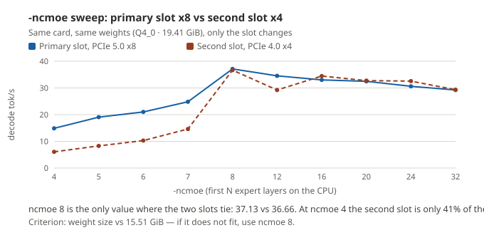
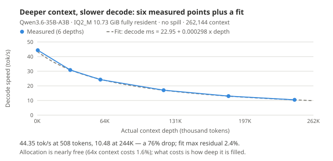
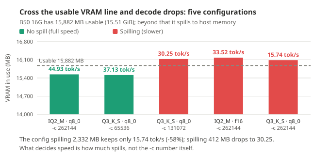

**English** · [简体中文](B50-README.md)

# GUNNIR Arc Pro B50 16G

> **¥4,499 · 16 GB VRAM · 224 GB/s · 70 W**
>
> The cheapest entry ticket. It handles every local AI job; the price is that **you have to budget VRAM**:
> chat at **37.6 tok/s**, a 720p image in **51.8 seconds**, a 5-second 1080p video in **37.7 minutes**.

---

## 1. Specifications

| Item | Value |
| --- | --- |
| Tested model | **GUNNIR (蓝戟) B50 16G** |
| VRAM | 16 GB physical, **15.51 GiB** usable |
| Bandwidth / INT8 compute | 224 GB/s / 170 TOPS |
| Xe2 cores | **16** |
| Power | TBP **70 W** (spec value; no power reading on this machine) |
| Slot | Both the primary slot (PCIe x8) and the secondary slot (PCIe x4) were tested |
| Driver | **32.0.101.8976** |

---

## 2. Five numbers

| What you want to do | Measured on the B50 |
| --- | --- |
| Chat with a 35B model | **37.6 tok/s** |
| Run a 260K-token context | ✅ yes; about **12 to 13 tok/s** at 190K depth and about **10 tok/s** at 260K |
| Render one 720p image (int8 · 25 steps) | **51.8 seconds** |
| Render a 5-second 480p video (6 steps · 864×480) | **4.7 minutes** |
| Render a 5-second 1080p video (6 steps · 1920×1088) | **37.7 minutes** |

---

## 3. Chat and text

### 3.1 Base performance

`llama-bench -p 512 -n 128 -r 3`:

| Model | Quant | Size | Decode | Prefill | Residency |
| --- | --- | ---: | ---: | ---: | --- |
| Qwen3.6-35B-A3B | Q4_0 | 19.41 GiB | **37.6 tok/s** | ≈425 tok/s | `-ncmoe 8` (does not fit) |
| same | Q3_K_S | 14.30 GiB | **37.99 tok/s** | 589.57 tok/s | fully resident |
| same | IQ2_M | 10.73 GiB | **45.99 tok/s** | 551.95 tok/s | fully resident |
| Qwen3-VL-4B (dense) | Q4_0 | 2.21 GiB | **63.99 tok/s** | 1,457.02 tok/s | fully resident |

**Two findings unique to the B50:**

1. **A smaller quant level buys no speed** (the three tiers span only +22%): at 35B this card is **compute-bound** — the resident IQ2_M uses only **19%** of 224 GB/s while dense Qwen3-VL-4B eats **68%**. A quant level chooses quality and VRAM headroom, not speed.
2. **Omitting `-ncmoe` when the model does not fit is the worst configuration**: `-ncmoe 4` gives only **6.08 tok/s**, `-ncmoe 8` gives **36.66** — **6× apart**. Criterion: weight size vs 15.51 GiB.

**Chart note: with the wrong parameters the gap is 6× (4 vs 8 layers); only after tuning do the two slots become comparable.**

**Read it this way: mis-tuned, the gap is 6× (4 vs 8 layers); tuned, the two slots become comparable.**

### 3.2 Delivery configuration

Same model, Q4_0 · 19.41 GiB · `-c 16384`:

| Item | Value |
| --- | --- |
| Decode | **35.55 to 37.55 tok/s** |
| Prefill | 46.5 to 48.6 tok/s |
| `-ncmoe` | 8 |
| Shared memory spill | **3,848 MB** |

**The `-c` ceiling is 64K**: 16384 / 32768 run at full speed (37.5 range), **65536 drops to 26.62 (−29%)**, **262144 drops to 10.35 (−72%)**, because shared spill grows from ≈39 MB to 3,351 MB. → **Spill volume sets speed, not the `-c` number.**

### 3.3 Long context: the brightest spot on this card

With **IQ2_M (10.73 GiB)**, the model's native **262,144** context, `-c 262144` loads in 10.5 seconds, **15,540 MB total, no spill**:

| `-c` | 4096 | 16384 | 32768 | 65536 | 131072 | **262144** |
| --- | ---: | ---: | ---: | ---: | ---: | ---: |
| Decode tok/s (shallow prompt) | 45.21 | 45.07 | 45.07 | 44.47 | 44.75 | **44.93** |

**Allocation is nearly free** — 64× the context costs 1.6%. **What actually costs is how deep the context is filled**:

| Measured depth | 508 | 31,323 | 59,918 | 119,902 | 181,454 | 244,098 |
| --- | ---: | ---: | ---: | ---: | ---: | ---: |
| **Decode tok/s** | **44.35** | **30.82** | **24.26** | **17.02** | **13.01** | **10.48** |
| Prefill tok/s | 414.91 | 427.53 | 385.95 | 330.04 | 285.82 | 254.76 |

Fit (max residual 2.4%): **`decode time (ms) ≈ 22.95 + 0.000298 × depth`** — the constant term corresponds to a 43.6 tok/s ceiling; the slope is the cost of attention.

**Chart note: the intercept is this card's ceiling, the slope is the attention bill — the gap widening with depth is inherent to attention, not a card deficiency.**

**Read it this way: the intercept is this card's ceiling, the slope is attention's bill — the gap widening with depth is attention arithmetic, not a broken card.**

**Long context at 16 GB requires IQ2_M, not Q3_K_S**: Q3_K_S (14.30 GiB) spills 2,332 MB and **loses 58% of decode** (15.74 tok/s). Spill is not an error — Windows allows VRAM oversubscription, the driver pages out to host memory, and the price is speed.

**Chart note: spillover is an invisible tax — no error raised, but decode drops 58%.**

**Read it this way: spill is an invisible tax — no error, but decode drops 58%.**

### 3.4 Multimodal: SYCL takes a minute and a half for the first image, Vulkan takes 9 seconds

Feed it a program-generated image with a unique answer (640×360) and check the reply: **both backends answer correctly (4/4 each)**. The entire difference is waiting:

| | SYCL cold | SYCL warm | Vulkan cold | Vulkan warm |
| --- | ---: | ---: | ---: | ---: |
| **First image wall clock** | 87.16 s | **75.46 s** | 15.60 s | **8.95 s** |
| Image prefill (tok/s) | 12.81 | 14.81 | 72.48 | **128.12** |
| Decode (tok/s) | 29.46 | 30.98 | 36.76 | 36.39 |
| VRAM / shared spill | 16,167 / **4,506 MB** | same | 16,130 / **590 MB** | same |

**Warm first image differs by 8.4×, image prefill 8.65×, decode only 1.17× — the first image gets faster, the token stream does not.**

**5 images in a row (one sequence)**: first image (cold, includes vision tower encoding) + 4 warm:

| | Vulkan | SYCL | |
| --- | ---: | ---: | --- |
| First image | **8.92 s** | 75.36 s | **8.5×** |
| Images 2 to 5 (prompt cache hit) | 0.28 to 0.29 s | 0.42 to 0.44 s | 1.5× |
| **Total for 5 questions** | **10.1 s** | **77.1 s** | **7.7×** |

**IQ2_M fully resident + the same vision tower**: first image **1.04×**, the two backends are almost identical.
→ **Those 75 seconds on SYCL are slow expert offload, not slow multimodal** (the prefill gap is in the table above; fully resident, both sides sit at ≈115 tok/s).

### 3.5 Switching backend: 1.22× when it fits, only 1.05 to 1.10× when it does not

Backend swapped, weights untouched:

| Tier | SYCL | Vulkan | |
| --- | ---: | ---: | --- |
| **IQ2_M 10.73 GiB** (fully resident) | 47.38 | **57.78** | **1.22×** |
| Q3_K_S 14.30 GiB (`-ncmoe 0`, spills 514 MB) | 39.97 | **48.08** | **1.20×** |
| **Q4_0 19.41 GiB** (8 expert layers offloaded) | 37.70 | **39.75** | **1.05×** |

The delivery command lines point the same way:

| Configuration | SYCL | Vulkan | |
| --- | ---: | ---: | --- |
| IQ2_M · `-c 16384` | 46.25 | **56.69** | **1.23×** |
| Q3_K_S · `-c 16384` (spills 514 MB) | 39.73 | **47.55** | **1.20×** |
| Q4_0 · `-c 16384` · `-ncmoe 8` | 38.08 | **41.81** | **1.10×** |
| Q4_0 · `-c 65536` · `-ncmoe 8` | **26.88** | 17.25 | **0.64× (Vulkan is slower here)** |
| Q4_0 · `-c 16384` · `-ncmoe 8` · vision tower | 31.90 | **41.83** | **1.31×** |

**Switching to Vulkan is not a sure win on the B50:**

- **1.22× only when the model fits** (B60 / B65 see 1.68×); after offloading experts only **1.05 to 1.10×**.
- **A longer `-c` reverses it**: at 64K Vulkan ends up 36% slower (408 MB more spill costs it 59%) → **keep SYCL for long context**.
- **Multimodal follows expert residency, not the backend**: experts offloaded, Vulkan is 8.5× faster on the first image; fully resident only 1.04× — **switch the main image-to-text tier (experts offloaded) to Vulkan; do not switch a fully resident one for images.**

---

## 4. Image generation

Qwen-Image 2.1 · 1280×720 · 25 steps:

| DiT tier | First round (incl. load) | **Steady state** | New prompt | of which sampling | Load |
| --- | ---: | ---: | ---: | ---: | --- |
| `bf16` | 122.75 s | **93.63 / 81.06 s** (mean 87.34) | 73.52 s | 45 s (1.80 s/step) | 12,963 MB + **608 MB offloaded** |
| **`int8`** | 84.83 s | **50.52 / 52.98 s** (mean 51.75) | 47.11 s | **29 s (1.16 s/step)** | 6,921 MB complete |

**Only int8 keeps the model fully resident**, and it is **1.69×** faster than bf16 — **at 16 GB, quantization is a VRAM tool first and a speed tool second.**

**Steady state still moves bytes**: 15.51 GiB cannot hold 6,920 + 8,709 + 629 MB, so **every round evicts the 3,837.8 MB text encoder and reads it back from disk**, costing 21 to 24 s. **The B70's 4.87× = 3.22× sampling × 1.51× reloading.**

| Resolution | Steady state | Sampling | Per step |
| --- | ---: | ---: | ---: |
| 1280×720 | 51.75 s | 29 s | 1.16 s |
| 1536×864 | 64.56 s | 45 s | 1.80 s |
| **2048×2048** | **246.12 s** | 214 s | **8.54 s** |
| **3072×3072** | **863.1 s** (14.4 min) | 802 s | **32.06 s** |

**Cost is superlinear in pixels**: pixels 1.00 / 1.44 / 4.55 / 10.24× → sampling 1.00 / 1.55 / 7.38 / **27.6×**. **Budget by area, not by just a little bigger.**

| Krea-2 Turbo · 1024×1024 · 8 steps | Steady state | Note |
| --- | ---: | --- |
| `int8` | **57.89 s** | 12,866 MB fully resident, but 42 s of fixed overhead and only 16 s of sampling |
| `bf16` | ❌ **does not run** | Needs **13,675 MB** offloaded, still short of VRAM |

**Krea-2 at 16 GB must be int8.**

---

## 5. Music generation

MiniMax Music 3 · 120 seconds · 30 steps · **DiT int8 + text encoder int8**:

| Item | Value |
| --- | --- |
| First round (incl. load) | 285.74 s |
| **Steady state** | **216.82 s** (5.50 s/step) |
| New full song | ❌ out of VRAM |

**The text encoder is a hard constraint on this card**: the `bf16` build at 15.56 GiB is **larger than the card's full 15.51 GiB** → partial offload, first round **+84%** (524.20 vs 285.74 s), **but steady state differs by only 0.6%**.

→ **Quantizing the text encoder is a capacity tool, not a performance tool**: steady state is set by DiT sampling.
→ **On the B50, Music 3 needs both DiT int8 and text encoder int8.**

---

## 6. Video generation

MiniMax H3 · 6 steps · 5 seconds (124 frames) · end-to-end incl. load:

| Resolution | End-to-end | Sampling | Per step | Sampling share | Efficiency |
| --- | ---: | ---: | ---: | ---: | ---: |
| 864×480 | **283.82 s** (4.7 min) | 144 s | 24.00 s | 51% | 10.9 |
| 1024×576 | **375.18 s** (6.3 min) | 238 s | 39.68 s | 63% | **11.7** |
| 1152×648 | **487.22 s** (8.1 min) | 344 s | 57.25 s | 71% | 11.4 |
| **1280×720** | **669.19 s** (11.2 min) | 503 s | 83.95 s | 75% | 10.2 |
| **1536×864** | **1,268.67 s** (21.1 min) | 1,078 s | **179.82 s** | 85% | 7.8 |
| **1920×1088** | **2,259.86 s** (**37.7 min**) | 2,022 s | **337.02 s** | 89% | 6.9 |
| 2560×1440 | _░ tested · out of VRAM_ | _—_ | _—_ | _—_ | _—_ |

> `Efficiency` = M of pixels × frames per minute; **higher saves time**; `░` = tested, does not run.

**Two patterns**: ① cost is superlinear in pixels, exponent **p ≈ 1.7** (pixels 5.04× → sampling **14.04×**); ② fixed overhead is roughly constant (137 to 238 s).

**1080p is the resolution ceiling** (3.4× the 720p time for 2.27× the pixels); 1440p does not fit (6,352.75 MB available, the next allocation needs 5.35 GiB).

**How long a clip can run is a question of resolution first.** 864×480 · 6 steps · `--reserve-vram 2` · cold single clip:

| Duration | Frames | End-to-end | Per step | Efficiency |
| ---: | ---: | ---: | ---: | ---: |
| 5 s | 124 | 283.82 s (4.7 min) | 24.00 s | **10.9** |
| 10 s | 243 | **574.94 s** (9.6 min) | **66.69 s** | 10.5 |
| 15 s | 362 | **997.63 s** (16.6 min) | **132.55 s** | 9.0 |
| 20 s | 481 | **1,556.01 s** (25.9 min) | **219.61 s** | 7.7 |

Frames grow 1.96× / 2.92× / 3.88× while per step grows faster still (**roughly the 1.7 power of frames**) — **fixed overhead amortized**.
The 20-second clip finishes with 10.08 GB of VRAM left: **480p is not short of VRAM, it is short of patience.**

**1280×720 is 5 seconds only**: pushing to 10 seconds lands on **░ does not fit** (6,352.75 MB available, the first step needs 1.79 GiB with 1.78 GiB left),
and moving the text encoder to the CPU to free 6 GB is still not enough. **Longer clips mean lower resolution.**

**How to choose — three sentences:**

1. **One clip → 720p · 5 seconds (11.2 minutes)**: the only HD tier. 576p is more efficient (11.7 vs 10.2) but only 0.59 MP.
2. **Long clips → split 480p into segments and stitch**: a 20-second clip takes **25.9 minutes** at efficiency 7.7; 4 × 5-second segments total **18.9 minutes, 1.37× faster**.
3. **Higher resolution → render 720p and upscale**: a directly generated 5-second 1080p clip takes **37.7 minutes (3.4×)**; upscale is not measured on this page.

**Video on this card is not load-dominated** (sampling share in the table above): trimming sampling pays — the exact opposite of the B70, where changing the step count does nothing.

> ⚠️ **Which step the offload cost lands on has not been measured on the B50.** On the B60 it measures **once per generation, on step 1, at about 1.9 s per GB** (steps 2 through 6 match a fully resident card). The B50 offloads 13 GB; only the sampling share is reported.

---

## 7. Power

**Spec value only: 70 W TBP. There is no measured wattage.**

The whole-card power domain cannot be read (Sysman reports `-1 mW`); the captured peak of 198 W contradicts the 70 W spec — **that reading is not quoted, and no electricity-cost estimate is given.**

---

## 8. What fits

15.51 GiB of visible VRAM:

| Combination | Resident | B50 |
| --- | ---: | --- |
| Qwen-Image 2.1 **int8** (6.9 + 8.7 + 0.6 GB) | 16.2 GB | ⚠️ exceeds the 15.88 GB usable → text encoder swapped out every round, 3.8 GB |
| Qwen-Image 2.1 **bf16** (12.96 GB) | 22.6 GB | ❌ needs 608 MB offloaded, not fully resident |
| Krea-2 **bf16** (24.48 GiB) | 32.98 GB | ❌ 13.68 GB offloaded and still out of VRAM |
| **H3 video model 19.53 GB** | 20.0 GB | ❌ even at 864×480 it offloads 12,985 MB to host memory |
| Music 3 **bf16 text encoder** | 15.56 GiB | ❌ larger than the whole card → partial offload |

**Four hard limits:**

1. **Krea-2 must be int8** (bf16 still runs out of VRAM).
2. **Music 3 must be DiT int8 + text encoder int8**, and a new full song still runs out of VRAM.
3. **Long context must use IQ2_M** (Q3_K_S spills).
4. **`-ncmoe` cannot be omitted**: leave it out when the model does not fit and speed drops 6×.

**Slot**: the secondary slot (PCIe x4) is **2.9%** slower than the primary, but repeated runs in that same secondary slot spread **13.9%** — **the slot difference is smaller than the noise, so no difference can be resolved.**

---

## 9. How to choose

| What you care about | Measured |
| --- | --- |
| A budget of three and a half thousand, everything must run | **B50** |
| 260K context, chat only | **B50 is enough**: IQ2_M does not spill, depth curve measured to the end |
| Fast image / music generation | Same int8 image workload, **B60 is 2.86× and B70 4.87× faster** |
| Krea-2 / Music 3 | On 16 GB both are squeezed into their narrowest configuration by capacity |
| Multimodal | SYCL first image **75 s**, Vulkan **9 s** |

---

## 10. Test conditions

| Item | Value |
| --- | --- |
| Capture dates | Chat / long context 2026-10-15 to 10-16; image 2026-10-16; video 2026-10-17 |
| OS | Windows 11 Pro 26H2 · Build 26300 |
| Software stack | ComfyUI 0.39.0 + `comfy_kitchen` 0.2.37 + XPU provider 0.2.33 + `torch 2.12.0+xpu` |
| llama.cpp | build **11431** |
| Driver | **32.0.101.8976** |
| VRAM | ECC off · **15.51 GiB** visible · power limit **70 W** (spec) |
| Test machine | Ryzen 5 9600X · B850M · **2×16 GB DDR5-6400 (both slots full)** · display driven by the iGPU, the whole dGPU given to the model |
| Raw records | [`bench/data/`](../../bench/data/) (every entry carries environment fields: driver, kernel, ECC, available VRAM) |

Install, drivers and patches → [`../install.md`](../install.en.md); full build → [`../build.md`](../build.en.md); 16 GB parameter tuning → [`../vram-16gb.md`](../vram-16gb.en.md).

---

MIT · handbook content may be reused freely with attribution. Author: Yonggang Lin · `lygsam75@gmail.com`
