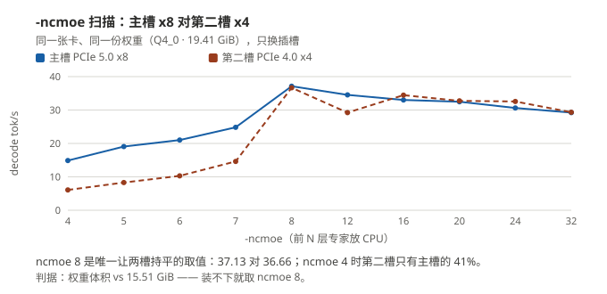
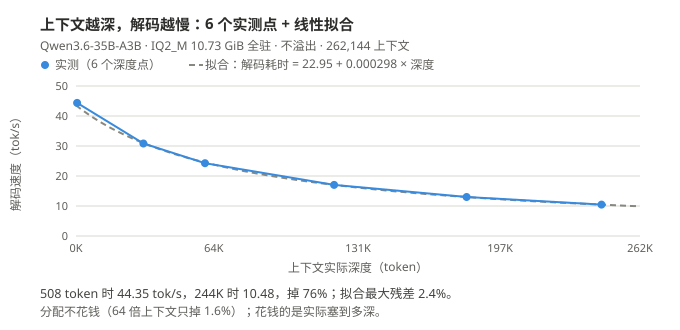
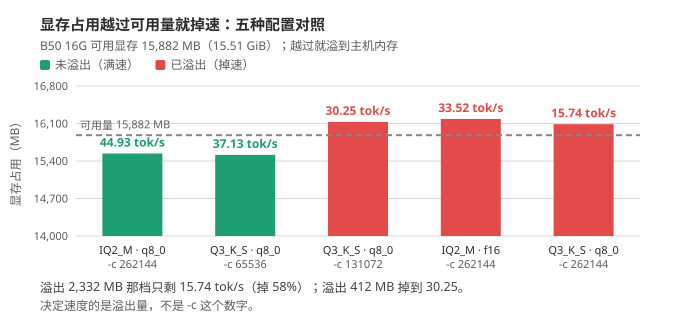

# GUNNIR Arc Pro B50 16G

> **¥4,499 · 16 GB 显存 · 224 GB/s · 70 W**
>
> 最便宜的一张入场券。本地 AI 的每一件事它都能干，代价是**要算着显存用**：
> 聊天 **37.6 tok/s**、画一张 720p 图 **51.8 秒**、出 5 秒 1080p 视频 **37.7 分钟**。

---

## 1. 规格

| 项 | 值 |
| --- | --- |
| 测试型号 | **GUNNIR（蓝戟）B50 16G** |
| 显存 | 16 GB 本体，可用 **15.51 GiB** |
| 带宽 / INT8 算力 | 224 GB/s / 170 TOPS |
| Xe2 核心 | **16 个** |
| 功耗 | TBP **70 W**（规格值，本机无功耗读数） |
| 槽位 | 主槽 PCIe x8、副槽 PCIe x4 都测过 |
| 驱动 | **32.0.101.8976** |

---

## 2. 五个数看完

| 你想干什么 | B50 上实测 |
| --- | --- |
| 跟 35B 大模型聊天 | **37.6 tok/s** |
| 跑 26 万 token 上下文 | ✅ 能，19 万深度时约 **12 至 13 tok/s**、26 万时约 **10 tok/s** |
| 画一张 720p 的图（int8 · 25 步） | **51.8 秒** |
| 出 5 秒 480p 视频（6 步 · 864×480） | **4.7 分钟** |
| 出 5 秒 1080p 视频（6 步 · 1920×1088） | **37.7 分钟** |

---

## 3. 聊天与文本

### 3.1 基础性能

`llama-bench -p 512 -n 128 -r 3`：

| 模型 | 量化 | 体积 | 解码 | 预填充 | 驻留 |
| --- | --- | ---: | ---: | ---: | --- |
| Qwen3.6-35B-A3B | Q4_0 | 19.41 GiB | **37.6 tok/s** | ≈425 tok/s | `-ncmoe 8`（装不下） |
| 同上 | Q3_K_S | 14.30 GiB | **37.99 tok/s** | 589.57 tok/s | 全驻留 |
| 同上 | IQ2_M | 10.73 GiB | **45.99 tok/s** | 551.95 tok/s | 全驻留 |
| Qwen3-VL-4B（稠密） | Q4_0 | 2.21 GiB | **63.99 tok/s** | 1,457.02 tok/s | 全驻留 |

**两条 B50 特有的结论：**

1. **换量化档不提速**（三档只差 +22%）：35B 这个尺寸上**算力受限**——带宽只用到 **19%**，稠密 4B 却能吃到 **68%**。量化档选的是质量和显存余量，不是速度。
2. **装不下时漏掉 `-ncmoe` 是最差配置**：`-ncmoe 4` 只有 **6.08 tok/s**，`-ncmoe 8` 是 **36.66**，差 **6 倍**。判据：权重体积 vs 15.51 GiB。

**看图：参数没调对时差距是 6 倍级（4 对 8 层），调对之后主副槽才进入可比区间。**

### 3.2 交付配置

同模型 Q4_0 · 19.41 GiB · `-c 16384`：

| 项 | 值 |
| --- | --- |
| 解码 | **35.55 至 37.55 tok/s** |
| 预填充 | 46.5 至 48.6 tok/s |
| `-ncmoe` | 8 |
| 共享显存溢出 | **3,848 MB** |

**`-c` 的天花板在 64K**：16384 / 32768 满速（37.5 级），**65536 掉到 26.62（−29%）**、**262144 掉到 10.35（−72%）**，因为共享溢出从 ≈39 MB 涨到 3,351 MB。→ **决定速度的是溢出量，不是 `-c` 这个数字。**

### 3.3 长上下文：这张卡最亮的一项

用 **IQ2_M（10.73 GiB）**，模型原生 **262,144** 上下文，`-c 262144` 加载 10.5 秒、**总占用 15,540 MB 不溢出**：

| `-c` | 4096 | 16384 | 32768 | 65536 | 131072 | **262144** |
| --- | ---: | ---: | ---: | ---: | ---: | ---: |
| 解码 tok/s（浅 prompt） | 45.21 | 45.07 | 45.07 | 44.47 | 44.75 | **44.93** |

**「分配」几乎不要钱**——跨 64 倍上下文只掉 1.6%。**真正花钱的是「上下文实际塞到多深」**：

| 实测深度 | 508 | 31,323 | 59,918 | 119,902 | 181,454 | 244,098 |
| --- | ---: | ---: | ---: | ---: | ---: | ---: |
| **解码 tok/s** | **44.35** | **30.82** | **24.26** | **17.02** | **13.01** | **10.48** |
| 预填充 tok/s | 414.91 | 427.53 | 385.95 | 330.04 | 285.82 | 254.76 |

拟合（最大残差 2.4%）：**`解码耗时(ms) ≈ 22.95 + 0.000298 × 深度`**——固定项对应 43.6 tok/s 上限，斜率是注意力的成本。

**看图：截距是这张卡的上限、斜率是注意力的账单——差距随深度拉大是注意力的固有成本，不是卡不行。**

**16 GB 上跑长上下文必须用 IQ2_M，不能用 Q3_K_S**：Q3_K_S（14.30 GiB）要溢出 2,332 MB、**解码掉 58%**（15.74 tok/s）。溢出不等于报错——Windows 允许显存超额订阅，驱动把页换到主机内存，代价是速度。

**看图：溢出是隐形税——不报错，但解码直接掉 58%。**

### 3.4 多模态：SYCL 首图要等一分半，Vulkan 只要 9 秒

送一张答案唯一的程序生成图（640×360），核对回答内容：**两个后端都答对（各 4/4）**。差别全在等待：

| | SYCL 冷 | SYCL 暖 | Vulkan 冷 | Vulkan 暖 |
| --- | ---: | ---: | ---: | ---: |
| **首图墙钟** | 87.16 s | **75.46 s** | 15.60 s | **8.95 s** |
| 图像预填充（tok/s） | 12.81 | 14.81 | 72.48 | **128.12** |
| 解码（tok/s） | 29.46 | 30.98 | 36.76 | 36.39 |
| 显存 / 共享溢出 | 16,167 / **4,506 MB** | 同左 | 16,130 / **590 MB** | 同左 |

**暖态首图差 8.4×、图像预填充 8.65×，decode 只有 1.17×——快的是首图，不是吐字。**

**连问 5 张图（一条序列）**：首张（冷，含视觉塔编码）+ 4 张暖：

| | Vulkan | SYCL | |
| --- | ---: | ---: | --- |
| 首图 | **8.92 s** | 75.36 s | **8.5×** |
| 第 2 至 5 张（提示词缓存命中） | 0.28 至 0.29 s | 0.42 至 0.44 s | 1.5× |
| **5 问总耗时** | **10.1 s** | **77.1 s** | **7.7×** |

**IQ2_M 全驻 + 同一个视觉塔**：首图 **1.04×**，两个后端几乎没差。
→ **SYCL 那 75 秒是「卸专家慢」，不是「多模态慢」**（预填充的差距见上表；全驻时两边都是 ≈115 tok/s）。

### 3.5 换后端：装得下 1.22×，装不下只剩 1.05 至 1.10×

只换后端、同一份权重：

| 档 | SYCL | Vulkan | |
| --- | ---: | ---: | --- |
| **IQ2_M 10.73 GiB**（全驻） | 47.38 | **57.78** | **1.22×** |
| Q3_K_S 14.30 GiB（`-ncmoe 0`，溢 514 MB） | 39.97 | **48.08** | **1.20×** |
| **Q4_0 19.41 GiB**（卸 8 层专家） | 37.70 | **39.75** | **1.05×** |

交付命令行同向：

| 配置 | SYCL | Vulkan | |
| --- | ---: | ---: | --- |
| IQ2_M · `-c 16384` | 46.25 | **56.69** | **1.23×** |
| Q3_K_S · `-c 16384`（溢 514 MB） | 39.73 | **47.55** | **1.20×** |
| Q4_0 · `-c 16384` · `-ncmoe 8` | 38.08 | **41.81** | **1.10×** |
| Q4_0 · `-c 65536` · `-ncmoe 8` | **26.88** | 17.25 | **0.64×（Vulkan 反而慢）** |
| Q4_0 · `-c 16384` · `-ncmoe 8` · 视觉塔 | 31.90 | **41.83** | **1.31×** |

**「换 Vulkan」在 B50 上不是稳赚：**

- **装得下才 1.22×**（B60 / B65 是 1.68×）；卸专家后只剩 **1.05 至 1.10×**。
- **`-c` 拉长会反向**：64K 档 Vulkan 反而慢 36%（多溢 408 MB 就掉 59%）→ **长上下文留 SYCL**。
- **多模态跟「卸不卸专家」走，不跟「后端」走**：卸专家档换 Vulkan 首图快 8.5×、全驻只 1.04× —— **卸专家的图生文主力档换 Vulkan，全驻不为图换。**

---

## 4. 出图

Qwen-Image 2.1 · 1280×720 · 25 步：

| DiT 档 | 首轮（含装载） | **稳态** | 换提示词 | 其中采样 | 装载 |
| --- | ---: | ---: | ---: | ---: | --- |
| `bf16` | 122.75 s | **93.63 / 81.06 s**（均值 87.34） | 73.52 s | 45 s（1.80 s/步） | 12,963 MB + **608 MB 卸载** |
| **`int8`** | 84.83 s | **50.52 / 52.98 s**（均值 51.75） | 47.11 s | **29 s（1.16 s/步）** | 6,921 MB 完整 |

**只有 int8 才让模型完整驻留**，且比 bf16 快 **1.69 倍** —— **16 GB 上量化首先是显存手段，然后才是速度手段。**

**稳态也在搬东西**：15.51 GiB 装不下 6,920 + 8,709 + 629 MB，**每一轮都踢掉 3,837.8 MB 的文本编码器、再从磁盘读回**，搬运占 21 至 24 s。**B70 的 4.87× = 采样 3.22× × 重载 1.51×。**

| 分辨率 | 稳态 | 采样 | 单步 |
| --- | ---: | ---: | ---: |
| 1280×720 | 51.75 s | 29 s | 1.16 s |
| 1536×864 | 64.56 s | 45 s | 1.80 s |
| **2048×2048** | **246.12 s** | 214 s | **8.54 s** |
| **3072×3072** | **863.1 s**（14.4 min） | 802 s | **32.06 s** |

**成本对像素超线性**：像素 1.00 / 1.44 / 4.55 / 10.24× → 采样 1.00 / 1.55 / 7.38 / **27.6×**。**按面积预算，别按「就大一点点」。**

| Krea-2 Turbo · 1024×1024 · 8 步 | 稳态 | 说明 |
| --- | ---: | --- |
| `int8` | **57.89 s** | 12,866 MB 完整驻留，但固定开销 42 s、采样只有 16 s |
| `bf16` | ❌ **跑不了** | 要卸 **13,675 MB**，仍然显存不足 |

**16 GB 档上 Krea-2 必须用 int8。**

---

## 5. 出音乐

MiniMax Music 3 · 120 秒 · 30 步 · **DiT int8 + 文本编码器 int8**：

| 项 | 值 |
| --- | --- |
| 首轮（含装载） | 285.74 s |
| **稳态** | **216.82 s**（5.50 s/步） |
| 换整首歌 | ❌ 显存不足 |

**文本编码器在这张卡上是硬约束**：`bf16` 版 15.56 GiB **大于整张卡的 15.51 GiB** → 部分卸载，首轮直接 **+84%**（524.20 vs 285.74 s），**但稳态只差 0.6%**。

→ **文本编码器的量化是容量手段，不是性能手段**：稳态由 DiT 采样决定。
→ **B50 上 Music 3 必须 DiT int8 + 文本编码器 int8 双量化。**

---

## 6. 出视频

MiniMax H3 · 6 步 · 5 秒（124 帧）· 端到端含装载：

| 分辨率 | 端到端 | 采样 | 单步 | 采样占比 | 效率 |
| --- | ---: | ---: | ---: | ---: | ---: |
| 864×480 | **283.82 s**（4.7 min） | 144 s | 24.00 s | 51% | 10.9 |
| 1024×576 | **375.18 s**（6.3 min） | 238 s | 39.68 s | 63% | **11.7** |
| 1152×648 | **487.22 s**（8.1 min） | 344 s | 57.25 s | 71% | 11.4 |
| **1280×720** | **669.19 s**（11.2 min） | 503 s | 83.95 s | 75% | 10.2 |
| **1536×864** | **1,268.67 s**（21.1 min） | 1,078 s | **179.82 s** | 85% | 7.8 |
| **1920×1088** | **2,259.86 s**（**37.7 min**） | 2,022 s | **337.02 s** | 89% | 6.9 |
| 2560×1440 | _░ 已测 · 显存不足_ | _—_ | _—_ | _—_ | _—_ |

> `效率` = 每分钟出多少 M「像素 × 帧」，**越大越省时间**；`░` = 已经测过、跑不通。

**两条规律**：① 成本对像素超线性，指数 **p ≈ 1.7**（像素 5.04× → 采样 **14.04×**）；② 固定开销近似恒定（137 至 238 s）。

**1080p 是分辨率上限**（720p 的 3.4 倍耗时、2.27 倍像素）；1440p 装不下（可用 6,352.75 MB，一次分配要 5.35 GiB）。

**时长能拉多长，先看分辨率。** 864×480 · 6 步 · `--reserve-vram 2` · cold 单条：

| 时长 | 帧数 | 端到端 | 单步 | 效率 |
| ---: | ---: | ---: | ---: | ---: |
| 5 秒 | 124 | 283.82 s（4.7 min） | 24.00 s | **10.9** |
| 10 秒 | 243 | **574.94 s**（9.6 min） | **66.69 s** | 10.5 |
| 15 秒 | 362 | **997.63 s**（16.6 min） | **132.55 s** | 9.0 |
| 20 秒 | 481 | **1,556.01 s**（25.9 min） | **219.61 s** | 7.7 |

帧数涨 1.96× / 2.92× / 3.88×，单步涨得更快（**约 1.7 次方**）——**固定开销被摊薄**。
20 秒那条跑完显存还剩 10.08 GB：**480p 不缺显存，缺的是等待时间。**

**1280×720 只能 5 秒**：拉到 10 秒就 **░ 装不下**（可用 6,352.75 MB，第一步要 1.79 GiB、只剩 1.78 GiB），
把文本编码器挪到 CPU 腾出 6 GB 也一样不够。**要长片就得降分辨率。**

**怎么选 —— 三句话：**

1. **单条出片 → 720p · 5 秒（11.2 分钟）**：唯一能出 HD 的档位。576p 效率更高（11.7 对 10.2）但只有 0.59 MP。
2. **要长片 → 480p 拆段接片**：一条 20 秒 **25.9 分钟**、效率 7.7；拆 4 段 5 秒 **合计 18.9 分钟，快 1.37 倍**。
3. **要更高分辨率 → 720p 出片再超分**：1080p 直接生成一条 5 秒要 **37.7 分钟（3.4 倍）**；超分本页没测。

**这张卡出视频不是加载主导**（采样占比见上表）：压采样有意义——与 B70 上「调步数没用」正好相反。

> ⚠️ **卸载代价发生在哪一步，B50 没量过**：B60 实测是每代第 1 步一次、约 **1.9 s / GB**（后五步与全驻留逐位平）。B50 卸 13 GB，只报采样占比。

---

## 7. 功耗

**只有规格值 70 W TBP，没有瓦特实测数。**

整卡功耗域读不到（Sysman 报 `-1 mW`），采出的峰值 198 W 与 70 W 规格不符 —— **读数不引用，不给电费估算。**

---

## 8. 能装下什么

15.51 GiB 可见显存：

| 组合 | 常驻 | B50 |
| --- | ---: | --- |
| Qwen-Image 2.1 **int8**（6.9 + 8.7 + 0.6 GB） | 16.2 GB | ⚠️ 超过 15.88 GB 的可用容量 → 文本编码器每轮换出 3.8 GB |
| Qwen-Image 2.1 **bf16**（12.96 GB） | 22.6 GB | ❌ 要卸 608 MB，非完整驻留 |
| Krea-2 **bf16**（24.48 GiB） | 32.98 GB | ❌ 卸 13.68 GB 仍然显存不足 |
| **H3 视频模型 19.53 GB** | 20.0 GB | ❌ 864×480 就卸 12,985 MB 到主机内存 |
| Music 3 **bf16 文本编码器** | 15.56 GiB | ❌ 比整卡还大 → 部分卸载 |

**四条硬边界：**

1. **Krea-2 必须 int8**（bf16 仍然显存不足）。
2. **Music 3 必须 DiT int8 + 文本编码器 int8 双量化**，换整首歌还会显存不足。
3. **长上下文必须用 IQ2_M**（Q3_K_S 会溢出）。
4. **`-ncmoe` 不能不加**：装不下时漏掉它，速度差 6 倍。

**槽位**：副槽（PCIe x4）比主槽慢 **2.9%**，但副槽自己重复测的极差是 **13.9%**——**槽位差比噪声还小，分不出差别。**

---

## 9. 怎么选

| 你在意 | 实测 |
| --- | --- |
| 预算三千五，什么都要能跑 | **B50** |
| 26 万上下文、只看聊天 | **B50 够**：IQ2_M 不溢出，深度曲线量到底 |
| 出图 / 出音乐要快 | 同 int8 出图 **B60 快 2.86×、B70 快 4.87×** |
| Krea-2 / Music 3 | 16 GB 被容量逼到最窄配置 |
| 多模态 | SYCL 首图 **75 s**，Vulkan **9 s** |

---

## 10. 测试条件

| 项 | 值 |
| --- | --- |
| 采集日期 | 聊天 / 长上下文 2026-10-15 至 10-16；出图 2026-10-16；视频 2026-10-17 |
| 系统 | Windows 11 专业版 26H2 · Build 26300 |
| 软件栈 | ComfyUI 0.39.0 + `comfy_kitchen` 0.2.37 + XPU provider 0.2.33 + `torch 2.12.0+xpu` |
| llama.cpp | build **11431** |
| 驱动 | **32.0.101.8976** |
| 显存 | ECC 关 · 可见 **15.51 GiB** · 功耗墙 **70 W**（规格） |
| 测试机 | Ryzen 5 9600X · B850M · **2×16 GB DDR5-6400（两槽已满）** · 显示器由核显输出，独显整块给模型 |
| 原始记录 | [`bench/data/`](../../bench/data/)（每条都带环境字段：驱动、内核、ECC、显存可用量） |

装什么、驱动与补丁 → [`../install.md`](../install.md)；整机配置 → [`../build.md`](../build.md)；16 GB 档参数优化 → [`../vram-16gb.md`](../vram-16gb.md)。

---

MIT · 手册内容可自由转载，注明出处即可。作者：林永刚（Yonggang Lin）· `lygsam75@gmail.com`
