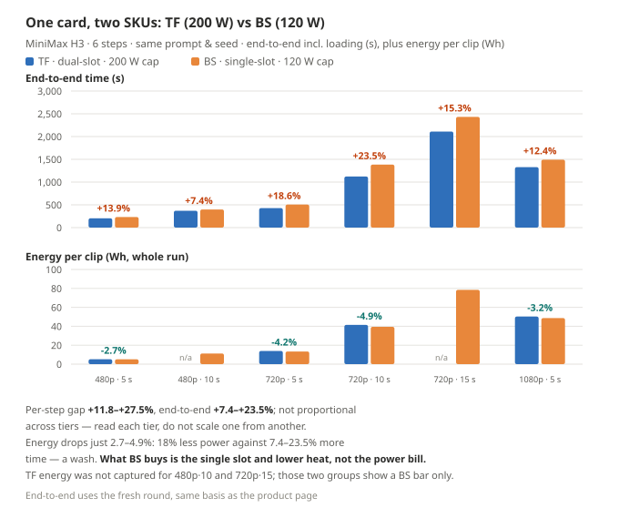
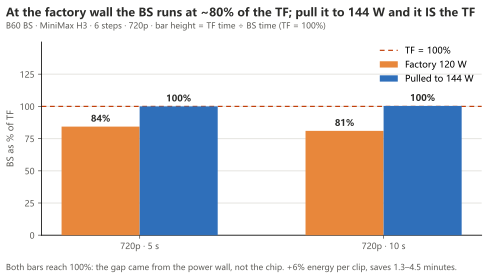

**English** · [简体中文](B60-README.md)

# GUNNIR Arc Pro B60 24G

> **¥6,499 (BS · single slot 120 W · 164 TOPS) / ¥6,599 (TF · dual slot 200 W · 197 TOPS) · 24 GB · 456 GB/s**
>
> **The dividing line for "fits"**: combinations a 16 GB card cannot hold, this one mostly can; and it costs a third of the B70.
> Chat at **52.4 tok/s** (85.6 on Vulkan), a 720p image in **18.1 seconds**, a 5-second 1080p video in **22 minutes**.
>
> ⚠️ **Every number below is measured; anything unmeasured is written as not measured** — no numbers from other cards are
> swapped in, and no extrapolated values are used to fill gaps.
>
> 🔴 **Both SKUs are measured.** Numbers on this page that say nothing about a SKU come from the **TF (dual slot · 200 W · 197 TOPS)**;
> the **BS (single slot · 120 W · 164 TOPS)** runs **7–24% slower end-to-end and 12–27% slower per step** at the same tier — six-tier table in §6.

---

## 1. Specifications

| Item | Value |
| --- | --- |
| Tested model | **GUNNIR (蓝戟) B60 TF 24G** (dual slot) |
| VRAM | 24 GB physical, **23.33 GiB** usable |
| Bandwidth | **456 GB/s** / 192-bit (identical on TF and BS) |
| INT8 compute | **197 TOPS** (TF) · BS is **164 TOPS** |
| Power | TBP **200 W** (TF, measured limit also 200 W) · BS is **120 W** |
| Form factor / power | Dual slot 266×111.5×37.5 mm · 2× 8-pin (TF) · **BS single slot · 1× 8-pin** |
| Slot | PCIe x16, CPU-attached |
| Driver | **32.0.101.9150** |

---

## 2. Five numbers

| What you want to do | Measured on the B60 |
| --- | --- |
| Chat with a 35B model | **52.4 tok/s** (SYCL) / **85.6 tok/s** (Vulkan) |
| Render one 720p image (int8 · 25 steps) | **18.1 seconds** |
| Render a 5-second 480p video (6 steps · 864×480) | **3.4 minutes** |
| Render a 5-second 1080p video (6 steps · 1920×1088) | **22.1 minutes** |
| Electricity for one hour at full load | about **1 mao** (200 W at ¥0.7/kWh, CSG reference rate); real full load only reaches 75% |

---

## 3. Chat and text

### 3.1 Base performance

`llama-bench -p 512 -n 128 -r 3`:

| Model | Quant | Size | Decode | Prefill | Residency |
| --- | --- | ---: | ---: | ---: | --- |
| Qwen3.6-35B-A3B | Q4_0 | 19.41 GiB | **52.43 tok/s** | 961.22 tok/s | fully resident |
| same | Q3_K_S | 14.30 GiB | **52.09 tok/s** | 730.55 tok/s | fully resident |
| same | IQ2_M | 10.73 GiB | **62.69 tok/s** | 771.07 tok/s | fully resident |

**The key at 24 GB is that fitting means never offloading**: Q4_0 is fully resident and `-ncmoe 0` is optimal; switching to `-ncmoe 8` drops to **44.40 (−15%)**. **The knee is decided by whether the model fits**, the mirror image of the B50, where it does not fit and offload is mandatory.

All three quant levels only shift within a narrow band → **changing quant level mainly chooses quality and headroom, not speed**.

### 3.2 Delivery configuration

Same model, Q4_0, same parameters, 4 sampling runs:

| Item | Value |
| --- | --- |
| Decode | **50.94 tok/s** (spread over 4 runs 2.1%) |
| Prefill | 52.34 tok/s |
| `-ncmoe` | **0 (it fits, do not offload)** |
| Shared memory spill | **326 MB** (the B50 is 3,848 MB) |

**`-c` up to 256K costs nothing**: decode across the five tiers has a full range of **1.6%** (16384 to 262144), and the only price is VRAM, 19.2 → 22.5 GB. The B50, by contrast, collapses from 64K on — **spill volume sets speed, not the `-c` number**.

**The vision tower is essentially free**: `--mmproj` adds only +0.6% (it costs −11.5% on the B50).

### 3.3 Multimodal

Feed it a program-generated image with a unique answer and check the reply: **all three correct**.

**First image 17.3 seconds (cold) → 7.0 seconds (warm)**, a follow-up on the same image **0.24 seconds**. Image tokens go through the prefill phase, so the one-off cost on the first image is real and only the second call reaches steady state.

### 3.4 Switching backend: Vulkan is 1.65× faster

Only the binary changes; the same delivery command line:

| Backend | Decode | Prefill | Multimodal first image (warm) |
| --- | ---: | ---: | ---: |
| SYCL | 51.79 tok/s | 670 tok/s | 7.0 s |
| **Vulkan** | **85.59 tok/s (1.65×)** | **1,934 tok/s (2.9×)** | **4.8 s (1.45×)** |

**The premise is that all weights are resident in VRAM.** Once experts must be offloaded it collapses: under `-ncmoe 8` Vulkan is down to **52.25** and SYCL still holds 46.78, **a ratio of only 1.12×**.

Vulkan needs `-dev Vulkan1`: enumerated card 0 is the local iGPU, and without pinning it the workload silently lands there.

### 3.5 The 24 GB counterpart: RTX 4500 Ada Generation — ¥6,500 against ¥17,500

> ⚠️ **Method first**: the right column is **not measured on this machine** — it is vendor datasheet
> specification (sources in
> [`bench/notes/external-32gb-competitors-2026-10.md`](../../bench/notes/external-32gb-competitors-2026-10.md)).
> This page does not put external numbers next to local ones to draw conclusions; it lays out specs and ratios only.
> Prices are October 2026 e-commerce list prices, used as a single basis for cost-effectiveness comparison. **Street prices move with platform discounts — check before ordering.**>

> 🔴 **RTX 4500 Ada and RTX PRO 4500 Blackwell are two different generations**: the former is 24 GB GDDR6 / 432 GB/s / Ada (2023),
> the latter 32 GB GDDR7 / 896 GB/s / Blackwell (2025). **The 24 GB matchup is the Ada card.**

**The two SKUs are ¥100 apart. The counterpart is the B60 24 GB as a product, not one SKU of it.**

| | **B60 TF** (measured here) | **B60 BS** | RTX 4500 Ada Generation |
| --- | --- | --- | --- |
| Memory / ECC | 24 GB GDDR6 · **ECC needs a manual switch** | same | 24 GB GDDR6 · **ECC standard** |
| Bus width / bandwidth | 192-bit / **456 GB/s** | 192-bit / **456 GB/s** | 192-bit / 432 GB/s |
| Power | 200 W | **120 W** | 130 W |
| Form factor | dual slot (37.5 mm) | **single slot** | **single slot** |
| Cores / clock | 20 Xe2 @ 2400 MHz | 20 Xe2 @ **2000 MHz** | 7,680 CUDA @ 2580 MHz |
| Vendor compute figure | 197 TOPS **INT8** | **164 TOPS INT8** | Tensor **634 TFLOPS FP8** |
| Lowest precision | to FP4 | to FP4 | **FP8 only** |
| Power connector | 2× 8-pin | **1× 8-pin** | **none** |
| Bus | PCIe 5.0 x8 | PCIe 5.0 x8 | PCIe 4.0 x16 |
| JD price | ¥6,599 | **¥6,499** | ¥17,500 |

🔴 **The two compute figures cannot be divided**: Intel quotes **INT8 TOPS**, NVIDIA quotes **FP8 Tensor TFLOPS** — different rulers.

**On money and watts, the two SKUs are the same card:**

| | B60 TF ¥6,599 | B60 BS ¥6,499 | Ada 4500 ¥17,500 |
| --- | ---: | ---: | ---: |
| Bandwidth per yuan (GB/s per ¥) | **0.069** | **0.070** | 0.025 |
| Multiple of the Ada's per-yuan figure | **2.80×** | **2.84×** | 1.00× |
| Bandwidth per watt (GB/s per W) | 2.28 | **3.80** | 3.32 |

**¥100 changes no conclusion**: capacity, bus width and bandwidth line up exactly across the two SKUs, and both land at 2.8× the Ada's per-yuan figure; the price gap is 2.65× to 2.69×.
The only non-comparable item is the vendor compute figure — the two vendors do not quote on the same ruler, so no ratio is given.

**The two SKUs differ in two things, and neither touches the matchup:**

- **Form factor and power**: TF is dual slot, 37.5 mm, 2x 8-pin, 200 W; BS is single slot, 1x 8-pin, 120 W (raisable to 144 W in the driver). Compute per watt: BS **1.37** against TF **0.99** TOPS/W.
- **Performance**: at the same tier the BS is **7 to 24% slower end to end** (six tiers, see §6) — **a lower clock and lower power buys the single slot, not the same speed.**

**One sentence**: the 24 GB matchup is the **B60 as a product**; whether the name ends in BS or TF only decides **which chassis it fits and how much power it draws** — not the **¥6,500 against ¥17,500 at 2.8× the bandwidth per yuan**.

**Three boundaries:**

1. **Ada is the August 2023 architecture**; its successor is the **RTX PRO 4000 Blackwell** (24 GB / 672 GB/s / 145 W / single slot) at a higher price.
   The ¥17,500 24 GB professional card on the shelf today is this Ada generation.
2. **130 W against 120 W is real, and this time ours is lower** — no soft wording needed.
3. **On FP4, claim only what was measured**: the Arc hardware spec goes to **FP4**, Ada stops at **FP8**. What this page measured is that
   **an nvfp4 weight tier runs** (H3's text encoder only fits on a 32 GB machine with the **14.61 GB nvfp4 tier**; the int8 tier at 25.28 GB crashes on load),
   **not native FP4 acceleration**.

## 4. Image generation

Qwen-Image 2.1 · 1280×720 · 25 steps:

| DiT tier | First round (incl. load) | **Steady state** | New prompt | of which sampling | Offload per round |
| --- | ---: | ---: | ---: | ---: | ---: |
| **`int8`** | 62.03 s | **18.80 / 17.33 s** (mean 18.06) | 22.67 s | **16 s (0.64 s/step)** | **0** |

**The cleanest tier of the four cards**: the model at 6,920 MB is fully resident, 0 offloaded, sampling is 85% of end-to-end → **the step count scales straight through**.

| Krea-2 Turbo · 1280×720 · 8 steps | Steady state | Shape |
| --- | ---: | --- |
| `int8` | **62.3 to 66.0 s** | Reloads a 12.6 GB model every round, 61% of it fixed overhead |

**Krea-2 is the counterexample**: on the same card Qwen-Image takes 18 seconds while Krea-2 takes 62 to 66 — the card is not slow, Krea-2's model is 12.6 GB, it fits but competes with the text encoder, so everything gets moved again every round. **On the B70 this combination is 6.04 s, 10× faster.** So "24 GB is enough" depends on the model.

**bf16 tier (2026-10-28 fill-in)**: steady state **24.3 to 27.5 s/image** (1.100 it/s, loads=0 fully resident). 37 to 46% slower than int8 (17.3 to 18.8 s) but clean and stable.

> ⚠️ **BS SKU requires pulling the power wall to 120% (144 W) to run bf16.** At the factory 120 W wall bf16 is borderline — the model loads but ComfyUI unloads it every round (1244 s/image resident, GPU duty 0%). **Set the power limit to 120% (144 W) in IGS** and bf16 runs stably fully resident. TF SKU (factory 200 W) has no such issue. See [pitfalls §2.7](../pitfalls.en.md).

---

## 5. Music generation

MiniMax Music 3 · 120 seconds · 30 steps:

| Combination | First round (incl. load) | **Steady state** | New full song |
| --- | ---: | ---: | ---: |
| **DiT int8 + text encoder int8** | 279.52 s | **144.9 to 145.8 s** (3.11 s/step) | 198.43 s |

**The bf16 text encoder (15.56 GiB) paired with fp16 DiT (20.34 GiB)** (reserve 2, 2026-10-28 fill-in): steady state **204.6 to 205.2 s** (4.13 s/step), loads=1 — 41% slower than int8+int8 (145 s).

→ **To save time, count how many items reload per round, not which quant tier you picked.**

---

## 6. Video generation

MiniMax H3 · 6 steps · 5 seconds (124 frames) · end-to-end incl. load:

| Resolution | End-to-end (steady state) | Per step | Rounds | Efficiency |
| --- | ---: | ---: | ---: | ---: |
| 864×480 | **203 s** (3.4 min) | 11.86 s | 4 | 15.2 |
| 1024×576 | **251 s** (4.2 min) | 20.49 s | 3 | 17.5 |
| 1152×648 | **307 s** (5.1 min) | 29.89 s | 3 | **18.1** |
| **1280×720** | **427 s** (7.1 min) | 45.46 s | 3 | 16.1 |
| 1536×864 | **653 s** (10.9 min) | 84.79 s | 3 | 15.1 |
| **1920×1088** | **1,328 s** (22.1 min) | 191.89 s | 3 | 11.7 |
| 2560×1440 | _not measured_ | _—_ | _—_ | _—_ |

> `Efficiency` = M of pixels × frames per minute; **higher saves time** (computed from **steady state**).

**Duration axis (same resolution, longer clip — all measured)**:

| Resolution | Duration | Frames | Pixels×frames | Per step (avg / steady) | End-to-end | Efficiency |
| --- | --: | --: | --: | --: | ---: | --: |
| 864×480 | 5 s | 124 | 51 M | 11.83 / 11.00 s | 203 s | 15.2 |
| 864×480 | 10 s | 243 | 101 M | 36.15 / 33.60 s | **371 s** (6.2 min) | **16.3** |
| 864×480 | 15 s | 362 | 150 M | 72.60 / 69.60 s | 597 s (9.9 min) | 15.1 |
| 864×480 | 20 s | 484 | 201 M | 122.06 / 118.00 s | 917 s (15.3 min) | 13.1 |
| 1280×720 | 5 s | 124 | 114 M | 45.33 / 43.00 s | 427 s | 16.0 |
| 1280×720 | 10 s | 243 | 224 M | 155.95 / 152.20 s | **1,106 s** (18.4 min) | 12.1 |
| 1280×720 | 15 s | 362 | 334 M | 317.11 / 313.50 s | 2,110 s (35.2 min) | 9.5 |
| 1920×1088 | 5 s | 124 | 259 M | 191.83 / 188.60 s | 1,328 s (22.1 min) | 11.7 |

> Two per-step columns: **avg** is the 6-step cumulative figure (the ComfyUI progress-bar reading, including step 1); **steady** uses steps 2 through 6 only.
> On offloading tiers step 1 costs 5.0 to 19.4 s extra, and the avg column spreads that across every step — **use steady state to compare compute, end-to-end to compare a whole clip**.

**The offload cost lands on step 1 only**: 3.7 / 7.8 / 10.8 GB costs 5.0 / 14.0 / 19.4 s extra (about 1.9 s per GB), and steps 2 through 6 line up with the fully-resident B65 to within ±0.01 s — **steady-state speed does not depend on PCIe bandwidth**.

**How to choose — three sentences:**

1. **One clip → 720p · 5 seconds.** Fastest at standard framing.
   **To squeeze out the least wall clock, take 1152×648 · 5 s** (28% faster, efficiency 18.1, the highest on this page, at 19% smaller framing). A 480p clip is faster but only 0.41 MP, so use it for drafts.
2. **Long clips → stitch segments, do not stretch one long clip.** Stretching 15 s costs 1.65× the stitched total and efficiency falls from 16.0 to 9.5; segments can be re-rolled individually, and a bad segment only costs one segment.
3. **Higher resolution → render 720p and upscale.** A directly generated 1080p clip takes **3.1×** the 720p time;
   the upscale step **is not measured on this page, no number given**.

2560×1440 and above: not measured.

### The two SKUs: six tiers, same conditions

Same prompt, same seed, 6 steps, `--reserve-vram 4`, port 8190; the fresh round of each tier.

| Tier | End-to-end TF → BS | Per-step TF → BS | Energy per clip TF → BS |
|---|---:|---:|---:|
| 480p · 5 s | 203 → **231** s (**+13.9%**) | 11.9 → **15.1** s (**+27.0%**) | 5.2 → **5.1** Wh (-2.7%) |
| 480p · 10 s | 371 → **398** s (+7.4%) | 36.1 → **40.4** s (+11.8%) | — |
| 720p · 5 s | 427 → **507** s (**+18.6%**) | 45.5 → **58.0** s (**+27.5%**) | 13.9 → **13.3** Wh (-4.2%) |
| 720p · 10 s | 1122 → **1385** s (**+23.5%**) | 155.8 → **197.7** s (**+26.9%**) | 41.4 → **39.4** Wh (-4.9%) |
| 720p · 15 s | 2110 → **2433** s (**+15.3%**) | 317.1 → **361.2** s (+13.9%) | — |
| 1080p · 5 s | 1328 → **1492** s (**+12.4%**) | 191.9 → **216.0** s (+12.6%) | 50.3 → **48.6** Wh (-3.2%) |

（6 档 / 待补 0 档）

**Chart note: across all six tiers the BS is 7 to 24% slower with nearly identical energy per clip — the BS saves on the power wall, not on time.**

**Read it this way: the BS is 7 to 24% slower across all six tiers while energy per clip barely moves — the BS saves power wall, not time.**

---

## 7. Power

Whole-card power domain energy counter, 1-second window:

| | Value |
| --- | --- |
| Video at full load (TF) | **P90 148.3 to 154.3 W** (**74 to 77%** of the 200 W wall, never hit the wall) |
| Video at full load (BS) | **P90 111 to 125 W** (120 W wall; peak 125 to 160 W) |
| Image / music | P90 **137.8 to 150.0 W** |
| 1-second peak | **147.2 to 168.9 W** |
| One 5-second 720p video | about **1 fen** (50 kJ) |
| One 5-second 1080p video | about **3.5 fen** (181 kJ) |

**P90 falls rather than rises with resolution** (153.7 → 151.4 W): the loading segment is a larger share of the higher-resolution round, and during loading the card is not at full load. What rises is the whole-round mean (86 → 136 W) — **P90 tells you how high full load gets; the mean tells you how much energy the task needs**.

**None of the three models reached the 200 W wall** (peaks in the table above) — power delivery is not the bottleneck on this card, which is the key difference from the B70 (steady at 290 W). **Sitting at the wall or not is itself a side effect of fitting**: the B70 is fully resident and computes continuously, while the B60 offloads 3.7 to 10.8 GB every round and power drops during loading.

**B60 BS with the power wall raised to 144 W** (IGS tuning at 120%, not the factory state, appendix only):

| Tier | TF | BS 120 W | BS 144 W |
|---|---:|---:|---:|
| 720p · 5 s | 427 s | 507 s = 84% of TF | **427 s = 100% of TF** |
| 720p · 10 s | 1,122 s | 1,385 s = 81% of TF | **1,117 s = 100% of TF** |

> Chart note: look at the bar heights — at the factory 120 W wall the BS reaches only 80% of TF; pull it to 144 W and it matches TF.

**At the factory wall the BS runs at about 80% of the TF; pull it to 144 W and it IS the TF.** Cost: +6% energy per clip, saves 1.3 to 4.5 minutes; a single 8-pin is rated 150 W and 144 W is 96% of it.
Stacking +100 MHz (boost to 2,500 MHz): 431.11 s, P90 still pinned at 144.8 W — **power is the bottleneck, more clock buys nothing**; offset reverted.

---

## 8. What fits

23.33 GiB of visible VRAM:

| Combination | Resident | B60 |
| --- | ---: | --- |
| Qwen-Image 2.1 int8 (6.9 + 8.7 + 0.6 GB) | 16.2 GB | ✅ fully resident, 0 offload (**the B50 misses it by that much**) |
| Qwen-Image 2.1 bf16 | 22.6 GB | ✅ steady state 24.3 to 27.5 s (BS SKU needs 120% power wall) |
| Krea-2 int8 (12.6 GB) | 12.9 GB | ⚠️ fits, but moves 12.6 GB again every round, steady state 62 to 66 s |
| Krea-2 bf16 | 32.98 GB | ❌ does not fit |
| Music 3 DiT int8 + text encoder int8 | 11.1 GB | ✅ steady state 145 s |
| Music 3 DiT fp16 + text encoder bf16 | 20.34 GB | ✅ runs at reserve 2 (steady state 204.6 to 205.2 s, BS SKU needs 120% power wall) |
| H3 video model 19.53 GB | 20.0 GB | ⚠️ all three tiers load partially, offloading 3.7 to 10.8 GB |

**Three hard limits:**

1. **Krea-2 bf16 does not fit**; int8 is required.
2. **"24 GB is enough" does not hold for every model**: Krea-2 fits but reloads every round, 10× slower than the B70.
3. **`bf16` is unusable on Vulkan**; the Vulkan path for bf16-weight models has not been verified.

---

## 9. How to choose

| What you care about | Verdict |
| --- | --- |
| A budget of six thousand, clearly faster than the B50 | **B60**. **2.86×** faster on images, 1.36 to 1.43× on chat |
| The fastest image generation | Not this one, **the B70 is 1.70× faster** |
| Mostly Krea-2 / frequent prompt changes | **The B70 is 10× better** (6.04 vs 62 to 66 s) — the one thing to remember |
| Only "fits" is missing | Of the B60's 2.86× over the B50, **most comes from fitting**, not compute (bandwidth differs by only 2.04×) |

---

## 10. Test conditions

| Item | Value |
| --- | --- |
| Capture date | **2026-10-20** for both ComfyUI and llama.cpp |
| OS | Windows 11 Pro 26H2 · Build 26300 |
| Software stack | ComfyUI 0.39.0 + `comfy_kitchen` 0.2.37 + XPU provider 0.2.33 + `torch 2.12.0+xpu` |
| llama.cpp | Official prebuilt **b11431** (delivery configuration) / **b11753** (backend comparison) |
| Driver | **32.0.101.9150** |
| VRAM | ECC off · **23.33 GiB** visible · power limit **200 W** |
| Test machine | Ryzen 5 9600X · B850M · **2×16 GB DDR5-6400 (both slots full)** · display driven by the iGPU, the whole dGPU given to the model |
| Raw records | [`bench/data/`](../../bench/data/) (every entry carries environment fields: driver, kernel, ECC, available VRAM) |

Install, drivers and patches → [`../install.md`](../install.en.md); full build → [`../build.md`](../build.en.md).

---

MIT · handbook content may be reused freely with attribution. Author: Yonggang Lin · `lygsam75@gmail.com`
