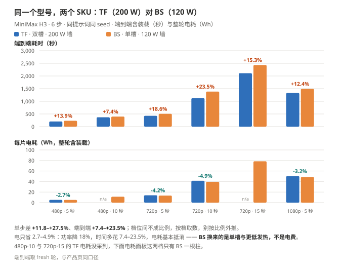
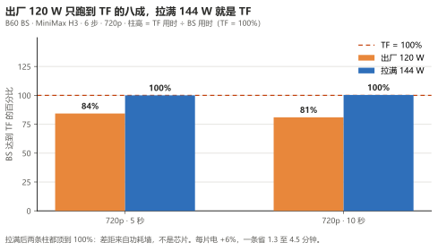

# GUNNIR Arc Pro B60 24G

> **¥6,499（BS · 单槽 120 W · 164 TOPS）／¥6,599（TF · 双槽 200 W · 197 TOPS） · 24 GB · 456 GB/s**
>
> **「装得下」的分水岭**：16 GB 卡装不下的组合，这张基本都装得下；而它比 B70 便宜三分之二。
> 聊天 **52.4 tok/s**（Vulkan 85.6）、画一张 720p 图 **18.1 秒**、出 5 秒 1080p 视频 **22 分钟**。
>
> ⚠️ **下面每个数都是实测的；没测的项就写「没测」，不拿别的卡的数字替上，也不用推算值填。**
>
> 🔴 **两个 SKU 都已实测。** 本页未标注的数字来自 **TF（双槽 · 200 W · 197 TOPS）**；
> **BS（单槽 · 120 W · 164 TOPS）同档端到端慢 7–24%、单步慢 12–27%**，六档对照见 §6。

---

## 1. 规格

| 项 | 值 |
| --- | --- |
| 测试型号 | **GUNNIR（蓝戟）B60 TF 24G**（双槽） |
| 显存 | 24 GB 本体，可用 **23.33 GiB** |
| 带宽 | **456 GB/s** / 192-bit（TF 与 BS 相同） |
| INT8 算力 | **197 TOPS**（TF）· BS 为 **164 TOPS** |
| 功耗 | TBP **200 W**（TF，实测也是 200 W 墙）· BS 为 **120 W** |
| 形态 / 供电 | 双槽 266×111.5×37.5 mm · 双 8pin（TF）· **BS 单槽 · 单 8pin** |
| 槽位 | CPU 直连 PCIe x16 |
| 驱动 | **32.0.101.9150** |

---

## 2. 五个数看完

| 你想干什么 | B60 上实测 |
| --- | --- |
| 跟 35B 大模型聊天 | **52.4 tok/s**（SYCL）/ **85.6 tok/s**（Vulkan） |
| 画一张 720p 的图（int8 · 25 步） | **18.1 秒** |
| 出 5 秒 480p 视频（6 步 · 864×480） | **3.4 分钟** |
| 出 5 秒 1080p 视频（6 步 · 1920×1088） | **22.1 分钟** |
| 满载一小时电费 | 约 **1 毛钱**（200 W，按 0.7 元/度 · 南方电网参考价），实际满载只到 75% |

---

## 3. 聊天与文本

### 3.1 基础性能

`llama-bench -p 512 -n 128 -r 3`：

| 模型 | 量化 | 体积 | 解码 | 预填充 | 驻留 |
| --- | --- | ---: | ---: | ---: | --- |
| Qwen3.6-35B-A3B | Q4_0 | 19.41 GiB | **52.43 tok/s** | 961.22 tok/s | 全驻留 |
| 同上 | Q3_K_S | 14.30 GiB | **52.09 tok/s** | 730.55 tok/s | 全驻留 |
| 同上 | IQ2_M | 10.73 GiB | **62.69 tok/s** | 771.07 tok/s | 全驻留 |

**24 GB 档的关键是「装得下就不用卸」**：Q4_0 全驻留，`-ncmoe 0` 最优；改成 `-ncmoe 8` 反而掉到 **44.40（−15%）**。**拐点由「装不装得下」决定**，与 B50（装不下、必须卸）形态相反。

三档量化只在窄带里挪动 → **换量化档主要是选质量与余量，不是选速度**。

### 3.2 交付配置

同模型 Q4_0、同参数，4 次采样：

| 项 | 值 |
| --- | --- |
| 解码 | **50.94 tok/s**（4 次极差 2.1%） |
| 预填充 | 52.34 tok/s |
| `-ncmoe` | **0（装得下，别卸）** |
| 共享显存溢出 | **326 MB**（B50 是 3,848 MB） |

**`-c` 到 256K 不花钱**：五档解码全距 **1.6%**（16384 至 262144），代价只有显存 19.2 → 22.5 GB。对照 B50 从 64K 起塌——**决定速度的是溢出量，不是 `-c` 这个数字**。

**视觉塔基本免费**：`--mmproj` 只 +0.6%（B50 上是 −11.5%）。

### 3.3 多模态

送一张答案唯一的程序生成图，核对回答内容：**三次全中**。

**首图 17.3 秒（冷）→ 7.0 秒（暖）**，同图追问 **0.24 秒**。图像 token 走的是预填充相位，所以首图的一次性代价真实存在，第二次才落到稳态。

### 3.4 换后端：Vulkan 快 1.65×

只换二进制，同一条交付命令行：

| 后端 | 解码 | 预填充 | 多模态首图（暖态） |
| --- | ---: | ---: | ---: |
| SYCL | 51.79 tok/s | 670 tok/s | 7.0 s |
| **Vulkan** | **85.59 tok/s（1.65×）** | **1,934 tok/s（2.9×）** | **4.8 s（1.45×）** |

**前提是「权重全驻显存」。** 一旦要卸专家就塌：`-ncmoe 8` 下 Vulkan 剩 **52.25**、SYCL 还有 46.78，**比值只剩 1.12×**。

Vulkan 要加 `-dev Vulkan1`：枚举的第 0 张卡是本机核显，不钉会静默跑到核显上。

### 3.5 同 24 GB 的对手：RTX 4500 Ada Generation —— ¥6,500 对 ¥17,500

> ⚠️ **方法先讲清**：右列**不是本机实测**，是原厂 datasheet 的规格（出处见
> [`bench/notes/external-32gb-competitors-2026-10.md`](../../bench/notes/external-32gb-competitors-2026-10.md)）。
> 本页不拿外部数字与本机数字并排下结论，只排规格、只给比值。
> 价格为 2026-10 电商挂牌价，作为性价比比较的统一基准；**实际成交价随平台优惠浮动，下单前请现查。**>

> 🔴 **RTX 4500 Ada 与 RTX PRO 4500 Blackwell 是两代不同的卡**：前者 24 GB GDDR6 / 432 GB/s / Ada（2023），
> 后者 32 GB GDDR7 / 896 GB/s / Blackwell（2025）。**24 GB 档的对位是 Ada 这一张。**

**两个 SKU 只差 ¥100，对位的是「B60 24 GB」这个产品，不分 SKU。**

| | **B60 TF**（本页实测） | **B60 BS** | RTX 4500 Ada Generation |
| --- | --- | --- | --- |
| 显存 / ECC | 24 GB GDDR6 · **需手动开** | 同左 | 24 GB GDDR6 · **标配** |
| 位宽 / 带宽 | 192-bit / **456 GB/s** | 192-bit / **456 GB/s** | 192-bit / 432 GB/s |
| 功耗 | 200 W | **120 W** | 130 W |
| 形态 | 双槽（37.5 mm） | **单槽** | **单槽** |
| 核心 / 频率 | 20 Xe2 @ 2400 MHz | 20 Xe2 @ **2000 MHz** | 7,680 CUDA @ 2580 MHz |
| 厂商算力标注 | 197 TOPS **INT8** | **164 TOPS INT8** | Tensor **634 TFLOPS FP8** |
| 最低精度 | 到 FP4 | 到 FP4 | **只到 FP8** |
| 供电 | 双 8pin | **单 8pin** | **无外接** |
| 总线 | PCIe 5.0 x8 | PCIe 5.0 x8 | PCIe 4.0 x16 |
| 京东价 | ¥6,599 | **¥6,499** | ¥17,500 |

🔴 **两边算力标注不能相除**：Intel 标 **INT8 TOPS**，NVIDIA 标 **FP8 Tensor TFLOPS**，尺子不同。

**按钱和电算，两个 SKU 是一回事：**

| | B60 TF ¥6,599 | B60 BS ¥6,499 | Ada 4500 ¥17,500 |
| --- | ---: | ---: | ---: |
| 每元带宽（GB/s per ¥） | **0.069** | **0.070** | 0.025 |
| 对 Ada 的每元带宽倍数 | **2.80×** | **2.84×** | 1.00× |
| 每瓦带宽（GB/s per W） | 2.28 | **3.80** | 3.32 |

**¥100 改变不了任何结论**：容量、位宽、带宽三项两 SKU 完全对得上，每元带宽对 Ada 都是 2.8 倍级；价差是 2.65 至 2.69 倍。
唯一不可比的是算力标注 —— 两家标的不是同一把尺子，不给倍数。

**两个 SKU 差在两件事，都不影响「打谁」：**

- **形态与功耗**：TF 双槽 37.5 mm、双 8pin、200 W；BS 单槽、单 8pin、120 W（驱动可上调到 144 W）。每瓦算力 BS **1.37** 对 TF **0.99** TOPS/W。
- **性能**：同档端到端 BS 慢 **7 至 24%**（六档见 §6）—— **低频低功耗换单槽，不是同速。**

**一句话**：24 GB 档对位的是 **B60 这个产品**；型号后面带 BS 还是 TF，只决定**插得进哪个机箱、吃多少电**，不改变「**¥6,500 对 ¥17,500、每元带宽 2.8 倍**」。

**三条边界：**

1. **Ada 是 2023 年 8 月的架构**，继任者是 **RTX PRO 4000 Blackwell**（24 GB / 672 GB/s / 145 W / 单槽），价格更高。
   今天货架上 ¥17,500 的 24 GB 专业卡，就是 Ada 这一代。
2. **130 W 对 120 W 是真的，而且这次是我们低** —— 不需要任何缓和措辞。
3. **FP4 这条只说到能做到的程度**：Arc 硬件规格到 **FP4**，Ada 只到 **FP8**。本页实测的是
   **nvfp4 权重档能跑通**（H3 文本编码器靠 **14.61 GB 的 nvfp4 档**才在 32 GB 内存机上站住，int8 档 25.28 GB 加载即崩），
   **不是原生 FP4 加速**。

## 4. 出图

Qwen-Image 2.1 · 1280×720 · 25 步：

| DiT 档 | 首轮（含装载） | **稳态** | 换提示词 | 其中采样 | 每轮卸载 |
| --- | ---: | ---: | ---: | ---: | ---: |
| **`int8`** | 62.03 s | **18.80 / 17.33 s**（均值 18.06） | 22.67 s | **16 s（0.64 s/步）** | **0** |

**这是四卡里最干净的一档**：模型 6,920 MB 完整驻留、0 卸载、采样占端到端 85% → **调步数直接按比例见效**。

| Krea-2 Turbo · 1280×720 · 8 步 | 稳态 | 形态 |
| --- | ---: | --- |
| `int8` | **62.3 至 66.0 s** | 每轮重装 12.6 GB 模型，固定开销占 61% |

**Krea-2 是个反例**：同一张卡上 Qwen-Image 18 秒、Krea-2 却 62 至 66 秒——不是卡慢，是 Krea-2 的模型有 12.6 GB，装得下但和文本编码器挤，每轮要重搬。**B70 上这个组合是 6.04 s，快 10 倍。** 所以「24 GB 够用」要分模型看。

**bf16 档（2026-10-28 补测）**：稳态 **24.3 至 27.5 s/张**（1.100 it/s · loads=0 全驻留）。比 int8（17.3 至 18.8 s）慢 37 至 46%，但干净可跑。

> ⚠️ **BS SKU 跑 bf16 必须拉墙到 120%（144 W）。** 出厂 120 W 功耗墙下 bf16 是临界态——模型装得进但 ComfyUI 每轮卸载重装（稳态 1,244 s/张，GPU 占空 0%）。**IGS 将功耗限制拉至 120%（144 W）后** bf16 稳定全驻留。TF SKU（出厂 200 W）无此问题。详见 [pitfalls §2.7](../pitfalls.md)。

---

## 5. 出音乐

MiniMax Music 3 · 120 秒 · 30 步：

| 组合 | 首轮（含装载） | **稳态** | 换整首歌 |
| --- | ---: | ---: | ---: |
| **DiT int8 + 文本编码器 int8** | 279.52 s | **144.9 至 145.8 s**（3.11 s/步） | 198.43 s |

**文本编码器的 bf16 版（15.56 GiB）配 fp16 DiT 的组合（20.34 GiB）**（reserve 2 · 2026-10-28 补测）：稳态 **204.6 至 205.2 s**（4.13 s/步），loads=1——比 int8+int8（145 s）慢 41%。

→ **要省时间看每轮重装几件，不看量化档位。**

---

## 6. 出视频

MiniMax H3 · 6 步 · 5 秒（124 帧）· 端到端含装载：

| 分辨率 | 端到端（稳态） | 单步 | 轮数 | 效率 |
| --- | ---: | ---: | ---: | ---: |
| 864×480 | **203 s**（3.4 min） | 11.86 s | 4 | 15.2 |
| 1024×576 | **251 s**（4.2 min） | 20.49 s | 3 | 17.5 |
| 1152×648 | **307 s**（5.1 min） | 29.89 s | 3 | **18.1** |
| **1280×720** | **427 s**（7.1 min） | 45.46 s | 3 | 16.1 |
| 1536×864 | **653 s**（10.9 min） | 84.79 s | 3 | 15.1 |
| **1920×1088** | **1,328 s**（22.1 min） | 191.89 s | 3 | 11.7 |
| 2560×1440 | _没测_ | _—_ | _—_ | _—_ |

> `效率` = 每分钟出多少 M「像素 × 帧」，**越大越省时间**（按**稳态**算）。

**时长维度（同一分辨率加长，全部实测）**：

| 分辨率 | 时长 | 帧数 | 像素·帧 | 单步（平均 / 稳态） | 端到端 | 效率 |
| --- | --: | --: | --: | --: | ---: | --: |
| 864×480 | 5 秒 | 124 | 51 M | 11.83 / 11.00 s | 203 s | 15.2 |
| 864×480 | 10 秒 | 243 | 101 M | 36.15 / 33.60 s | **371 s**（6.2 min） | **16.3** |
| 864×480 | 15 秒 | 362 | 150 M | 72.60 / 69.60 s | 597 s（9.9 min） | 15.1 |
| 864×480 | 20 秒 | 484 | 201 M | 122.06 / 118.00 s | 917 s（15.3 min） | 13.1 |
| 1280×720 | 5 秒 | 124 | 114 M | 45.33 / 43.00 s | 427 s | 16.0 |
| 1280×720 | 10 秒 | 243 | 224 M | 155.95 / 152.20 s | **1,106 s**（18.4 min） | 12.1 |
| 1280×720 | 15 秒 | 362 | 334 M | 317.11 / 313.50 s | 2,110 s（35.2 min） | 9.5 |
| 1920×1088 | 5 秒 | 124 | 259 M | 191.83 / 188.60 s | 1,328 s（22.1 min） | 11.7 |

> 单步两列：**平均**是 6 步累计（ComfyUI 进度条口径，含第 1 步），**稳态**只取第 2 至 6 步。
> 卸载档的第 1 步多花 5.0 至 19.4 s，平均列把它摊进每一步 —— **比算力看稳态，比一整条看端到端**。

**卸载的代价只在第 1 步**：卸 3.7 / 7.8 / 10.8 GB 分别贵 5.0 / 14.0 / 19.4 s（约 1.9 s/GB），后五步与全驻留的 B65 逐位平（±0.01 s）—— **稳态速度不吃 PCIe 带宽**。

**怎么选 —— 三句话：**

1. **单条出片 → 720p · 5 秒。** 标准画幅里它最快。**要极限省时间走 1152×648 · 5 秒**（快 28%、效率 18.1 全表最高，但画幅小 19%）；480p 更快，只有 0.41 MP，当草稿用。
2. **要长片 → 接片，别硬拉一条长条。** 硬拉 15 秒是拆成三段 5 秒的 1.65 倍时间，效率从 16.0 掉到 9.5；拆段还能单独重抽，坏一段只废一段。
3. **要更高分辨率 → 720p 出片再超分。** 1080p 直接生成是 720p 的 **3.1 倍**时间；超分那一步**本页没测，不给数字**。

2560×1440 及以上没测。

### 两个 SKU：六档同条件对照

同提示词、同 seed、6 步、`--reserve-vram 4`、端口 8190，每档取 fresh 轮。

| 档位 | 端到端 TF → BS | 单步 TF → BS | 每片电耗 TF → BS |
|---|---:|---:|---:|
| 480p · 5 秒 | 203 → **231** s（**+13.9%**） | 11.9 → **15.1** s（**+27.0%**） | 5.2 → **5.1** Wh（-2.7%） |
| 480p · 10 秒 | 371 → **398** s（+7.4%） | 36.1 → **40.4** s（+11.8%） | — |
| 720p · 5 秒 | 427 → **507** s（**+18.6%**） | 45.5 → **58.0** s（**+27.5%**） | 13.9 → **13.3** Wh（-4.2%） |
| 720p · 10 秒 | 1122 → **1385** s（**+23.5%**） | 155.8 → **197.7** s（**+26.9%**） | 41.4 → **39.4** Wh（-4.9%） |
| 720p · 15 秒 | 2110 → **2433** s（**+15.3%**） | 317.1 → **361.2** s（+13.9%） | — |
| 1080p · 5 秒 | 1328 → **1492** s（**+12.4%**） | 191.9 → **216.0** s（+12.6%） | 50.3 → **48.6** Wh（-3.2%） |

（6 档 / 待补 0 档）

**看图：六档里 BS 全线慢 7 至 24%，每片电耗却几乎一样——BS 省的是功耗墙，不是时间。**

---

## 7. 功耗

整卡电源域能耗计数器，1 秒窗口：

| | 数值 |
| --- | --- |
| 视频满载（TF） | **P90 148.3 至 154.3 W**（200 W 墙的 **74 至 77%**，从没触墙） |
| 视频满载（BS） | **P90 111 至 125 W**（120 W 墙；峰值 125 至 160 W） |
| 出图 / 出音乐 | P90 **137.8 至 150.0 W** |
| 1 秒峰值 | **147.2 至 168.9 W** |
| 一条 5 秒 720p 视频 | 约 **1 分钱**（50 kJ） |
| 一条 5 秒 1080p 视频 | 约 **3.5 分钱**（181 kJ） |

**P90 随分辨率不升反降**（153.7 → 151.4 W）：高分辨率那一轮里装载段占比更大，而装载时卡不在满载。涨的是整轮均值（86 → 136 W）——**看 P90 是「满载有多高」，看均值才是「这条任务要多少电」**。

**三模型全程没触 200 W 墙**（峰值见上表）——这张卡的瓶颈不在供电，这是它和 B70（稳在 290 W）的关键差别。**贴不贴墙本身是「装得下」的副作用**：B70 完全驻留所以一直在算，B60 每轮要卸 3.7 至 10.8 GB，装载那一段功率掉下来。

**B60 BS 功耗墙拉到 144 W 后的性能**（IGS 调优 120%，非出厂状态，只作附录）：

| 档位 | TF | BS 120 W | BS 144 W |
|---|---:|---:|---:|
| 720p · 5 秒 | 427 s | 507 s，TF 的 84% | **427 s，TF 的 100%** |
| 720p · 10 秒 | 1,122 s | 1,385 s，TF 的 81% | **1,117 s，TF 的 100%** |

> 图注：看柱高——出厂 120 W 只跑到 TF 的八成，拉满 144 W 就是 TF。

**出厂 120 W 只跑到 TF 的八成，拉满 144 W 就是 TF。** 代价是每片电 +6%，换来一条省 1.3 至 4.5 分钟；单 8pin 额定 150 W，144 W 占 96%。
再叠 +100 MHz（boost 到 2500 MHz）：431.11 s，P90 仍贴 144.8 W —— **功率是瓶颈，频率零收益**，offset 已退回。

---

## 8. 能装下什么

23.33 GiB 可见显存：

| 组合 | 常驻 | B60 |
| --- | ---: | --- |
| Qwen-Image 2.1 int8（6.9 + 8.7 + 0.6 GB） | 16.2 GB | ✅ 全驻留、0 卸载（**B50 就差这一点**） |
| Qwen-Image 2.1 bf16 | 22.6 GB | ✅ 稳态 24.3 至 27.5 s（BS SKU 需拉墙 120%） |
| Krea-2 int8（12.6 GB） | 12.9 GB | ⚠️ 装得下，但每轮重搬 12.6 GB，稳态 62 至 66 s |
| Krea-2 bf16 | 32.98 GB | ❌ 装不下 |
| Music 3 DiT int8 + 文本编码器 int8 | 11.1 GB | ✅ 稳态 145 s |
| Music 3 DiT fp16 + 文本编码器 bf16 | 20.34 GB | ✅ reserve 2 下稳态 204.6 至 205.2 s（BS SKU 需拉墙 120%） |
| H3 视频模型 19.53 GB | 20.0 GB | ⚠️ 三档全部分装载，卸 3.7 至 10.8 GB |

**三条硬边界：**

1. **Krea-2 bf16 装不下**，必须用 int8。
2. **「24 GB 够用」不是所有模型都成立**：Krea-2 装得下但每轮重搬，比 B70 慢 10 倍。
3. **Vulkan 上 `bf16` 不可用**，bf16 权重模型的 Vulkan 用法没验过。

---

## 9. 怎么选

| 你在意 | 结论 |
| --- | --- |
| 预算六千，要比 B50 明显快 | **B60**。出图快 **2.86×**、聊天快 1.36 至 1.43× |
| 出图要最快 | 别选它，**B70 快 1.70×** |
| 主要跑 Krea-2 / 换提示词频繁 | **B70 好 10 倍**（6.04 vs 62 至 66 s）——这条最该记住 |
| 只差「装得下」这一件事 | B50 → B60 的 2.86× 里，**大部分是「装得下」赚的**，不是算力（带宽只差 2.04×） |

---

## 10. 测试条件

| 项 | 值 |
| --- | --- |
| 采集日期 | ComfyUI 与 llama.cpp 均为 **2026-10-20** |
| 系统 | Windows 11 专业版 26H2 · Build 26300 |
| 软件栈 | ComfyUI 0.39.0 + `comfy_kitchen` 0.2.37 + XPU provider 0.2.33 + `torch 2.12.0+xpu` |
| llama.cpp | 官方预编译 **b11431**（交付配置）/ **b11753**（后端对照） |
| 驱动 | **32.0.101.9150** |
| 显存 | ECC 关 · 可见 **23.33 GiB** · 功耗墙 **200 W** |
| 测试机 | Ryzen 5 9600X · B850M · **2×16 GB DDR5-6400（两槽已满）** · 显示器由核显输出，独显整块给模型 |
| 原始记录 | [`bench/data/`](../../bench/data/)（每条都带环境字段：驱动、内核、ECC、显存可用量） |

装什么、驱动与补丁 → [`../install.md`](../install.md)；整机配置 → [`../build.md`](../build.md)。

---

MIT · 手册内容可自由转载，注明出处即可。作者：林永刚（Yonggang Lin）· `lygsam75@gmail.com`
