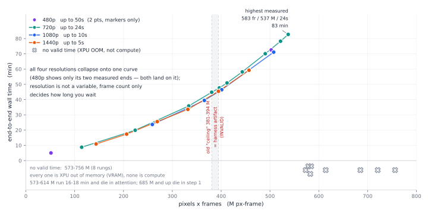

**English** · [简体中文](B65-README.md)

# GUNNIR Arc Pro B65 32G

> **¥9,999 · 32 GB VRAM · 608 GB/s · 197 TOPS · 200 W**
>
> The best value in the 32 GB tier. Chat decode **53.1 tok/s**, one 720p image in **16 seconds**, a 5-second 1080p video in **24 minutes**.
> Same die as the B70, 12 fewer cores, half the price — **you are buying VRAM, not speed**.

---

## 1. Specifications

| Item | Value |
| --- | --- |
| Tested model | **GUNNIR（蓝戟）B65 32G** |
| VRAM | 32 GB total, **31.16 GiB** usable |
| GPU cores | BMG-G31 · **20 Xe2 cores** |
| Bandwidth / INT8 compute | 608 GB/s / **197 TOPS** |
| Power | TBP **200 W**, measured power limit **200 W** |
| Slot | CPU-attached PCIe x16 |
| Driver | **32.0.101.9150** |

---

## 2. Six numbers

| What you want to do | Measured on B65 |
| --- | --- |
| Chat with a 35B model (Q4_0) | **53.1 tok/s** |
| Generate one 720p image (Qwen-Image 2.1 · 25 steps) | **16.1 s** |
| Generate 2 minutes of music (Music 3 · 120 s) | **3.0 min** (181 s) |
| Generate a 5-second 480p video (6 steps · 864×480) | **5.1 min** (303 s) |
| Generate a 5-second 720p video (6 steps · 1280×720) | **8.2 min** (492 s) |
| Generate a 5-second 1080p video (6 steps · 1920×1088) | **24.0 min** (1,439 s) |
| Electricity for one hour at full load | about **¥0.14** (200 W × 1 hour at ¥0.7/kWh, CSG reference rate) |

---

## 3. Chat and text

### 3.1 Base performance

`llama-bench -p 512 -n 128 -r 3`, SYCL backend, all weights resident in VRAM:

| Model | Quant | Size | Decode | Prefill |
| --- | --- | ---: | ---: | ---: |
| Qwen3.6-35B-A3B | **Q4_0** | 19.41 GiB | **53.09 tok/s** | **670.06 tok/s** |
| same | Q3_K_S | 14.30 GiB | 59.36 tok/s | 646.37 tok/s |
| same | IQ2_M | 10.73 GiB | 63.96 tok/s | 636.93 tok/s |
| same | Q4_0 · `-ncmoe 8` | 19.41 GiB | 45.84 tok/s（−13.7%） | 300.42 tok/s（−55%） |

**Smaller quants decode faster**: the smallest quant is 45% smaller and only 20% faster — **chat on this card is bound by compute per token, not bandwidth.**

Switching to the **Vulkan** backend (`-dev Vulkan1`, every other flag identical):

| Backend | Prefill | Decode | vs SYCL |
| --- | ---: | ---: | ---: |
| SYCL | 670.06 | 53.09 | 1.00× |
| **Vulkan** | **2,013.51** | **89.27** | Prefill **3.00×** · Decode **1.68×** |

Vulkan's 89.27 is still only 0.77× the B70 — **a backend switch does not buy back cores.**

Q3_K_S (same build 11753):

| Backend | Prefill | Decode | vs SYCL |
| --- | ---: | ---: | ---: |
| SYCL（Q3_K_S） | 663.96 | 59.20 | 1.00× |
| **Vulkan（Q3_K_S）** | **1,944.59** | **72.74** | Prefill **2.93×** · Decode **1.23×** |

**The Vulkan multiplier tracks the quant** (Q4_0 and Q3_K_S in the two tables). It is not constant on one card. Report it per quant.

**Delivery configuration command line** (`llama-server` · Q3_K_S · `-c 16384` · 4 samples):

| Backend | Decode | Prefill | Shared spill |
| --- | ---: | ---: | ---: |
| SYCL | 57.62 tok/s | 58.67 tok/s | 514 MB |
| **Vulkan** | **71.36 tok/s** | **80.21 tok/s** | **4.9 MB** |

### 3.2 Against the B70 / B60: core count is the difference

One harness run, one binary, one set of flags — only the card changes:

| Card | INT8 TOPS | Bandwidth | Power | Prefill | Decode | vs B70 |
| --- | ---: | ---: | ---: | ---: | ---: | ---: |
| **B70** | 367 | 608 GB/s | 290 W | **1,010.38** | **75.97** | 1.00× |
| **B65** | 197 | 608 GB/s | 200 W | 670.06 | **53.09** | **0.70×** |
| **B60** | 197 | 456 GB/s | 200 W | 670.47 | **52.25** | 0.69× |

Core ratio **20 / 32 = 0.625**; measured prefill **0.663**, decode **0.699**.

- **B65 and B60 match almost digit for digit** (both 20 cores). The B65's extra 152 GB/s is not on the one-token-at-a-time path.
- **608 GB/s decides how fast data moves; 20 of 32 cores decides how fast it computes.** Decode on a MoE like 35B-A3B is compute-bound.

**The B65 is the B70 at 20/32 cores, not a cheaper card with the same bandwidth.**

### 3.3 Long context

**How cost scales with length** (`-c 262144` · `-fa on` · KV q8_0 · all weights resident, feeding progressively longer prompts):

| Prompt tokens | Prefill tok/s | Decode tok/s | End-to-end per round |
| ---: | ---: | ---: | ---: |
| 512 | 366.97 | **51.29** | 3.9 s |
| 32,768 | 569.88 | **37.20** | 58.4 s |
| 65,536 | 547.19 | **30.02** | 118.8 s |
| 131,072 | 507.60 | **21.73** | 253.0 s |
| 196,608 | 472.47 | **17.81** | 405.5 s |
| 262,144 | 440.77 | **14.24** | 578.5 s |

**Prefill gets faster as the prompt grows**: a long prompt is batched matrix multiply, and bigger batches saturate the compute.
**Decode falls monotonically with context (−72%)**: every token re-reads the KV, and KV grows linearly in VRAM with length. That is a bandwidth bill, not a compute bill.

**Capacity ceiling** (criterion: VRAM must grow proportionally with `-c` for the context to really fit):

| `-c` | KV footprint | VRAM left | Actually allocated? |
| ---: | ---: | ---: | --- |
| 262,144 | 3.34 GiB | 9.50 GiB | ✅ |
| 1,048,576 | 12.81 GiB | 0.03 GiB | ✅ |
| 1,572,864 | 12.68 GiB | 0.16 GiB | ░ not really allocated (KV same size as 1M) |
| 2,097,152 | — | — | ░ will not start |

**One card really does hold 1M tokens** (KV is 12.8 GiB per M tokens; at 1M only 0.03 GiB is left on the card), equal to 4 full-length sessions.
`-c` set to 1.5M or 2M also starts and answers, but VRAM does not grow at all → **not really allocated, so it does not fit.**

Sensitivity at short context: **4K → 16K costs nothing** (decode 52.89 → 53.30), and **quantizing KV to q8 costs nothing** (0.7 to 3.3%, inside the sampling spread):

| Config | Prefill | Decode | First load | Sampling spread |
| --- | ---: | ---: | ---: | ---: |
| `-c 4096`（default KV） | 60.97 | **52.89** | 14.5 s | 1.9% |
| `-c 4096 -fa on -ctk/-ctv q8_0` | 61.16 | 52.54 | 21.6 s | 1.1% |
| `-c 16384`（default KV） | 60.28 | **53.30** | 14.5 s | 0.1% |
| `-c 16384 -fa on -ctk/-ctv q8_0` | 61.85 | 51.52 | 14.5 s | 0.5% |

### 3.4 Multimodal (image to text)

Qwen3.6-35B with its vision tower (mmproj), fed one procedurally generated image with a single correct answer; both backends get it right. On 32 GB, Q4_0 at 19.41 GiB is **fully resident** (`-ncmoe 0`), and IQ2_M at 10.73 GiB is resident too:

| | Vulkan | SYCL | vs SYCL |
| --- | ---: | ---: | ---: |
| **First image** (Q4_0 resident · cold) | **12.5 s** | 17.7 s | 1.4× |
| **First image** (IQ2_M · cold) | **6.5 s** | 8.0 s | **1.23×** |
| decode (warm · Q4_0) | **86.9 tok/s** | 52.6 tok/s | **1.65×** |
| 5 images in a row, total (Q4_0) | **13.0 s** | 18.5 s | 1.42× |

**With everything resident, the backend makes little difference (1.23 to 1.65×)** — on the B50, the same first-image test with offloaded experts differs by **8.5×** (75.5 → 9.0 s).
Same workload, same vision tower, two cards side by side: **SYCL is slow at offloading experts, not at multimodality.**

### 3.5 The other three 32 GB cards: NVIDIA's 4500, AMD's R9700

> ⚠️ The next three columns are **not local measurements** — vendor specifications plus numbers published by others
> (sources and builds: [`bench/notes/external-32gb-competitors-2026-10.md`](../../bench/notes/external-32gb-competitors-2026-10.md)).
> Only orders of magnitude and ratios; never set side by side with local numbers to draw a conclusion.
> Prices are October 2026 e-commerce list prices; **street prices move with platform discounts.**

| | **Arc Pro B65** (measured here) | RTX PRO 4500 Blackwell | RTX 5090 32G | Radeon AI PRO R9700 |
| --- | --- | --- | --- | --- |
| VRAM / ECC | 32 GB GDDR6 · **ECC must be enabled manually** | 32 GB GDDR7 · **ECC standard** | 32 GB GDDR7 · no ECC | 32 GB GDDR6 · **ECC on Linux only** |
| Bandwidth | 608 GB/s | **896 GB/s** | **1,792 GB/s** | 640 GB/s |
| Power / form factor | **200 W** · blower | **200 W** · dual-slot full height | 575 W · triple-slot consumer card | 300 W · dual-slot blower |
| JD price (captured 2026-10-26, channel price 10-27) | **¥9,999** | ¥22,101 to 31,349 (**¥30,999** channel 10-27) | ¥52,999 | **¥17,900** (list ¥17,999) |
| Bandwidth per watt | 3.04 GB/s/W | **4.48** | 3.12 | **2.13** |
| Bandwidth per yuan | **0.061** | 0.029 to 0.041 | 0.034 | 0.036 |
| Lowest precision | down to FP4 | down to FP4 | down to FP4 | **only down to INT4** |

**The like-for-like rival is the 4500, not the 5090** (a 575 W triple-slot consumer card against a 200 W blower workstation card is a cross-category comparison).
Against the 4500: **1.47× its bandwidth, identical power, 1.5 to 2.1× its bandwidth per yuan, but only 68% of its bandwidth per watt** — the last figure is an architecture efficiency gap, not a pricing gap.

**The closest AMD card is the R9700**: same 32 GB, same dual-slot blower, ¥17,900. Four hard numbers:

- **300 W vs 200 W** → **1.43×** its bandwidth per watt (3.04 vs 2.13), the lowest of the four cards.
- **640 vs 608 GB/s is 5.3% more bandwidth for 79% more money** (¥17,900 vs ¥9,999) → **1.70×** its bandwidth per yuan.
- **The vendor lists ECC as `Yes (Linux Only)`** → no ECC on Windows workstations; on Linux, GECC is on by default and costs about 10% of bandwidth (576 GB/s effective). **You cannot have both.**
- **No FP4** (INT4 is the vendor floor). The H3 workflow here only runs on a 32 GB machine through the nvfp4 encoder path; AMD has nothing equivalent.

**Decode is the only measured comparison** (same-class MoE, but models and quants are different generations, so only the order of magnitude counts):

| Decode | tok/s | Conditions |
| --- | ---: | --- |
| **B65** · Qwen3.6-35B-A3B Q4_0 19.41 GiB | **53.09** (SYCL) / **89.27** (Vulkan) | local · llama.cpp **b11753** · `-p 512 -n 128` |
| RTX 5090 · qwen3moe 30B.A3B Q4_K_M | **134.18** | public record · llama.cpp **b10741 CUDA 13.3** · `-p 1024 -n 400` |
| RTX PRO 4500 · scaled by bandwidth | ≈78 | **extrapolated, not measured** (896 / 608 × 53.09) |
| R9700 · same-class MoE (four public data points) | **77 to 127** (vendor stack) · 147 to 156 (tuned) | third party, 1.65× spread, conditions on the reference page |

→ vs the 5090, decode is **1.50× (Vulkan) to 2.53× (SYCL)**; vs the 4500 about **1.47×** (pure bandwidth scaling).
→ vs the R9700: **Vulkan at 89.27 lands inside its vendor-stack range of 77 to 127 (0.86× the median)**;
  with AMDVLK plus community patches it reaches 147 to 156, which is **1.65 to 1.75×**, at the cost of 100 W more power and a non-vendor driver stack.
→ 🔴 **Prefill**: SYCL gives 670.06 against the 5090's 4,081.20 = **6.09×**, but the same card on Vulkan gives 2,013.51 = **2.03×**, which lands right on the hardware compute ratio (about 2.1×).
  **The 6× is SYCL backend maturity, not card capability.** For llama.cpp the answer is one line: **use Vulkan.**

**Four caveats:**

1. **ECC's capacity cost must be quantified**: with ECC enabled in IGS, the B65 shows the application only **27.25 GB** (31.16 GiB only with ECC off).
   ECC is standard on the 4500; how much capacity stays usable with it on **was not measured here**.
2. **Prices drift**: the 4500 first-party listing is ¥29,479 to 31,349; the R9700 went from ¥10,999 to **¥17,900** in six months (+63%). Conclusions built on old prices go badly wrong.
3. **Part of the 4500's advantage is not in the numbers**: the full CUDA 12.8 stack, RAPIDS, the official vLLM multi-GPU stack.
   On this side there is SYCL, plus a `torch.xpu.synchronize` patch that is still not merged into mainline.
4. **Dual AMD cards are crippled on Windows**: `hipDeviceCanAccessPeer = false`, so cross-card traffic all goes through host memory →
   tensor parallelism is **2.15× slower** than a single card (public report 2026-10-19). Two B65s on Windows give **+12 to 19%** from layer splitting and **+6.0%** from concurrency.
   **If you need two cards, this matters more than tok/s.**

> **In one line**: same 32 GB with ECC, same 200 W, same blower form factor; the 4500 has 47% more bandwidth and costs 2.2 to 3.1× as much;
> the R9700 costs 79% more, draws 100 W more, gives 70% of our bandwidth per watt and 59% of our bandwidth per yuan, ships ECC only on Linux, and cannot run two cards on Windows.
> **The CUDA ecosystem sits with the 4500, the AMD ecosystem with the R9700; "four 32 GB cards in one box and still save power" is the B65.**

---

## 4. Image generation

| Workload | First round (incl. load) | **Steady state** | New prompt | of which sampling |
| --- | ---: | ---: | ---: | ---: |
| **Qwen-Image 2.1** int8 · 1280×720 · 25 steps | 62.08 s | **16.13 / 16.19 s** | 16.85 s | 15.0 s（**0.60 s/step**） |
| **Qwen-Image 2.1** bf16 · 1280×720 · 25 steps | 103.97 s | **22.82 / 23.00 s** | 23.86 s | 21.6 s（**0.86 s/step**） |
| **Qwen-Image 2.1** int8 · **2048×2048** · 25 steps | 161.37 s | **117.55 / 117.52 s** | 118.18 s | **110.5 s（4.42 s/step）** |
| **Krea-2 Turbo** int8 · 1280×720 · 8 steps | 68.52 s | **8.74 / 8.73 s** | 9.01 s | 7.0 s（**0.88 s/step**） |
| **Qwen-Image 2.1** int8 · **3072×3072** · 25 steps | 488.2 s | **456.34 / 455.97 s** | 457.0 s | 431 s（**17.24 s/step**） |
| **Qwen-Image 2.1** int8 · **4096×4096** · 25 steps | 1,410.5 s | **1,307.45 / 1,305.87 s** | 1,305.5 s | 1,229 s（**49.17 s/step**） |
| **Qwen-Image 2.1** int8 · **5120×5120** · 25 steps | 3,027.7 s | **3,021.9 / 3,021.6 s** | —（round 4 cut off by a harness timeout） | 2,785 s（**110.76 s/step**） |

**int8 is 29% faster than bf16**; both stay fully resident with 0 offload.

**Against the other three cards** (same resolution, same stack):

| Workload | B50 16G | B60 24G | **B65 32G** | B70 32G | B65 / B70 |
| --- | ---: | ---: | ---: | ---: | ---: |
| Qwen-Image 2.1 · 1280×720 | 51.75 s | 17.33 to 18.80 s | **16.13 to 16.19 s** | **10.61 to 10.64 s** | **1.52×** |
| Krea-2 Turbo · 1280×720 | — | 62.30 to 66.00 s | **8.73 to 8.74 s** | **6.03 to 6.07 s** | **1.45×** |

**Krea-2 at bf16 does not fit on this card**: DiT 24.5 GB + text encoder 8.3 GB = 32.9 GB > 31.16 GiB, so all three parts reload every round and steady state is **167 s** — **19×** the int8 figure.

**Resolution law** (superlinear): 4.55× the pixels (720p → 2048²) costs **7.37×** the sampling time and **7.27×** steady state; at **3072²** (10.24×) sampling rises **28.7×**, still fully resident (`loads=0`).

- **4096²** (16.8 MP): `loads=3` every round — VRAM is full and the model reloads, so **the residency bonus is used up at this tier**; one image costs about 253 kJ ≈ **¥0.05**.
- **5120²** (26.2 MP): **0 OOM** throughout, P90 pinned at the 200 W wall, about 586 kJ ≈ **¥0.12** — **no VRAM ceiling appears in any tier tested**; the bottleneck has moved from VRAM to time. Higher than that: not measured.
- The B50 at 3072² runs 32.06 s/step, so **the B65 is 1.86× faster**; a 2048² image takes 2 minutes and 23.6 kJ.

**Three points:**

1. **1.45 to 1.52× slower than the B70**, slightly less than the 1.60× core-count inverse — 7 to 22% of end-to-end time is loading and scheduling, and that part does not scale with cores.
2. **Slightly faster than the B60**. The huge Krea-2 gap in the table is not a speed difference — the B60 re-moves a model every round; it is not compute.
3. **Once the model is resident, sampling is 80 to 93% of the time**; image generation is compute-dominated, so **step count scales the cost proportionally** — the opposite of video.

---

## 5. Music generation

MiniMax Music 3, 120 seconds of audio, 30 steps:

| DiT / text encoder · `--reserve-vram` | First round | **Steady ×2** | New song | Reload per round |
| --- | ---: | ---: | ---: | --- |
| int8 / bf16 · **4** | 309.96 s | 301.14 / 236.51 s | 225.08 s | all three parts |
| **int8 / bf16 · 2** | 303.29 s | **180.85 / 180.21 s** | 236.47 s | one part (2.39 GB) |
| **int8 / int8 · 4** | 309.74 s | 198.31 / 164.56 s | 239.15 s | one part at steady state |
| **fp16 / bf16 · 4** | 370.80 s | 227.94 / 223.39 s | 292.18 s | one part at steady state |

**Music 3 on this card needs `--reserve-vram` dropped to 2.**

- The `reserve 4` group falls round after round (see the table) because the server reloads all three parts every round — **it never converges, so it is not steady state**.
- **`reserve 2` gives two rounds 0.4% apart**, with one 2.39 GB DiT eviction per round. **That is the steady-state time for this card.**
- **The B70 does 61.9 s in the same configuration**; the B65 is **2.9×** that.

Energy: **25.1 to 25.4 kJ** per round ≈ **¥0.005**.

---

## 6. Video generation

> ⚠️ **Precondition: page file fixed at 96 GB (initial = maximum = 98304) → commit limit 127.11 GiB.**
> Loading the 19.53 GB DiT plus the host-side text encoder puts **peak commit at 91.8 to 102.7 GiB** (dominated by loading, only weakly correlated with video size).
> 32 GB reports `os error 1455`, 48 GB reports `0xC0000005` (4/4 reproduced);
> 🔴 **64 GB is the worst**: loading climbs to 92.08 GiB (96.8%) and stops — that is not a crash; it is the moment before the machine locks up.

MiniMax H3, 6 steps, 5 seconds (124 frames) — **same batch, same machine, same page file configuration**:

| Resolution | Cold start | **Warm** | Per step (cold / warm) | Fixed overhead (cold) | Sampling share (cold) | Peak commit | Efficiency |
| --- | ---: | ---: | ---: | ---: | ---: | ---: | ---: |
| 864×480 | 301.35 s | **303.25 s** | 11.02 / 10.70 s/it | 235 s | 22% | 93.03 GiB | 10.2 |
| 1280×720 | 527.45 s | **491.80 s** | 42.72 / 42.46 s/it | 271 s | 49% | 91.75 GiB | **13.0** |
| 1920×1088 | 1,421.27 s | **1,439.38 s** | 190.74 / 190.27 s/it | 277 s | 81% | 99.83 GiB | 10.9 |

**Three patterns:**

1. **Resolution flips the cost structure**: at 480p fixed overhead is **78%** (sampling only 66 s), at 720p it is roughly half (sampling 49%), at 1080p sampling reaches **81%**. → **Low resolution buys feasibility; high resolution is billed in sampling minutes.**
2. **"Cold costs more than warm" does not hold**: in one batch 480p cold was **1.9 s faster**, 720p **35.7 s slower**, 1080p **18.1 s faster** — all three directions appear. **Do not plan around "a restart costs a few tens of seconds"; report end-to-end from the table above with a ±10% day-to-day band.**
3. **At 480p / 720p the model is fully resident; at 1080p it offloads 7.5 GB** (`loaded partially; 12,431.90 MB loaded, 7,564.24 MB offloaded`). The load decision at all three resolutions matches the B70 exactly.

> **There is no hard answer to how long a clip can be, only a time cost.** Every measured point (**30 tiers: 22 completed / 8 do not fit**); in the table, **`░` = tested, does not run**.

| Resolution | Frames | Duration | Pixels·frames | DiT offload | End-to-end |
| --- | --: | --: | --: | ---: | --- |
| 864×480 | 124 | 5 s | 51 M | 0 | ✅ 301.35 s |
| 1280×720 | 124 | 5 s | 114 M | 0 | ✅ 527.45 s |
| 2560×1440 | 39 | 1 s | 144 M | 1,760.68 MB | ✅ 654.37 s |
| 2560×1440 | 56 | 2 s | 206 M | 5,814.85 MB | ✅ 1,042.79 s |
| 1280×720 | 243 | 10 s | 224 M | 6,721.83 MB | ✅ 1,194.63 s |
| 1920×1088 | 124 | 5 s | 259 M | 7,564.24 MB | ✅ 1,421.27 s |
| 2560×1440 | 73 | 3 s | 269 M | 7,564.24 MB | ✅ 1,533.51 s |
| 2560×1440 | 90 | 3.7 s | 332 M | 7,564.24 MB | ✅ 2,016.43 s |
| 1280×720 | 362 | 15 s | 334 M | 7,564 MB | ✅ 2,149.75 s |
| **1920×1088** | **175** | **7 s** | **366 M** | 7,564.24 MB | ✅ **2,368.45 s** |
| 1280×720 | 413 | 17 s | 381 M | 7,564 MB | ✅ 2,689.48 s |
| **2560×1440** | **107** | **4 s** | **394 M** | 7,564.24 MB | ✅ **2,726.51 s** |
| 1280×720 | 430 | 17.5 s | 396 M | 7,564.24 MB | ✅ **2,860.37 s** |
| 1920×1088 | 192 | 8 s | 401 M | 7,564.24 MB | ✅ **2,788.78 s** |
| 1280×720 | 447 | 18 s | 412 M | 7,564.24 MB | ✅ **3,054.61 s** |
| **1280×720** | **481** | **20 s** | **443 M** | 7,564.24 MB | ✅ **3,489.65 s** |
| 2560×1440 | 124 | 5 s | 457 M | 7,564.24 MB | ✅ **3,554.99 s** |
| **864×480** | **1,212** | **50 s** | **503 M** | 0 (fully resident) | ✅ **4,351.79 s ≈ 72.5 min** ← **furthest at 480p** |
| 1280×720 | 532 | 22 s | 490 M | 7,564.24 MB | ✅ **4,204.48 s** |
| **1920×1088** | **243** | **10 s** | **508 M** | 7,564.24 MB | ✅ 4,267.18 s |
| 1280×720 | 566 | 23 s | 522 M | 7,564.24 MB | ✅ **4,695.57 s** |
| **1280×720** | **583** | **24 s** | **537 M** | 7,564.24 MB | ✅ **4,963.67 s ≈ 82.7 min** ← **highest passing point in the table** |
| **864×480** | **1,382** | **57 s** | **573 M** | 0 (fully resident) | ░ **attention OOM**: after 16 min 16 s, requested 2.26 GiB with 1.76 left; power 173.1 W (85.4%) |
| 1280×720 | 634 | 26 s | 584 M | 7,564.24 MB | ░ **attention OOM**: requested 2.33 GiB with only 564 MiB left; power 173.7 W (85.9%) |
| 1920×1088 | 277 | 11 s | 578 M | 7,564.24 MB | ░ **attention OOM**: after 16 min 13 s, `scaled_dot_product_attention` requested 2.25 GiB with 1.79 GiB free; mean power 171.5 W (84.6% ≥150 W) |
| 2560×1440 | 158 | 6 s | 582 M | 7,564.24 MB | ░ **attention OOM**: `scaled_dot_product_attention` requested 2.27 GiB with 1.54 GiB left; mean power 172.7 W (85.3%) |
| 1920×1088 | 294 | 12 s | 614 M | 7,564.24 MB | ░ **attention OOM**: `scaled_dot_product_attention` requested 2.38 GiB with only 208 MiB left; mean power 171.0 W (84.2%), rerun 1,119.1 s (2.7% apart) |
| 1920×1088 | 328 | 13 s | 685 M | 7,564.24 MB | ░ **OOM at step 1**: `_tile_int8_linear` wants **10.63 GiB** at once, 8.94 free; mean power 79.5 W (14.3%) |
| 1920×1088 | 345 | 14 s | 721 M | 7,564.24 MB | ░ **OOM at step 1**: `_tile_int8_linear` wants **11.18 GiB** at once, 8.91 free; mean power 80.9 W (16.5%) |
| 1920×1088 | 362 | 15 s | 756 M | 7,564.24 MB | ░ **OOM at step 1**: only 2.93 GiB wanted, but 26.24 GiB already allocated with 2.90 left; mean power 62.3 W (1.1%) |

⭐ The eight tiers above them are **none of them short of compute, and none is unstable** — every one is XPU VRAM OOM:

| 1080p | Frames | Pixels·frames | Result | End-to-end | Card power | Where it died |
| --: | --: | --: | --- | --: | --- | --- |
| 10 s | 243 | 508 M | ✅ | 4,267.18 s | mean **188.1 W**, 95.6% of samples ≥150 W | completed |
| 720p 22 s | 532 | 490 M | ✅ | 4,204.48 s | mean **187.8 W**, 95.5% | completed |
| 720p 23 s | 566 | 522 M | ✅ | 4,695.57 s | mean **188.6 W**, 96.2% | completed |
| 720p 24 s | 583 | 537 M | ✅ | 4,963.67 s | mean **188.6 W**, 96.3% | completed |
| 480p 50 s | 1,212 | 503 M | ✅ | 4,351.79 s | mean **188.7 W**, 95.5% | completed (DiT fully resident) |
| 480p 57 s | 1,382 | 573 M | ░ | 1,024.6 s | mean **173.1 W**, 85.4% | **attention OOM**: 2.26 GiB / 1.76 left ← **lowest failing point in the table** |
| 720p 26 s | 634 | 584 M | ░ | 1,074.5 s | mean **173.7 W**, 85.9% | **attention OOM**: 2.33 GiB / 564 MiB left |
| **11 s** | **277** | **578 M** | ░ | **1,022.2 s** | mean **171.5 W**, 84.6% | **attention OOM**: requested 2.25 GiB / 1.79 left |
| 12 s | 294 | 614 M | ░ | 1,150.3 / 1,119.1 s | mean **171.0 W**, 84.2% | **attention OOM**: 2.38 GiB / 208 MiB left (same failure signature twice) |
| 13 s | 328 | 685 M | ░ | 168.2 s | mean 79.5 W, 14.3% | **int8 output buffer OOM**: 10.63 GiB |
| 14 s | 345 | 721 M | ░ | 170.1 s | mean 80.9 W, 16.5% | **int8 output buffer OOM**: 11.18 GiB |
| 15 s | 362 | 756 M | ░ | 168.1 / 173.8 s | mean 62.3 W, 1.1% | **int8 output buffer OOM**: 2.93 GiB (26.24 already allocated) |

**Where the edge is**: the threshold is one scalar — **pixels × frames**. **537.3 M passes (720p · 24 s), 573.1 M fails (480p · 57 s)**, with no inversion in between, so **T ∈ (537.3, 573.1) M**.
**All eight failures are `torch.OutOfMemoryError: XPU out of memory`**, traceback checked tier by tier.
⭐ Two different walls: **578 to 614 M dies in attention** (`attention_pytorch → scaled_dot_product_attention`; a single request of only **2.25 / 2.27 / 2.38 GiB** against 1.79 / 1.54 / **0.20** GiB free, after 16 to 18 minutes of running); **685 M and up die in the int8 linear output buffer** (`_tile_int8_linear → torch.empty((rows, output_features))`, asking for **10.63 / 11.18 / 2.93 GiB** at once, dead at step 1, 116 to 119 s in).
⚠️ The 15 s tier fails while requesting only 2.93 GiB, because **26.24 GiB was already allocated** at that point — **a different op hit the wall first**. So the wall is not one fixed op's limit; it is "**31.16 GiB cannot hold this tier's transient peak**".
⚠️ **Frames are measured, not extrapolated from seconds**: 1440p · 6 s measured **158 frames (582.5 M)**; extrapolating at 23.8 frames/s gives 141 frames (519.8 M), inventing an inversion that does not exist.
**Conclusion: 31.16 GiB cannot hold a transient peak above 578 M** (peak commit 111.58 / 127.11 GiB is plenty, and the 537.3 M tier ran for 83 minutes) — **the shortage is VRAM capacity.**
⭐ This turns the ceiling from fixed into movable: the bottleneck is **transient buffers**, not weight residency. A tiled attention backend, or int8 tiles sized to the VRAM budget, could push the limit up (**not done**).

**Chart note: look at the curve — four resolutions collapse onto one line; the grey band is the voided "ceiling"; grey crosses below the axis are XPU OOM failures, not compute limits.**

> Caption: the x axis is a single scalar that folds resolution and duration together (width × height × frames, in million pixel·frames); the y axis is end-to-end minutes.
> **The 22 completed tiers form one smooth rising line** — four resolutions land on the same curve, so resolution is not the variable and frame count only decides how long you wait.
> The grey band marks the 381 to 394 M "ceiling"; it **sits right in the middle of the line** — that line was cut by a wait limit, not by the card.
> The row of grey crosses below the axis is the 8 tiers with no valid timing (573 / 578 / 582 / 584 / 614 / 685 / 721 / 756 M). **None of them is a compute or stability problem; all are XPU VRAM OOM**:
> 578 / 582 / 614 M die in attention allocation after 16 to 18 minutes; 685 M and up stall in the int8 output buffer at step 1 (requesting 10.6 to 11.2 GiB).
> Generated straight from `bench/data` by `bench/harness/gen_px_frame_chart.py`; do not edit by hand.

**Waiting seconds per second of output** (1080p): **longer is worse value** —
sampling steps rise with frame count while fixed overhead is paid only once.

**Loading is not a variable**: at one resolution, passing and failing tiers carry **byte-identical load parameters** —
1440p at 3 s / 3.7 s / 4 s all read `12,762.74 / 12,431.90 / 7,564.24 / 330.83`;
1080p at 5 / 7 / 8 / 10 s the same. `--reserve-vram` 4→1 does not change that plan either.
→ **"Does not fit / offloads too much / not enough VRAM" is the wrong explanation for this line** — loading always succeeded.

→ **Time table (all measured)**:

| Output length | 480p | 720p | 1080p | 1440p |
| --- | --: | --: | --: | --: |
| 5 s | 5 min | 9 min | 24 min | **59 min** |
| 6 s | — | — | — | not runnable (582 M) |
| 8 s | — | — | 46 min | — |
| 10 s | — | 20 min | **71 min** | — |
| 11 s | — | — | not runnable (578 M) | — |
| 15 s | — | 36 min | not runnable (756 M) | — |
| 17 s | — | 45 min | — | — |
| 18 s | — | 51 min | — | — |
| 20 s | — | 58 min | — | — |
| 22 s | — | 70 min | — | — |
| 23 s | — | 78 min | — | — |
| 24 s | — | **82.7 min (furthest at 720p)** | — | — |
| 26 s | — | not runnable (584 M) | — | — |
| 50 s | **72.5 min (furthest at 480p)** | — | — | — |
| 57 s | not runnable (573 M) | — | — | — |

**Duration ceilings: 480p ≤ 50 s / 720p ≤ 24 s / 1080p ≤ 10 s / 1440p ≤ 5 s.**
End-to-end time drifts ±10 to 15% at random (see the end of this section), so report times as ranges.

**How to choose — three lines:**

1. **One clip → 720p · 5 to 10 s**: the highest efficiency in the table for anything 5 s or longer. 480p is faster but only 0.41 MP.
2. **Long video → stitch clips**: the same 25 s as 5 clips of 5 s is **1.9× faster** than one stretched clip.
3. **Higher resolution → render at 720p, then upscale**: 1080p is **2.7×** the time, 1440p **6.7×**; upscale is not measured here.

> ⚠️ **Compare end-to-end only within one batch; across batches compare per step only.** Same machine, same configuration: one day apart, 480p cold start 322.37 → 301.35 s (−6.5%), per step moved 0.1%;
> on the same day the same configuration also differed by **17%** (527.45 against 438.78 s), per step by 0.4%. **The spread is random drift in load time, not a property of the configuration** —
> every end-to-end number here carries a **±10 to 15%** band. Quote times as a range, not to the second.

**Duration axis** (1280×720, duration only) — **compare rows on per step only** (end-to-end drifts ±10 to 15% across batches):

| Duration | Frames | End-to-end | Per step | Sampling | Fixed overhead | Model load |
| ---: | --: | ---: | ---: | ---: | ---: | --- |
| 5 s | 124 | **527.45 s** | 42.72 s/it | 256.3 s | 271 s | fully resident, 0 offload |
| 10 s | 243 | **1,194.63 s** | 152.51 s/it | 915.1 s | 279.6 s | partial, offload **6,721.83 MB** |
| 15 s | 362 | **2,149.75 s** | 314.17 s/it | 1,885 s | 265 s | partial, offload **7,564 MB** |
| 17 s | 413 | **2,689.48 s**（44.8 min） | **405.19 s/it** | 2,431 s | 258 s | partial, offload **7,564 MB** |
| 20 s | 481 | **3,489.65 s**（58.2 min） | **537.94 s/it** | 3,227.6 s | 262 s | partial, offload **7,564 MB** |

**The sampling multipliers match the B70 digit for digit**: 10 s 3.577×, 15 s 7.427× (B70: 3.579× / 7.430×) → **the duration axis follows frame count only, whichever card runs it.**

**Longer duration also pushes the model out of VRAM**: 720p at 5 s is fully resident, from 10 s it offloads 6.7 GB, at 15 s 7.6 GB. **Fitting depends on duration as well as resolution.**

**Same conditions against the B70 (864×480):**

| | B65 | B70 | B65 / B70 |
| --- | ---: | ---: | ---: |
| Cold start | 227.71 s | 191.03 s | 1.19× |
| Warm | 198.12 s | 163.73 s | **1.21×** |
| Per step | 10.65 s/it | 6.90 s/it | **1.54×** |
| Fixed overhead | 134 s | 123 s | 1.09× |

**That 1.19 to 1.21× comes from one batch and must not be reused across batches** (the B65's own fixed overhead shifts 20 to 30 s day to day).
**Per step is the stable one**: B65 at 10.70 to 11.02 s/it against B70 at 6.90 s/it = **1.55 to 1.60×**, the same order as the 32 / 20 = 1.60 core-count inverse. **Across batches, report the per-step ratio only.**

**Per-step ratios across five tiers (B65 ÷ B70): 480p 1.60× · 576p 1.61× · 720p 1.67× · 864p 1.69× · 1080p 1.66×**, same order as the **32 / 20 = 1.60** core-count inverse, **independent of resolution and bandwidth**.

---

## 7. Power

`power_probe_multi.py` · difference of whole-card power-domain energy counters · 1-second window · **attributed to cards by PCI bus** (test card = bus 3, idle card = bus 16):

| | 864×480 | 1280×720 | 1920×1088 |
| --- | ---: | ---: | ---: |
| Idle (both cards) | 44.9 W | 44.8 W | 44.9 W |
| Whole-run mean (incl. load) | 87.1 W | 140.8 W | 166.3 W |
| Median | 59.1 W | 197.5 W | 191.3 W |
| **P90** | **200.3 W** | **201.8 W** | **204.3 W** |
| 1-second peak | 222.4 W | 215.1 W | 219.0 W |
| Duty cycle (time ≥160 W) | **20.1%** | **57.8%** | **77.4%** |
| Energy per task (probe window) | **35.1 kJ** | **70.7 kJ** | **250.0 kJ** |
| Cost per clip (¥0.7/kWh) | **¥0.007** | **¥0.014** | **¥0.049** |

1. **P90 is the 200 W wall itself** (0 to 2.2% over), with **1-second peaks of 215 to 222 W**. Design cooling for **200 W sustained plus 224 W transient**; a 450 W PSU is enough.
2. **Means sit far below P90; duty cycle is what shows whether the card is busy** (see the table; it matches the §6 sampling shares). **A mean understates a low-resolution run by half; use P90 and duty cycle.**
3. **Energy per task drifts with how long loading takes, not with the card** (different batches have differed by 100 s in 480p fixed overhead and 34% in energy, while **the sampling phase did not move**).
   Energy is counted over the **probe window** (including one service start and stop, 63 to 74 s and about 4 kJ more than the service window): a real run starts the service once.

> ⚠️ **Attribution trap (H-26)**: the `power_sampler.py` built into `bench_f_h3.py` enumerates only Sysman's `devs[0]`, and Sysman order on this machine is not `level_zero:N` —
> `devs[0]` = bus 16 = `xpu:1` = **the idle card**. It reported 43 to 47 W for this batch, while the card actually running (bus 3) was at **156 W**.
> → **With two cards in the machine, never trust `samples[].power`**; the check is whether P90 reaches the card's `defaultLimit` (B65 = 200 W, B70 = 290 W).

---

## 8. What fits

31.16 GiB of visible VRAM:

| Combination | Resident | B65 |
| --- | ---: | --- |
| Qwen-Image 2.1 int8 (6.9 + 8.7 + 0.6 GB) | 16.2 GB | ✅ fully resident |
| Krea-2 int8 (12.6 + 8.3 + 0.2 GB) | 21.1 GB | ✅ fully resident |
| Music 3 (2.4 + text encoder 15.9 + 0.2 GB) | 18.5 GB | ⚠️ `reserve` must drop to 2, otherwise all three parts reload each round |
| H3 int8 19.53 GB + 32B text encoder | ≈34 GB | ⚠️ video model fully resident at 480p / 720p, offloads 7,564 MB at 1080p |
| Qwen3.6-35B-A3B Q4_0 | 19.41 GiB | ✅ fully resident |
| Qwen3.6-35B-A3B Q4_0 + **1M token context** (KV q8_0) | 31.13 GiB | ✅ only 0.03 GiB left on the card, equal to 4 full-length sessions |

**Three hard limits:**

1. **32 GB does not mean "H3 fully resident"**: the video model alone is 19.53 GB, yet 1080p needs 7.5 GB offloaded — activations and VAE buffers eat into usable VRAM, leaving 12.7 GB.
2. **It has 12 fewer cores than the B70 and draws 90 W less** — fewer cores, not lower clocks. 20 cores + 200 W is a complete tier of its own; **raising the power limit does not reach B70 levels**.
3. **Core count, not bandwidth, sets the Vulkan advantage** (multipliers in §3.1; they match the B60 exactly).

---

## 9. How to choose

| What you care about | Measured |
| --- | --- |
| Fast chat decode | 53.1 tok/s, level with the B60 (52.3), 30% below the B70 (76.0), and ¥3,100 more than the B60 |
| Budget first, model fits within 24 GB | **B60**: same 20 cores, same 197 TOPS / 200 W, ¥6,499 |
| Need 32 GB of VRAM but not stepping up to the B70 | **B65**: about half the B70's price; per tok/s, **28%** cheaper |
| Video | Sampling phase is **1.55 to 1.60×** slower; end-to-end drifts with loading, **compare within one batch only** (§6) |
| Only care whether it runs | It runs: all four chat tiers, H3 at three resolutions over nine rounds, zero crashes |

**The B65 sells VRAM, not speed**: it nearly coincides with the B60 on chat decode (same core count); the gap to the B70 is exactly **20 vs 32 cores** (ratios in §3.2).

| | Price | Decode | Cost per tok/s |
| --- | ---: | ---: | ---: |
| B65 | ¥9,999 | 53.09 tok/s | **≈ ¥188** |
| B70 | ¥18,999 | 75.97 tok/s | **≈ ¥250** |

---

## 10. Test conditions

| Item | Value |
| --- | --- |
| Collection date | **2026-10-21** |
| OS | Windows 11 Pro 26H2 · Build 26300 |
| Software stack | ComfyUI **0.39.0** + `comfy_kitchen` XPU backend + `torch 2.12.0+xpu` |
| Service flags | `--port 8189 --reserve-vram 4 --enable-dynamic-vram` |
| llama.cpp | official prebuilt **b11753** · SYCL |
| Driver | **32.0.101.9150** |
| VRAM | ECC off · **31.16 GiB** visible · power limit **200 W** |
| Test machine | Ryzen 5 9600X · B850M · **2×16 GB DDR5-6400 (both slots occupied)** · display driven by the iGPU, the discrete card given entirely to the model |
| Page file | `e://pagefile.sys` **98304 MB fixed (initial = maximum)**, commit limit 127.11 GiB. Video peak commit **91.8 (720p) ≈ 102.7 (1080p · 10 s) GiB**, 72 to 81% of the limit; 32 GB reports `os error 1455`, 48 GB crashes with `0xC0000005`, 64 GB stalls at 96.8% and stops. A large page file needs a job limit, or large allocations push the whole machine past its commit limit |
| Raw records | `bench/data/2026-10-21_b65-*.json`, `2026-10-21_b65-32g_*_comfyui.json` |

What to install, and which three driver and patch changes to make → [`../install.md`](../install.en.md); full machine configuration → [`../build.md`](../build.en.md).

---

MIT · Handbook content may be freely reposted with attribution. Author: Yonggang Lin · `lygsam75@gmail.com`
