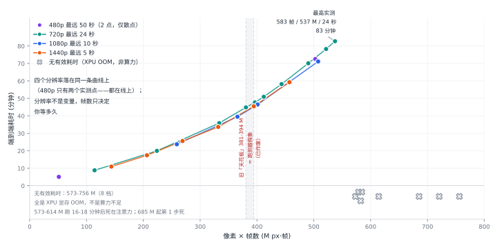

# GUNNIR Arc Pro B65 32G

> **¥9,999 · 32 GB 显存 · 608 GB/s · 197 TOPS · 200 W**
>
> 32 GB 档里最划算的一张。聊天解码 **53.1 tok/s**，画一张 720p 图 **16 秒**，出 5 秒 1080p 视频 **24 分钟**。
> 它和 B70 是同一颗芯片，少开 12 个核心、价格便宜一半——**买的是显存，不是速度**。

---

## 1. 规格

| 项 | 值 |
| --- | --- |
| 测试型号 | **GUNNIR（蓝戟）B65 32G** |
| 显存 | 32 GB 本体，可用 **31.16 GiB** |
| GPU 核心 | BMG-G31 · **20 个 Xe2 核心** |
| 带宽 / INT8 算力 | 608 GB/s / **197 TOPS** |
| 功耗 | TBP **200 W**，实测功耗墙 **200 W** |
| 槽位 | CPU 直连 PCIe x16 |
| 驱动 | **32.0.101.9150** |

---

## 2. 六个数字看完

| 你想干什么 | B65 上实测 |
| --- | --- |
| 跟 35B 大模型聊天（Q4_0） | **53.1 tok/s** |
| 画一张 720p 的图（Qwen-Image 2.1 · 25 步） | **16.1 秒** |
| 出 2 分钟音乐（Music 3 · 120 s） | **3.0 分钟**（181 秒） |
| 出 5 秒 480p 视频（6 步 · 864×480） | **5.1 分钟**（303 秒） |
| 出 5 秒 720p 视频（6 步 · 1280×720） | **8.2 分钟**（492 秒） |
| 出 5 秒 1080p 视频（6 步 · 1920×1088） | **24.0 分钟**（1,439 秒） |
| 满载一小时电费 | 约 **1 毛 4**（200 W × 1 小时，按 0.7 元/度 · 南方电网参考价） |

---

## 3. 聊天与文本

### 3.1 基础性能

`llama-bench -p 512 -n 128 -r 3`，SYCL 后端，权重全驻显存：

| 模型 | 量化 | 体积 | 解码 | 预填充 |
| --- | --- | ---: | ---: | ---: |
| Qwen3.6-35B-A3B | **Q4_0** | 19.41 GiB | **53.09 tok/s** | **670.06 tok/s** |
| 同上 | Q3_K_S | 14.30 GiB | 59.36 tok/s | 646.37 tok/s |
| 同上 | IQ2_M | 10.73 GiB | 63.96 tok/s | 636.93 tok/s |
| 同上 | Q4_0 · `-ncmoe 8` | 19.41 GiB | 45.84 tok/s（−13.7%） | 300.42 tok/s（−55%） |

**换小量化解码变快**：档位体积少 45%，解码只快 20% —— **聊天卡在每 token 的计算，不是带宽。**

换 **Vulkan** 后端（`-dev Vulkan1`，其余参数逐字相同）：

| 后端 | 预填充 | 解码 | 相对 SYCL |
| --- | ---: | ---: | ---: |
| SYCL | 670.06 | 53.09 | 1.00× |
| **Vulkan** | **2,013.51** | **89.27** | 预填充 **3.00×** · 解码 **1.68×** |

Vulkan 的 89.27 仍只有 B70 的 0.77×——**换后端追不回核心数。**

Q3_K_S 档（同 build 11753）：

| 后端 | 预填充 | 解码 | 相对 SYCL |
| --- | ---: | ---: | ---: |
| SYCL（Q3_K_S） | 663.96 | 59.20 | 1.00× |
| **Vulkan（Q3_K_S）** | **1,944.59** | **72.74** | 预填充 **2.93×** · 解码 **1.23×** |

**Vulkan 倍数跟量化档走**（Q4_0 与 Q3_K_S 见两表）——同一张卡上不恒定，按档报。

**交付命令行**（`llama-server` · Q3_K_S · `-c 16384` · 4 次采样）：

| 后端 | 解码 | 预填充 | 共享溢出 |
| --- | ---: | ---: | ---: |
| SYCL | 57.62 tok/s | 58.67 tok/s | 514 MB |
| **Vulkan** | **71.36 tok/s** | **80.21 tok/s** | **4.9 MB** |

### 3.2 和 B70 / B60 比：差在核心数

同一次跑测、同一份二进制、同一串参数，只换卡：

| 卡 | INT8 TOPS | 带宽 | 功耗 | 预填充 | 解码 | 相对 B70 |
| --- | ---: | ---: | ---: | ---: | ---: | ---: |
| **B70** | 367 | 608 GB/s | 290 W | **1,010.38** | **75.97** | 1.00× |
| **B65** | 197 | 608 GB/s | 200 W | 670.06 | **53.09** | **0.70×** |
| **B60** | 197 | 456 GB/s | 200 W | 670.47 | **52.25** | 0.69× |

核心数比 **20 / 32 = 0.625**，实测预填充 **0.663**、解码 **0.699**。

- **B65 与 B60 几乎逐位相同**（都是 20 核）。B65 多出的 152 GB/s 不在「每次吐一个 token」的路径上。
- **608 GB/s 决定搬得快不快，20 / 32 个核心决定算得快不快。** 35B-A3B 这种 MoE 解码是算力受限。

**B65 是 B70 的 20/32 版，不是「同带宽的便宜版」。**

### 3.3 长上下文

**长度的成本形状**（`-c 262144` · `-fa on` · KV q8_0 · 权重全驻，逐档送越来越长的 prompt）：

| 送入 token | 预填充 tok/s | 解码 tok/s | 单轮端到端 |
| ---: | ---: | ---: | ---: |
| 512 | 366.97 | **51.29** | 3.9 s |
| 32,768 | 569.88 | **37.20** | 58.4 s |
| 65,536 | 547.19 | **30.02** | 118.8 s |
| 131,072 | 507.60 | **21.73** | 253.0 s |
| 196,608 | 472.47 | **17.81** | 405.5 s |
| 262,144 | 440.77 | **14.24** | 578.5 s |

**预填充越拉越快**：长 prompt 是批量矩阵乘，规模越大越吃满算力。
**解码随上下文单调掉（−72%）**：每出一个 token 都要读一遍 KV，而 KV 在显存里随长度线性涨——这条是带宽账，不是算力账。

**容量上限**（判据：显存必须随 `-c` 按比例涨才算真装下）：

| `-c` | KV 占用 | 卡上余量 | 真的分配了吗 |
| ---: | ---: | ---: | --- |
| 262,144 | 3.34 GiB | 9.50 GiB | ✅ |
| 1,048,576 | 12.81 GiB | 0.03 GiB | ✅ |
| 1,572,864 | 12.68 GiB | 0.16 GiB | ░ 没真分配（KV 与 1M 同量） |
| 2,097,152 | — | — | ░ 起不来 |

**单卡真能吃进 1M token**（KV 每 M token 12.8 GiB，1M 时卡上只剩 0.03 GiB），等于 4 个满长会话。
`-c` 写到 1.5M / 2M 也能起、也能答，但显存一点都不多占 → **没真分配，不算装下**。

短上下文的参数敏感性：**4K → 16K 不花钱**（解码 52.89 → 53.30），**KV 量化到 q8 也不花钱**（差 0.7 至 3.3%，在采样极差内）：

| 配置 | 预填充 | 解码 | 首次装载 | 采样极差 |
| --- | ---: | ---: | ---: | ---: |
| `-c 4096`（默认 KV） | 60.97 | **52.89** | 14.5 s | 1.9% |
| `-c 4096 -fa on -ctk/-ctv q8_0` | 61.16 | 52.54 | 21.6 s | 1.1% |
| `-c 16384`（默认 KV） | 60.28 | **53.30** | 14.5 s | 0.1% |
| `-c 16384 -fa on -ctk/-ctv q8_0` | 61.85 | 51.52 | 14.5 s | 0.5% |

### 3.4 多模态（图生文）

Qwen3.6-35B · 带视觉塔（mmproj），送一张答案唯一的程序生成图，两个后端都答对。32 GB 上 Q4_0 19.41 GiB **全驻**（`-ncmoe 0`），IQ2_M 10.73 GiB 也全驻：

| | Vulkan | SYCL | 相对 SYCL |
| --- | ---: | ---: | ---: |
| **首图**（Q4_0 全驻 · 冷） | **12.5 s** | 17.7 s | 1.4× |
| **首图**（IQ2_M · 冷） | **6.5 s** | 8.0 s | **1.23×** |
| decode（暖态 · Q4_0） | **86.9 tok/s** | 52.6 tok/s | **1.65×** |
| 连问 5 张总耗时（Q4_0） | **13.0 s** | 18.5 s | 1.42× |

**全驻时换后端没有大差（1.23 至 1.65×）** —— B50 上卸专家档的首图差是 **8.5×**（75.5 → 9.0 s）。
同一负载、同一视觉塔，两卡对着看：**SYCL 慢的是「卸专家」，不是「多模态」。**

### 3.5 同 32 GB 的另外三家：NVIDIA 挑 4500、AMD 挑 R9700

> ⚠️ 下面三列**不是本机实测**，是原厂规格 + 别人跑的数（出处与 build 见
> [`bench/notes/external-32gb-competitors-2026-10.md`](../../bench/notes/external-32gb-competitors-2026-10.md)）。
> 只给量级和比值，不与本机数字并排下结论。价格为 2026-10 电商挂牌价，**实际成交价随平台优惠浮动。**

| | **Arc Pro B65**（本机实测） | RTX PRO 4500 Blackwell | RTX 5090 32G | Radeon AI PRO R9700 |
| --- | --- | --- | --- | --- |
| 显存 / ECC | 32 GB GDDR6 · **需手动开 ECC** | 32 GB GDDR7 · **标配 ECC** | 32 GB GDDR7 · 无 ECC | 32 GB GDDR6 · **ECC 仅 Linux** |
| 带宽 | 608 GB/s | **896 GB/s** | **1,792 GB/s** | 640 GB/s |
| 功耗 / 形态 | **200 W** · 涡轮 | **200 W** · 双槽全高 | 575 W · 三槽消费卡 | 300 W · 双槽涡轮 |
| 京东价（10-26 核，10-27 补渠道价） | **¥9,999** | ¥22,101 至 31,349（**10-27 渠道 ¥30,999**） | ¥52,999 | **¥17,900**（挂牌 ¥17,999，已并拢） |
| 每瓦带宽 | 3.04 GB/s/W | **4.48** | 3.12 | **2.13** |
| 每元带宽 | **0.061** | 0.029 至 0.041 | 0.034 | 0.036 |
| 最低精度 | 到 FP4 | 到 FP4 | 到 FP4 | **只到 INT4** |

**同形态、同功耗、同显存的对手是 4500，不是 5090**（575 W 三槽消费卡对 200 W 涡轮工作站卡是跨形态）。
对着 4500 看：**带宽差 1.47 倍、功耗一模一样、每元带宽我们是它 1.5 至 2.1 倍，但每瓦带宽只有它 68%** —— 最后一条是架构效率差，不是定价差。

**AMD 这边最像的是 R9700**：同样 32 GB、同样双槽涡轮，¥17,900。四条硬账：

- **功耗 300 W 对 200 W** → 每瓦带宽我们是它 **1.43 倍**（3.04 对 2.13），四张卡里它最低。
- **带宽 640 对 608 只多 5.3%，价却多 79%**（¥17,900 对 ¥9,999）→ 每元带宽我们是它 **1.70 倍**。
- **ECC 官方写明 `Yes (Linux Only)`** → Windows 工作站上没有 ECC；而 Linux 上 GECC 默认开，吃掉约 10% 带宽（有效 576 GB/s）。**两面不可兼得。**
- **没有 FP4**（官方最低 INT4）。本页的 H3 工作流靠 nvfp4 编码器档才在 32 GB 内存机上跑通，这条对 AMD 是空白。

**唯一有实测对照的是解码**（同档 MoE，但模型与量化不同代，只能看量级）：

| 解码 | tok/s | 条件 |
| --- | ---: | --- |
| **B65** · Qwen3.6-35B-A3B Q4_0 19.41 GiB | **53.09**（SYCL）/ **89.27**（Vulkan） | 本机 · llama.cpp **b11753** · `-p 512 -n 128` |
| RTX 5090 · qwen3moe 30B.A3B Q4_K_M | **134.18** | 公开记录 · llama.cpp **b10741 CUDA 13.3** · `-p 1024 -n 400` |
| RTX PRO 4500 · 按带宽折算 | ≈78 | **推算，未实测**（896 / 608 × 53.09） |
| R9700 · 同档 MoE（四条公开数据） | **77 至 127**（原厂栈）· 147 至 156（调优后） | 第三方，极差 1.65×，条件见参考页 |

→ 对 5090 解码 **1.50 倍（Vulkan）≈2.53 倍（SYCL）**；对 4500 约 **1.47 倍**（纯带宽折算）。
→ 对 R9700：**我们 Vulkan 的 89.27 正落在它原厂栈的 77 至 127 里（中位 0.86 倍）**；
  它换 AMDVLK 加社区补丁能到 147 至 156，是 **1.65 至 1.75 倍**，代价是多 100 W 功耗加一套非原厂驱动。
→ 🔴 **预填充**：SYCL 是 670.06 对 5090 的 4,081.20 = **6.09 倍**，但同一张卡换 Vulkan 是 2,013.51 = **2.03 倍**，
  正好落在硬件算力比（约 2.1 倍）上。**6 倍是 SYCL 后端的成熟度问题，不是卡的能力问题。** 对客口径就一句：**跑 llama.cpp 用 Vulkan。**

**四个坑：**

1. **ECC 的容量代价要对着量**：B65 开 ECC 后应用只见 **27.25 GB**（关着才是 31.16 GiB）。
   4500 的 ECC 是标配，开着的可用容量 **本项目没测**。
2. **价格会漂**：4500 自营挂牌 ¥29,479 至 31,349；R9700 半年内从 ¥10,999 涨到 **¥17,900**（+63%）—— 按旧价算出来的结论会完全走样。
3. **4500 的优势有一部分不在数字里**：CUDA 12.8 全套、RAPIDS、vLLM 官方多卡栈。
   我们这边是 SYCL，加上一个仍未并进主线的 `torch.xpu.synchronize` 补丁。
4. **AMD 的双卡在 Windows 上是瘸的**：`hipDeviceCanAccessPeer = false`，跨卡全走主机内存 →
   tensor 并行比单卡**慢 2.15 倍**（公开报告 2026-10-19）。我们是 Windows 双 B65 拆层 **+12 至 19%**、并发 **+6.0%**。
   **要双卡，这条比 tok/s 更要紧。**

> **一句话**：同 32 GB 带 ECC、同 200 W、同涡轮形态，4500 带宽多 47%、贵 2.2 至 3.1 倍；
> R9700 贵 79% 且多 100 W、每瓦带宽只有我们 70%、每元带宽只剩 59%、ECC 只给 Linux、Windows 双卡跑不起来。
> **CUDA 生态在 4500，AMD 生态在 R9700；「一台机塞四张 32 GB 还省电」是 B65。**

---

## 4. 出图

| 工作负载 | 首轮（含装载） | **稳态** | 换提示词 | 其中采样 |
| --- | ---: | ---: | ---: | ---: |
| **Qwen-Image 2.1** int8 · 1280×720 · 25 步 | 62.08 s | **16.13 / 16.19 s** | 16.85 s | 15.0 s（**0.60 s/步**） |
| **Qwen-Image 2.1** bf16 · 1280×720 · 25 步 | 103.97 s | **22.82 / 23.00 s** | 23.86 s | 21.6 s（**0.86 s/步**） |
| **Qwen-Image 2.1** int8 · **2048×2048** · 25 步 | 161.37 s | **117.55 / 117.52 s** | 118.18 s | **110.5 s（4.42 s/步）** |
| **Krea-2 Turbo** int8 · 1280×720 · 8 步 | 68.52 s | **8.74 / 8.73 s** | 9.01 s | 7.0 s（**0.88 s/步**） |
| **Qwen-Image 2.1** int8 · **3072×3072** · 25 步 | 488.2 s | **456.34 / 455.97 s** | 457.0 s | 431 s（**17.24 s/步**） |
| **Qwen-Image 2.1** int8 · **4096×4096** · 25 步 | 1,410.5 s | **1,307.45 / 1,305.87 s** | 1,305.5 s | 1,229 s（**49.17 s/步**） |
| **Qwen-Image 2.1** int8 · **5120×5120** · 25 步 | 3,027.7 s | **3,021.9 / 3,021.6 s** | —（第 4 轮被采集超时截断） | 2,785 s（**110.76 s/步**） |

**int8 比 bf16 快 29%**，两者都完整驻留、0 卸载。

**和另外三张卡比**（同分辨率、同栈）：

| 工作负载 | B50 16G | B60 24G | **B65 32G** | B70 32G | B65 / B70 |
| --- | ---: | ---: | ---: | ---: | ---: |
| Qwen-Image 2.1 · 1280×720 | 51.75 s | 17.33 至 18.80 s | **16.13 至 16.19 s** | **10.61 至 10.64 s** | **1.52×** |
| Krea-2 Turbo · 1280×720 | — | 62.30 至 66.00 s | **8.73 至 8.74 s** | **6.03 至 6.07 s** | **1.45×** |

**Krea-2 的 bf16 档在这张卡上装不下**：DiT 24.5 GB + 文本编码器 8.3 GB = 32.9 GB > 31.16 GiB，每轮三件全装，稳态 **167 s**——是 int8 的 **19 倍**。

**分辨率律**（超线性）：像素涨 4.55×（720p → 2048²），采样涨 **7.37×**、稳态涨 **7.27×**；涨到 **3072²**（10.24×）采样涨 **28.7×**，仍完整驻留（`loads=0`）。

- **4096²**（16.8 MP）：每轮 `loads=3`，显存打满开始每轮重装 —— **驻留红利在这一档用完**，出一张约 253 kJ ≈ **¥0.05**。
- **5120²**（26.2 MP）：**0 OOM**、P90 贴 200 W 墙，约 586 kJ ≈ **¥0.12** —— **测过的档里没有显存天花板**，瓶颈从显存转为时间；再往上未测。
- 同口径 B50 跑 3072² 是 32.06 s/步，**B65 快 1.86×**；2048² 单张 2 分钟、23.6 kJ。

**三条要点：**

1. **比 B70 慢 1.45 至 1.52×**，比核心数倒数的 1.60× 还小一点——端到端里有 7 至 22% 是装载与调度，这一段不随核心数变。
2. **比 B60 略快**。Krea-2 那格的巨大差距不能当速度差——B60 是每轮重搬模型，不是算力问题。
3. **模型驻留后采样占 80 至 93%**，出图是计算主导——**调步数按比例见效**，和出视频相反。

---

## 5. 出音乐

MiniMax Music 3，120 秒音频、30 步：

| DiT / 文本编码器 · `--reserve-vram` | 首轮 | **稳态 ×2** | 换歌 | 每轮重装 |
| --- | ---: | ---: | ---: | --- |
| int8 / bf16 · **4** | 309.96 s | 301.14 / 236.51 s | 225.08 s | 三件全装 |
| **int8 / bf16 · 2** | 303.29 s | **180.85 / 180.21 s** | 236.47 s | 一件（2.39 GB） |
| **int8 / int8 · 4** | 309.74 s | 198.31 / 164.56 s | 239.15 s | 稳态一件 |
| **fp16 / bf16 · 4** | 370.80 s | 227.94 / 223.39 s | 292.18 s | 稳态一件 |

**这张卡跑 Music 3，`--reserve-vram` 要降到 2。**

- `reserve 4` 那组四轮一路往下掉（见表），服务端每轮把三件重新装一遍——**没收敛，不能当稳态**。
- **`reserve 2` 两轮差 0.4%**，每轮只需把 2.39 GB 的 DiT 请出去一次。**这才是这张卡的稳态时间。**
- **B70 同配置 61.9 s**，B65 是它的 **2.9 倍**。

电费：一轮 **25.1 至 25.4 kJ** ≈ **¥0.005**。

---

## 6. 出视频

> ⚠️ **前提：页面文件 96 GB 固定（初始 = 最大 = 98304）→ 提交上限 127.11 GiB。**
> 装载 19.53 GB 的 DiT 加主机侧文本编码器，**峰值提交量 91.8 至 102.7 GiB**（主项是装载，与视频尺寸只是弱相关）。
> 32 GB 报 `os error 1455`、48 GB 报 `0xC0000005`（4/4 复现）；
> 🔴 **64 GB 最坑**：装载爬到 92.08 GiB（96.8%）就再也不动 —— 那不是崩溃，是整机卡死的前一刻。

MiniMax H3，6 步、5 秒（124 帧）—— **同一批、同一台、同一个页面文件配置**。

> ⚠️ **`效率` 这一列按「冷启」算**（重启服务后第 1 条）；B60 / B70 两页按**稳态**算，同一档两边差 **5 至 8%** —— **跨卡只比单步，不要拿效率列相除。**

| 分辨率 | 冷启 | **热态** | 单步（冷 / 热） | 固定开销（冷） | 采样占比（冷） | 峰值提交 | 效率 |
| --- | ---: | ---: | ---: | ---: | ---: | ---: | ---: |
| 864×480 | 301.35 s | **303.25 s** | 11.02 / 10.70 s/it | 235 s | 22% | 93.03 GiB | 10.2 |
| 1280×720 | 527.45 s | **491.80 s** | 42.72 / 42.46 s/it | 271 s | 49% | 91.75 GiB | **13.0** |
| 1920×1088 | 1,421.27 s | **1,439.38 s** | 190.74 / 190.27 s/it | 277 s | 81% | 99.83 GiB | 10.9 |

**三条形态：**

1. **分辨率把成本结构整个翻过来**：480p 固定开销占 **78%**（采样只有 66 s），720p 变成半半（采样 49%），1080p 采样占到 **81%**。→ **低分辨率买的是「跑得动」，高分辨率要按采样分钟数算钱。**
2. **「冷启比热态贵」不成立**：同一批里 480p 冷比热**快 1.9 s**、720p **慢 35.7 s**、1080p **快 18.1 s** —— 三个方向都有。**别按「重启服务要多花几十秒」做规划，端到端按上表报并带 ±10% 的日间波动。**
3. **480p / 720p 上模型完整驻留，1080p 要卸 7.5 GB**（`loaded partially; 12,431.90 MB loaded, 7,564.24 MB offloaded`）。三个分辨率的装载判决和 B70 完全一致。

**「能出多长」没有硬答案，只有时间成本。** 全部实测点（**30 档：22 档真跑完 / 8 档装不下**），`░` = 已经测过、跑不通。

| 分辨率 | 帧数 | 时长 | 像素·帧 | DiT 卸载 | 端到端 |
| --- | --: | --: | --: | ---: | --- |
| 864×480 | 124 | 5 秒 | 51 M | 0 | ✅ 301.35 s |
| 1280×720 | 124 | 5 秒 | 114 M | 0 | ✅ 527.45 s |
| 2560×1440 | 39 | 1 秒 | 144 M | 1,760.68 MB | ✅ 654.37 s |
| 2560×1440 | 56 | 2 秒 | 206 M | 5,814.85 MB | ✅ 1,042.79 s |
| 1280×720 | 243 | 10 秒 | 224 M | 6,721.83 MB | ✅ 1,194.63 s |
| 1920×1088 | 124 | 5 秒 | 259 M | 7,564.24 MB | ✅ 1,421.27 s |
| 2560×1440 | 73 | 3 秒 | 269 M | 7,564.24 MB | ✅ 1,533.51 s |
| 2560×1440 | 90 | 3.7 秒 | 332 M | 7,564.24 MB | ✅ 2,016.43 s |
| 1280×720 | 362 | 15 秒 | 334 M | 7,564 MB | ✅ 2,149.75 s |
| **1920×1088** | **175** | **7 秒** | **366 M** | 7,564.24 MB | ✅ **2,368.45 s** |
| 1280×720 | 413 | 17 秒 | 381 M | 7,564 MB | ✅ 2,689.48 s |
| **2560×1440** | **107** | **4 秒** | **394 M** | 7,564.24 MB | ✅ **2,726.51 s** |
| 1280×720 | 430 | 17.5 秒 | 396 M | 7,564.24 MB | ✅ **2,860.37 s** |
| 1920×1088 | 192 | 8 秒 | 401 M | 7,564.24 MB | ✅ **2,788.78 s** |
| 1280×720 | 447 | 18 秒 | 412 M | 7,564.24 MB | ✅ **3,054.61 s** |
| **1280×720** | **481** | **20 秒** | **443 M** | 7,564.24 MB | ✅ **3,489.65 s** |
| 2560×1440 | 124 | 5 秒 | 457 M | 7,564.24 MB | ✅ **3,554.99 s** |
| **864×480** | **1,212** | **50 秒** | **503 M** | 0（完整驻留） | ✅ **4,351.79 s ≈ 72.5 分** ← **480p 最远** |
| 1280×720 | 532 | 22 秒 | 490 M | 7,564.24 MB | ✅ **4,204.48 s** |
| **1920×1088** | **243** | **10 秒** | **508 M** | 7,564.24 MB | ✅ 4,267.18 s |
| 1280×720 | 566 | 23 秒 | 522 M | 7,564.24 MB | ✅ **4,695.57 s** |
| **1280×720** | **583** | **24 秒** | **537 M** | 7,564.24 MB | ✅ **4,963.67 s ≈ 82.7 分** ← **全表最高通过点** |
| **864×480** | **1,382** | **57 秒** | **573 M** | 0（完整驻留） | ░ **注意力 OOM**：跑 16:16 后申请 2.26 GiB，剩 1.76；功耗 173.1 W（85.4%） |
| 1280×720 | 634 | 26 秒 | 584 M | 7,564.24 MB | ░ **注意力 OOM**：申请 2.33 GiB，剩仅 564 MiB；功耗 173.7 W（85.9%） |
| 1920×1088 | 277 | 11 秒 | 578 M | 7,564.24 MB | ░ **注意力 OOM**：跑 16:13 后 `scaled_dot_product_attention` 申请 2.25 GiB，当时只剩 1.79 GiB；功耗均值 171.5 W（84.6% ≥150 W） |
| 2560×1440 | 158 | 6 秒 | 582 M | 7,564.24 MB | ░ **注意力 OOM**：`scaled_dot_product_attention` 申请 2.27 GiB，剩 1.54 GiB；功耗均值 172.7 W（85.3%） |
| 1920×1088 | 294 | 12 秒 | 614 M | 7,564.24 MB | ░ **注意力 OOM**：`scaled_dot_product_attention` 申请 2.38 GiB，剩仅 208 MiB；功耗均值 171.0 W（84.2%），复测 1,119.1 s（差 2.7%） |
| 1920×1088 | 328 | 13 秒 | 685 M | 7,564.24 MB | ░ **第 1 步 OOM**：`_tile_int8_linear` 一次要 **10.63 GiB**，空闲 8.94；功耗均值 79.5 W（14.3%） |
| 1920×1088 | 345 | 14 秒 | 721 M | 7,564.24 MB | ░ **第 1 步 OOM**：`_tile_int8_linear` 一次要 **11.18 GiB**，空闲 8.91；功耗均值 80.9 W（16.5%） |
| 1920×1088 | 362 | 15 秒 | 756 M | 7,564.24 MB | ░ **第 1 步 OOM**：只要 2.93 GiB，但已分配 26.24 GiB、只剩 2.90；功耗均值 62.3 W（1.1%） |

⭐ 再往上的八档**不是算力不够、也不是卡不稳**，全部是 XPU 显存 OOM：

| 1080p | 帧数 | 像素·帧 | 结果 | 端到端 | 被测卡功耗 | 死在哪一步 |
| --: | --: | --: | --- | --: | --- | --- |
| 10 秒 | 243 | 508 M | ✅ | 4,267.18 s | 均值 **188.1 W**，95.6% 采样点 ≥150 W | 跑完 |
| 720p 22 秒 | 532 | 490 M | ✅ | 4,204.48 s | 均值 **187.8 W**，95.5% | 跑完 |
| 720p 23 秒 | 566 | 522 M | ✅ | 4,695.57 s | 均值 **188.6 W**，96.2% | 跑完 |
| 720p 24 秒 | 583 | 537 M | ✅ | 4,963.67 s | 均值 **188.6 W**，96.3% | 跑完 |
| 480p 50 秒 | 1,212 | 503 M | ✅ | 4,351.79 s | 均值 **188.7 W**，95.5% | 跑完（DiT 完整驻留） |
| 480p 57 秒 | 1,382 | 573 M | ░ | 1,024.6 s | 均值 **173.1 W**，85.4% | **注意力 OOM**：2.26 GiB / 剩 1.76 ← **全表最低失败点** |
| 720p 26 秒 | 634 | 584 M | ░ | 1,074.5 s | 均值 **173.7 W**，85.9% | **注意力 OOM**：2.33 GiB / 剩 564 MiB |
| **11 秒** | **277** | **578 M** | ░ | **1,022.2 s** | 均值 **171.5 W**，84.6% | **注意力 OOM**：申请 2.25 GiB / 剩 1.79 |
| 12 秒 | 294 | 614 M | ░ | 1,150.3 / 1,119.1 s | 均值 **171.0 W**，84.2% | **注意力 OOM**：2.38 GiB / 剩 208 MiB（两次形态一致） |
| 13 秒 | 328 | 685 M | ░ | 168.2 s | 均值 79.5 W，14.3% | **int8 输出缓冲 OOM**：10.63 GiB |
| 14 秒 | 345 | 721 M | ░ | 170.1 s | 均值 80.9 W，16.5% | **int8 输出缓冲 OOM**：11.18 GiB |
| 15 秒 | 362 | 756 M | ░ | 168.1 / 173.8 s | 均值 62.3 W，1.1% | **int8 输出缓冲 OOM**：2.93 GiB（已分配 26.24） |

**边界在哪**：门槛是一个标量 —— **像素 × 帧数**。**537.3 M 过（720p·24 秒）、573.1 M 挂（480p·57 秒）**，中间没有倒挂，**T ∈ (537.3, 573.1) M**。
**八档失败全部是 `torch.OutOfMemoryError: XPU out of memory`**，traceback 逐档查过。
⭐ 分两个撞线点：**578 至 614 M 死在注意力**（`attention_pytorch → scaled_dot_product_attention`，单次只请求 **2.25 / 2.27 / 2.38 GiB**，但空闲只剩 1.79 / 1.54 / **0.20** GiB，跑了 16 至 18 分钟才死）；**685 M 起死在 int8 线性输出缓冲**（`_tile_int8_linear → torch.empty((rows, output_features))`，一口气要 **10.63 / 11.18 / 2.93 GiB**，第 1 步就死、116 至 119 s）。
⚠️ 15 秒档只请求 2.93 GiB 仍挂，因为那时**已分配 26.24 GiB** —— **先撞线的 op 换了**。所以墙不是某个固定 op 的上限，而是「**31.16 GiB 装不下这一档的瞬时峰值**」。
⚠️ **帧数按实测取，不按秒外推**：1440p·6 秒实测 **158 帧（582.5 M）**；若按 23.8 帧/秒外推会算成 141 帧（519.8 M），凭空造出一个不存在的「倒挂」。
**结论：31.16 GiB 装不下 578 M 以上的瞬时峰值**（提交峰值 111.58 / 127.11 GiB 够用，537.3 M 那档连跑 83 分钟）—— **缺的是显存容量。**
⭐ 这条把天花板从「铁板」变成「可动的」：瓶颈是**瞬态缓冲**而不是权重驻留，注意力换分块后端、int8 的 tile 按显存预算自适应，都可能把上限往上挪（**未做**）。

> 图注：横轴是把分辨率和时长合成的一个标量（宽 × 高 × 帧数，百万像素·帧），纵轴是端到端分钟数。
> **22 个跑完的档连起来是一条平滑上升的线** —— 四个分辨率落在同一条曲线上，说明分辨率不是变量、帧数只决定你等多久。
> 灰色带子是 381 至 394 M 这个「天花板」位置，它**正好落在线段中间** —— 那道线切在等待上限上，不在卡上。
> 轴下那排灰叉是 8 档没跑出有效耗时的（573 / 578 / 582 / 584 / 614 / 685 / 721 / 756 M），**一条都不是算力与稳定性问题，全部是 XPU 显存 OOM**：
> 578 / 582 / 614 M 跑 16 至 18 分钟后死在注意力分配；685 M 起第 1 步就卡在 int8 输出缓冲（请求 10.6 至 11.2 GiB）。
> 图由 `bench/harness/gen_px_frame_chart.py` 从 `bench/data` 直出，不要手改。

**按「每输出一秒要等多久」看**（1080p）：越长越不划算——因为采样步数与帧数同涨，而固定开销只摊一次。

**装载不是变量的证据**：同一分辨率下，过与「挂」的装载参数**逐字节相同** ——
1440p 的 3 秒 / 3.7 秒 / 4 秒三档全是 `12,762.74 / 12,431.90 / 7,564.24 / 330.83`；
1080p 的 5 / 7 / 8 / 10 秒也一样。`--reserve-vram` 4→1 也改不了这个规划。
→ **拿「装不下 / 卸载太多 / 显存不够」解释这条线是错的**，装载一直是成功的。

→ **时间表（全部实测）**：

| 输出时长 | 480p | 720p | 1080p | 1440p |
| --- | --: | --: | --: | --: |
| 5 秒 | 5 分钟 | 9 分钟 | 24 分钟 | **59 分钟** |
| 6 秒 | — | — | — | 测不了（582 M） |
| 8 秒 | — | — | 46 分钟 | — |
| 10 秒 | — | 20 分钟 | **71 分钟** | — |
| 11 秒 | — | — | 测不了（578 M） | — |
| 15 秒 | — | 36 分钟 | 测不了（756 M） | — |
| 17 秒 | — | 45 分钟 | — | — |
| 18 秒 | — | 51 分钟 | — | — |
| 20 秒 | — | 58 分钟 | — | — |
| 22 秒 | — | 70 分钟 | — | — |
| 23 秒 | — | 78 分钟 | — | — |
| 24 秒 | — | **82.7 分钟（720p 最远）** | — | — |
| 26 秒 | — | 测不了（584 M） | — | — |
| 50 秒 | **72.5 分钟（480p 最远）** | — | — | — |
| 57 秒 | 测不了（573 M） | — | — | — |

**时长上限：480p ≤ 50 秒 / 720p ≤ 24 秒 / 1080p ≤ 10 秒 / 1440p ≤ 5 秒。**
端到端有 ±10 至 15% 的随机漂移（见本节末），报时间按区间报。

**怎么选 —— 三句话：**

1. **单条出片 → 720p · 5 至 10 秒**：5 秒以上的镜头里效率全表最高。480p 更快但只有 0.41 MP。
2. **要长片 → 接片**：同样 25 秒，拆 5 段 5 秒比硬拉一条快 **1.9 倍**。
3. **要更高分辨率 → 720p 出片再超分**：同长度 1080p 是 **2.7 倍**时间、1440p **6.7 倍**；超分本页没测。

> ⚠️ **端到端只在同一批内横比，跨批一律只比单步。** 同一台、同一份配置：隔天 480p 冷启 322.37 → 301.35 s（−6.5%），单步只动 0.1%；
> 同一天同配置也曾差 **17%**（527.45 对 438.78 s），单步只差 0.4%。**差异全在装载时长的随机漂移，不在配置** ——
> 本页端到端数字都带 **±10 至 15%** 的带子，**按区间报，别按秒报。**

**时长维度**（1280×720，只改时长）—— **跨行比只用单步**（端到端跨批会漂 ±10 至 15%）：

| 时长 | 帧数 | 端到端 | 单步 | 采样 | 固定开销 | 模型装载 |
| ---: | --: | ---: | ---: | ---: | ---: | --- |
| 5 秒 | 124 | **527.45 s** | 42.72 s/it | 256.3 s | 271 s | 完整驻留、0 卸载 |
| 10 秒 | 243 | **1,194.63 s** | 152.51 s/it | 915.1 s | 279.6 s | 部分、卸 **6,721.83 MB** |
| 15 秒 | 362 | **2,149.75 s** | 314.17 s/it | 1,885 s | 265 s | 部分、卸 **7,564 MB** |
| 17 秒 | 413 | **2,689.48 s**（44.8 min） | **405.19 s/it** | 2,431 s | 258 s | 部分、卸 **7,564 MB** |
| 20 秒 | 481 | **3,489.65 s**（58.2 min） | **537.94 s/it** | 3,227.6 s | 262 s | 部分、卸 **7,564 MB** |

**采样倍数和 B70 逐位相同**：10 秒 3.577×、15 秒 7.427×（B70 是 3.579× / 7.430×）→ **时长维度只跟帧数走，跟哪张卡无关。**

**拉长时长也会把模型挤出显存**：720p 5 秒完整驻留，10 秒起卸 6.7 GB、15 秒卸 7.6 GB。**装不装得下不只看分辨率，也看时长。**

**和 B70 同条件比（864×480）：**

| | B65 | B70 | B65 / B70 |
| --- | ---: | ---: | ---: |
| 冷启 | 227.71 s | 191.03 s | 1.19× |
| 热态 | 198.12 s | 163.73 s | **1.21×** |
| 单步 | 10.65 s/it | 6.90 s/it | **1.54×** |
| 固定开销 | 134 s | 123 s | 1.09× |

**1.19 至 1.21× 是同批比出来的，不能跨批复用**（B65 自己的固定开销隔日能差 20 至 30 s）。
**稳定的是单步**：B65 10.70 至 11.02 s/it 对 B70 6.90 s/it = **1.55 至 1.60×**，与核心数倒数 32 / 20 = 1.60 同量级。**跨批只报单步比。**

**五档单步比（B65 ÷ B70）：480p 1.60× · 576p 1.61× · 720p 1.67× · 864p 1.69× · 1080p 1.66×**，落在核心数倒数 **32 / 20 = 1.60** 的同量级，**和分辨率、和带宽都无关**。

---

## 7. 功耗

`power_probe_multi.py` · 整卡电源域能耗计数器求差 · 1 秒窗口 · **按 PCI 总线归属到卡**（跑测卡 = 总线 3，空闲卡 = 总线 16）：

| | 864×480 | 1280×720 | 1920×1088 |
| --- | ---: | ---: | ---: |
| 空载（两张卡都是） | 44.9 W | 44.8 W | 44.9 W |
| 整轮均值（含装载） | 87.1 W | 140.8 W | 166.3 W |
| 中位数 | 59.1 W | 197.5 W | 191.3 W |
| **P90** | **200.3 W** | **201.8 W** | **204.3 W** |
| 1 秒峰值 | 222.4 W | 215.1 W | 219.0 W |
| 占空比（≥160 W 的时间） | **20.1%** | **57.8%** | **77.4%** |
| 单次任务能量（探针窗口） | **35.1 kJ** | **70.7 kJ** | **250.0 kJ** |
| 一条电费（0.7 元/度） | **¥0.007** | **¥0.014** | **¥0.049** |

1. **P90 就是 200 W 墙本身**（超出 0 至 2.2%），**1 秒峰值 215 至 222 W**。散热按 **200 W 持续 + 224 W 瞬态**设计，电源 450 W 足够。
2. **均值远低于 P90，占空比才说明卡忙不忙**（见表，与 §6 采样占比对得上）。**报均值会把低分辨率档说小一半，看 P90 和占空比。**
3. **单次能量随「装载有多长」漂，不随卡漂**（不同批 480p 的固定开销差过 100 s，能量随之差 34%，而**采样段没动**）。
   能量按**探针窗口**算（含一次服务启停，比服务窗口多 63 至 74 s、约 4 kJ）：实际跑一条就是要起一次服务。

> ⚠️ **口径坑（H-26）**：`bench_f_h3.py` 内置的 `power_sampler.py` 只枚举 Sysman 的 `devs[0]`，而本机 Sysman 顺序 ≠ `level_zero:N` ——
> `devs[0]` = 总线 16 = `xpu:1` = **空闲那张**。这批它报 43 至 47 W，同一时刻在跑的卡（总线 3）是 **156 W**。
> → **双卡在机时 `samples[].power` 一律不采信**；自证法是看 P90 有没有贴到卡的 `defaultLimit`（B65 = 200 W、B70 = 290 W）。

---

## 8. 能装下什么

31.16 GiB 可见显存：

| 组合 | 常驻 | B65 |
| --- | ---: | --- |
| Qwen-Image 2.1 int8（6.9 + 8.7 + 0.6 GB） | 16.2 GB | ✅ 完整驻留 |
| Krea-2 int8（12.6 + 8.3 + 0.2 GB） | 21.1 GB | ✅ 完整驻留 |
| Music 3（2.4 + 文本编码器 15.9 + 0.2 GB） | 18.5 GB | ⚠️ `reserve` 要降到 2，否则每轮三件全装 |
| H3 int8 19.53 GB + 32B 文本编码器 | ≈34 GB | ⚠️ 480p / 720p 上视频模型完整驻留，1080p 卸 7,564 MB |
| Qwen3.6-35B-A3B Q4_0 | 19.41 GiB | ✅ 全驻 |
| Qwen3.6-35B-A3B Q4_0 + **1M token 上下文**（KV q8_0） | 31.13 GiB | ✅ 卡上只剩 0.03 GiB，等于 4 个满长会话 |

**三条硬边界：**

1. **32 GB 不等于「H3 全驻留」**：视频模型自己 19.53 GB，但 1080p 仍要卸 7.5 GB——激活和 VAE buffer 把可用显存吃到 12.7 GB。
2. **它比 B70 少 12 个核心、功耗低 90 W**，是「减核心」不是「降频」。20 核 + 200 W 是一套完整档位，**解锁功耗墙也拉不到 B70 的水平**。
3. **决定 Vulkan 优势的是核数，不是带宽**（倍数见 §3.1；与 B60 一模一样）。

---

## 9. 怎么选

| 你在意 | 结论 |
| --- | --- |
| 聊天解码要快 | 53.1 tok/s，和 B60（52.3）持平、比 B70（76.0）低 30%，却比 B60 贵 ¥3,100 |
| 预算优先、模型在 24 GB 内装得下 | **B60**。同样 20 核、同样 197 TOPS / 200 W，¥6,499 |
| 需要 32 GB 显存、但不想上 B70 | **B65**。比 B70 便宜约一半；按每 tok/s 的花费算，B65 反而便宜 **28%** |
| 出视频 | 采样段慢 **1.55 至 1.60×**；端到端跟着装载漂，**只同批横比**（§6） |
| 只关心「能不能跑通」 | 能。聊天四档全跑通；H3 三档分辨率九轮零崩溃 |

**B65 卖的是显存，不是速度**：与 B60 聊天解码几乎重合（核心数一样），与 B70 的差距是 **20 vs 32 个核心**（比值见 §3.2）。

| | 价 | 解码 | 每 tok/s 花多少钱 |
| --- | ---: | ---: | ---: |
| B65 | ¥9,999 | 53.09 tok/s | **≈ ¥188** |
| B70 | ¥18,999 | 75.97 tok/s | **≈ ¥250** |

---

## 10. 测试条件

| 项 | 值 |
| --- | --- |
| 采集日期 | **2026-10-21** |
| 系统 | Windows 11 专业版 26H2 · Build 26300 |
| 软件栈 | ComfyUI **0.39.0** + `comfy_kitchen` XPU 后端 + `torch 2.12.0+xpu` |
| 服务参数 | `--port 8189 --reserve-vram 4 --enable-dynamic-vram` |
| llama.cpp | 官方预编译 **b11753** · SYCL |
| 驱动 | **32.0.101.9150** |
| 显存 | ECC 关 · 可见 **31.16 GiB** · 功耗墙 **200 W** |
| 测试机 | Ryzen 5 9600X · B850M · **2×16 GB DDR5-6400（两槽已满）** · 显示器由核显输出，独显整块给模型 |
| 页面文件 | `e://pagefile.sys` **98304 MB 固定（初始 = 最大）**，提交上限 127.11 GiB。出视频峰值提交 **91.8（720p）≈ 102.7（1080p·10 秒）GiB**，占上限 72 至 81%；32 GB 报 `os error 1455`、48 GB 崩 `0xC0000005`、64 GB 卡在 96.8% 不动。大页面文件必须配 job 限额，否则大分配会把整机提交顶穿 |
| 原始记录 | `bench/data/2026-10-21_b65-*.json`、`2026-10-21_b65-32g_*_comfyui.json` |

装什么、驱动与补丁改哪三处 → [`../install.md`](../install.md)；整机配置 → [`../build.md`](../build.md)。

---

MIT · 手册内容可自由转载，注明出处即可。作者：林永刚（Yonggang Lin）· `lygsam75@gmail.com`
