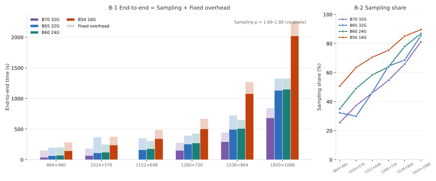

**English** · [简体中文](comfyui-capability.md)

# ComfyUI capability sheet: how much fits · video · images

"Will this card actually run ComfyUI" comes down to three numbers:

1. **How big a model fits** (the capacity ledger — this decides "can it run at all"; it is the gate)
2. **How long one video takes** (H3, by resolution and duration)
3. **How long one image takes** (Qwen-Image 2.1 / Krea-2, by step count)

This sheet puts all three on one page. **Every number names the machine it was measured on and what the timer covers** —  
where nothing was measured, it says `not measured`. No estimate is passed off as a measurement.

> Cards (AIB naming; all GUNNIR (蓝戟) boards): **Arc Pro B70 32G** `DEV_E223`/`SUBSYS_27421EF7` ·  
> **Arc Pro B65 32G** `DEV_E222`/`SUBSYS_27441EF7` · **Arc Pro B60 24G** `DEV_E211`/`SUBSYS_25421EF7` ·  
> **Arc Pro B50 LP 16G** `DEV_E212`/`SUBSYS_25221EF7`
>
> Video details → [`comfyui-h3.md`](comfyui-h3.en.md)  
> Image / music details → [`comfyui-image.md`](comfyui-image.en.md)  
> Raw data (schema `comfyui-xpu-bench/1`) → `bench/data/2026-*_*.json`  
> Software stack: the H3 line ran the 09-25 / 10-05 / 10-16 stacks; the image line ran **ComfyUI 0.39.0** + `comfy-kitchen 0.2.37`
>
> - `omni_xpu_kernel 0.2.0b2+torch213.bmg`; **the 10-16 to 10-21 batches on B50 / B60 / B65 switched to `torch212.bmg` + the int8fix patch**.  
>   **The three lines ran different stacks. Across lines, compare only whether things fit — never seconds.**

---

## I. How big a model fits (capacity ledger)

### 1.1 Usable VRAM at both settings

| Card              | Physical | Factory default (ECC on) |             **Shipping state (ECC off)** |
| ------------------ | ----: | ----------: | -------------------------: |
| Arc Pro B70 32G    | 32 GB |    27.25 GB | **31.16 GiB** (31,920.4 MB) |
| Arc Pro B65 32G    | 32 GB | same as above (same die, same memory) |            **≈ 31.16 GiB** |
| Arc Pro B50 LP 16G | 16 GB |           — |   **15.51 GiB** (15,882 MB) |
| Arc Pro B60 24G    | 24 GB |           — |          **23.33 GiB** (measured) |

> ECC changes capacity, not compute (measured difference under 6%; ECC off is slightly faster). Every figure here uses the **shipping-state value with ECC off**.  
> B65 and B70 are both 32 GB/608 GB/s and reach the same capacity verdict (B65 went on the bench on 2026-10-21; 31.16 GiB visible, bit-identical to B70);  
> B60's usable VRAM is measured (23.33 GiB usable). **All three cards were measured for capacity. Nothing is extrapolated from spec sheets.**

### 1.2 Verdict per workload

Model sizes come from **actual file byte counts** (sources: the second section of [`comfyui-image.md`](comfyui-image.en.md)  
and the first section of [`comfyui-h3.md`](comfyui-h3.en.md)). The verdict: **sum the components that must be resident in the same task**  
and compare against usable VRAM — **larger means it does not fit**. ComfyUI offloads the shortfall to host memory / page file,  
moving it on every use (server log says `loaded partially`; see [`comfyui-h3.md`](comfyui-h3.en.md) 7.2).

| Workload                                         | Components resident together                 |            Total | B70 31.16 GiB                                                                              | B65 31.16 GiB                                                                                     | B60 23.33 GiB                                                                    | B50 15.51 GiB                                                                                      |
| -------------------------------------------- | ---------------------- | ------------: | ------------------------------------------------------------------------------------------ | ------------------------------------------------------------------------------------------------- | -------------------------------------------------------------------------------- | -------------------------------------------------------------------------------------------------- |
| **H3 video** · DiT int8 + two VAEs                 | 19.530 + 4.850 + 0.564 | **24.94 GiB** | ⚠️ **depends on resolution**: 480p / 720p DiT fully resident (19,996 MB, 0 offload); partial from 1536×864 (2,932 MB offloaded), 1080p offloads 7,564 MB | **bit-identical to B70** (same capacity, same reserve, the verdict has to match)                                                               | ❌ **1.6 GiB short** → partially loaded: 16,267 MB resident + **3,728 MB** offloaded                             | ❌ **9.4 GiB short** → **12,985 MB** offloaded (measured)                                                             |
| H3 · plus two-stage (upscaler + LoRA)                       | +0.643 +0.726          |     26.31 GiB | ✅                                                                                          | not measured                                                                                                | not measured                                                                               | ❌                                                                                                  |
| H3 · text encoder nvfp4 (14.610)                     | workflow sets `device=cpu`     |             — | runs from host memory (the only stable setting at 32 GB)                                                                        | same                                                                                                | same                                                                               | same                                                                                                 |
| **Qwen-Image 2.1** · DiT **bf16** + TE + VAE | 13.253 + 8.709 + 0.629 | **22.59 GiB** | ✅ fully resident                                                                                      | ✅ fully resident (steady state **22.82 / 23.00 s**)                                                                    | not measured                                                                               | ⚠️ **7.1 GiB short → measured: DiT 12,963 MB + 608 MB offloaded** (TE 8,917 MB fully resident; the two alternate)                            |
| **Qwen-Image 2.1** · DiT **int8** + TE + VAE | 6.758 + 8.709 + 0.629  | **16.10 GiB** | ✅                                                                                          | ✅ **fully resident** (`loads=0`, `offload=0`)                                                                 | ✅ **fully resident, 0 offload** (**B50 misses it by 0.6 GB**)                                               | ⚠️ **0.6 GiB short → measured: DiT 6,921 MB fully resident, alternating with TE** (`Unloaded partially: 3837.80 MB freed`), **4/4 runs passed** |
| **Krea-2 Turbo** · DiT **bf16** + TE + VAE   | 24.478 + 8.266 + 0.236 | **32.98 GiB** | ❌ **1.8 GiB short** → TE re-moved on every new prompt (measured 21.70 vs 9.33 s)                                           | ❌ same                                                                                              | ❌ same                                                                             | ❌ DiT alone at 24.48 already exceeds → **OOM measured 2026-10-22**: after offloading **13,675 MB**, still `UR_RESULT_ERROR_OUT_OF_DEVICE_MEMORY`                                                                          |
| **Krea-2 Turbo** · DiT **int8** + TE + VAE   | 12.566 + 8.266 + 0.236 | **21.07 GiB** | ✅ fully resident                                                                                      | ✅ **fully resident** (`loads=0`, `offload=0`)                                                                 | ⚠️ **fits, but re-moves 12.6 GB every round** (steady state 62 to 66 s; B70 is 6.04 s)                                 | ⚠️ **5.6 GiB short → measured: DiT 12,866 MB fully resident (offload 0)**, TE alternates; **4/4 runs passed**                               |
| **Music 3** · DiT **fp16** + TE + VAE        | 4.577 + 15.559 + 0.202 | **20.34 GiB** | ✅                                                                                          | not measured                                                                                                | ⚠️ 0.5 GiB short → exceeds what `reserve 4` leaves available, **not measured** | ❌ **TE alone at 15.559 GiB is already ≥ 15.51 GiB** → TE must run on CPU                                                  |
| **Music 3** · DiT **int8** + TE bf16         | 2.330 + 15.559 + 0.202 | **18.09 GiB** | ✅ (steady state 61.83 to 61.97 s)                                                                        | ⚠️ **depends on `--reserve-vram`**: at `4` all three load every round (`loads=3`); at `2` only the DiT reloads (`loads=1`, steady state **180.85 / 180.21 s**) | ❌ **bf16 TE does not fit** → TE must be int8                                                   | ❌ same (**not measured**)                                                                                       |
| **Music 3** · DiT **int8** + TE int8         | 2.330 + 8.569 + 0.202  | **11.10 GiB** | ✅                                                                                          | not measured                                                                                                | ✅ (steady state **144.9 to 145.8 s**)                                                          | ❌ same (**not measured**)                                                                                       |

### 1.3 Four verdicts

1. **The real dividing line is 24 GB, not 32 GB.** B60 (23.33 GiB) fits Qwen-Image 2.1 int8 (16.10 GiB); it does not fit Krea-2 bf16 (32.98) or Music 3 with a bf16 TE. And **B65 and B70 are both 31.16 GiB with bit-identical capacity verdicts**     
   (four H3 settings measured and checked) — **inside the 32 GB tier, more capacity never buys a different verdict.**
2. **Inside the 32 GB tier, the boundary is "does the text encoder have to sit in VRAM too", plus resolution.**     
   H3 (24.94), Krea-2 int8 (21.07), Qwen-Image bf16 (22.59) and Music 3 int8 + bf16 TE (18.09) all fit in 31.16 GiB and stay **fully resident**; the only one that does not fit is **Krea-2 bf16 at 32.98 GiB**, and its symptom is exactly "every new prompt re-moves the TE" — **not fitting and a slow first prompt are two names for one thing**. ⚠️ H3 is the exception: **the DiT fits by itself; what does not fit is "DiT + 32B text encoder" added together**, and from 1080p the DiT itself gets pushed out by 7,564 MB (criterion in the note to §2.1).
3. **The 16 GB tier raises a different question: not "which quantization tier" but "is there any model that fits at all".** In this table **none of the 7 combinations fits into 15.51 GiB** — the largest single component (Krea-2 bf16 DiT 24.478, H3 DiT 19.530, Music 3 TE 15.559) exceeds total card capacity. → **On 16 GB, changing quantization is not a speed choice, it is a choice of how much to offload**: int8 squeezes the DiT from 19.53 to 6.76 and the offload volume falls with it. That is its real job.
4. **The capacity ledger decides "can it run", not "how fast".** Among settings that do fit, speed can invert (Qwen-Image bf16 steady state is actually 37% faster than int8 — but **that pair holds only on the `torch213.bmg` kernel + no-int8fix stack**, see [`comfyui-image.md`](comfyui-image.en.md) §0). The reason is in section three.

> ⚠️ **The four cards are not covered equally**; read the table column by column:  
> **B70** is the most complete (three image models × two settings, Music 3's 2×2, five H3 resolutions);  
> **B65** has two image entries + Music 3 at two `reserve` settings + three H3 settings (2026-10-21);  
> **B60** has Qwen-Image 2.1 int8, Krea-2 int8, Music 3 int8 TE, three H3 settings (2026-10-20);  
> **B50** has Qwen-Image 2.1 bf16 / int8, Krea-2 int8 (**bf16 has a negative result: OOM**), three Music 3 DiT×TE combinations, seven H3 resolutions (**the seventh, 2560×1440, is OOM — that is the ceiling**).  
> "X GiB short" is a capacity gap. It is **not how much slower the card runs**. See section seven of [`comfyui-image.md`](comfyui-image.en.md).
>
> ⚠️ **`not measured` means not measured.** The table never extrapolates from model size to fill a cell — the same combination on a different card  
> gets a different verdict once `--reserve-vram` or the kernel variant changes (B65's Music 3 is the example: same 18.5 GB,  
> `reserve 4` loads all three every round, `reserve 2` reloads only the DiT — **mechanism not investigated; the logs are reported as they stand**).

---

## II. Video output (MiniMax H3)

### 2.1 Measured: 864×480 · 124 frames @ 24 fps (5.17 s) · 6 steps · fresh

| Item                   |                              B70 32G |                                         B65 32G |                           B60 24G |                                B50 16G |
| ------------------- | -----------------------------------: | ----------------------------------------------: | --------------------------------: | -------------------------------------: |
| **DiT (19.53 GB) loading** |            **fully resident** 19,996 MB · 0 offload | **fully resident** 19,996 MB · 0 offload<br />(**bit-identical to B70**) | **partial** 16,267 MB + **3,728 MB** offloaded |      **partial** 7,010 MB + **12,985 MB** offloaded |
| **End-to-end**             | 276.94 s (09-25 stack) / 317.50 s (10-05 stack) |                           **198.12 s** (10-21 stack) |             **203.03 s** (10-20 stack) | **399.0 s** (4 runs 391.4 to 409.9, spread 4.7%) |
| of which 6-step sampling            |                            44 / 43 s |                                     **63.90 s** |                       **71.16 s** |                 **164.5 s** (158 to 169) |
| **Per step · steady state**         |                                7 s/step |                                   **10.65 s/step** |                     **11.86 s/step** |                    **22 s/step** (first step 54 s) |
| Load + encode + decode        |                      232.9 / 274.5 s |                                       **134 s** |                         **132 s** |                            **234.5 s** |
| Sampling share of end-to-end              |                             14 to 16% |                                         **32%** |                           **35%** |                                **41%** |

> 🔴🔴 **Fitting has nothing to do with how strong the card is. It depends only on "DiT size vs usable VRAM at that moment", and usable VRAM is set by resolution.**  
> Same B70, same stack: 864×480 and 1280×720 are `loaded completely` (`full load: True`),  
> **from 1536×864 it turns partial** (2,932 MB offloaded), **1920×1088 offloads 7,564 MB** — `usable` falls from 24,500 to 12,762 MB,  
> **eaten by activations and the VAE buffer**.  
> **B65 and B70 are both 31.16 GiB with the same `--reserve-vram 4`, and all four loading verdicts are bit-identical**  
> (at 1080p even the `330.83 MB buffer reserved` line matches). See "what actually decides whether it fits" in [`comfyui-h3.md`](comfyui-h3.en.md).
>
> ⚠️ **Seconds cannot be read across columns**: the two B70 columns are the 09-25 / 10-05 stacks, B60 is the 10-20 stack and B65 the 10-21 stack,  
> and measured stack drift is **+14.6%** (all of it in the loading segment). **What is comparable is the loading verdict and the per-step order of magnitude, not absolute end-to-end seconds.**

**The bottleneck flips with resolution. This is the most important video conclusion:**

- **Low resolution is loading-dominated** (fixed cost is **74 to 95%**) → going from 2 steps to 12 steps (6×) grows total time by only 24%,  
  **so tuning step count is nearly useless**. In one line: "**2-step turbo LoRA is not a compromise; extra steps just add cost linearly**".  
  B65 / B60 both have 20 cores; at 480p sampling takes only 32% / 35%, again loading-dominated.
- **High resolution flips to compute-bound**: B50 spends **89%** in sampling at 1080p, B65 **85%** at 1080p  
  → **at low resolution you save time by not restarting the service; at high resolution you save it by running fewer steps.**
- **B50 16G is already compute-bound at the low end** (fixed cost down to 59%) → 22 s/step steady state (3.1× B70),  
  while its 234.5 s loading segment is **basically identical** to B70's 232.9 s — **that segment is driven by disk and host-memory traffic, not by the card**.  
  ⚠️ **On B50 the 1st step of every round pays a fixed 47 to 58 s warm-up stair**, and it eats any further step savings first;  
  moving the text encoder into VRAM (`CLIPLoader.device=default`) brings the cold fixed cost from **190.6 s down to 151.0 s**.

### 2.2 Resolution × duration: two tables — A is a field record from elsewhere, B is this project's measurement

**Resolution is the dimension these numbers scale with** — cost is superlinear in pixel count (same B70, same 6 steps: 0.5 MP → 1.03 MP is 2.06× the pixels and **3.92×** the per-step time).  
Two tables below: **table A comes from a different workflow** (B70 field data, **not this project's measurement setup**), **table B is this project's per-setting measurement on four cards, 2026-10-17 to 10-22**.  
**Seconds from the two tables are not comparable**; the reason is in the warning after table A.

#### Table A · field matrix from another workflow (**not this project's setup**)

Every row is **the same card, the same software stack, the same selector setting (0.5 MP)**; only the path and the resolution differ. Each row carries its own card type and timing basis.

| Card · usable VRAM · stack                             | Timing basis     | Path                              | Resolution                         |            5 s |  10 s |   15 s | 20 s |
| ---------------------------------------- | -------- | ------------------------------- | --------------------------- | -------------: | ----: | -----: | ---: |
| **B70 32G** · 31.16 GiB · ComfyUI 0.30.2 | from the 2nd clip in a row | **direct**                          | 0.5 MP 960×544              |       **60 s** | 173 s |  331 s |   timeout |
| **B70 32G** · 31.16 GiB · ComfyUI 0.30.2 | from the 2nd clip in a row | direct                          | 0.75 MP 1152×648            |          114 s |     — |      — |    — |
| **B70 32G** · 31.16 GiB · ComfyUI 0.30.2 | from the 2nd clip in a row | direct                          | **1.03 MP 1344×768 (direct ceiling)** |      **176 s** |  out of VRAM |   out of VRAM | out of VRAM |
| **B70 32G** · 31.16 GiB · ComfyUI 0.30.2 | from the 2nd clip in a row | direct                          | ≥ 1.22 MP                   | all out of VRAM (no tuning recovers it) |       |        |      |
| **B70 32G** · 31.16 GiB · ComfyUI 0.30.2 | from the 2nd clip in a row | **two-stage** (draft → latent upscale → 3-step refine) | 1440×832 (1.5×)              |          166 s |     — | 1019 s |    — |
| **B70 32G** · 31.16 GiB · ComfyUI 0.30.2 | from the 2nd clip in a row | two-stage                             | 1920×1088 (2.0×)             |          401 s |     — |      — |    — |
| **B70 32G** · 31.16 GiB · ComfyUI 0.30.2 | from the 2nd clip in a row | two-stage                             | **2560×1440 (B70 maximum)**       |     **1130 s** |  out of VRAM | switch to segmented stitch |    — |

- **B70's resolution ceiling is 2560×1440**, and only through the two-stage path; direct output stops at 1.03 MP.
- In the two-stage 1440×832 · 5 s = 166 s run, **the upscaler itself takes only 2.7 s**; the 3-step refine takes 119 s (39.7 s/it)    
  — the time goes to refine and VAE decode, not to upscaling.
- **1440p single-pass hard limit is 5 s** (124 frames passes, 158 frames always OOM); anything longer uses "3 segments of 5 s + ffmpeg stream-copy stitch".

> ⚠️ **Table A cannot be set beside table B, nor beside the seconds in 2.1**: the timing endpoints differ (**one clip including loading vs the Nth clip in a row — a 3.5 to 4× gap**),  
> the selector setting differs (0.4 MP→864×480 vs 0.5 MP→960×544), and the stacks are two generations apart.  
> The three reasons and the recomputation are in section eight of [`comfyui-h3.md`](comfyui-h3.en.md).

#### Table B · this project's setup (6 steps · 5 s / 124 frames · DiT int8 + TE nvfp4), four-card ladder

**B-1 end-to-end** (server-side `Prompt executed`; includes loading / encode / decode):

| Card · usable VRAM                | Timing basis · batch                   |                  864×480 |                   1024×576 |                   1152×648 |                 1280×720 |                   1536×864 |                  1920×1088 |
| ----------------------- | --------------------------- | -----------------------: | -------------------------: | -------------------------: | -----------------------: | -------------------------: | -------------------------: |
| **B70 32G** · 31.16 GiB | fresh · 10-19               | **152.54 s**<br />DiT full |   **182.57 s**<br />DiT full |                 not measured | **276.68 s**<br />DiT full |   **444.98 s**<br />DiT partial |   **841.55 s**<br />DiT partial |
| **B65 32G** · 31.16 GiB | fresh · 10-21 · `reserve 4` | **198.12 s**<br />DiT full |   **370.31 s**<br />DiT full |   **352.31 s**<br />DiT full | **394.06 s**<br />DiT full |   **721.76 s**<br />DiT partial | **1,326.17 s**<br />DiT partial |
| **B60 24G** · 23.33 GiB | fresh · 10-20 / 10-27       | **203.03 s**<br />DiT partial | **250.86 s**<br />DiT partial | **307.42 s**<br />DiT partial | **427.31 s**<br />DiT partial | **653.40 s**<br />DiT partial | **1,327.67 s**<br />DiT partial |
| **B50 16G** · 15.51 GiB | **cold** · 10-17            |             **283.82 s** |               **375.18 s** |               **487.22 s** |             **669.19 s** |             **1,268.67 s** |             **2,259.86 s** |

> - **fresh = from the 2nd clip on the same service** (weights need not reload); **cold = the 1st clip on a freshly started service** (includes all loading).
>   🔴 **The B50 row is cold and cannot be set against the first three rows in absolute terms** (fresh rounds always hit `DEVICE_LOST`, see §I of [`comfyui-h3.md`](comfyui-h3.en.md)).
> - "DiT full / partial" comes from server log `loaded completely / partially` lines; B50 did not record them per batch, but 864×480 was already partial → higher settings must be too.
> - 🔴 **B50's ceiling = 1080p** (2560×1440 OOM, see `bench/notes/b50-negative-results.md`).
> - The four rows come from five batches between 10-17 and 10-22; same-card cross-stack drift **+14.6% all in the loading segment** → **end-to-end across batches is order-of-magnitude only; sampling segment is comparable across batches** (see B-2).
> - ⚠️ B70's `not measured` cell was never queued, not a failed run; B70 has been pulled, so it cannot be filled.


**B-2 sampling segment** (6 steps combined; "share" = sampling segment ÷ that row's end-to-end):

| Card · usable VRAM · basis                  |          864×480 |         1024×576 |         1152×648 |         1280×720 |           1536×864 |          1920×1088 |    Sampling p |
| ------------------------------ | ---------------: | ---------------: | ---------------: | ---------------: | -----------------: | -----------------: | -------: |
| B70 32G · 31.16 GiB · fresh    |  39.00 s · 25.6% |  68.00 s · 37.2% |       not measured | 151.00 s · 54.6% |   293.00 s · 65.8% |   682.00 s · 81.0% | **1.78** |
| B65 32G · 31.16 GiB · fresh    |  63.90 s · 32.3% | 110.70 s · 29.9% | 162.78 s · 46.2% | 253.80 s · 64.4% |   494.76 s · 68.5% | 1,131.84 s · 85.3% | **1.80** |
| B60 24G · 23.33 GiB · fresh    |  71.16 s · 35.0% | 122.94 s · 49.0% | 179.34 s · 58.3% | 272.76 s · 63.8% |   508.74 s · 77.9% | 1,151.34 s · 86.7% | **1.74** |
| B50 16G · 15.51 GiB · **cold** | 144.00 s · 50.7% | 238.08 s · 63.5% | 343.50 s · 70.5% | 503.70 s · 75.3% | 1,078.92 s · 85.0% | 2,022.12 s · 89.5% | **1.69** |

> - 🔴 **`p ≈ 1.75` belongs to "sampling segment vs pixels", not to end-to-end** — end-to-end against pixels is only p ≈ 1.07 to 1.34. **Do not apply 1.75 to end-to-end seconds.**
> - B65 / B70 sampling-segment ratio ≈ 1.6 to 1.7, same order as the core ratio 32/20 = 1.60 (1152×648 only has B65, not counted). B60 / B70 is 1.69 to 2.10 across five settings (same 20 cores, 456 vs 608 GB/s). ⚠️ n=1 per cell; order of magnitude only.
> - **B60 and B65 are almost identical at 1080p end-to-end** (0.1% apart) — same 20 cores, sampling 86%+, loading difference disappears.




> Chart note: left panel bar height = B-1 end-to-end, solid base = B-2 sampling segment, light top = fixed overhead (loading + encode + decode).
> Low resolution is loading-bound (large fixed overhead share); high resolution is compute-bound (sampling >80%).
> Right panel: sampling share rises monotonically with resolution — p ≈ 1.75 describes only the sampling segment, not end-to-end.
> Generated by `bench/harness/gen_h3_ladder_bars.py` from this table; do not hand-edit.

**Conclusions**:

- **The 16 GB tier can produce 1080p too**, at **37.7 minutes** for a 5-second clip (B50 cold 2,259.86 s) — **and 1080p is its ceiling**.
- **The 32 GB tier does 1080p in 14 to 22 minutes per clip** (B70 841.55 s / B65 1,326.17 s); **the 24 GB tier lands on the same minutes as B65** (B60 1,327.67 s).
- The full ladder for all four cards (cold column and per-step included) is in §I of [`comfyui-h3.md`](comfyui-h3.en.md). **B50's 2560×1440 was measured as OOM on 2026-10-22; B65's 2560×1440 was measured on 2026-10-25 and passed at 1 / 2 / 3 / 3.7 / 4 seconds, all of them, with 1080p now reaching 10 seconds** (see `cards/B65-README.md` §6); **B70 / B60 at 2560×1440 are not measured**.

### 2.3 Three tuning conclusions for video

| Item                            | Conclusion                            | Strength     |
| ----------------------------- | ----------------------------- | ------ |
| OmniXPU off (`OMNIXPU_ENABLE=0`) | kernel loses `sdp`, **6.2 s more per sampling step**    | ✅ proven by logs |
| Pinned-memory switch                        | ±0.1%, **no difference, no need to enable it**             | measured     |
| Stack drift (same card, 10 days apart)               | **+14.6%**, and **all of it in the loading segment** (sampling unchanged) | measured     |

> ⚠️ **Quote the "6.2 s more per sampling step", not a percentage** — the same effect changes percentage at another resolution or step count (sampling is only 13 to 16%).

---

## III. Image output (Qwen-Image 2.1 / Krea-2 / Music 3)

**All four cards have measurements**, but **not from the same batch, and not all on the same stack**: the steady-state table in §3.1 is **B70** (`torch213.bmg` kernel · the 0.39 stack without int8fix); the same-code four-card comparison in §3.3 is **B50 / B60 / B65 / B70** (`torch212.bmg` + int8fix); §3.4 is six groups on **B50**. The three roles:  
**`first`** model just swapped in (includes loading) · **`resident`** same prompt, new seed (steady state) · **`newprompt`** new prompt.  
⚠️ **Across sections, compare only whether things fit; seconds only within a section.**

### 3.1 B70 32G (31.16 GiB usable) · ComfyUI 0.39.0 · `torch213.bmg` kernel · no int8fix

| Workload                               | DiT setting                      |  `first` |  **`resident` (steady state)** | `newprompt` |
| ---------------------------------- | -------------------------- | -------: | ------------------: | ----------: |
| **Qwen-Image 2.1** 1280×720 · 25 steps | `bf16` (13.253 GiB)         |  96.66 s | **13.69 / 13.77 s** |     14.31 s |
| same                                 | `int8_convrot` (6.758 GiB)  |  28.04 s |     18.87 / 18.83 s |     19.27 s |
| **Krea-2 Turbo** 1024×1024 · 8 steps   | `bf16` (24.478 GiB)         | 173.74 s |   **9.33 / 9.26 s** |     21.70 s |
| same                                 | `int8_convrot` (12.566 GiB) |  41.90 s |     11.60 / 11.57 s |     11.70 s |
| **Music 3** 120 s · 30 steps           | `fp16` (4.577 GiB)          | 214.40 s |        **105.54 s** |    127.90 s |
| same                                 | `int8_convrot` (2.330 GiB)  | 166.79 s |            163.96 s |    190.02 s |

**⭐ Before reading this table, check what each card actually covers** (the same table does not carry over to another card, so every table names the card and its usable VRAM):

| Card           | Usable VRAM          | Image measurements                                                                                          | Stack                             |
| ----------- | ------------- | --------------------------------------------------------------------------------------------- | ----------------------------- |
| **B70 32G** | **31.16 GiB** | Qwen-Image 2.1 × bf16/int8 · Krea-2 × bf16/int8 · Music 3, full DiT×TE 2×2                     | `torch213.bmg` kernel · no int8fix |
| **B65 32G** | **31.16 GiB** | Qwen-Image 2.1 int8 · Krea-2 int8 · Music 3 at two `reserve` settings                                      | `torch212.bmg` + int8fix      |
| **B60 24G** | **23.33 GiB** | Qwen-Image 2.1 int8 · Krea-2 int8 · Music 3 int8 TE                                           | `torch212.bmg` + int8fix      |
| **B50 16G** | **15.51 GiB** | Qwen-Image 2.1 × bf16/int8 (incl. 1536×864 / 2048×2048) · Krea-2 × bf16/int8 · Music 3, three DiT×TE combinations | `torch212.bmg` + int8fix      |

⚠️ **The four cards do not all share one stack**, so from here on, seconds in each table **are comparable only inside that table**; across tables, compare only whether things fit.

### 3.2 Three ways to read it

1. **Image output is compute-bound, video is loading-bound — the optimization directions are opposite.**     
   With the model resident, sampling takes **78 to 90%** of image end-to-end time (H3 takes only 14 to 16%).     
   → **With images, tuning steps pays off proportionally; with video it is nearly useless.** Do not carry the video conclusions over to images.
2. **Steady state is on the order of ten-odd seconds, one notch below video.** Image models are an order of magnitude smaller     
   (6.8 to 12.6 GiB DiT vs H3's 19.53 GiB), and there is no 5-second video's worth of frames to decode.
3. **⚠️ "int8 is slower than bf16" holds on one specific stack only.** The table above (B70 · `torch213.bmg` kernel ·     
   no int8fix) measured Qwen-Image bf16 steady state **37% faster** than int8, and Music 3 55% faster.     
   **But on the `torch212.bmg` kernel + int8fix, Qwen-Image 2.1 int8 reaches 10.63 s steady state, 23% faster than bf16**     
   (see [`comfyui-image.md`](comfyui-image.en.md) §0).     
   → **That group reflects "wrong kernel", not "slow int8 on Intel cards". Any citation must name the kernel variant.**

### 3.2 ⚠️ One line in ComfyUI 0.39 marks Intel XPU as "no native INT8"

**First, where that sentence comes from** (three layers, keep them apart):

| Claim                       | What it is                               | Evidence                   |
| ------------------------ | --------------------------------- | -------------------- |
| "Intel officially says XPU does not support INT8" | ❌ **not this**                        | this project has no Intel documentation behind it |
| "upstream ComfyUI has such a line"       | ✅ **yes**, and only in newer versions                    | see below                   |
| "that line sends INT8 down the emulated path"        | ⚠️ **seen in the B70 batch, not reproducible on the local B50** | see "⚠️ percentages do not transfer" below      |

**Source (traceable to the commit)**: ComfyUI **PR #16130**, commit `313a76fb8`,  
titled *"Disable int8 weight-only quantization on devices without torch.\_int_mm  
(fixes MPS crash)"*, author **Jialong(Bruce) Li (Intel email)**, dated 2026-09-08.  
It added:

```python
def supports_int8_compute(device=None):
    # The eager comfy_kitchen backend implements int8 weight-only quantized
    # matmul via torch._int_mm, which PyTorch does not implement for MPS.
    if (device is not None and is_device_mps(device)) or mps_mode():
        return False
    if is_intel_xpu():          # ← this line
        return False
    if is_directml_enabled():
        return False
    if is_ixuca():
        return False
    return True
```

⚠️ **Two things have to be said clearly:**

1. **The commit message explains only the MPS motivation** (`torch._int_mm` is not implemented on MPS and crashes),     
   and **says nothing about why XPU / DirectML / IXUCA are switched off as well**.
2. **The line on this machine is byte-identical to upstream HEAD** (`git show HEAD:…` diffs empty against the working tree) —     
   **it was not edited locally**.

**Same machine, same B70, no such gate on 0.34** (the Akiba production stack, `ComfyUI 0.34.0`):

|                                    | 0.34.0 (Akiba production stack)                                               | 0.39.0 (this project's 0.39 stack)                                                     |
| ---------------------------------- | ----------------------------------------------------------- | ---------------------------------------------------------------------- |
| disabled set in upstream `pick_operations` | only `nvfp4` / `mxfp8` / `float8_*`                           | adds `int8_tensorwise` / `convrot_w4a4` / `asym_w4a8_int8` / `w6a8_int8` |
| `supports_int8_compute()` present?      | **no such function**                                                  | yes, and XPU returns False                                                        |
| Startup log, measured                             | `Native ops: convrot_w4a4, asym_w4a8_int8, int8_tensorwise` | `Native ops:` **empty** without the patch; all int8 runs emulated                            |

> 📌 **The local changes in 0.34**: `git diff` on that stack shows 14 files modified locally,  
> **including `comfy/ops.py` (+25 lines)**. Those 25 lines **expose the criterion that upstream `pick_operations`  
> computed from local variables as a queryable `get_disabled_quant_formats()`**; the function's own docstring says it adds  
> "a read-only query using the same criterion as pick_operations, **behaviour unchanged**" —  
> **it copies the fp8/nvfp4/mxfp8 entries and introduces no int8 gate**.

**What the code supports**: *"ComfyUI added an int8 gate in 0.39 that marks XPU as unsupported;  
the same hardware on 0.34 has no such gate and int8 runs native. The commit that introduced the gate  
does not explain why XPU was switched off along with it."* — **not "Intel says XPU does not support int8".**

With that check flipped (`OMNIXPU_INT8_COMPUTE=1`):

| Group | INT8 as-is | With patch | Change | Runs on local 0.39? |
| --- | ---: | ---: | --- | --- |
| **Krea-2 Turbo** int8 · new prompt | 11.70 s | **7.07 s** | **−40%**¹ | ✅ |
| **Music 3** int8 · new lyrics | 190.02 s | **114.74 s** | **−40%**¹ | ✅ |
| **Qwen-Image 2.1** int8 | 19.27 s | no measurable gain² | ≈ 0% (at the switch level) | ✅ B50 4/4 passed |

¹ **Both percentages come from the B70 · 2026-10-14/15 batch and are not universal.** On the local B50 the capability declaration alone is worth **4 to 5%**  
(steady state 61.19 → 57.89 s, see [`comfyui-image.md`](comfyui-image.en.md) §3.4.0b).  
→ **The only claim is that the native INT8 path has to be enabled — no percentage.**

² This gate brings no gain for Qwen-Image 2.1; but on the same card and stack `int8` is **36 to 41%** faster than `bf16` — that is quantization plus the native path,  
**not the gate**. It first crashed on **something else** (an interface signature, 12 arguments vs 8): ComfyUI 0.39 calls with 12 arguments,  
the vendored comfy_kitchen in the XPU provider has 8, **a signature mismatch, not a missing feature**  
(the kernel whitelist includes `swiglu`; the 4 missing arguments are empty on that path anyway).

**Three conclusions; none of them stands alone:**

1. **"ComfyUI 0.39 treats XPU as not supporting INT8 by default" is a source-code fact** (PR #16130). Leave the check as is, and INT8 gets dequantized back to float.
2. **Flipped, Krea-2 / Music 3 are 40% faster in the B70 batch**, but that number does not transfer: the control on the local B50 is worth only 4 to 5%.
3. **Qwen-Image 2.1 gains ≈ 0%**; after the signature fix it runs (4/4). The long-term fix is upgrading the XPU provider (upstream PR #12 has merged).

### 3.3 ⭐⭐ Four cards, same code, head to head (B50 / B60 / B65 / B70 — the cleanest group)

**The only cross-card comparison in this project with identical ComfyUI code, an identical shim and an identical resolution and step count**  
— every earlier cross-card comparison mixed kernel builds and code patches (see `comfyui-image.md` §0).

Workload: **Qwen-Image 2.1 · int8 · 1280×720 · 25 steps**; all four cards ran  
`OMNIXPU_INT8_COMPUTE=1` + `OMNIXPU_INT8_SIGFIX=1`,  
`torch 2.12.0+xpu`, kernel `torch212.bmg`, provider 0.2.33:

|                        |         **B50** (16 GB) |     **B60** (24 GB) |       **B65** (32 GB) |    **B70** (32 GB) |
| ---------------------- | ---------------------: | -----------------: | -------------------: | ----------------: |
| **Steady state** (mean of two resident runs) |            **51.75 s** |        **18.06 s** |          **16.16 s** |       **10.62 s** |
| **Sampling segment**                |     29 s (**1.16 s/step**) | 16 s (**0.64 s/step**) | **15.0 s (0.60 s/step)** | **9 s (0.36 s/step)** |
| **Fixed segment outside sampling**           |      **21.5 to 24.0 s** |        1.3 to 2.8 s |      **1.1 to 1.2 s** |         **1.6 s** |
| DiT VRAM resident               |               6,921 MB |           6,920 MB |             6,920 MB |          6,920 MB |
| **Partial offload per round**             | **3,837.8 MB × 4/4 rounds** |              **0** |                **0** |             **0** |

| Ratio            |        Steady state |       Sampling segment |
| ------------- | --------: | --------: |
| **B70 / B50** | **4.87×** | **3.22×** |
| **B65 / B50** | **3.20×** | **1.93×** |
| **B60 / B50** | **2.86×** | **1.81×** |
| **B70 / B65** | **1.52×** | **1.67×** |
| **B60 / B65** | **1.12×** | **1.07×** |
| **B70 / B60** | **1.70×** | **1.78×** |

**⭐ Five points:**

1. **The 4.87× is not all compute** — a 2026-10-20 correction to an earlier version of this file that said "all of it in the sampling segment, no offload anywhere".     
   B50 evicts the TE by 3,837.8 MB every round and reads it back off disk     
   (`Unloaded partially: 3837.80 MB freed, 5079.68 MB remains loaded`, 4 times in 4 rounds),     
   so **only 29 s of the 51.75 s is sampling**. → **4.87× = 3.22× (compute / bandwidth) × 1.51× (B50 reloading every round)**.
2. **B70 / B60 inverts**: sampling is 1.78× faster, steady state only 1.70×, because B60 has no reload to save.     
   **The bigger the card, the less there is to win from fitting.**
3. ⭐ **B65 vs B60 is the "both 20 cores" control**: 1.12× steady state, 1.07× sampling; **33% more bandwidth (456 → 608 GB/s)     
   changes almost nothing** → on the two 20-core cards this path is **not bandwidth-bound**.
4. ⭐ **B70 / B65 = 1.52× (steady) / 1.67× (sampling)**, against a core ratio of `32 / 20 = 1.60` —     
   **sampling tracks the core ratio closely; steady state is diluted by the fixed segment** (which does not scale with cores). **That is direct evidence, on the image path, that B65 is a 20/32 version of B70.**
5. **⚠️ The ratios cannot be pinned on a single capacity gap**: the per-step ratios 1.81× / 1.78× match no single spec ratio     
   (bandwidth 2.04× / 1.33×, INT8 compute 1.16× / 1.86×). **Give the conclusion only; do not attribute it to one parameter.**
6. **⚠️ The four batches are not fully identical in environment**: `--reserve-vram` was **4** for the B60 / B65 batch, **2** for B70, unrecorded for B50,   
   so **the B60 column cannot be read as a pure card-to-card control**.   
   **Not established**: whether the B50 batch ran with "B70 already removed, single card" or "two cards installed" —     
   `batch_mark_note` in the `b70same` record says the former, versions of this file before 2026-10-20 say the latter; **the two conflict and it is unsettled**.     
   The sampling segment is pure compute and independent of PCIe slot, so the sampling and steady-state numbers above are unaffected.


**Four-card data for the other three workloads** (Qwen bf16, Krea-2 int8 / bf16, Music 3) is in the four tables of §3.0 of [`comfyui-image.md`](comfyui-image.en.md); this table keeps only the group where all four cards are present and the setup is cleanest.

### 3.3b ⭐⭐ Music 3, full DiT × TE 2×2 (B70 · 2026-10-17)

| DiT        | TE     | Total resident |         **Steady state** | Result        |
| ---------- | ------ | ------------: | --------------: | --------- |
| `fp16`     | `bf16` | **20,608 MB** | **81.3 s** (1 of 4 runs succeeded) | ⚠️ **borderline** |
| `fp16`     | `int8` |     13,445 MB |      **78.7 s** | ✅         |
| **`int8`** | `bf16` |     18,307 MB |      **61.9 s** | ✅         |
| **`int8`** | `int8` |     11,145 MB | **61.4 to 66.7 s** | ✅         |

**In one line**: *"Music 3 turns out a 2-minute track in about **62 to 67 seconds** per track, steady state, with the INT8 DiT.  
An INT8 text encoder is more stable (saves 7 GB), but the float version runs on a 32 GB card too —  
as long as the DiT is INT8. **Float on both drops into the borderline state: it runs, but not reliably.**"*

⚠️ Full derivation and the cross-check on two cards: §3.4.0d of [`comfyui-image.md`](comfyui-image.en.md).

### 3.4 Image output on the 16 GB tier: six measured groups (filled in late 2026-10-16)

Software stack: torch 2.12 / `omni_xpu_kernel …+torch212.bmg`, `reserve-vram 2`,  
all with `OMNIXPU_INT8_COMPUTE=1` + `OMNIXPU_INT8_SIGFIX=1`.  
⚠️ **Not the same stack as the B70 batch (torch 2.13)**, which also ran a `torch213` kernel — see  
[`comfyui-image.md`](comfyui-image.en.md) §0.

| Workload                                          |                      First round |          **Steady state** |    New prompt |                  Sampling | Loading                           |
| --------------------------------------------- | ----------------------: | --------------: | ------: | ------------------: | ---------------------------- |
| **Qwen-Image 2.1** 1280×720 · 25 steps `bf16`     |                122.75 s | 93.63 / 81.06 s | 73.52 s |      45 s (1.80 s/step) | 12,963 MB + **608 MB offloaded**    |
| same `int8`                                     |                 84.83 s | 50.52 / 52.98 s | 47.11 s |  **29 s (1.16 s/step)** | 6,921 MB full                  |
| same `int8` **1536×864**                        |                 94.24 s | 64.12 / 64.99 s | 64.54 s |  **45 s (1.80 s/step)** | same as above                           |
| same `int8` **2048×2048**                       |            **269.60 s** |      not measured |    not measured | **214 s (8.56 s/step)** | same as above                           |
| **Krea-2 Turbo** 1024×1024 · 8 steps `int8`       |                 86.88 s | 58.47 / 57.30 s | 58.03 s |      16 s (2.00 s/step) | 12,866 MB full (offload 0)      |
| same `bf16`                                     | first round 88.31 s, **then the device dropped** |               — |       — |                   — | 12,822 MB + **11,628 MB offloaded** |
| **Music 3** 120 s · 30 steps `int8` + **int8 TE** |                285.74 s |    **216.82 s** | **OOM** |     165 s (5.50 s/step) | DiT 2,386 + TE 8,760 MB, both full  |

**⭐ bf16 vs int8 on the same card and stack (the first time this project did it)**

| Item                 |                    `bf16` |             `int8` |  int8 relative |
| ----------------- | ------------------------: | -----------------: | --------: |
| Qwen-Image 2.1 steady state |                   87.34 s |        **51.75 s** | **41% faster** |
| Qwen-Image 2.1 sampling |            45 s (1.80 s/step) | **29 s (1.16 s/step)** | **36% faster** |
| Loading                | 12,963 MB + **608 MB offloaded** |    6,921 MB **full** |         — |

⚠️ Opposite direction from the B70 batch (2026-10-14, `torch213` kernel + no int8fix), where int8 is 37% slower  
→ **the two numbers cannot be mixed**. A same-code re-run has ruled out the kernel factor (see `comfyui-image.md` §0.5/§0.6).

**Three mechanism conclusions:**

1. **On the 16 GB tier, quantization is a VRAM tool first and a speed tool second.**     
   `bf16` keeps 608 MB resident in host memory; Krea-2 `bf16` goes further —     
   **12,822 MB resident + 11,628 MB offloaded**, moved on every sampling step,     
   and the first round ends in `UR_RESULT_ERROR_DEVICE_LOST`. **The int8 setting on the same card and stack has offload 0.**
2. **Music 3's text encoder runs in both settings; the difference is in the "first" round**: bf16 is 15.56 GiB > the card's 15.51 GiB,     
   measured as **12,866 MB resident + 3,056 MB offloaded** (partial offload, not a full one).     
   The **first** round costs 238 s more (524.20 vs 285.74), **steady state is nearly the same** (218.21 vs 216.82),     
   and the sampling segment is the same (163 vs 165 s) → **the offload cost lands in the text-encode / loading stage, not in sampling.**
3. **Cost is superlinear in pixels**: 1.44× pixels → 1.55× sampling time; **4.55× → 7.38×**.

**In one line**: *"A ¥4,499 16 GB card does images and music.  
Qwen-Image 2.1 at 1280×720, 25 steps takes about 50 seconds per image once the model is resident with INT8;  
at 1536×864 it is about 65 seconds per image, still normal range; at 2048×2048 it still produces, at 4 and a half minutes per image.  
Music 3 produces a 2-minute track in about three and a half minutes — but its text encoder has to be the INT8 version;  
the float version is larger than the whole card's VRAM."*

⚠️ **Still not measured**: 2048×2048 steady state and new prompt (only the first round was verified), higher resolutions,  
the fp16 DiT control for Music 3, and Music 3 with a whole new song (OOM — the same wall as on B70).

---

## IV. How to read these numbers

| Point | Explanation |
| --- | --- |
| One number carries four conditions | card and VRAM basis, model setting, resolution and step count, timing basis (incl. loading / steady state) |
| Capacity and speed are separate | "does it fit" compares weight size against usable VRAM; "how fast" depends on whether the bottleneck is loading or sampling. Neither causes the other |
| Do not say "Intel cards do not support INT8" | They do. Upstream ComfyUI marks Intel XPU as not supporting native INT8 by default and falls back to dequantization; flipping that check makes it usable here. The speedup varies with card and model — no single cross-card ratio |

### Common questions

| Question | Answer |
| --- | --- |
| Can B70 produce a 5-second video | Yes. 864×480 · 124 frames · 6 steps is about **5.3 minutes**; the maximum is 2560×1440 (two-stage, about 19 minutes). See §2.1 |
| Does adding steps make a 32 GB card slow | No. Time is loading-dominated — the 14.6 GB text encoder runs through once on every new prompt, and **more steps barely add time** |
| Can the 4,499 B50 produce video | Yes. The same 5-second clip takes about **6.7 minutes**, plus about **54 seconds** of warm-up on the 1st prompt |
| Can the 4,499 B50 produce images | Yes. 1280×720 · 25 steps, about **47 seconds** per image once the model is resident, about **75 seconds** for the first prompt; roughly **2.5×** slower than a 32 GB card. ⚠️ Qwen-Image 2.1 only |
| Is a 32 GB card fast at images | Qwen-Image 2.1 at 1280×720 is about **14 seconds** steady state (bf16); Krea-2 at 1024×1024 about **9 seconds**. Images are compute-bound: with the model resident, sampling takes nine tenths of the time, and more steps add time proportionally |

---

## V. Not measured yet

| #  | Gap                                                               | Impact                                                                                                                                                   |
| -- | ---------------------------------------------------------------- | ---------------------------------------------------------------------------------------------------------------------------------------------------- |
| 1  | **Image output on B50 covers only 3 groups + 3 Music 3 groups**                                   | §3.3 / §3.4 have Qwen-Image 2.1 bf16 / int8, Krea-2 int8 and three Music 3 DiT×TE combinations; **the Krea-2 bf16 setting** still has only a capacity estimate (and the first round ends in `DEVICE_LOST`)                      |
| 2  | **Resolution sweep on B70 (0.75 / 1.03 / 1.22 MP) — closed 2026-10-19 (five settings)** | video 864×480 → 1920×1088 all pass, see §I of `comfyui-h3.md`; **B65's 2560×1440 is filled in (2026-10-25, 1 to 3 seconds runs / 5 seconds fails), B70 is still not measured**                                                                                 |
| 3  | **Resolution ceiling on the 16 GB tier — closed 2026-10-17 (images and video both filled in)**             | images: **all three settings 1280×720 / 1536×864 / 2048×2048 pass** (pixels 4.55× → sampling 7.38×, superlinear); video: **all six settings pass** (→ 1080p in 37.7 minutes). Details in `comfyui-image.md` §3.4.0 and §I of `comfyui-h3.md` |
| 4  | **Re-run 6-step H3 on B70 with the current stack**                                          | removes the stack-drift residue in the two 09-25 / 10-05 numbers in 2.1 (needs B70 back in the machine)                                                                                                        |
| 5  | **B60 24G / B65 32G on the bench — closed 2026-10-20 / 10-21**           | B60 VRAM measured **23.33 GiB**; B65 measured **31.16 GiB**, and **all four H3 loading verdicts are bit-identical to B70** (see the note to §2.1)                                                                      |
| 6  | **No valid int8fix data for Qwen-Image 2.1 on B70**                        | that group is `discarded` (0/4, run with an early patch that only did the capability declaration); B70 is not on the bench now                                                                                                       |
| 7  | **Re-measure after upgrading the XPU provider**                                       | upstream has fixed the signature and added native W4/W6; once installed, the int8 setting of Qwen-Image 2.1 may gain real speedup — **the current data only proves "it runs", not "it runs faster than bf16"**                                                          |
| 8  | **Capacity verdict for Krea-2 / Music 3 on B60 24G — closed 2026-10-20**    | measured: Krea-2 int8 **fits but re-moves 12.6 GB every round** (steady state 62 to 66 s); Music 3 delivered at the **TE int8 tier** (steady state 144.9 to 145.8 s). See `cards/B60-README.md` §4 / §5. (`fp16 DiT + bf16 TE` exceeds what `reserve 4` leaves available, not measured.)|
| 9  | **Image resolution axis on the 16 GB tier**: only 1280×720 / 1536×864 / 2048×2048 measured          | 2.1 supports higher; nothing above was tried; where the resolution ceiling sits on 15.51 GiB is unknown                                                                                                                 |
| 10 | **Why B65's Music 3 loads all three components every round at `reserve 4`**                       | 18.5 GB clearly fits inside 26.99 GB `usable`, yet `loads=3`; **mechanism not investigated, the logs are reported as they stand**. See `cards/B65-README.md` §5                                                           |
| 11 | **Music steady state on B65 / B60 is far slower than B70, cause undetermined**                                 | B65 `reserve 2` steady state 180.85 s vs B70 61.83 s = **2.92×**, far beyond the core ratio 1.60×; the only checkable difference left is the power limit, 200 W vs 290 W — **no control run, no cause given**                                            |