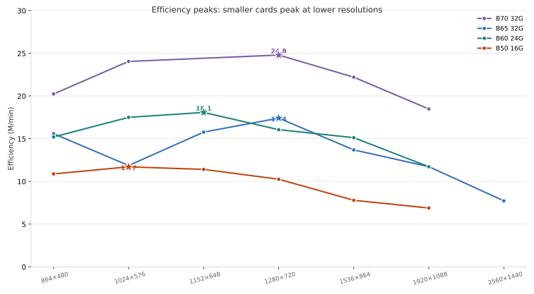
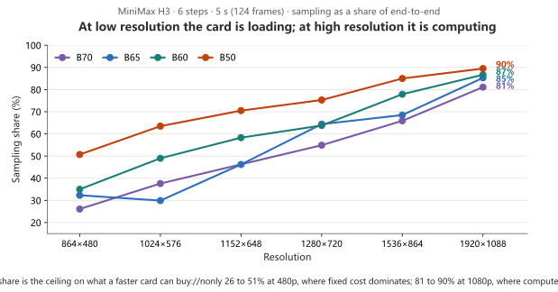
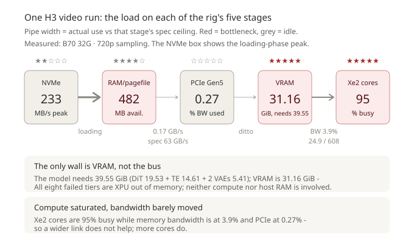
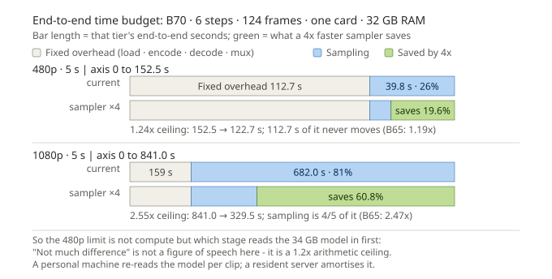
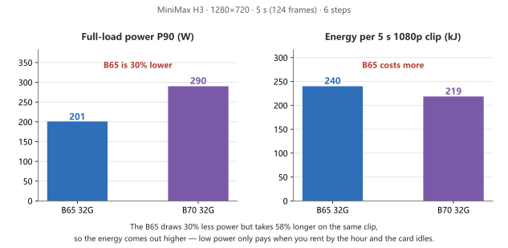

**English** · [简体中文](comfyui-h3.md)

# MiniMax H3 video: four Arc Pro cards, measured

> **In one line**: a single Arc Pro B card makes a 5-second video with audio locally — 720p in about **4.6 min** (B70) / **6.6 min** (B65) / **7.1 min** (B60), 1080p in about **14 to 38 min**.
> Every cell below is a **measured end-to-end** figure: model loading, sampling, VAE decode, and audio/video muxing included.

Fixed workload unless noted: **6 steps · 5.0 s · 124 frames · 24 fps · fixed seed · single card**.
Host: 32 GB RAM, display on the motherboard iGPU, the tested dGPU drives no display.

## 1. Four cards × six resolutions

| Resolution | Pixels | B70 32G | B65 32G | B60 24G | B50 16G |
|---|---:|---:|---:|---:|---:|
| 864×480 | 414,720 | **152.54 s** 6.64 s/step | **198.12 s** 10.65 s/step | **203.03 s** 11.86 s/step | **283.82 s** *(cold)* 24.00 s/step |
| 1024×576 | 589,824 | **182.57 s** 11.45 s/step | **370.31 s** 18.45 s/step | **250.86 s** 20.49 s/step | ★ **375.18 s** *(cold)* 39.68 s/step |
| 1152×648 | 746,496 | not measured | **352.31 s** 27.13 s/step | ★ **307.42 s** 29.89 s/step | **487.22 s** *(cold)* 57.25 s/step |
| 1280×720 | 921,600 | ★ **276.68 s** 25.30 s/step | ★ **394.06 s** 42.30 s/step | **427.31 s** 45.46 s/step | **669.19 s** *(cold)* 83.95 s/step |
| 1536×864 | 1,327,104 | **444.98 s** 48.86 s/step | **721.76 s** 82.46 s/step | **653.40 s** 84.79 s/step | **1,268.67 s** *(cold)* 179.82 s/step |
| 1920×1088 | 2,088,960 | **841.55 s** 113.73 s/step | **1,326.17 s** 188.64 s/step | **1,327.67 s** 191.89 s/step | **2,259.86 s** *(cold)* 337.02 s/step |
| 2560×1440 | 3,686,400 | not measured | **3,554.99 s** | not measured | ❌ **OOM** |

**How to read the table**

- Top half of a cell is **end-to-end seconds**; bottom half is **per-step sampling**; bold = steady state (2nd run on the same server).
- ★ = that card's own efficiency peak, `efficiency = pixels × frames ÷ end-to-end minutes` (M/min). Per-card values are in each card page §6; **do not compare this number across cards** (not the same batch).
- The B50 column is *(cold)*: first runs only, **not subtractable** from the other three columns (why: §6).
- B70's 1152×648 was never measured: it did not make the queue while the card was installed, and the card is gone.

> Chart note: ★ marks each card's efficiency peak (efficiency = pixel × frames / end-to-end minutes). Look at where the stars sit — B50 peaks at 576p, B60 at 648p, B65 and B70 at 720p: **smaller cards peak at lower resolutions.**
> Generated by `bench/harness/gen_h3_efficiency_peaks.py` from this table; do not hand-edit.

## 2. How far each card gets

| Card | Visible VRAM | 480p | 1024×576 | 1280×720 | 1536×864 | 1920×1088 |
|---|---|---|---|---|---|---|
| **B70 32G** | 31.16 GiB | ✅ fully resident | ✅ fully resident | ✅ fully resident | ⚠️ partial · offload 2,932 MB | ⚠️ partial · offload 7,564 MB |
| **B65 32G** | 31.16 GiB | ✅ fully resident | ✅ fully resident | ✅ fully resident | ⚠️ partial · offload 2,932 MB | ⚠️ partial · offload 7,564 MB |
| **B60 24G** | 23.33 GiB | ⚠️ partial · offload 3,728 MB | ⚠️ partial · offload 5,113 MB | ⚠️ partial · offload 7,847 MB | ⚠️ partial · offload 10,769 MB | ⚠️ partial · offload 10,769 MB |
| **B50 16G** | 15.51 GiB | ⚠️ partial · offload 12,985 MB | ⚠️ partial | ⚠️ partial | ⚠️ partial | ⚠️ partial |

How long a 5-second 720p clip takes (steady state): **B70 4.6 min · B65 6.6 min · B60 7.1 min · B50 11.2 min** (B50 is a first-run figure).

- **Fully resident** = all 19.5 GiB of the DiT sits in VRAM, no weights move per step. **Partial** = part of the weights is offloaded to host memory.
- 🔴 **The offload cost lands on step 1, not on every step**: about **1.9 s per GB** offloaded, and the other five steps stay within **0.3–3.4%** of a fully resident card. Direct 720p · 15 s comparison: B60 offloads 10,769 MB against B65's 7,564 MB, steady state **313.5 vs 311.0 s/step (+0.8%)**. Evidence: `bench/notes/b60-offload-cost-2026-10-26.md`.
- What decides this column is not the model but **how much VRAM is left at that resolution**: B65 and B70 match tier by tier (at 1536×864 both report `usable` 17,284.90 MB and both offload 2,931.76 MB).
- **720p and below is the comfort zone for 32 GB**; at 1080p a 32 GB card still offloads about 7.5 GB, and 24 GB offloads 10.8 GB.

## 3. Where the time goes: loading vs compute

| Card | 864×480 | 1024×576 | 1152×648 | 1280×720 | 1536×864 | 1920×1088 |
|---|---:|---:|---:|---:|---:|---:|
| B70 32G · 31.16 GiB | 26.1% | 37.6% | not measured | 54.9% | 65.9% | 81.1% |
| B65 32G · 31.16 GiB | 32.3% | 29.9% | **46.2%** | 64.4% | 68.5% | 85.3% |
| B60 24G · 23.33 GiB | 35.0% | 49.0% | 58.3% | 63.8% | 77.9% | 86.7% |
| B50 16G · 15.51 GiB | 50.7% | 63.5% | 70.5% | 75.3% | 85.0% | 89.5% |

**Read the chart: only 26 to 51% of the time is sampling at 480p, rising to 81 to 90% at 1080p — how much a faster card can buy is exactly how high this line goes.**
⚠️ Per-step is the 6-step cumulative average (includes the one-off first step); for raw compute use steady state (steps 2–6). The non-sampling part swings with whether that round re-reads the 15 GB text encoder (same card, same tier: 134–260 s) → **across batches compare per-step only; end-to-end only within one back-to-back batch**.

> Chart note: only the VRAM stage is saturated — bandwidth and PCIe are nearly idle, so a faster card does not fix "does it fit".

### How much faster could a card with N× the sampling speed be?

The sampling share is the entry point for "how much of this is compressible". Speed the sampling segment up N× and
**leave the fixed overhead exactly as measured on this machine** (a conservative choice: the text-encoder forward pass
and the VAE decode inside that fixed block also consume compute, so holding them constant treats them as incompressible):

| Tier (6 steps · 5 s = 124 frames) | End-to-end | Sampling | Fixed overhead | Sampling share | Sampling 3× faster | Sampling 4× faster |
|---|---:|---:|---:|---:|---:|---:|
| B70 · 864×480 | 152.5 s | 39.8 s | 112.7 s | **26%** | **1.21×** | **1.24×** |
| B65 · 864×480 | 303.2 s | 64.2 s | 239.1 s | **21%** | **1.16×** | **1.19×** |
| B70 · 1280×720 | 276.7 s | 151.0 s | 125.7 s | 55% | 1.57× | 1.69× |
| B65 · 1280×720 | 491.8 s | 254.8 s | 237.0 s | 52% | 1.53× | 1.64× |
| B70 · 1920×1088 | 841.0 s | 682.0 s | 159.0 s | 81% | 2.18× | 2.55× |
| B65 · 1920×1088 | 1439.4 s | 1141.6 s | 297.8 s | 79% | 2.12× | 2.47× |

**Chart note: the compressible ceiling is the sampling share. N× is an assumption, not a measurement; the 5090 H3 figure was not measured in this project.**

*Split end-to-end into "fixed overhead + sampling": **at 480p sampling is only 21 to 26% of the run, so a 4× faster sampler still only buys 1.19 to 1.24× end-to-end**; at 1080p sampling is 79 to 81% and the same assumption reaches 2.12 to 2.55×. The green segment is everything a faster card can win on this workload — at this tier it is not about compute, it is about who reads the 34 GB model in first.*

**Read the chart: the compressible ceiling is the sampling share.** N× is an assumption, not a measurement; H3 on a 5090 is not measured here, so no cross-card figure is given. A personal machine re-reads the 34 GB of models on every clip; a resident server loads once and serves many, which is when the gap returns to N× itself.

## 4. Duration: 5 s → 10 s → 15 s

Same 1280×720 · 6 steps, only the duration changes (end-to-end includes loading):

| Card | 5 s · 124 frames | 10 s · 243 frames | 15 s · 362 frames |
|---|---:|---:|---:|
| B70 32G | **276.7 s** 25.30 s/step | **705.5 s** 90.54 s/step | **1,309.8 s** 187.98 s/step |
| B65 32G | **437.1 s** *(cold)* 42.30 s/step | **1,166.4 s** 151.33 s/step | **2,149.8 s** 314.17 s/step |
| B60 24G | **427.3 s** 45.46 s/step | **1,106.1 s** 155.95 s/step | **2,110.0 s** 317.11 s/step |
| B50 16G | **669.2 s** *(cold)* 83.95 s/step | ❌ does not fit | ❌ does not fit |

> Each card's 480p ladder, offload volumes and the per-step exponent over frames are in its own card page §6. B65 has been pushed to 720p · 24 s and B60 to 480p · 20 s; **B70 above 20 s is not measured**.

## 5. Power and electricity cost

**Chart note: B65 draws 30% less power than B70 but is 58% slower per clip — energy per clip is actually higher. Low power only pays for "always-on, never saturated" rentals.**

**Read the chart: the B65 draws 30% less power than the B70 but takes 58% longer on the same clip, so the energy comes out higher** — low power only pays when you rent by the hour and the card idles for long stretches. For image and music, see [`comfyui-power.md`](comfyui-power.en.md).

## 6. Stability: do back-to-back runs survive

- **B65 32 GB**: nine consecutive H3 runs, **zero crashes, zero new system-level GPU timeout records**.
- **B70 32 GB**: 4 crashes in 16 decodes; the process **vanishes silently** (not an out-of-VRAM error). After raising the Windows GPU engine timeout from the default 2 s to 60 s, the process stopped being killed by the system; the cost is that in extreme cases the whole machine reboots.
- **B50 16 GB**: the "2nd run on the same server" in H3 **always drops the device**, at any resolution — an inherent boundary of the 16 GB tier, which is why 16 GB numbers are first-run only.
- All three affect only "can it run unattended for a long time"; **they do not affect a single clip**.

## 7. Which one to pick

| Your case | Pick | Why |
|---|---|---|
| Occasional clips, validating a workflow | **B50 16G** | 1080p works too, but one 5 s clip takes **37.7 min** |
| Regular 720p output | **B60 24G** | about 7.1 min at 720p; the cheapest 24 GB tier |
| 720p, but faster | **B65 32G** | 720p fully resident, 6.6 min; about ¥9,000 cheaper than B70 |
| Maximum 720p speed / regular 1080p | **B70 32G** | 1.4× faster at 720p, 1.6× at 1080p (vs B65) |

## 8. How to run it (three things you must know)

1. **Single card only.** With two cards installed the text encoder is placed on the CPU, and the server disappears without reporting an error.
2. **CUTE attention must be off** (`OMNI_ATTN_BACKEND=sdpa`), otherwise audio muxing dies at `avcodec_send_frame() returned 22`.
3. **`--reserve-vram 4`** is the collection condition behind these numbers; changing it changes loading behaviour (B65's music path behaves differently at `reserve 4` and `2`).

## 9. Where the data comes from

- Time: **2026-10-17 to 2026-10-27**, the four cards measured one at a time; at least 1 first run + 1 steady state per card per tier.
- Machine: 32 GB RAM (2×16 GB), monitor on the iGPU, the measured dGPU drives no display, ECC off (a 32 GB card shows 31.16 GB).
- Software: ComfyUI + OmniXPU runtime (Torch 2.12 + XPU provider 0.2.33); H3 with an int8 DiT and an nvfp4 text encoder.
- Raw records: date-named json under `bench/data/`, each holding end-to-end, sampling, load verdict, offload volume and power samples. Raw server logs stay on the capture machine and are not shipped.
- Extra runs: B65's 1024×576 / 1536×864 (10-21) and B60's 1024×576 / 1152×648 / 1536×864 (10-27), matched to their own main tables item by item (6 steps / 5 s / 124 frames / `--reserve-vram 4` / same seed).
- **Resolution ceiling (all measured): B50 stops at 1080p (1440p OOM); B65 does run 1440p, one 5 s clip takes 59 min; B70 / B60 at 1440p are not measured.**
- Every failed tier is `torch.OutOfMemoryError: XPU out of memory` — **not enough VRAM**, nothing to do with compute or host RAM. Evidence: `bench/notes/h3-vram-oom-signature-2026-10-26.md`.