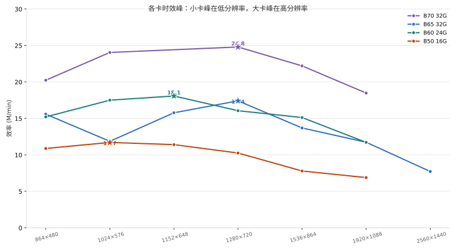
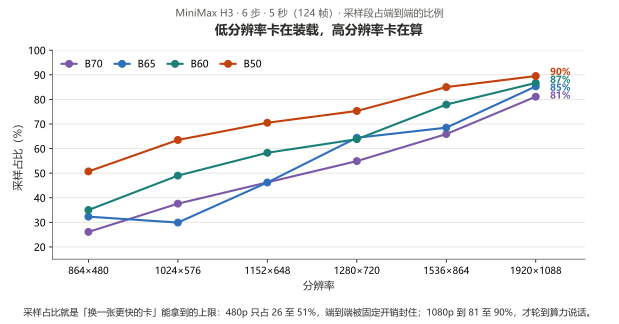
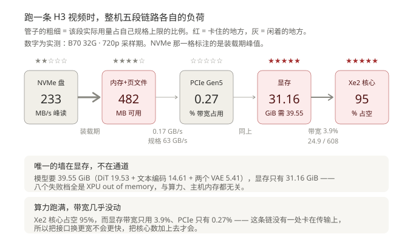
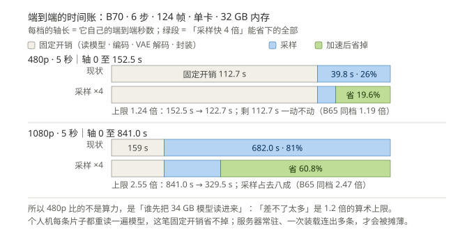
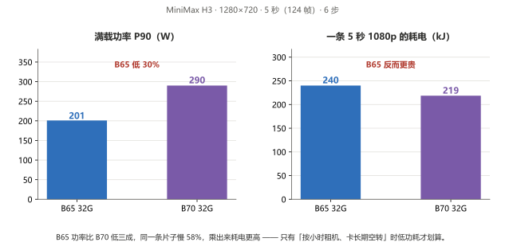

# MiniMax H3 video: four Arc Pro cards, measured

> **一句话**：一张 Arc Pro B 卡就能在本地把 5 秒有声视频做出来 —— 720p 约 **4.6 分钟**（B70）/ **6.6 分钟**（B65）/ **7.1 分钟**（B60），1080p 约 **14 至 38 分钟**。
> 下表每一格都是**实测端到端**：含模型装载、采样、VAE 解码、音视频封装。

固定工作负载（除非另注）：**6 步 · 5.0 秒 · 124 帧 · 24 fps · 固定随机种子 · 单卡**。
整机条件：32 GB 内存、显示器接主板核显、被测独显不出图。

## 一、四张卡 × 六个分辨率

| 分辨率 | 像素 | B70 32G | B65 32G | B60 24G | B50 16G |
|---|---:|---:|---:|---:|---:|
| 864×480 | 414,720 | **152.54 s** 6.64 s/步 | **198.12 s** 10.65 s/步 | **203.03 s** 11.86 s/步 | **283.82 s** *(cold)* 24.00 s/步 |
| 1024×576 | 589,824 | **182.57 s** 11.45 s/步 | **370.31 s** 18.45 s/步 | **250.86 s** 20.49 s/步 | ★ **375.18 s** *(cold)* 39.68 s/步 |
| 1152×648 | 746,496 | 未测 | **352.31 s** 27.13 s/步 | ★ **307.42 s** 29.89 s/步 | **487.22 s** *(cold)* 57.25 s/步 |
| 1280×720 | 921,600 | ★ **276.68 s** 25.30 s/步 | ★ **394.06 s** 42.30 s/步 | **427.31 s** 45.46 s/步 | **669.19 s** *(cold)* 83.95 s/步 |
| 1536×864 | 1,327,104 | **444.98 s** 48.86 s/步 | **721.76 s** 82.46 s/步 | **653.40 s** 84.79 s/步 | **1,268.67 s** *(cold)* 179.82 s/步 |
| 1920×1088 | 2,088,960 | **841.55 s** 113.73 s/步 | **1,326.17 s** 188.64 s/步 | **1,327.67 s** 191.89 s/步 | **2,259.86 s** *(cold)* 337.02 s/步 |
| 2560×1440 | 3,686,400 | 未测 | **3,554.99 s** | 未测 | ❌ **OOM** |

**怎么读这张表**

- 每格上半是**端到端秒数**，下半是**单步采样耗时**；加粗 = 稳态（同服务连跑的第 2 条）。
- ★ = 这张卡自己的时效峰，`效率 = 像素 × 帧 ÷ 端到端分钟`（M/min）。四张卡的数值见各自单卡页 §6；**跨卡不比这个数**（不是同一批跑的）。
- B50 列带 *(cold)*：只报首条，**不能与其它三列直接相减**（原因见 §六）。
- B70 的 1152×648 没测：在机那几天没排进队列，已拆机，补不了。

> 图注：★ 是各卡时效峰（效率 = 像素 × 帧 ÷ 端到端分钟）。看★的位置——B50 峰在 576p、B60 在 648p、B65 与 B70 在 720p：**小卡峰在低分辨率，大卡峰在高分辨率。**
> 图由 `bench/harness/gen_h3_efficiency_peaks.py` 从本表直出，不要手改。

## 二、每张卡能跑到哪一档

| 卡 | 可见显存 | 480p | 1024×576 | 1280×720 | 1536×864 | 1920×1088 |
|---|---|---|---|---|---|---|
| **B70 32G** | 31.16 GiB | ✅ 完整 | ✅ 完整 | ✅ 完整 | ⚠️ 部分 · 卸 2,932 MB | ⚠️ 部分 · 卸 7,564 MB |
| **B65 32G** | 31.16 GiB | ✅ 完整 | ✅ 完整 | ✅ 完整 | ⚠️ 部分 · 卸 2,932 MB | ⚠️ 部分 · 卸 7,564 MB |
| **B60 24G** | 23.33 GiB | ⚠️ 部分 · 卸 3,728 MB | ⚠️ 部分 · 卸 5,113 MB | ⚠️ 部分 · 卸 7,847 MB | ⚠️ 部分 · 卸 10,769 MB | ⚠️ 部分 · 卸 10,769 MB |
| **B50 16G** | 15.51 GiB | ⚠️ 部分 · 卸 12,985 MB | ⚠️ 部分 | ⚠️ 部分 | ⚠️ 部分 | ⚠️ 部分 |

一条 5 秒 720p 视频要等多久（稳态）：**B70 4.6 分钟 · B65 6.6 分钟 · B60 7.1 分钟 · B50 11.2 分钟**（B50 为首条口径）。

- **完整驻留** = 19.5 GiB 的 DiT 全进显存，每步不搬权重；**部分** = 卸一部分到主机内存。
- 🔴 **卸载的代价落在第 1 步，不在每步**：约 **1.9 s / GB** 卸载量，之后五步与全驻留差 **0.3–3.4%**。720p·15 秒直接对照：B60 卸 10,769 MB 对 B65 卸 7,564 MB，稳态 **313.5 对 311.0 s/步（+0.8%）**。取证见 `bench/notes/b60-offload-cost-2026-10-26.md`。
- 决定这一列的不是型号，是**这个分辨率下还剩多少显存**：B65 与 B70 逐档判决完全一致（1536×864 都是 `usable` 17,284.90 MB、卸 2,931.76 MB）。
- **720p 及以下是 32 GB 卡的舒适区**；1080p 在 32 GB 上也卸约 7.5 GB，24 GB 上卸 10.8 GB。

## 三、时间花在哪：装载 vs 计算

| 卡 | 864×480 | 1024×576 | 1152×648 | 1280×720 | 1536×864 | 1920×1088 |
|---|---:|---:|---:|---:|---:|---:|
| B70 32G · 31.16 GiB | 26.1% | 37.6% | 未测 | 54.9% | 65.9% | 81.1% |
| B65 32G · 31.16 GiB | 32.3% | 29.9% | **46.2%** | 64.4% | 68.5% | 85.3% |
| B60 24G · 23.33 GiB | 35.0% | 49.0% | 58.3% | 63.8% | 77.9% | 86.7% |
| B50 16G · 15.51 GiB | 50.7% | 63.5% | 70.5% | 75.3% | 85.0% | 89.5% |

**看图：480p 只有 26 至 51% 的时间在采样，1080p 到 81 至 90% —— 换一张更快的卡能拿到多少，就看这条线有多高。**
⚠️ 单步是 6 步累计平均（含第 1 步的一次性代价），比纯算力用稳态（第 2–6 步）；端到端的非采样段随「本轮要不要重读 15 GB 文本编码器」波动（同卡同档 134 至 260 s）→ **跨批只比单步，端到端只比同一批连跑**。

> 图注：五段链路里只有显存那条是满的——带宽与 PCIe 几乎闲置，所以「换更快的卡」不解决装不装得下。

### 换一张采样快 N 倍的卡，端到端能快多少

采样占比就是「可压缩比例」的入口。把采样段按 N 倍加速、**固定开销按本机实测原封不动保留**
（这是保守算法：固定的那块里文本编码器前向与 VAE 解码同样吃算力，不动它们等于把它们当成不可压缩）：

| 档位（6 步 · 5 秒 = 124 帧） | 端到端 | 采样段 | 固定开销 | 采样占比 | 采样快 3 倍 | 采样快 4 倍 |
|---|---:|---:|---:|---:|---:|---:|
| B70 · 864×480 | 152.5 s | 39.8 s | 112.7 s | **26%** | **1.21×** | **1.24×** |
| B65 · 864×480 | 303.2 s | 64.2 s | 239.1 s | **21%** | **1.16×** | **1.19×** |
| B70 · 1280×720 | 276.7 s | 151.0 s | 125.7 s | 55% | 1.57× | 1.69× |
| B65 · 1280×720 | 491.8 s | 254.8 s | 237.0 s | 52% | 1.53× | 1.64× |
| B70 · 1920×1088 | 841.0 s | 682.0 s | 159.0 s | 81% | 2.18× | 2.55× |
| B65 · 1920×1088 | 1439.4 s | 1141.6 s | 297.8 s | 79% | 2.12× | 2.47× |

*把端到端拆成「固定开销 + 采样」两段：**480p 采样只占 21 至 26%，所以采样快 4 倍、端到端也只快 1.19 至 1.24 倍**；1080p 采样占 79 至 81%，同样的假设上限才到 2.12 至 2.55 倍。绿段就是「换一张更快的卡」在这条负载上能拿到的全部 —— 这一档比的不是算力，是谁先把 34 GB 模型读进来。*

**看图：可压缩的上限就是采样占比。** N 倍是假设、不是实测，5090 上的 H3 本项目没测、不给对卡数字；个人机每条都要重读 34 GB 模型，服务器常驻、一次装载连出多条，差距才回到 N 倍本身。

## 四、时长：5 秒 → 10 秒 → 15 秒

同样 1280×720 · 6 步，只改时长（端到端含装载）：

| 卡 | 5 秒 · 124 帧 | 10 秒 · 243 帧 | 15 秒 · 362 帧 |
|---|---:|---:|---:|
| B70 32G | **276.7 s** 25.30 s/步 | **705.5 s** 90.54 s/步 | **1,309.8 s** 187.98 s/步 |
| B65 32G | **437.1 s** *(cold)* 42.30 s/步 | **1,166.4 s** 151.33 s/步 | **2,149.8 s** 314.17 s/步 |
| B60 24G | **427.3 s** 45.46 s/步 | **1,106.1 s** 155.95 s/步 | **2,110.0 s** 317.11 s/步 |
| B50 16G | **669.2 s** *(cold)* 83.95 s/步 | ❌ 装不下 | ❌ 装不下 |

> 各卡的 480p 阶梯、卸载量、单步对帧数的指数见各单卡页 §6。B65 已顶到 720p · 24 秒、B60 到 480p · 20 秒，**B70 的 20 秒以上没测**。

## 五、功耗与电费

**看图：B65 功率比 B70 低三成，同一条片子慢 58%，乘出来耗电反而更高** —— 只有「按小时租机器、且卡长期空转」的场景，低功耗才划算。出图 / 出音乐另见 [`comfyui-power.md`](comfyui-power.md)。

## 六、稳定性：连续跑会不会挂

- **B65 32 GB**：H3 连跑九轮，**零崩溃、零新增系统级 GPU 超时记录**。
- **B70 32 GB**：16 次解码里挂过 4 次，表现是**进程静默消失**（不是报显存不足）。把 Windows 的 GPU 引擎超时阈值从默认 2 秒放宽到 60 秒后，进程不再被系统杀掉；代价是极端情况下会整机重启。
- **16 GB 的 B50**：H3 的"同一服务连跑第 2 条"**必然掉设备**，与分辨率无关 —— 这是 16 GB 档的固有边界，所以 16 GB 的数只报首条。
- 这三条都只影响"能不能长时间无人值守跑"，**不影响单条出片本身**。

## 七、怎么选

| 你的场景 | 选 | 理由 |
|---|---|---|
| 偶尔出片、验证工作流 | **B50 16G** | 1080p 也能出，就是一条 5 秒要 **37.7 分钟** |
| 720p 日常量产 | **B60 24G** | 720p 约 7.1 分钟，价格最低的 24 GB 档 |
| 720p 要更快 | **B65 32G** | 720p 完整驻留、6.6 分钟；比 B70 便宜约 ¥9,000 |
| 720p 极限速度 / 1080p 常态 | **B70 32G** | 720p 快 1.4 倍、1080p 快 1.6 倍（对 B65） |

## 八、怎么跑起来（三条必知）

1. **必须单卡**。双卡在机时，文本编码器会被判到 CPU，服务端直接消失且不报错。
2. **必须关 CUTE 注意力**（`OMNI_ATTN_BACKEND=sdpa`），否则音频封装会崩在 `avcodec_send_frame() returned 22`。
3. **显存预留 `--reserve-vram 4`** 是这套数字的采集条件，改这个值会影响装载行为（B65 出音乐在 `reserve 4` 与 `2` 下行为不同）。

## 九、数据从哪来

- 时间：**2026-10-17 至 2026-10-27**，四张卡分别在机实测；同一张卡同一档至少 1 条首条 + 1 条稳态。
- 机器：32 GB 内存（2×16 GB）、显示器接主板核显、被测独显不出图、ECC 关（32 GB 卡可见 31.16 GB）。
- 软件：ComfyUI + OmniXPU 运行时（Torch 2.12 + XPU provider 0.2.33）；H3 用 int8 量化的 DiT + nvfp4 文本编码器。
- 原始记录：`bench/data/` 按日期命名的 json，每条含端到端、采样段、装载判决、卸载量、功耗采样。服务端原始日志体量大，留在采集机、不随仓库分发。
- 补测：B65 的 1024×576 / 1536×864（10-21）、B60 的 1024×576 / 1152×648 / 1536×864（10-27），条件与各自主表逐项对齐（同 6 步 / 5 秒 / 124 帧 / `--reserve-vram 4` / 同种子）。
- **分辨率上限（全实测）：B50 到 1080p 为止（1440p OOM）；B65 的 1440p 能跑，5 秒一条 59 分钟；B70 / B60 的 1440p 未测。**
- 失败档全部是 `torch.OutOfMemoryError: XPU out of memory` —— **显存不够**，与算力、主机内存无关。取证见 `bench/notes/h3-vram-oom-signature-2026-10-26.md`。
