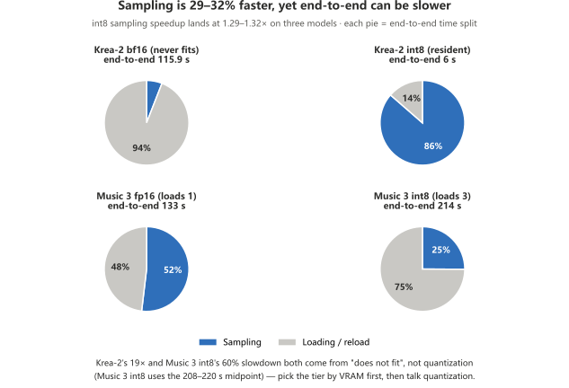

**English** · [简体中文](comfyui-image.md)

# ComfyUI · Image and music benchmarks (Qwen-Image 2.1 / Krea-2 / Music 3)

> Cards tested (AIB): **Arc Pro B50 LP 16G** · **Arc Pro B60 24G** · **Arc Pro B65 32G** · **Arc Pro B70 32G** (board partner GUNNIR 蓝戟)
>
> Harness: `sweep.py` (graph construction copied from `igerry/comfyui-b70-xpu`'s `benchmarks/*.py`) · `sweep_039*.py` / `smoke_039*.py` (0.39 upgrade A/B, see §0)
> Raw data: `bench/data/2026-*-{b50,b60,b65,b70}-*-comfyui.json` (schema `comfyui-xpu-bench/1`) · Migration scripts: `bench/harness/migrate_comfy_media.py` · `bench/harness/migrate_upgrade_ab.py` · Evidence backfill: `bench/harness/annotate_comfy_evidence.py`
> The video track lives in [`comfyui-h3.md`](comfyui-h3.en.md); the combined capability table is in [`comfyui-capability.md`](comfyui-capability.en.md)

---

## 0. Read this first: on one card, in one ComfyUI build, int8 speed depends on the **kernel variant**

**This is the most important table in the document.** One B70, one ComfyUI 0.39. The two columns differ in three places (kernel build + provider version + ComfyUI code patch):

| Qwen-Image 2.1<br>1280×720 · 25 steps | Precision | `torch213.bmg`<br>(no int8fix) | `torch212.bmg`<br>(with int8fix) | Change |
|---|---|---:|---:|---:|
| **Same prompt (steady state)** | `bf16` | 13.69 / 13.77 s | 13.79 / 13.85 s | **Unchanged** |
| Same prompt (steady state) | **`int8`** | 18.87 / 18.83 s | **10.63 / 10.63 s** | **1.78× faster** |
| First load | `bf16` | 96.66 s | 46.42 s | — |
| First load | `int8` | 28.04 s | 19.45 s | — |
| New prompt | `int8` | 19.27 s | **11.00 s** | **1.75× faster** |

| Kernel + stack | int8 steady state | bf16 steady state | **int8 vs bf16** |
|---|---:|---:|---:|
| `torch213.bmg` · no int8fix | 18.85 s | 13.73 s | **37% slower** |
| `torch212.bmg` · with int8fix | **10.63 s** | 13.82 s | **23% faster** |

**One result**: "int8 is 37% slower than bf16" is an artifact of **a misconfigured kernel**, not a property of the Intel card; on `torch212.bmg`, 10.63 s lands right inside the 10.3 to 10.6 s gerrywang claims. **The 1.78× comes from one ComfyUI 0.39 code patch** (see §0.6); kernel build and provider version together are worth ≤3% (see §0.5).

### §0.1 Where the two stacks actually differ

Both kernel variants report the same version number (`0.2.0b2`) and register the same capability list; they differ in maturity. **Every number in this document comes from the left-hand stack:**

| Item | Stack behind this document's numbers | Comparison stack |
|---|---|---|
| torch | 2.12.0+xpu | 2.13.0+xpu |
| `omni_xpu_kernel` | `0.2.0b2+torch212.bmg` | `0.2.0b2+torch213.bmg` |
| provider | **0.2.33** | 0.2.31 |
| Registered capability list | **Identical** on both | Same |
| **B70 · Qwen-Image int8 steady state** (same code) | **10.62 s** | **10.63 s** |

> Full build differences and the A/B/C grouping design: [`bench/notes/comfyui-image-kernel-ab.md`](../bench/notes/comfyui-image-kernel-ab.md).

### §0.5 ⭐⭐ Same code on B70: **both "capability declaration" and "kernel build" are worth 0%**

One B70, one ComfyUI codebase, one `omni_int8fix.py` (Qwen-Image 2.1 int8 · 1280×720 · 25 steps):

| Group | torch / kernel / provider | Switches | First round | **Steady state ×2** | Mean | **Sampling** |
|---|---|---|---:|---:|---:|---:|
| **b70same** | 2.12 / torch212 / **0.2.33** | Both on | 52.94 s | 10.61 / 10.64 | **10.62 s** | **9 s** |
| **b70sig** | 2.12 / torch212 / **0.2.33** | Signature fix only | 46.70 s | 10.65 / 10.67 | **10.66 s** | **9 s** |
| **b70t213** | **2.13 / torch213 / 0.2.31** | Both on | 38.52 s | 10.59 / 10.67 | **10.63 s** | **9 s** |

| Card | What "capability declaration" is worth | What "swapping the kernel build" is worth |
|---|---:|---:|
| **B50** (16 GB) | 4 to 5% (only Krea-2 can resolve it) | 1.5 to 3.4% |
| **B70** (32 GB) | **0%** | **0%** |

⚠️ First rounds (52.94 / 46.70 / 38.52 s) are shaped by warm vs cold disk page cache — **never compare kernels on first-round numbers**; cross-batch conclusions use steady state only.

### §0.6 The 1.78× comes from the ComfyUI code version — not the kernel build, not the capability declaration

| Batch | Kernel build | int8fix | ComfyUI code | B70 int8 steady state |
|---|---|---|---|---:|
| 2026-10-14 (`torch213`) | torch213 | **No** | **Before** the patch | 18.85 s |
| 2026-10-15 (`torch212`) | torch212 | **Yes** | **After** the patch (`ops.py` mtime 10-14 22:43) | 10.63 s |
| **2026-10-17 (`torch213`)** | **torch213** | Yes | Same file (post-patch) | **10.63 s** |

📌 Precisely: one patch to ComfyUI 0.39 moves this card by 1.78×. The 2026-10-14 B70 records describe that old kernel's behaviour only — **they say nothing about B70's INT8 capability**.

---

## 1. Capture setup

| Item | Definition |
|---|---|
| Timing source | Server-side `execution_start` → `execution_success`, **queueing excluded** |
| Software stack | ComfyUI **0.39.0** + `comfy-kitchen 0.2.37` + `omni_xpu_kernel 0.2.0b2+torch213.bmg` |
| VRAM | 31.16 GiB (B70, ECC off) / 32 GB system RAM |
| Three roles | **`first`** model just swapped in (incl. load) · **`resident`** same prompt, new seed (steady state) · **`newprompt`** new prompt (node cache fully invalidated) |
| Sampling groups | 2 resident runs per configuration (to check that steady state really holds), plus 1 `first` and 1 `newprompt` |
| Text encoder | **the 8B encoder for 2.1 exists locally in int8 only** (no bf16); all three groups use `qwen3vl_8b_int8_convrot` — bf16 rows deviate only in the encoder, INT8 rows are exactly aligned |
| Launch flags | no `--enable-dynamic-vram` (on 0.39 the aimdo XPU provider lacks `aimdo_storage_fast_disk`; enabling it crashes on startup) |

**Criteria (used throughout)**: ① compare precision tiers with `s/it` (sampling rate) only; ② end-to-end seconds are comparable only when `loads == 0`; ③ never mix the three roles, and never compare first rounds across batches.

---

## 2. Model sizes (bookkeeping, from actual file byte counts)

| Model | Component | Size |
|---|---|---:|
| **Qwen-Image 2.1** | DiT `qwen_image_2.1_bf16` | **13.253 GiB** |
| | DiT `qwen_image_2.1_int8_convrot` | **6.758 GiB** |
| | Text encoder `qwen3vl_8b_int8_convrot` | 8.709 GiB |
| | VAE `qwen_image_2.1_vae_bf16` | 0.629 GiB |
| **Krea-2 Turbo** | DiT `krea2_turbo_bf16` | **24.478 GiB** |
| | DiT `krea2_turbo_int8_convrot` | **12.566 GiB** |
| | Text encoder `qwen3vl_4b_bf16` | 8.266 GiB |
| | VAE `qwen_image_vae` | 0.236 GiB |
| **Music 3** | DiT `minimax_music3_dit_fp16` | 4.577 GiB |
| | DiT `minimax_music3_dit_int8_convrot` | 2.330 GiB |
| | Text encoder `minimax_music3_text_encoder_pruned_bf16` | **15.559 GiB** |
| | VAE `minimax_music3_dav` | 0.202 GiB |

> The fits / does-not-fit verdicts are in the first section of [`comfyui-capability.md`](comfyui-capability.en.md), not repeated here.

---

## 3. Results

### 3.0 ⭐ Master summary: four cards × every test item

Stack: ComfyUI 0.39.0 + torch **2.12.0+xpu** + kernel `torch212.bmg` + `omni_int8fix`, same code on all four cards. **Every figure is a `resident` steady-state time** (sec/image for image models, sec/song for music · 120 s · 30 steps).

**Image generation (steady state, s/image)**

| Test item | B50 16G | B60 24G | B65 32G | B70 32G |
|---|---:|---:|---:|---:|
| Qwen-Image 2.1 · 1280×720 · 25 steps · `int8` | 51.75 ᵃ | 17.33 to 18.80 | **16.13 to 16.19** | **10.61 to 10.64** |
| Qwen-Image 2.1 · 1280×720 · 25 steps · `bf16` | 87.34 | 24.3 to 27.5 ⁱ | **22.91** | 13.79 to 13.85 |
| Qwen-Image 2.1 · 1536×864 · 25 steps · `int8` | 64.56 | 41.94 to 42.09 | — | — |
| Qwen-Image 2.1 · 2048×2048 · 25 steps · `int8` | 246.12 | 126.71 to 126.81 | 117.53 | — |
| Qwen-Image 2.1 · 3072×3072 · 25 steps · `int8` | 863.10 | 494.20 to 494.85 | 456.15 | — |
| Qwen-Image 2.1 · 4096×4096 · 25 steps · `int8` | — | 1425.83 to 1427.28 | 1306.66 | — |
| Qwen-Image 2.1 · 5120×5120 · 25 steps · `int8` | — | — | 3021.75 ᵏ | — |
| Krea-2 Turbo · 1024×1024 · 8 steps · `int8` | 57.89 ᶜ | — | — | — |
| Krea-2 Turbo · 1280×720 · 8 steps · `int8` | — | 62.30 to 66.00 ᵈ | **8.73 to 8.74** | **6.03 to 6.07** |
| Krea-2 Turbo · 1280×768 · 8 steps · `int8` | — | — | — | 6.54 |
| Krea-2 Turbo · 1536×1024 · 8 steps · `int8` | — | — | — | 11.13 |
| Krea-2 Turbo · 1280×720 · `bf16` | ❌ ᵉ | ❌ cannot fit ⁱ | 167.37 to 167.56 ᵈ | 127.74 ᵈ |

**Music generation (steady state, s/song · 120 s · 30 steps · cfg 1.7)**

| Test item | B50 16G | B60 24G | B65 32G | B70 32G |
|---|---:|---:|---:|---:|
| Music 3 · `int8` DiT + `int8` TE | 216.82 | 144.89 to 145.84 | 164.56 / 198.31 ᶠ | **61.35 to 66.69** |
| Music 3 · `int8` DiT + `bf16` TE | 218.21 | — | 236.51 / 301.14 ᵈ·ᶠ | **61.83 to 61.97** |
| Music 3 · `int8` DiT + `bf16` TE · `reserve 2` | — | — | **180.21 to 180.85** | — |
| Music 3 · `fp16` DiT + `int8` TE | 282.29 | — | — | 78.70 to 78.76 |
| Music 3 · `fp16` DiT + `bf16` TE | — | 204.6 to 205.2 ⁱ | 223.39 to 227.94 | 81.34 ᵍ |

**Table notes (conditions only)**: ᵃ B50 reloads the TE every round (3,837.8 MB) · ᵃ' 3072/4096/5120 come from the 2026-10-22/23 new batches (ceiling probes) · ᶜ 1024×1024 (the 16 GB delivery form), a different resolution from the other Krea-2 rows · ᵈ reloads every round (B60 Krea-2: the 12.6 GB DiT; Krea-2 bf16 and the Music `reserve 4` rows: `loads=3`) · ᵉ device lost after sampling (`UR_RESULT_ERROR_DEVICE_LOST`) · ᶠ two rounds did not converge; the faster one is taken · ᵍ borderline: runs but unstable · ⁱ B60 bf16 fill-in (2026-10-28, reserve 1/2) — Krea-2 cannot fit (32.98 GB); BS SKU requires pulling the power wall to 120% (144 W) to run bf16 (see B60-README §4 and pitfalls §2.7) · ᵏ 5120 has only 3 rounds (first + 2×resident); the new-prompt round was not run.


> Chart note: look at the solid bars — int8 is the delivery tier; the hatched bars on the same card are comparison tiers.

**Dynamic chart**: [`assets/image-bench-dashboard.html`](assets/image-bench-dashboard.html)

**How to read it**: the interactive version of the §3.0 master table — two panels (image / music), bar height = steady-state seconds, bar colour = card model (click the legend to toggle cards); hover any bar for batch id, load behaviour and the table-note letters (ᵃ–ᵏ, same meaning as the notes above); top-right language toggle. Every figure is sourced cell-by-cell from the master table (`bench/data/*.json` re-read for cross-checks).

**One result**: the cross-card gap comes from **whether it fits**, not from compute — when a workload is fully resident on a 32 GB card (`loads=0`), B70 is fastest; the moment things reload every round (B50's TE ping-pong, B60's Krea-2 DiT, all of Krea-2 bf16), the loading segment eats end-to-end time and it decouples from `s/it`.

### 3.2 What quantization buys, in time and in energy: sampling 1.29 to 1.32× faster; end-to-end is rewritten by "does it fit"

> Compare performance with the sampling rate only; end-to-end seconds are comparable only when `loads == 0` (criteria in §1). ⚠️ The three rows below come from one re-capture (same stack, same batch, internally comparable).

| Model | Configuration | Float tier | int8 tier | int8 sampling speedup |
|---|---|---:|---:|---:|
| Krea-2 Turbo | B70 · 1280×720 · 8 steps | 1.165 it/s | **1.543 it/s** | **1.32×** |
| Qwen-Image 2.1 | B70 · 1280×720 · 25 steps | 13.79 s | **10.64 s** | **1.30×** |
| MiniMax Music 3 | B70 · 120 s · 30 steps | 2.30 s/step | **1.79 s/step** | **1.29×** |

| Model | Steady-state time bf16/fp16 → int8 | Steady-state energy per run bf16/fp16 → int8 | **P90 power** | Energy gain |
|---|---|---|---:|---:|
| Qwen-Image 2.1 | 14.05 → 10.80 s (−23.1%) | 4.14 → 3.20 kJ | 291 W / 291 W | **−22.5%** |
| Krea-2 | 127.74 → 6.08 s (−95.2%) | 10.82 → 1.93 kJ | **93 W** / 291 W | **−82.1%** |
| Music 3 | 232.95 → 193.73 s (−16.8%) | 39.16 → 32.74 kJ | 290 W / 290 W | **−16.4%** |



> Chart note: look at the pie slices — sampling did speed up, but the end-to-end share is dominated by "does it fit in VRAM".

**One result**: quantization does not change power, only duration (both tiers draw 290 W P90, so energy gain ≈ time gain); **a P90 far below 290 W means the configuration does not fit** (Krea-2 bf16 runs at 93 W — the card waits on disk 94% of the time). The cost of "does not fit" is paid in time, not electricity. Full power setup: [`comfyui-power.md`](comfyui-power.en.md).

### 3.3d Music 3: DiT and TE are two dimensions, and `--reserve-vram` is part of the result

B70 32G · 4 rounds per cell (first + resident ×2 + new_song):

| DiT | DiT resident | TE | TE resident | First round | **resident ×2** | Result |
|---|---:|---|---:|---:|---:|---|
| **`fp16`** | 4,686 MB | **`bf16`** | 15,921 MB | 140.91 / **162.25 s** | 81.34 s | ⚠️ **borderline** |
| **`fp16`** | 4,686 MB | **`int8`** | 8,759 MB | 139.51 s | **78.76 / 78.70 s** | ✅ 3/4 |
| **`int8`** | 2,386 MB | **`bf16`** | 15,921 MB | 148.93 / 142.94 | **61.95 / 61.97 / 61.83 s** | ✅ |
| **`int8`** | 2,386 MB | **`int8`** | 8,759 MB | 128.51 / 127.11 | **66.74 / 66.69 / 61.35 s** | ✅ |

| Combination | Resident total | Result |
|---|---:|---|
| fp16 DiT + int8 TE | 13,445 MB | ✅ passes |
| **fp16 DiT + bf16 TE** | **20,608 MB** | ⚠️ **borderline**: runs but unstable (two runs scored 1/4 and 2/4) |
| int8 DiT + int8 TE | 11,145 MB | ✅ passes |
| int8 DiT + bf16 TE | 18,307 MB | ✅ passes (tightest margin, but enough) |

**Same model, different `--reserve-vram` (B65 · DiT int8 + TE bf16)**:

| `--reserve-vram` | first | resident | new_song | `loads` per round |
|---|---:|---:|---:|---|
| `4` | 309.96 s | 301.14 / 236.51 s (**27% apart, not converged**) | 225.08 s | 3 / 3 / 3 / 3 |
| `2` | 303.29 s | **180.85 / 180.21 s** (**0.4%** apart) | 236.47 s | 3 / **1 / 1** / 2 |

**One result**: DiT quantization is the performance lever (int8 steady state is 16 to 21% faster than fp16); TE precision only moves the first round (steady state within 5%); **any music timing figure must carry `--reserve-vram`** — same card, same model, reserve 4 → 2 moves steady state by 24% (mechanism not investigated, phenomenon only). `new_song` (a whole new song) fails on every tier: a capacity wall in the "swap the whole song" operation itself, independent of card and TE precision. Data: `../bench/data/2026-10-21_b65-32g_*.json` (`b65m3` / `b65m3res2`).

### 3.4 ⭐ Three-tier delivery summary (B50 16G / B60 24G / B65 32G)

All three tiers share one stack (int8fix¹), 4 rounds each (first / 2×resident / new prompt). Capture conditions: B50 `reserve-vram 2` (10-16/17 batches); B60 and B65 `reserve-vram 4` · driver 9150 · card guard verified `Intel(R) Arc(TM) Pro B60 Graphics` (10-20) / `Intel(R) Arc(TM) Pro B65 Graphics` (chip `E222` / subsys `27441EF7` / board GUNNIR `2744`, 10-21). The resolution dimension is in §3.4.0 and is not repeated here.

**Role readings (first round / steady state ×2 / new prompt, s)**

| Workload | Precision | B50 16G | B60 24G | B65 32G |
| --- | --- | ---: | ---: | ---: |
| **Qwen-Image 2.1** 1280×720 · 25 steps | `int8`¹ | 84.83 / **50.52 · 52.98** / 47.11 | 62.03 / **17.33–18.80** / 22.67 | 62.08 / **16.13 · 16.19** / 16.85 |
| Same | `bf16` | 122.75 / **93.63 · 81.06** / 73.52 | not measured ⁱ | 103.97 / **22.82 · 23.00** / 23.86 |
| **Krea-2 Turbo** · 8 steps (B50 = 1024², B60/B65 = 1280×720) | `int8`¹ | 86.88 / **58.47 · 57.30** / 58.03 | 94.69 / **62.30–66.00** / 60.08 | 68.52 / **8.74 · 8.73** / 9.01 |
| Same | `bf16` | **device lost after 88.31 s**³ | not measured ⁱ | 200.90 / **167.56 · 167.37** / 184.36 |
| **Music 3** 120 s · 30 steps | `fp16` DiT + int8 TE | 342.84 / **282.29** / **OOM**⁵ | — | — |
| Same | `int8`¹ DiT + **int8 TE** | 285.74 / **216.82** / **OOM**⁵ | 279.52 / **144.9–145.8** / 198.43 | 309.74 / **164.56 / 198.31** ᶠ / 239.15 |
| Same | `int8`¹ DiT + **bf16 TE**⁴ | **524.20** / **218.21** / **OOM**⁵ | — | 309.96 / **301.14 · 236.51** ᵈ / 225.08 |

**Load behaviour and form**

| Workload | B50 16G | B60 24G | B65 32G |
| --- | --- | --- | --- |
| Qwen-Image · int8 | 6,921 MB complete; TE reloaded every round (3,837.8 MB) | sampling-dominated (1.55 it/s) | `loads` 3→0, fully resident |
| Krea-2 · int8 | 12,866 MB complete (offload 0) | DiT reloaded every round (12.6 GB), fixed overhead 61% | `loads` 3→0, fully resident |
| Music 3 · int8 + int8 TE | DiT 2,386 + TE 8,760 MB, both fully resident | sampling-dominated (3.11 s/it) | `loads=3`, all three reload |
| Music 3 · int8 + bf16 TE | TE 12,866 MB resident + 3,056 MB offloaded | — | `loads=3` × 4, not resident |
| Whole-card power avg / peak | — | 54–144 / 147–163 W (74–82% of the 200 W TBP) | — |

¹ with `OMNIXPU_INT8_SIGFIX=1` + `OMNIXPU_INT8_COMPUTE=1`. ³ `UR_RESULT_ERROR_DEVICE_LOST` after sampling finished. ⁴ the cost sits in the first round only (+84%); for batch song generation bf16 TE is usable. ⁵ B50's `new_song` rounds OOM; the "swap the whole song" capacity wall is in §3.3d. ᵈ two rounds did not converge (301.14 / 236.51), see §3.3d. ᶠ two rounds did not converge (198.31 / 164.56); the faster one is taken. ⁱ the 10-20 batch never scheduled bf16 (backfill is queued).

**One result**: the three tiers differ in load behaviour, not compute — B50 reloads the TE every image round (3,837.8 MB), B60's Krea-2 reloads the DiT every round (fixed overhead 61%, 33% slower than Qwen on the same card), B65 keeps both image components fully resident from round 2 on (`loads=0`; capacity arithmetic: B60 has 19.33 GiB usable < 21.07 GiB and does not fit, B65 has 27.16 GiB > 21.07 GiB and does); Music 3 never stays resident on any tier (TE precision and `--reserve-vram` effects in §3.3d). B60 power never touches the wall (peaks 147.2 to 163.2 W); Music 3's `fp16` DiT + `bf16` TE runs at 204.6 to 205.2 s steady state (BS SKU). **The criterion is always `loads`, never `role`.**

#### 3.4.0 Resolution: how large an image can be produced (four-card summary)

The grid baseline rows (1280×720 / 1024×1024) share steady-state values with the table above — this section owns the resolution axis, the table above owns the role/load axis. Qwen-Image 2.1 · int8 · 25 steps · steady state s/image:

| Resolution | Pixels | Pixel ratio | B50 16G | B60 24G | B65 32G | B70 32G |
|---|---:|---:|---:|---:|---:|---:|
| 1280×720 | 0.92 MP | 1.00× | 51.75 | 17.33 to 18.80 | 16.13 to 16.19 | 10.61 to 10.64 |
| 1536×864 | 1.33 MP | **1.44×** | 64.56 | 42.02 | — | — |
| **2048×2048** | 4.19 MP | **4.55×** | **246.12**<br>(246.50 / 246.74) | **126.76**<br>(126.71 / 126.81) | **117.53**<br>(117.52 / 117.55) | — |
| **3072×3072** | 9.44 MP | **10.22×** | **863.10** ᵐ<br>(849.52 / 876.68) | 494.52 ᵐ<br>(494.20 / 494.85) | 456.15 ᵐ<br>(455.97 / 456.34) | — |
| **4096×4096** | 16.78 MP | **18.17×** | — | **1426.55** ᵐ<br>(1425.83 / 1427.28) | **1306.66** ᵐ<br>(1305.87 / 1307.45) | — |
| **5120×5120** | 26.21 MP | **28.40×** | — | — | **3021.75** ᵏ<br>(3021.61 / 3021.89) | — |

Krea-2 Turbo · int8 · 8 steps · steady state s/image:

| Resolution | Pixels | Pixel ratio | B50 16G | B60 24G | B65 32G | B70 32G |
|---|---:|---:|---:|---:|---:|---:|
| 1280×720 | 0.92 MP | 1.00× | — | 62.30 to 66.00 ᵈ | **8.73 to 8.74** | **6.03 to 6.07** |
| 1280×768 | 0.98 MP | **1.07×** | — | — | — | 6.54 |
| 1024×1024 | 1.05 MP | **1.14×** | 57.89 ᶜ | — | — | — |
| **1536×1024** | 1.57 MP | **1.71×** | — | — | — | **11.13** |

Role readings outside the tables above (first round / new prompt, s):

| Batch | First round | New prompt |
|---|---:|---:|
| B50 · 1536×864 | 94.24 s | 64.54 s |
| B60 · 1536×864 | 70.86 s | 42.07 s |
| B50 · 2048×2048 | 275.20 s | 245.09 s |
| B60 · 2048×2048 | 169.36 s | 137.12 s |
| B65 · 2048×2048 | 161.37 s | 118.18 s |
| B50 · 3072×3072 | 879.92 s | 859.09 s |
| B60 · 3072×3072 | 516.55 s | 494.49 s |
| B65 · 3072×3072 | 488.20 s | 457.02 s |
| B60 · 4096×4096 | 1421.61 s | 1432.59 s |
| B65 · 4096×4096 | 1410.46 s | 1305.51 s |
| B65 · 5120×5120 | 3027.67 s | — ᵏ |
| B70 · Krea 1280×720 | 48.82 s | 6.29 s |
| B70 · Krea 1280×768 | 49.34 s | 6.75 s |
| B70 · Krea 1536×1024 | 55.69 s | 11.36 s |

**One result**: **sampling cost grows superlinearly with pixel count and the curve steepens at higher resolutions** (Qwen-Image: 1.44× the pixels → 1.55× the sampling, p ≈ 1.21; 4.55× the pixels → 7.38× the sampling, p ≈ 1.36; across the span p ≈ 1.32) — that exponent belongs to the sampling segment only; B50 end-to-end carries 18 to 24 s of fixed overhead per round which flattens it (end-to-end p ≈ 1.03), **so never apply 1.21–1.36 to end-to-end seconds**. Krea-2 runs only 8 steps with a low sampling share, so the same dimension is flatter (p ≈ 1.10 to 1.14, about 20% flatter, not an order of magnitude). The video track shows the same law (see [`comfyui-h3.md`](comfyui-h3.en.md) §8). **Image ceiling (fully measured)**: B50 reaches **3072×3072** (863 s steady state ≈ 14.4 min); B60 reaches **4096×4096** (1,427 s steady state ≈ 24 min); B65 reaches **5120×5120** (about 3,022 s ≈ 50 min) — all cards stop at their probe tier; above that is untested. From 3072 up only end-to-end is measured (the new batches carry no sampling split, ᵐ). B60's 2048×2048 is the only resolution with `loads=0` (all three components fully resident; other resolutions trigger `loads=3` reloads each round as activations displace weights).

#### 3.4.0b ⭐⭐ The INT8 switch 2×2: "signature fix" decides whether it runs; "capability declaration" is worth ≤5%

One ComfyUI codebase, one `omni_int8fix.py`. The full switch matrix across three models × two cards (base = both switches off, shim not installed; sigfix = signature fix only; int8fix = both on; **this matrix was only run on B50 / B70** — neither B60 nor B65 was scheduled for it; the all-four-card comparison is in §3.0):

| Card | Model | base | sigfix | int8fix | **What capability declaration is worth** |
|---|---|---:|---:|---:|---:|
| B50 | **Qwen-Image 2.1** | ❌ **0/4, all crashed** | ✅ 4/4 · 47.68 | ✅ 4/4 · 51.75 | **≈ 0%** (sampling segment bit-identical) |
| B50 | **Krea-2 Turbo** | 61.19 s | 61.99 s | **57.89 s** | **4 to 5%** |
| B50 | **Music 3** (int8 TE) | ❌ **crashed** | ✅ 2/3 · 221.81 | ✅ 2/3 · 216.82 | **2%** |
| B70 | **Krea-2 Turbo** | **6.04 s** | 6.07 s | **6.04 s** | **0%** |

The two switches separated on Qwen-Image 2.1 (B50 · 1280×720 · 25 steps):

| Capability declaration | Signature fix | First round | **Steady state ×2** | New prompt | Sampling |
|---|---|---:|---:|---:|---:|
| off | off | **0/4, all crashed** | — | — | — |
| off | **on** | 74.93 s | **47.93 / 47.42 s** | 46.95 s | **29 s (1.16 s/step)** |
| on | **on** | 84.83 s | 50.52 / 52.98 s | 47.11 s | **29 s (1.16 s/step)** |

**One result**: **the signature fix decides whether it runs at all** (Qwen-Image 2.1 and Music 3 crash in every base cell: `TypeError: int8_linear() got an unexpected keyword argument 'input_act_weight'`; the adapter layer fixes both — it is not optional); **"capability declaration" is worth ≤5% everywhere** (Qwen-Image ≈0%, Krea-2 4–5%, Music 3 2%, Krea-2 on B70 0%). Mechanism in §5.

#### 3.4.0e ⭐⭐ The KV cache (`QwenImage21Cache`): **steady state is completely unaffected by it**

One B70, Qwen-Image 2.1 int8 · 1280×720 · 25 steps, 4 rounds each:

| `device` / `dtype` | First round | **resident ×2** | New prompt |
|---|---:|---:|---:|
| `auto` / `default` (historical default, baseline) | 27.11 s | **10.85 / 10.70** | 11.04 s |
| **`gpu` / `default`** | 50.86 s | **10.63 / 10.65** | 11.02 s |
| **`cpu` / `default`** | 27.14 s | **10.77 / 10.75** | 11.13 s |
| **`off` / `default`** (= cache off) | 26.98 s | **10.61 / 10.60** | 11.00 s |
| `auto` / **`int8`** | 27.82 s | **10.68 / 10.69** | 11.12 s |
| `auto` / **`int4`** | 29.08 s | **10.72 / 10.72** | 11.14 s |

**One result**: `off` and `auto` give bit-identical steady state — **tuning `device` / `dtype` does nothing for image speed** (the image path is compute-bound: sampling is 56 to 90% of steady state, so the prefix-cache gain is buried). The verdict holds only for "model resident + sampling-dominated" workloads; long-text-prefix + few-step editing workflows are unmeasured. ⚠️ The 24 s spread in the first-round column is entirely warm vs cold disk page cache (three first rounds of the same configuration: 51.29 / 27.11 / 27.70 s) — nothing to do with `device`.

#### 3.4.2 The load pattern confirms the capacity arithmetic

| Component | Size | Measured result |
|---|---:|---|
| DiT `QwenImage21` (bf16) | 12.96 GB | `loaded partially; 12963.02 MB loaded, 608.00 MB offloaded` |
| DiT `QwenImage21` (int8) | 6.92 GB | `loaded completely; 7933.63 MB usable, 6920.54 MB loaded` |
| VAE `WanVAE` | 0.64 GB | `loaded completely; 12251.47 MB usable, 644.19 MB loaded` |
| Text encoder `QwenImage21TEModel_` | 8.92 GB | `loaded completely; 13014.30 MB usable, 8917.48 MB loaded` |
| Alternating | — | `Unloaded partially: 3837.80 MB freed` |

6.92 + 8.92 = 15.84 GB > 15.51 GiB → does not fit; the two take turns being resident (capacity verdict in the first section of [`comfyui-capability.md`](comfyui-capability.en.md)); the bf16 combination (22.59 GiB) is worse — 608 MB sits resident in host memory.

---

## 4. Image vs video: the fundamental difference — one is compute-bound, one is loading-bound

| Workload | Resolution | Role | Sampling share of end-to-end | Fixed overhead |
|---|---|---|---:|---:|
| **Image** Qwen-Image 2.1 int8 | 1280×720 | resident | **90%** | 1.8 to 1.9 s |
| **Image** Krea-2 int8 | 1024×1024 | resident | 78% | 2.6 s |
| **Image** Qwen-Image 2.1 int8 | 1280×720 | first (incl. load) | 61% | 11.0 s |
| **Image** Qwen-Image 2.1 bf16 | 1280×720 | first (incl. load) | 16% | 81.7 s |
| **Video** MiniMax H3 (B70) | 864×480 | fresh | 14 to 16% | 227 to 275 s |
| **Video** MiniMax H3 (B50) | 864×480 | fresh | 41% | 234.5 s |

**One result**: on the 32 GB tier, H3 video is **loading-bound** (fixed overhead 74 to 95%), so step count buys little; image generation is **compute-bound** (sampling is 78 to 90% once resident), so step count scales straight through — **the two optimise in opposite directions; do not carry the video conclusions over to image generation**. Image steady state is tens of seconds, video is minutes (the image models are an order of magnitude smaller: 6.8 to 12.6 GiB of DiT vs H3's 19.53 GiB).

---

## 5. ComfyUI 0.39 treats Intel XPU as "no native INT8 support" — and needs a patch

```python
def supports_int8_compute(device=None):
    ...
    if is_intel_xpu():
        return False          # ← every Intel XPU is treated as "no native INT8 support"
    ...
    return True
```

Consequence: `int8_tensorwise` and `convrot_w4a4` get pushed into the disabled set, and **INT8 weights are dequantized back to float before compute** — slower than plain bf16. Flip that one line (`OMNIXPU_INT8_COMPUTE=1`) and INT8 takes the native path.

📌 **The one statement used throughout this document**: **"INT8 has to take the native path, otherwise the weights get dequantized back to float" is a mechanism statement, and it holds; no percentage is promised** — reproducible gains are always the ≤5% of §3.4.0b.

**Why the three models benefit differently** (`Native ops`, measured from the startup log):

| Configuration | `Native ops` | `emulated ops` |
|---|---|---|
| Capability declaration **off** | `int8_tensorwise` | `nvfp4, float8_*, mxfp8, asym_w4a8_int8, w6a8_int8, convrot_w4a4` |
| Capability declaration **on** | `asym_w4a8_int8, w6a8_int8, int8_tensorwise, convrot_w4a4` | `mxfp8, nvfp4, float8_*` |

`int8_tensorwise` is Native in both states, and Qwen-Image 2.1's int8 weights are exactly that format — it takes the native kernel whichever way the switch sits, so flipping the switch unlocks nothing for it (gain ≈ 0, and it hits the signature mismatch so the adapter is required: the MLP's `[gate;up]` fusion goes through `comfy.ops.linear_input_act`). Krea-2 / Music 3 gain from `convrot_w4a4` / `w6a8_int8` / `asym_w4a8_int8` moving from emulated to native. The ComfyUI gate moves all four formats together, yet the base cell's log shows `int8_tensorwise` Native by itself — OmniXPU's `int8_ffn_adapter` adds it back to native on its own, bypassing the gate.

| Approach | What it does | Status |
|---|---|---|
| **A · adapter layer** (recommended, verified) | Wrap the provider and fill in the signature; pass fused activations through untouched where understood, run the rest eagerly | ✅ **4/4 end-to-end on B50** (74.93 / 47.93 / 47.42 / 46.95 s); cosine **0.9997** |
| **B · upgrade the provider** (the long-term fix) | Upstream PR #12 fills in the signature and adds native W4/W6 paths | ⏳ waiting on a package (**not on public PyPI**) |

The adapter lives at `ComfyUI/custom_nodes/omni_int8fix.py`. The two switches are decoupled: `OMNIXPU_INT8_COMPUTE` controls the capability declaration, `OMNIXPU_INT8_SIGFIX` the signature fix — decoupled so that "does it run" and "how much faster" can be measured separately. Source-level cause and PR reference: [`bench/notes/int8-native-path.md`](../bench/notes/int8-native-path.md).

---

## 6. Cross-check against a third party (`igerry/comfyui-b70-xpu`, not measured here · new stack only)

| Workload | Third party | This machine (new stack) | Comparison |
|---|---:|---:|---:|
| Qwen-Image 2.1 bf16 · steady state | 15.4 to 15.8 s | 13.79 to 13.85 s | 12% faster |
| Qwen-Image 2.1 INT8 · steady state | 10.3 to 10.6 s | **10.61 to 10.64 s** | **on par** |
| Krea-2 Turbo bf16 · new prompt | 14 to 16 s (1024²) | not re-measured ⁿ | — |
| Krea-2 Turbo INT8 · new prompt | 7.6 s (1024²) | not re-measured ⁿ | — |
| Music 3 fp16 · new lyrics | 110 to 113 s | ❌ new-song fails everywhere (§3.3d) | not comparable |
| Music 3 INT8 · new lyrics | 87 to 90 s | ❌ same | not comparable |

ⁿ the new stack only measures 1280×720 and above; the 1024² new-prompt comparison was not re-measured, and old-batch numbers are not cited.

**One result**: the two rows with matching conditions (Qwen-Image 2.1) run **on par to 12% faster** than the third party on the new stack — the INT8 row now lands inside their 10.3 to 10.6 s range (exactly where §0's patch fix puts it); the Krea-2 / Music 3 comparison conditions (1024² / new lyrics) were not re-measured on the new stack, and no old numbers are cited.

---

## 7. Not measured yet

| # | Gap |
|---|---|
| 1 | **Viggle turbo 6-step LoRA**: `Qwen-Image-2.1-viggle-turbo-v0.3-6step` is already downloaded locally and the official template supports 6-step generation. Not measured |
| 2 | **Above the resolution probe tiers**: B50 stops at 3072×3072, B60 at 4096×4096, B65 at 5120×5120 (ceiling probes, see §3.4.0); 2.1 supports higher but it is untested |
| 3 | **No valid int8fix data for Qwen-Image 2.1 on B70**: that group is `discarded` (0/4) and B70 is no longer in the machine — cannot be backfilled |
| 4 | **Higher resolutions for Krea-2 / Music 3**: Krea-2 is measured up to 1536×1024 (B70) and 1024×1024 (B50) only; Music 3 has no resolution dimension |
| 5 | **The KV cache under long-text-prefix + few-step editing workloads**: the §3.4.0e "no effect" verdict is verified only for resident + sampling-dominated loads |
| 6 | **Why `--reserve-vram` moves Music 3 steady state by 24%** (§3.3d): the phenomenon is measured; no "fixed reserve, change only the cache policy" control has been run |
| 7 | **B60 bf16 fill-in batch queued** (Qwen-Image bf16 / Music fp16 DiT + bf16 TE; Krea-2 bf16 at 32.98 GB cannot fit); higher resolutions remain unmeasured |
