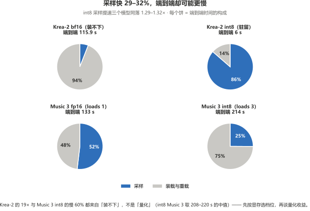

# ComfyUI · Image and music benchmarks (Qwen-Image 2.1 / Krea-2 / Music 3)

> 测过的机型（AIB 口径）：**Arc Pro B50 LP 16G** · **Arc Pro B60 24G** · **Arc Pro B65 32G** · **Arc Pro B70 32G**（板厂 GUNNIR 蓝戟）
>
> 采集脚本：`sweep.py`（图构造照抄 `igerry/comfyui-b70-xpu` 的 `benchmarks/*.py`）· `sweep_039*.py` / `smoke_039*.py`（0.39 升级 A/B，见 §0）
> 原始数据：`bench/data/2026-*-{b50,b60,b65,b70}-*-comfyui.json`（schema `comfyui-xpu-bench/1`）· 迁移脚本：`bench/harness/migrate_comfy_media.py` · `bench/harness/migrate_upgrade_ab.py` · 取证回填：`bench/harness/annotate_comfy_evidence.py`
> 视频那条线见 [`comfyui-h3.md`](comfyui-h3.md)；三合一的能力总表见 [`comfyui-capability.md`](comfyui-capability.md)

---

## 〇、先读这一节：同一张卡、同一套 ComfyUI，int8 快慢取决于**内核变体**

**这是整份文档最重要的一张表。** 同一张 B70、同一套 ComfyUI 0.39，左右两列差在三处（内核构建 + provider 版本 + ComfyUI 代码补丁）：

| Qwen-Image 2.1<br />1280×720 · 25 步 | 档          | `torch213.bmg`<br />（无 int8fix） | `torch212.bmg`<br />（有 int8fix） |          变化 |
| ----------------------------------- | ---------- | ------------------------------: | ------------------------------: | ----------: |
| **同提示词（稳态）**                        | `bf16`     |                 13.69 / 13.77 s |                 13.79 / 13.85 s |    **分毫未动** |
| 同提示词（稳态）                            | **`int8`** |                 18.87 / 18.83 s |             **10.63 / 10.63 s** | **快 1.78×** |
| 首次装载                                | `bf16`     |                         96.66 s |                         46.42 s |           — |
| 首次装载                                | `int8`     |                         28.04 s |                         19.45 s |           — |
| 换提示词                                | `int8`     |                         19.27 s |                     **11.00 s** | **快 1.75×** |

| 内核 + 栈                     |     int8 稳态 | bf16 稳态 | **int8 相对 bf16** |
| -------------------------- | ----------: | ------: | ---------------: |
| `torch213.bmg` · 无 int8fix |     18.85 s | 13.73 s |        **慢 37%** |
| `torch212.bmg` · 有 int8fix | **10.63 s** | 13.82 s |        **快 23%** |

**一个结果**：「int8 比 bf16 慢 37%」是**内核配错**的产物，不是 Intel 卡的性质；换 `torch212.bmg` 后 10.63 s 正中 gerrywang 声称的 10.3 至 10.6 s。**1.78× 差在 ComfyUI 0.39 的一个代码补丁**（见 §0.6），内核构建与 provider 版本合计 ≤3%（见 §0.5）。

### §0.1 两套栈具体差在哪

两个 kernel 变体版本号完全相同（`0.2.0b2`）、注册能力清单完全相同，实现成熟度不同。**本篇所有数字全部采自左列那套**：

| 项                                 | 本篇数字用的那套               | 对照那套                   |
| --------------------------------- | ---------------------- | ---------------------- |
| torch                             | 2.12.0+xpu             | 2.13.0+xpu             |
| `omni_xpu_kernel`                 | `0.2.0b2+torch212.bmg` | `0.2.0b2+torch213.bmg` |
| provider                          | **0.2.33**             | 0.2.31                 |
| 注册能力清单                            | 两边**完全相同**             | 同左                     |
| **B70 · Qwen-Image int8 稳态**（同代码） | **10.62 s**            | **10.63 s**            |

> 完整构建差异与 A/B/C 分组设计见 [`bench/notes/comfyui-image-kernel-ab.md`](../bench/notes/comfyui-image-kernel-ab.md)。

### §0.5 ⭐⭐ B70 上的同代码对照：**「能力声明」与「内核构建」两项都只值 0%**

同一张 B70、同一套 ComfyUI 代码、同一份 `omni_int8fix.py`（Qwen-Image 2.1 int8 · 1280×720 · 25 步）：

| 组           | torch / kernel / provider    | 开关    |      首轮 |     **稳态 ×2** |          均值 | **采样段** |
| ----------- | ---------------------------- | ----- | ------: | ------------: | ----------: | ------: |
| **b70same** | 2.12 / torch212 / **0.2.33** | 两开关都开 | 52.94 s | 10.61 / 10.64 | **10.62 s** | **9 s** |
| **b70sig**  | 2.12 / torch212 / **0.2.33** | 只签名适配 | 46.70 s | 10.65 / 10.67 | **10.66 s** | **9 s** |
| **b70t213** | **2.13 / torch213 / 0.2.31** | 两开关都开 | 38.52 s | 10.59 / 10.67 | **10.63 s** | **9 s** |

| 卡              |            「能力声明」值多少 | 「换内核构建」值多少 |
| -------------- | -------------------: | ---------: |
| **B50**（16 GB） | 4 至 5%（Krea-2 唯一能量出） | 1.5 至 3.4% |
| **B70**（32 GB） |               **0%** |     **0%** |

⚠️ 首轮（52.94 / 46.70 / 38.52 s）受磁盘页缓存冷热影响，**不能用来比内核**；跨批结论只用稳态。

### §0.6 1.78× 差在 ComfyUI 代码版本，不在内核构建、不在能力声明

| 批次                         | 内核构建         | int8fix | ComfyUI 代码                          | B70 int8 稳态 |
| -------------------------- | ------------ | ------- | ----------------------------------- | ----------: |
| 2026-10-14（`torch213`）     | torch213     | **无**   | 补丁**前**                             |     18.85 s |
| 2026-10-15（`torch212`）     | torch212     | **有**   | 补丁**后**（`ops.py` mtime 10-14 22:43） |     10.63 s |
| **2026-10-17（`torch213`）** | **torch213** | 有       | 同一份（补丁后）                            | **10.63 s** |

📌 准确说法：同一张卡上 ComfyUI 0.39 的一个补丁前后差 1.78×。2026-10-14 那批 B70 记录只代表旧内核下的表现，**不代表 B70 的 INT8 能力**。

---

## 一、采集口径

| 项     | 口径                                                                                               |
| ----- | ------------------------------------------------------------------------------------------------ |
| 计时来源  | 服务端 `execution_start` → `execution_success`，**不含排队**                                             |
| 软件栈   | ComfyUI **0.39.0** + `comfy-kitchen 0.2.37` + `omni_xpu_kernel 0.2.0b2+torch213.bmg`             |
| 显存    | 31.16 GiB（B70 关 ECC）/ 32 GB 内存                                                                   |
| 三种角色  | **`first`** 模型刚换上来（含加载）· **`resident`** 同提示词换种子（稳态）· **`newprompt`** 换提示词（节点缓存全失效）              |
| 采样组   | 每组跑 2 个 resident（检验稳态是否真稳），另 1 个 first + 1 个 newprompt                                           |
| 文本编码器 | **2.1 的 8B 编码器本机只有 int8 版**（无 bf16），三组统一用 `qwen3vl_8b_int8_convrot`——bf16 行只在编码器上有偏差，INT8 行是精确对齐 |
| 启动参数  | 不带 `--enable-dynamic-vram`（0.39 上 aimdo 的 XPU provider 缺 `aimdo_storage_fast_disk`，启用即崩）         |

**判据（全文通用）**：① 跨档位比性能只用 `s/it`（采样速率）；② 端到端秒数只在 `loads == 0` 时可比；③ `first` / `resident` / `newprompt` 三种角色不可混比，首轮不作跨批比较。

---

## 二、模型体积（记账用，来源为文件实际字节数）

| 模型                 | 组件                                              |             体积 |
| ------------------ | ----------------------------------------------- | -------------: |
| **Qwen-Image 2.1** | DiT `qwen_image_2.1_bf16`                       | **13.253 GiB** |
|                    | DiT `qwen_image_2.1_int8_convrot`               |  **6.758 GiB** |
|                    | 文本编码器 `qwen3vl_8b_int8_convrot`                 |      8.709 GiB |
|                    | VAE `qwen_image_2.1_vae_bf16`                   |      0.629 GiB |
| **Krea-2 Turbo**   | DiT `krea2_turbo_bf16`                          | **24.478 GiB** |
|                    | DiT `krea2_turbo_int8_convrot`                  | **12.566 GiB** |
|                    | 文本编码器 `qwen3vl_4b_bf16`                         |      8.266 GiB |
|                    | VAE `qwen_image_vae`                            |      0.236 GiB |
| **Music 3**        | DiT `minimax_music3_dit_fp16`                   |      4.577 GiB |
|                    | DiT `minimax_music3_dit_int8_convrot`           |      2.330 GiB |
|                    | 文本编码器 `minimax_music3_text_encoder_pruned_bf16` | **15.559 GiB** |
|                    | VAE `minimax_music3_dav`                        |      0.202 GiB |

> 「装不装得下」的判决在 [`comfyui-capability.md`](comfyui-capability.md) 第一节，不在本文重复。

---

## 三、结果

### 3.0 ⭐ 总测试项汇总：四张卡 × 全部测试项

栈：ComfyUI 0.39.0 + torch **2.12.0+xpu** + 内核 `torch212.bmg` + `omni_int8fix`，四张卡同一份代码。**表内数字一律为 `resident` 稳态秒数**（出图为秒/张，出音乐为秒/首 · 120 s · 30 步）。

**出图（稳态 s/张）**

| 测试项                                     |     B50 16G |          B60 24G |          B65 32G |          B70 32G |
| --------------------------------------- | ----------: | ---------------: | ---------------: | ---------------: |
| Qwen-Image 2.1 · 1280×720 · 25 步 · `int8`  | 51.75 ᵃ |     17.33 至 18.80 | **16.13 至 16.19** | **10.61 至 10.64** |
| Qwen-Image 2.1 · 1280×720 · 25 步 · `bf16`  |      87.34 |   24.3 至 27.5 ⁱ |        **22.91** |  13.79 至 13.85 |
| Qwen-Image 2.1 · 1536×864 · 25 步 · `int8`  |      64.56 |           41.94 至 42.09 |                — |                — |
| Qwen-Image 2.1 · 2048×2048 · 25 步 · `int8` |     246.12 |          126.71 至 126.81 |           117.53 |                — |
| Qwen-Image 2.1 · 3072×3072 · 25 步 · `int8` |     863.10 |          494.20 至 494.85 |            456.15 |                — |
| Qwen-Image 2.1 · 4096×4096 · 25 步 · `int8` |          — |         1425.83 至 1427.28 |           1306.66 |                — |
| Qwen-Image 2.1 · 5120×5120 · 25 步 · `int8` |          — |                — | 3021.75 ᵏ |                — |
| Krea-2 Turbo · 1024×1024 · 8 步 · `int8`    |  57.89 ᶜ |                — |                — |                — |
| Krea-2 Turbo · 1280×720 · 8 步 · `int8`     |          — | 62.30 至 66.00 ᵈ |  **8.73 至 8.74** |  **6.03 至 6.07** |
| Krea-2 Turbo · 1280×768 · 8 步 · `int8`     |          — |                — |                — |             6.54 |
| Krea-2 Turbo · 1536×1024 · 8 步 · `int8`    |          — |                — |                — |            11.13 |
| Krea-2 Turbo · 1280×720 · `bf16`            |      ❌ ᵉ |       ❌ 装不下 ⁱ | 167.37 至 167.56 ᵈ |        127.74 ᵈ |

**出音乐（稳态 s/首 · 120 s · 30 步 · cfg 1.7）**

| 测试项                                |     B50 16G |          B60 24G |            B65 32G |          B70 32G |
| ---------------------------------- | ----------: | ---------------: | -----------------: | ---------------: |
| Music 3 · `int8` DiT + `int8` TE     |      216.82 | 144.89 至 145.84 |   164.56 / 198.31 ᶠ | **61.35 至 66.69** |
| Music 3 · `int8` DiT + `bf16` TE     |      218.21 |                — | 236.51 / 301.14 ᵈ·ᶠ | **61.83 至 61.97** |
| Music 3 · `int8` DiT + `bf16` TE · `reserve 2` |          — |                — | **180.21 至 180.85** |                — |
| Music 3 · `fp16` DiT + `int8` TE     |      282.29 |                — |                  — |  78.70 至 78.76 |
| Music 3 · `fp16` DiT + `bf16` TE     |          — |   204.6 至 205.2 ⁱ |  223.39 至 227.94 |  81.34 ᵍ |

**表注（只列数字之外的条件）**：ᵃ B50 每轮重载 TE 3,837.8 MB · ᵃ' 3072/4096/5120 为 2026-10-22/23 新批（上限探测）· ᶜ 1024×1024（16 GB 交付形态），与其余 Krea-2 行不同分辨率 · ᵈ 每轮重装（B60 Krea-2：DiT 12.6 GB；Krea-2 bf16 与 Music `reserve 4` 行：`loads=3`）· ᵉ 采样后设备失联（`UR_RESULT_ERROR_DEVICE_LOST`）· ᶠ 两轮未收敛，取快者 · ᵍ 临界态：跑得通但不稳 · ⁱ B60 bf16 补测（2026-10-28 · reserve 1/2）——Krea-2 装不下（32.98 GB）；BS SKU 需拉墙 120%（144 W）方可跑 bf16（见 B60-README §4 与 pitfalls §2.7） · ᵏ 5120 只跑 3 轮（first + 2×resident），换提示词未跑。


> 图注：看实心柱——int8 是交付档；同卡同负载的斜纹柱是对比档。

**动态图**：[`assets/image-bench-dashboard.html`](assets/image-bench-dashboard.html)

**配套说明**：§3.0 主表的交互版——出图 / 出音乐两面板，柱高 = 稳态秒数、柱色 = 卡型（图例可点选开关）；悬停任意条看批号、装载形态与表注字母（ᵃ–ᵏ同本节表注）；右上角中英切换。数据与主表逐格同源（`bench/data/*.json` 回读对账）。

**一个结果**：跨卡差距的主要来源是**装不装得下**，不是算力——同一负载在 32 GB 卡上完整驻留（`loads=0`）时 B70 最快；一旦每轮重装（B50 的 TE 交替、B60 的 Krea-2 DiT、Krea-2 bf16 全线），端到端就被装载段吃掉，与 `s/it` 脱钩。

### 3.2 量化收益与能量：采样快 1.29 至 1.32×，端到端由「装不装得下」改写

> 比性能一律用采样速率；端到端秒数只在 `loads == 0` 时可比（判据见 §一）。⚠️ 本节三行来自同一次重采（同栈同批，内部可比）。

| 模型              | 配置                    |        浮点档 | int8 档 | int8 采样提速 |
| --------------- | --------------------- | ----------: | ------: | --------: |
| Krea-2 Turbo    | B70 · 1280×720 · 8 步  |  1.165 it/s | **1.543 it/s** | **1.32×** |
| Qwen-Image 2.1  | B70 · 1280×720 · 25 步 | 13.79 s | **10.64 s** | **1.30×** |
| MiniMax Music 3 | B70 · 120 s · 30 步    | 2.30 s/步 | **1.79 s/步** | **1.29×** |

| 模型             | 稳态耗时 bf16/fp16 → int8     | 稳态能量/次 bf16/fp16 → int8 |       **P90 功率** |       能量收益 |
| -------------- | ------------------------- | ----------------------- | ---------------: | ---------: |
| Qwen-Image 2.1 | 14.05 → 10.80 s（−23.1%）   | 4.14 → 3.20 kJ          |    291 W / 291 W | **−22.5%** |
| Krea-2         | 127.74 → 6.08 s（−95.2%）   | 10.82 → 1.93 kJ         | **93 W** / 291 W | **−82.1%** |
| Music 3        | 232.95 → 193.73 s（−16.8%） | 39.16 → 32.74 kJ        |    290 W / 290 W | **−16.4%** |



> 图注：看饼块——采样段确实提速了，但端到端的大头被「装不装得下」改写。

**一个结果**：量化不改功率、只改耗时（两档 P90 都是 290 W，能量收益 ≈ 时间收益）；**P90 远低于 290 W 就说明该配置装不下**（Krea-2 bf16 只有 93 W、卡 94% 时间在等磁盘）——「装不下」的代价在时间，不在电费。完整功耗口径见 [`comfyui-power.md`](comfyui-power.md)。

### 3.3d Music 3：DiT × TE 是两个维度，`--reserve-vram` 也进结果

B70 32G · 每格 4 轮（first + resident ×2 + new_song）：

| DiT        |   DiT 驻留 | TE         |     TE 驻留 |                    首轮 |             **resident ×2** | 结果         |
| ---------- | -------: | ---------- | --------: | --------------------: | --------------------------: | ---------- |
| **`fp16`** | 4,686 MB | **`bf16`** | 15,921 MB | 140.91 / **162.25 s** |                     81.34 s | ⚠️ **临界态** |
| **`fp16`** | 4,686 MB | **`int8`** |  8,759 MB |              139.51 s |         **78.76 / 78.70 s** | ✅ 3/4      |
| **`int8`** | 2,386 MB | **`bf16`** | 15,921 MB |       148.93 / 142.94 | **61.95 / 61.97 / 61.83 s** | ✅          |
| **`int8`** | 2,386 MB | **`int8`** |  8,759 MB |       128.51 / 127.11 | **66.74 / 66.69 / 61.35 s** | ✅          |

| 组合                     |          常驻合计 | 结果                           |
| ---------------------- | ------------: | ---------------------------- |
| fp16 DiT + int8 TE     |     13,445 MB | ✅ 通过                         |
| **fp16 DiT + bf16 TE** | **20,608 MB** | ⚠️ **临界**：能跑但不稳（两次跑 1/4、2/4） |
| int8 DiT + int8 TE     |     11,145 MB | ✅ 通过                         |
| int8 DiT + bf16 TE     |     18,307 MB | ✅ 通过（余量最紧但够）                 |

**同一个模型换 `--reserve-vram`（B65 · DiT int8 + TE bf16）**：

| `--reserve-vram` |    first |                          resident | new_song | 每轮 `loads`        |
| ---------------- | -------: | --------------------------------: | -------: | ----------------- |
| `4`              | 309.96 s |  301.14 / 236.51 s（**差 27%，未收敛**） | 225.08 s | 3 / 3 / 3 / 3     |
| `2`              | 303.29 s | **180.85 / 180.21 s**（差 **0.4%**） | 236.47 s | 3 / **1 / 1** / 2 |

**一个结果**：DiT 量化是性能杠杆（int8 稳态比 fp16 快 16 至 21%），TE 档位只改首轮（稳态差 ≤5%）；**报音乐耗时必须带上 `--reserve-vram`**——同一张卡同一模型，reserve 4 → 2 稳态差 24%（机制未查，只报现象）。`new_song`（换整首新歌）所有档位都失败：那是「换整首歌」自身的容量墙，与卡型、TE 档位无关。数据出处：`../bench/data/2026-10-21_b65-32g_*.json`（`b65m3` / `b65m3res2`）。

### 3.4 ⭐ 三档交付汇总（B50 16G / B60 24G / B65 32G）

三档同栈（int8fix¹），每档 4 轮（first / 2×resident / 换提示词）。采集条件：B50 `reserve-vram 2`（10-16/17 批）；B60 与 B65 `reserve-vram 4` · 驱动 9150 · 卡型守卫核对 `Intel(R) Arc(TM) Pro B60 Graphics`（10-20）/ `Intel(R) Arc(TM) Pro B65 Graphics`（chip `E222` / subsys `27441EF7` / 板 GUNNIR `2744`，10-21）。分辨率维度见 §3.4.0，本表不重复。

**角色读数（首轮 / 稳态 ×2 / 换提示词，秒）**

| 工作负载 | 档位 | B50 16G | B60 24G | B65 32G |
| --- | --- | ---: | ---: | ---: |
| **Qwen-Image 2.1** 1280×720 · 25 步 | `int8`¹ | 84.83 / **50.52 · 52.98** / 47.11 | 62.03 / **17.33–18.80** / 22.67 | 62.08 / **16.13 · 16.19** / 16.85 |
| 同上 | `bf16` | 122.75 / **93.63 · 81.06** / 73.52 | 未测 ⁱ | 103.97 / **22.82 · 23.00** / 23.86 |
| **Krea-2 Turbo** · 8 步（B50 = 1024²，B60/B65 = 1280×720） | `int8`¹ | 86.88 / **58.47 · 57.30** / 58.03 | 94.69 / **62.30–66.00** / 60.08 | 68.52 / **8.74 · 8.73** / 9.01 |
| 同上 | `bf16` | **88.31 后设备失联**³ | 未测 ⁱ | 200.90 / **167.56 · 167.37** / 184.36 |
| **Music 3** 120 s · 30 步 | `fp16` DiT + int8 TE | 342.84 / **282.29** / **OOM**⁵ | — | — |
| 同上 | `int8`¹ DiT + **int8 TE** | 285.74 / **216.82** / **OOM**⁵ | 279.52 / **144.9–145.8** / 198.43 | 309.74 / **164.56 / 198.31** ᶠ / 239.15 |
| 同上 | `int8`¹ DiT + **bf16 TE**⁴ | **524.20** / **218.21** / **OOM**⁵ | — | 309.96 / **301.14 · 236.51** ᵈ / 225.08 |

**装载与形态**

| 工作负载 | B50 16G | B60 24G | B65 32G |
| --- | --- | --- | --- |
| Qwen-Image · int8 | 6,921 MB 完整；TE 每轮重载 3,837.8 MB | 采样主导（1.55 it/s） | `loads` 3→0，整驻 |
| Krea-2 · int8 | 12,866 MB 完整（offload 0） | 每轮重装 DiT 12.6 GB，固定开销占 61% | `loads` 3→0，整驻 |
| Music 3 · int8 + int8 TE | DiT 2,386 + TE 8,760 MB，均完整驻留 | 采样主导（3.11 s/it） | `loads=3`，三件全重装 |
| Music 3 · int8 + bf16 TE | TE 12,866 MB 驻留 + 3,056 MB 卸载 | — | `loads=3` × 4，不驻留 |
| 整卡功耗 均 / 峰 | — | 54–144 / 147–163 W（TBP 200 W 的 74–82%） | — |

¹ 带 `OMNIXPU_INT8_SIGFIX=1` + `OMNIXPU_INT8_COMPUTE=1`。 ³ 采样完成后报 `UR_RESULT_ERROR_DEVICE_LOST`。 ⁴ 代价只在首轮（+84%），批量出歌时 bf16 TE 也能用。 ⁵ B50 的 `new_song` 轮 OOM；换歌自身的容量墙见 §3.3d。 ᵈ 两轮未收敛（301.14 / 236.51），见 §3.3d。 ᶠ 两轮未收敛（198.31 / 164.56），取快者。 ⁱ 10-20 批未排 bf16 档（补测已列入队列）。

**一个结果**：三档的差别在装载形态，不在算力——B50 出图每轮重载 TE（3,837.8 MB）、B60 的 Krea-2 每轮重装 DiT（固定开销占 61%，比同卡 Qwen 慢 33%）、B65 出图两件从第 2 轮起 `loads=0` 整驻（容量账：B60 可用 19.33 < 21.07 GiB 装不下；B65 可用 27.16 > 21.07 GiB 装得下）；Music 3 三档都不驻留（TE 档位与 `--reserve-vram` 的影响见 §3.3d）。B60 功耗全程未触墙（峰值 147.2 至 163.2 W）；Music 3 的 `fp16` DiT + `bf16` TE 档稳态 204.6 至 205.2 s。**判据永远是 `loads`，不是 `role`。**

#### 3.4.0 分辨率维度：能出多大的图（四卡汇总）

网格基线行（1280×720 / 1024×1024）的稳态与上表同源——本节管分辨率轴，上表管角色 / 装载轴。Qwen-Image 2.1 · int8 · 25 步 · 稳态 s/张：

| 分辨率           |     像素数 |       像素比 |                      B50 16G |          B60 24G |                      B65 32G |          B70 32G |
| ------------- | ------: | --------: | ---------------------------: | ---------------: | ---------------------------: | ---------------: |
| 1280×720      | 0.92 MP |     1.00× |                        51.75 | 17.33 至 18.80 | 16.13 至 16.19 | 10.61 至 10.64 |
| 1536×864      | 1.33 MP | **1.44×** |                        64.56 | 42.02 |                            — |                — |
| **2048×2048** | 4.19 MP | **4.55×** | **246.12**<br />（246.50 / 246.74） | **126.76**<br />（126.71 / 126.81） | **117.53**<br />（117.52 / 117.55） |                — |
| **3072×3072** | 9.44 MP | **10.22×** | **863.10** ᵐ<br />（849.52 / 876.68） | 494.52 ᵐ<br />（494.20 / 494.85） | 456.15 ᵐ<br />（455.97 / 456.34） |                — |
| **4096×4096** | 16.78 MP | **18.17×** |                            — | **1426.55** ᵐ<br />（1425.83 / 1427.28） | **1306.66** ᵐ<br />（1305.87 / 1307.45） |                — |
| **5120×5120** | 26.21 MP | **28.40×** |                            — |                — | **3021.75** ᵏ<br />（3021.61 / 3021.89） |                — |

Krea-2 Turbo · int8 · 8 步 · 稳态 s/张：

| 分辨率           |      像素数 |       像素比 | B50 16G |          B60 24G |          B65 32G |          B70 32G |
| ------------- | ------: | --------: | ------: | ---------------: | ---------------: | ---------------: |
| 1280×720      | 0.92 MP |     1.00× |     — | 62.30 至 66.00 ᵈ | **8.73 至 8.74** | **6.03 至 6.07** |
| 1280×768      | 0.98 MP | **1.07×** |     — |                — |                — |             6.54 |
| 1024×1024     | 1.05 MP | **1.14×** | 57.89 ᶜ |                — |                — |                — |
| **1536×1024** | 1.57 MP | **1.71×** |     — |                — |                — |        **11.13** |

上表之外的角色读数（首轮 / 换提示词，秒）：

| 批                          |      首轮 |      换提示词 |
| -------------------------- | ------: | -------: |
| B50 · 1536×864             |  94.24 s |  64.54 s |
| B60 · 1536×864             |  70.86 s |  42.07 s |
| B50 · 2048×2048            | 275.20 s | 245.09 s |
| B60 · 2048×2048            | 169.36 s | 137.12 s |
| B65 · 2048×2048            | 161.37 s | 118.18 s |
| B50 · 3072×3072            | 879.92 s | 859.09 s |
| B60 · 3072×3072            | 516.55 s | 494.49 s |
| B65 · 3072×3072            | 488.20 s | 457.02 s |
| B60 · 4096×4096            | 1421.61 s | 1432.59 s |
| B65 · 4096×4096            | 1410.46 s | 1305.51 s |
| B65 · 5120×5120            | 3027.67 s |        — ᵏ |
| B70 · Krea 1280×720        |  48.82 s |   6.29 s |
| B70 · Krea 1280×768        |  49.34 s |   6.75 s |
| B70 · Krea 1536×1024       |  55.69 s |  11.36 s |

**一个结果**：**采样段成本对像素超线性且越高越陡**（Qwen-Image：像素 1.44× → 采样 1.55×，p ≈ 1.21；像素 4.55× → 采样 7.38×，p ≈ 1.36；整段 p ≈ 1.32）——该指数只属采样段，B50 端到端另有 18 至 24 s 固定开销把指数压平（端到端 p ≈ 1.03），**别把 1.21 至 1.36 套到端到端秒数上**。Krea-2 只 8 步、采样占比低，同维度更平（p ≈ 1.10 至 1.14），平约 20%，不是数量级差别。出视频侧是同一条规律（见 [`comfyui-h3.md`](comfyui-h3.md) §八）。**出图上限（全实测）**：B50 到 **3072×3072**（稳态 863 s ≈ 14.4 分钟）；B60 到 **4096×4096**（稳态 1,427 s ≈ 24 分钟）；B65 到 **5120×5120**（约 3,022 s ≈ 50 分钟）——都止步于探测档，再往上未探。3072 及以上只测端到端（新批未拆采样段，ᵐ）。B60 的 2048×2048 是唯一 `loads=0` 整驻的分辨率档（DiT+TE+VAE 全驻留，其余分辨率因激活占显存导致 `loads=3` 每轮重装）。

#### 3.4.0b ⭐⭐ INT8 开关 2×2：「签名适配」定能不能跑，「能力声明」收益 ≤5%

同一套 ComfyUI 代码、同一份 `omni_int8fix.py`，三个模型 × 两张卡的完整开关矩阵（base = 两开关全关、shim 不装；sigfix = 只签名适配；int8fix = 两个都开；**本矩阵只在 B50 / B70 上做过**——B60 与 B65 均未排该实验，四卡全量对比见 §3.0）：

| 卡     | 模型                 |        base |          sigfix |        int8fix | **能力声明值多少**       |
| ----- | ------------------ | ----------: | --------------: | --------------: | ----------------- |
| B50   | **Qwen-Image 2.1** | ❌ **0/4 全崩** |     ✅ 4/4 · 47.68 |     ✅ 4/4 · 51.75 | **≈ 0%**（采样段逐位相同） |
| B50   | **Krea-2 Turbo**   |    61.19 s |          61.99 s |      **57.89 s** | **4 至 5%**        |
| B50   | **Music 3**（int8 TE） |      ❌ **崩** | ✅ 2/3 · 221.81 |  ✅ 2/3 · 216.82 | **2%**            |
| B70   | **Krea-2 Turbo**   |     **6.04 s** |           6.07 s |       **6.04 s** |        **0%**     |

Qwen-Image 2.1 的两开关分离（B50 · 1280×720 · 25 步）：

| 能力声明 | 签名适配 |         首轮 |           **稳态 ×2** |    换提示词 |                 采样 |
| ----- | ---- | ---------: | ------------------: | ------: | -----------------: |
| 关     | 关    | **0/4 全崩** |                   — |       — |                  — |
| 关     | **开** |    74.93 s | **47.93 / 47.42 s** | 46.95 s | **29 s（1.16 s/步）** |
| 开     | **开** |    84.83 s |     50.52 / 52.98 s | 47.11 s | **29 s（1.16 s/步）** |

**一个结果**：**「签名适配」决定能不能跑**（Qwen-Image 2.1 与 Music 3 在 base 格全崩：`TypeError: int8_linear() got an unexpected keyword argument 'input_act_weight'`，装适配层就全通过，不是可选项）；**「能力声明」的收益全部 ≤5%**（Qwen-Image ≈0%、Krea-2 4–5%、Music 3 2%、B70 上 Krea-2 0%）。机制见 §五。

#### 3.4.0e ⭐⭐ KV 缓存（`QwenImage21Cache`）：**稳态完全不受它影响**

同一张 B70、Qwen-Image 2.1 int8 · 1280×720 · 25 步，各 4 轮：

| `device` / `dtype`            |      首轮 |   **resident ×2** |    换提示词 |
| ----------------------------- | ------: | ----------------: | ------: |
| `auto` / `default`（历史默认，基线）   | 27.11 s | **10.85 / 10.70** | 11.04 s |
| **`gpu` / `default`**         | 50.86 s | **10.63 / 10.65** | 11.02 s |
| **`cpu` / `default`**         | 27.14 s | **10.77 / 10.75** | 11.13 s |
| **`off` / `default`**（= 关掉缓存） | 26.98 s | **10.61 / 10.60** | 11.00 s |
| `auto` / **`int8`**           | 27.82 s | **10.68 / 10.69** | 11.12 s |
| `auto` / **`int4`**           | 29.08 s | **10.72 / 10.72** | 11.14 s |

**一个结果**：`off` 与 `auto` 稳态逐位相同——**调 `device` / `dtype` 对出图速度没有意义**（出图是计算主导：采样占稳态 56 至 90%，前缀缓存的收益被采样淹没）；该结论只对「模型驻留 + 采样主导」成立，长文本 prefix + 少步数的编辑类工作流未测。⚠️ 首轮列的 24 s 抖动全部来自磁盘页缓存冷热（同配置三次首轮 51.29 / 27.11 / 27.70 s），与 `device` 无关。

#### 3.4.2 装载方式印证了容量账的判决

| 组件                          |       体积 | 实测结果                                                        |
| --------------------------- | -------: | ----------------------------------------------------------- |
| DiT `QwenImage21`（bf16）     | 12.96 GB | `loaded partially; 12963.02 MB loaded, 608.00 MB offloaded` |
| DiT `QwenImage21`（int8）     |  6.92 GB | `loaded completely; 7933.63 MB usable, 6920.54 MB loaded`   |
| VAE `WanVAE`                |  0.64 GB | `loaded completely; 12251.47 MB usable, 644.19 MB loaded`   |
| 文本编码器 `QwenImage21TEModel_` |  8.92 GB | `loaded completely; 13014.30 MB usable, 8917.48 MB loaded`  |
| 交替                          |        — | `Unloaded partially: 3837.80 MB freed`                      |

6.92 + 8.92 = 15.84 GB > 15.51 GiB → 装不下，两者交替驻留（容量账判决见 [`comfyui-capability.md`](comfyui-capability.md) 第一节）；bf16 组合（22.59 GiB）更甚——608 MB 常驻主机内存。

---

## 四、出图与出视频的根本差别：一个是计算主导，一个是加载主导

| 工作负载                       | 分辨率       | 角色         |   采样占端到端 |        固定开销 |
| -------------------------- | --------- | ---------- | -------: | ----------: |
| **出图** Qwen-Image 2.1 int8 | 1280×720  | resident   |  **90%** | 1.8 至 1.9 s |
| **出图** Krea-2 int8         | 1024×1024 | resident   |      78% |       2.6 s |
| **出图** Qwen-Image 2.1 int8 | 1280×720  | first（含加载） |      61% |      11.0 s |
| **出图** Qwen-Image 2.1 bf16 | 1280×720  | first（含加载） |      16% |      81.7 s |
| **出视频** MiniMax H3（B70）    | 864×480   | fresh      | 14 至 16% | 227 至 275 s |
| **出视频** MiniMax H3（B50）    | 864×480   | fresh      |      41% |     234.5 s |

**一个结果**：H3 视频在 32 GB 档上是**加载主导**（固定开销 74 至 95%），调步数收益小；出图是**计算主导**（驻留后采样占 78 至 90%），调步数直接按比例见效——**两者的优化方向是反的，别把视频那套结论套到出图上**。出图稳态是十几秒量级、出视频是几分钟量级（出图模型小一个数量级：6.8 至 12.6 GiB 的 DiT vs H3 的 19.53 GiB）。

---

## 五、ComfyUI 0.39 把 Intel XPU 当成「不支持原生 INT8」，要打补丁

```python
def supports_int8_compute(device=None):
    ...
    if is_intel_xpu():
        return False          # ← Intel XPU 一律当作「不原生支持 INT8」
    ...
    return True
```

后果：`int8_tensorwise` 与 `convrot_w4a4` 被塞进 disabled 集合，**INT8 权重被反量化回浮点再算**——比纯 bf16 还慢。把这一处翻过来（`OMNIXPU_INT8_COMPUTE=1`）后 INT8 才走原生路径。

📌 **全文唯一口径**：**「INT8 必须走原生路径，否则权重被反量化回浮点算」是机制陈述，成立；具体快多少不承诺百分比**——可复现的收益一律以 §3.4.0b 的 ≤5% 为准。

**为什么三个模型受益不一样**（`Native ops`，启动日志实测）：

| 配置        | `Native ops`                                               | `emulated ops`                                                    |
| --------- | ---------------------------------------------------------- | ----------------------------------------------------------------- |
| 能力声明**关** | `int8_tensorwise`                                          | `nvfp4, float8_*, mxfp8, asym_w4a8_int8, w6a8_int8, convrot_w4a4` |
| 能力声明**开** | `asym_w4a8_int8, w6a8_int8, int8_tensorwise, convrot_w4a4` | `mxfp8, nvfp4, float8_*`                                          |

`int8_tensorwise` 两种状态下都是 Native，Qwen-Image 2.1 的 int8 权重正是这个格式——无论开关如何都走原生 kernel，翻开关对它没东西可解锁（所以收益 ≈ 0，且它撞签名错配、必须适配才能跑：MLP 的 `[gate;up]` 融合走 `comfy.ops.linear_input_act`）。Krea-2 / Music 3 受益的是 `convrot_w4a4` / `w6a8_int8` / `asym_w4a8_int8` 从 emulated 转 native。ComfyUI 门禁四个格式同生同死，但 base 格日志里 `int8_tensorwise` 单独在 Native——是 OmniXPU 的 `int8_ffn_adapter` 把它独立加回 native，绕过了门禁。

| 方式                        | 做法                                                | 状态                                                                       |
| ------------------------- | ------------------------------------------------- | ------------------------------------------------------------------------ |
| **A · 适配层**（推荐，已验证）       | 在 provider 之外包一层，把签名补齐；能透传的融合激活原样透传，不认的先 eager 算完 | ✅ **B50 上 4/4 端到端跑通**（74.93 / 47.93 / 47.42 / 46.95 s）；cosine **0.9997** |
| **B · 升级 provider**（长期正解） | 上游 PR #12 已把签名补齐并加了原生 W4/W6 路径                    | ⏳ 待装包（**不在公开 PyPI**）                                                     |

适配层在 `ComfyUI/custom_nodes/omni_int8fix.py`，两个开关已解耦：`OMNIXPU_INT8_COMPUTE` 管能力声明、`OMNIXPU_INT8_SIGFIX` 管签名适配（解耦是为了把「能不能跑」与「快多少」分开量）。源码级原因、PR 出处见 [`bench/notes/int8-native-path.md`](../bench/notes/int8-native-path.md)。

---

## 六、与第三方对照（`igerry/comfyui-b70-xpu`，非本机数据 · 只比新栈）

| 工作负载                     |           第三方 |        本机（新栈） |     对比 |
| ------------------------ | ------------: | -------------: | ----: |
| Qwen-Image 2.1 bf16 · 稳态 | 15.4 至 15.8 s | 13.79 至 13.85 s | 快 12% |
| Qwen-Image 2.1 INT8 · 稳态 | 10.3 至 10.6 s | **10.61 至 10.64 s** | **持平** |
| Krea-2 Turbo bf16 · 换提示词 | 14 至 16 s（1024²） |       未复测 ⁿ |     — |
| Krea-2 Turbo INT8 · 换提示词 |     7.6 s（1024²） |       未复测 ⁿ |     — |
| Music 3 fp16 · 换歌词       |   110 至 113 s | ❌ 换歌全线失败（§3.3d） | 不可比 |
| Music 3 INT8 · 换歌词       |     87 至 90 s | ❌ 同上 | 不可比 |

ⁿ 新栈只测 1280×720 及以上；1024² 的换提示词对照未复测，按口径不引旧数。

**一个结果**：同口径可比的两行（Qwen-Image 2.1）新栈与第三方**持平至快 12%**——INT8 行已进入对方 10.3 至 10.6 s 区间（这正是 §0 补丁修复后的落点）；Krea-2 / Music 3 的对照条件（1024² / 换歌词）新栈未复测，不引旧数。

---

## 七、还没量的

| #  | 缺口                                                                                                                                                          |
| -- | ----------------------------------------------------------------------------------------------------------------------------------------------------------- |
| 1  | **Viggle turbo 6 步 LoRA**：`Qwen-Image-2.1-viggle-turbo-v0.3-6step` 本机已下载，官方模板支持 6 步出图，未测                                                                                  |
| 2  | **出图分辨率探测档以上**：B50 止于 3072×3072、B60 止于 4096×4096、B65 止于 5120×5120（上限探测，见 §3.4.0），2.1 支持到更高但未测                                                                                     |
| 3  | **B70 上没有 Qwen-Image 2.1 的 int8fix 有效数据**：那组是 `discarded`（0/4），B70 已不在机，补不了                                                                           |
| 4  | **Krea-2 / Music 3 的更高分辨率**：Krea-2 只测到 1536×1024（B70）与 1024×1024（B50）；Music 3 无分辨率维度                                                                                   |
| 5  | **KV 缓存在「长文本 prefix + 少步数」编辑类工作流下的表现**：§3.4.0e 的「无影响」只在驻留 + 采样主导负载下验证                                                                                              |
| 6  | **`--reserve-vram` 影响 Music 3 稳态 24% 的机制**（§3.3d）：现象已实测，未做「固定 reserve、只改缓存策略」的单变量对照                                                                                   |
| 7  | **B60 的 bf16 补测队列已排**（Qwen-Image bf16 / Music fp16 DiT + bf16 TE；Krea-2 bf16 32.98 GB 装不下）；更高分辨率仍缺                                                                                       |
