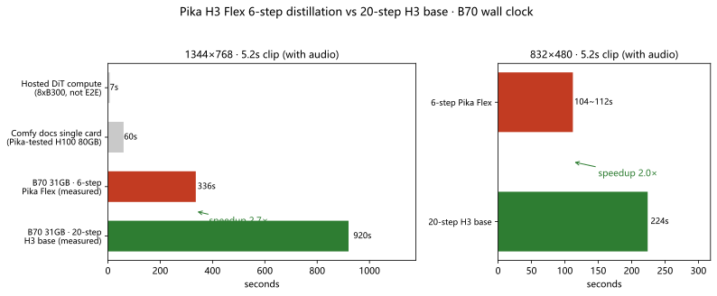

# Pika H3 Flex on Arc Pro B70: how much the six-step path actually buys

> **Bottom line:** ① The launch claims that matter all hold, and Pika H3 Flex **runs on an Intel Arc Pro B70 (31 GB)** — first/last-frame-to-video (FL2VA) with synced audio, two resolutions out of the box. ② Against the non-distilled 20-step H3 default, the six-step path is **2.0× faster at 480p and 2.7× faster at 768p** (same card, same seed, same prompt; sycl9-paired runtime). ③ "7 seconds per clip" is hosted DiT compute, not end-to-end wall clock — mixing the two books only scares buyers.

- Test rig: Intel Arc Pro B70 32G (GUNNIR, ECC off, 31.16 GiB visible) + Ryzen 5 9600X + **32 GB RAM** + Windows
- Software: ComfyUI **0.43.2** + torch 2.13.0+xpu + OmniXPU runtime
- Models: MiniMax H3 base (fl2va DiT int8_convrot + Qwen3VL 32B nvfp4 TE) + the two open Pika LoRA adapters
- Data: measured on the sycl9-paired runtime (full sycl8 / sycl9 / legacy-runtime comparison → [`xpu-runtime-pairing.en.md`](xpu-runtime-pairing.en.md))

## 1. Claims vs measurements

Pika H3 Flex shipped 2026-10-29 ([blog](https://pika.art/blog/pika-h3-flex) / [HF: Pika-Labs/Pika-H3-Flex](https://huggingface.co/Pika-Labs/Pika-H3-Flex)) as two open LoRA adapters on MiniMax H3, distilling the 50-step generator to six.

| Claim | Verdict | Evidence |
|---|---|---|
| "7s DiT / under 10s" ≠ local end-to-end | ✅ holds, off by an order of magnitude | hosted 7 s vs B70 768p clip 15.3 min (20-step) / 5.6 min (six-step) (see §3) |
| Gate = "can you run the H3 base" | ✅ holds | B70 31 GB + 32 GB RAM qualifies; template TE is the nvfp4 tier |
| Local T2V / FL2VA / Ref2VA with synced stereo | ✅ FL2VA verified | both resolutions out with 32 kHz stereo from the same forward pass |
| Six-step schedule = lcm + ManualSigmas + CFG 1.0, no turbo LoRA stacked | ✅ followed, clean output | 7 sigma values, adapter strength 1.0 |
| Comfy docs: "≈1 min for 5 s of 1344×768 on a single card" | ⚠️ NVIDIA-class wording | B70 measures 336 s (~5.6 min) at 768p, ≈5.6× that line |
| 4K / five stems / prompt enhancement | ✅ hosted-only | not in the open weights |

## 2. Wiring: only two new files


Base DiT, text encoder and both VAEs are shared with the existing MiniMax H3 templates; the **only additions are two adapters** (1.96 GB each). Six steps is the trained schedule — more steps add no detail, and fewer than seven sigma values breaks it.

## 3. Measured: six steps vs twenty

Same card, seed 20261220, first/last frames, prompt and VAEs — only the sampling path changes:

| Tier | Path | Steps | Wall clock | Speedup |
|---|---|---|---|---|
| 832×480 · 124 frames (≈5.2 s) | H3 base res_multistep + BasicScheduler | 20 | 224 s | — |
| 832×480 · 124 frames | **Pika six-step** (lcm + ManualSigmas) | 6 | **104~112 s** (warm~cold) | **2.0×** |
| 1344×768 · 124 frames | H3 base res_multistep + BasicScheduler | 20 | 920 s | — |
| 1344×768 · 124 frames | **Pika six-step** (lcm + ManualSigmas) | 6 | **336 s** | **2.7×** |

Wall clock = queue submit → `/history` complete (TE encode, sampling, video+audio VAE decode, MP4 mux).



Two caveats: the 480p six-step figure spans warm~cold (104~112 s); the headline speedup takes the conservative cold end (warm-vs-warm it is 2.2×). The 768p pair is warm-vs-warm (2.7×).

## 4. Setup (32 GB RAM rig)

### 4.1 Model files

| Folder | File | Size | Note |
|---|---|---|---|
| `diffusion_models/MiniMax/` | `minimax_h3_fl2va_pruned_int8_convrot.safetensors` | 20.97 GB | existing H3 |
| `text_encoders/` | `qwen3vl_32b_minimax_h3_nvfp4_awq.safetensors` | 15.69 GB | **nvfp4 tier is mandatory on 32 GB RAM** |
| `vae/MiniMax/` | `minimax_h3_video_vae_int8_convrot.safetensors` (or fp16) | 2.81 / 5.21 GB | existing H3 |
| `vae/MiniMax/` | `minimax_h3_audio_vae_fp32.safetensors` | 605 MB | existing H3 |
| `loras/` | **`pika_h3_flex_fl2va_v1_bf16.safetensors`** | **1.96 GB** | **new** · [Comfy-Org/MiniMax-H3](https://huggingface.co/Comfy-Org/MiniMax-H3) |
| `loras/` | **`pika_h3_flex_ref2va_v1_bf16.safetensors`** | **1.96 GB** | **new** |

### 4.2 Sampling red lines

```
KSamplerSelect   = lcm
ManualSigmas     = 1.0, 0.972973, 0.923077, 0.8, 0.571429, 0.333333, 0.0
LoraLoaderModelOnly: pika_h3_flex_fl2va_v1_bf16.safetensors · strength = 1.0
CFG 1.0 via BasicGuider
```

- **Never stack turbo / Lightning LoRA** on top — the adapter is already distilled to six steps.
- Six is the trained schedule: more steps add no detail; <7 sigma values breaks it.
- Existing H3 templates work: switch sampler to `lcm`, scheduler to `ManualSigmas`, load the adapter.

### 4.3 Versions

- ComfyUI **0.43.2+** (T2V template); FL2VA/Ref2VA templates need 0.30.0+.
- Template Library → Video → **Pika H3 Flex** (T2V / Ref2VA / FL2VA, shipped with comfyui-workflow-templates 0.11.100).
- Intel XPU users: **the SYCL runtime your XPU runtime is linked against must match torch's bundled syclN** (mismatched linking costs 3.6× on identical code — see [`xpu-runtime-pairing.en.md`](xpu-runtime-pairing.en.md)). Grab the verified sycl9 package: [Release xpu-runtime-sycl9-20261102](https://github.com/lygsam75-buddy/intel-arc-local-ai/releases/tag/xpu-runtime-sycl9-20261102).

### 4.4 Capacity envelope (B70 31 GB)

| Tier | Result |
|---|---|
| 480p (0.4 MP) / 5.2 s | ✅ reliable |
| 1344×768 (1.03 MP) / 5.2 s | ✅ passed, no OOM |
| 768p / 15 s | ❌ expected OOM (Pika itself reports 768p/15s exceeding the H100 default path) |

## 5. Limits

1. **License**: adapters ship under the **MiniMax H3 Community License** — review territorial/commercial terms before commercial use.
2. **Hosted ≠ local**: 1080p/2K/4K upsampler, five audio stems, prompt enhancement live on the Pika API side only.
3. **Prompting** (from Pika's own notes): camera amplitude is advisory — give stopping points; "wide shot" alone tends to render medium (write the subject small in a large empty room); fine contact constraints unreliable; short prop labels usually hold.
4. Ref2VA caps at 12 references (9 img + 3 video + 3 standalone audio), each video/audio 2–15 s, per-type total ≤15 s.

## Appendix A: XPU runtime version gate (test env only)

ComfyUI 0.43.x wants comfy-aimdo 0.6.0 / comfy-kitchen 0.2.40; prebuilt OmniXPU providers accept only 0.4.15 / 0.2.31. Four test-environment changes (do not copy to production):

1. add `0.6.0` / `0.2.40` to `provider.json` `compatible_versions`;
2. `hasattr`-guard the missing `aimdo_storage_fast_disk` symbol in `comfy_aimdo/storage.py`;
3. replace the vendored `comfy_kitchen` tree with [xiangyuT/comfy-kitchen-xpu](https://github.com/xiangyuT/comfy-kitchen-xpu) HEAD and re-hash provider.json;
4. add `pageout_callback=None` to vendored `ModelVBAR.__init__` (0.6.0 VBAR writeback is inert on XPU).

Long-term: wait for Windows prebuilt runtimes from [xiangyuT/comfy-aimdo-xpu](https://github.com/xiangyuT/comfy-aimdo-xpu) (AIMDO 0.6.0 already merged) or build with Intel oneAPI DPC++/C++ (`scripts\build-windows-xpu.cmd`). **2026-11-02 update: the runtime is now built and packaged → [`docs/xpu-runtime-pairing.en.md`](xpu-runtime-pairing.en.md) / [Release](https://github.com/lygsam75-buddy/intel-arc-local-ai/releases/tag/xpu-runtime-sycl9-20261102).**

## Sources

- Pika blog (2026-10-29): <https://pika.art/blog/pika-h3-flex> · HF: <https://huggingface.co/Pika-Labs/Pika-H3-Flex>
- ComfyUI docs: Pika H3 Flex Workflows · Comfy-Org/MiniMax-H3
- Measured data: `docs/xpu-runtime-pairing.en.md` (full sycl8 / sycl9 / legacy-runtime table); `bench/data/2026-11-02_b70-32g_*-comfyui.json` are the legacy-runtime comparison records
