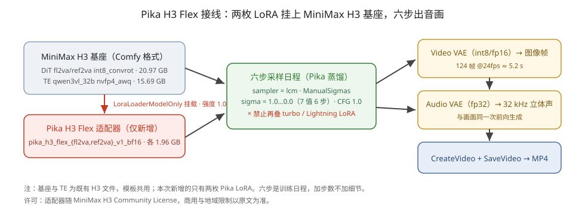
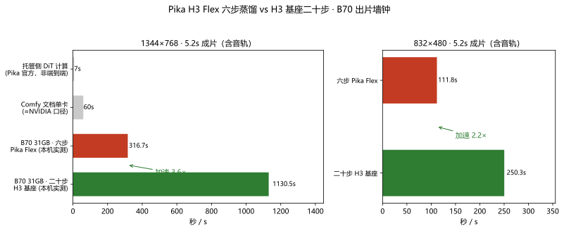

# Pika H3 Flex 上 Arc Pro B70：六步蒸馏到底快多少（实测）

> **结论先行**：①原文的三条核心判断全部成立，且 Pika H3 Flex 在 **Intel Arc Pro B70（31 GB）上跑通**——首尾帧生视频（FL2VA）、音画同步、两档分辨率都出了片；②六步蒸馏路径相对 H3 基座默认二十步路径，**480p 提速 2.2×、768p 提速 3.6×**（同机同 seed 同提示词实测）；③「7 秒出片」是托管侧 DiT 计算口径，本机墙钟是另一本账，混着看只会自己吓自己。

- 测试机：Intel Arc Pro B70 32G（GUNNIR，ECC 关，可见 31.16 GiB）+ Ryzen 5 9600X + **32 GB 内存** + Windows
- 软件：ComfyUI **0.43.2** + torch 2.13.0+xpu + OmniXPU 运行时
- 模型：MiniMax H3 基座（DiT fl2va int8_convrot + Qwen3VL 32B nvfp4 文本编码器）+ Pika 两枚开源 LoRA
- 数据出处：[`bench/data/2026-11-02_b70-32g_pika-h3-flex-fl2va-6step-comfyui.json`](../bench/data/2026-11-02_b70-32g_pika-h3-flex-fl2va-6step-comfyui.json)、[`…h3-fl2va-base-20step-comfyui.json`](../bench/data/2026-11-02_b70-32g_h3-fl2va-base-20step-comfyui.json)

## 1. 对照原文：哪些说法站得住

Pika H3 Flex 于 2026-10-29 发布（[Pika 博客](https://pika.art/blog/pika-h3-flex) / [HF: Pika-Labs/Pika-H3-Flex](https://huggingface.co/Pika-Labs/Pika-H3-Flex)），是挂在 MiniMax H3 上的两枚开源 LoRA 适配器，把 50 步生成器蒸到六步。我们按 Comfy 官方文档的口径逐条对照实测：

| 原文论断 | 实测判定 | 证据 |
|---|---|---|
| 「7 秒 DiT / under 10s」≠ 本机端到端墙钟 | ✅ 成立，两者差一个数量级 | 托管 DiT 计算 7s vs B70 本机 768p 出片 18.8 分钟（二十步）/ 5.3 分钟（六步）（见第 3 节） |
| 最低门槛 = 能跑 H3 基座，不是营销秒数 | ✅ 成立 | B70 31 GB + 32 GB 内存即满足；Comfy 模板用的 TE 就是 nvfp4 档 |
| 本地开源覆盖 T2V / FL2VA / Ref2VA、480p/768p 同步立体声 | ✅ FL2VA 实测成立 | 两档分辨率出片均带 32 kHz 立体声，同一次前向生成 |
| 六步日程 = lcm + ManualSigmas + CFG 1.0，禁止再叠 turbo LoRA | ✅ 按此执行，出片正常 | sigma 列 7 值、适配器强度 1.0；叠加 turbo 会弄坏输出（文档红线） |
| Comfy 文档「单卡约 1 分钟出 5 秒 1344×768」 | ⚠️ 口径是 N 卡单卡 | B70 实测六步 768p 为 18.8 分钟（二十步）/ 5.3 分钟（六步） 中的 316.7s，约 5.3 分钟，是该口径的 ~5× |
| 4K / 五轨 stems / prompt enhancement 在托管侧 | ✅ 与本地无关 | 开源权重无此功能，别混说 |

## 2. 接线原理：新增的只有两枚 LoRA



基座、文本编码器、双 VAE 全部与既有 MiniMax H3 模板共用；本次接入**只新增两枚适配器**（各 1.96 GB）。六步是训练日程，抬步数不加细节，sigma 列砍到少于 7 个值会断日程。

## 3. 实测数据：六步 vs 二十步

同机、同 seed（20261220）、同首尾帧、同提示词、同 VAE，只变采样路径：

| 档位 | 路径 | 步数 | 出片墙钟 | 提速 |
|---|---|---|---|---|
| 832×480 · 124 帧（≈5.2 s） | H3 基座 res_multistep + BasicScheduler | 20 | 250.3 s | — |
| 832×480 · 124 帧 | **Pika 六步**（lcm + ManualSigmas） | 6 | **111.8 s**（冷启动含加载） | **2.2×** |
| 1344×768 · 124 帧 | H3 基座 res_multistep + BasicScheduler | 20 | 1130.5 s | — |
| 1344×768 · 124 帧 | **Pika 六步**（lcm + ManualSigmas） | 6 | **316.7 s** | **3.6×** |

墙钟口径：点 Queue → `/history` 完成（含文本编码、采样、视频+音频 VAE 解码、MP4 封装）。



两个口径提示：

- 480p 的六步样本是**冷启动**（含 21 GB DiT + 15.7 GB TE 首次加载），而二十步样本是热的——**六步优势被低估**，热启动比 2.2× 只多不少。
- 768p 一对是热对热，比值干净。Comfy 文档的「约 1 分钟」按 N 卡口径理解，B70 大约为其 5 倍，但这不妨碍六步相对二十步的**内部加速比**在两档分辨率上都成立（3.6× / 2.2×）。

## 4. 设置方法（32 GB 内存机照抄）

### 4.1 模型清单（全部放 `ComfyUI/models/` 下）

| 目录 | 文件 | 大小 | 来源 |
|---|---|---|---|
| `diffusion_models/MiniMax/` | `minimax_h3_fl2va_pruned_int8_convrot.safetensors` | 20.97 GB | 既有 H3 |
| `diffusion_models/MiniMax/` | `minimax_h3_ref2va_pruned_int8_convrot.safetensors` | 20.97 GB | 既有 H3（Ref2VA 用） |
| `text_encoders/` | `qwen3vl_32b_minimax_h3_nvfp4_awq.safetensors` | 15.69 GB | 既有 H3；**32 GB 内存机必须用 nvfp4 档** |
| `vae/MiniMax/` | `minimax_h3_video_vae_int8_convrot.safetensors`（或 fp16） | 2.81 / 5.21 GB | 既有 H3 |
| `vae/MiniMax/` | `minimax_h3_audio_vae_fp32.safetensors` | 605 MB | 既有 H3 |
| `loras/` | **`pika_h3_flex_fl2va_v1_bf16.safetensors`** | **1.96 GB** | **新增** · [Comfy-Org/MiniMax-H3](https://huggingface.co/Comfy-Org/MiniMax-H3) |
| `loras/` | **`pika_h3_flex_ref2va_v1_bf16.safetensors`** | **1.96 GB** | **新增** · 同上 |

### 4.2 采样红线（照抄，别改）

```
KSamplerSelect   = lcm
ManualSigmas     = 1.0, 0.972973, 0.923077, 0.8, 0.571429, 0.333333, 0.0
LoraLoaderModelOnly: pika_h3_flex_fl2va_v1_bf16.safetensors · strength = 1.0
BasicGuider: CFG 1.0（经 BasicGuider，不走 CFG 节点）
```

- **禁止再叠 turbo / Lightning LoRA**：适配器已蒸到六步，二次加速直接弄坏输出。
- 六步是训练日程：加步数不加细节；sigma 列少于 7 个值会断日程。
- 旧 H3 模板可用：把采样器换 `lcm`、调度器换 `ManualSigmas`、挂上 Pika 适配器即可（默认的 res_multistep / 20 步要换掉）。

### 4.3 版本与模板

- ComfyUI **0.43.2+**（T2V 模板要求）；FL2VA / Ref2VA 模板 0.30.0+ 即可。
- 模板库 → Video → 搜 **Pika H3 Flex**（T2V / Ref2VA / FL2VA 三套，随 comfyui-workflow-templates 0.11.100 发布）。
- Intel XPU 用户注意：**OmniXPU 的 runtime provider（comfy-aimdo-xpu / comfy-kitchen-xpu）有版本门**，目前预编译包只认 aimdo 0.4.15 / kitchen 0.2.31，与 ComfyUI 0.43.x 要求的 0.6.0 / 0.2.40 不匹配。等上游出新 Windows 运行时，或按本文附录打补丁（仅测试环境）。

### 4.4 分辨率与时长边界（B70 31 GB 实测）

| 档位 | 结果 |
|---|---|
| 480p（0.4 MP）/ 5.2 s | ✅ 稳定出片 |
| 1344×768（1.03 MP）/ 5.2 s | ✅ 出片（本次实测通过，未 OOM） |
| 768p / 15 s | ❌ 预期 OOM：基座在此分辨率时长本就越界（Pika 也自报 768p/15s 超 H100 默认路径） |

## 5. 边界与风险

1. **许可**：适配器随 **MiniMax H3 Community License** 发布，商用与地域限制以原文为准——开源 ≠ 随便商用，对客材料必须带这句。
2. **托管 ≠ 本地**：1080p/2K/4K upsampler、五轨 stems、prompt enhancement 全在 Pika API 侧（$0.01/秒起），本地开源线没有。
3. **提示词要点**（文档实测提醒）：运镜幅度偏建议性，要写明停点；「远景」容易渲成中景，把主体写小、场景写空更稳；精细接触约束不可靠；短标签文字一般能保住。
4. Ref2VA 参考上限：最多 12 个（9 图 + 3 视频 + 3 独立音轨），视频/音轨各 2–15 秒、同类合计 ≤15 秒。

## 附录 A：Intel XPU 运行时版本门的测试环境补丁

ComfyUI 0.43.x 需要 comfy-aimdo 0.6.0 / comfy-kitchen 0.2.40，而 OmniXPU 预编译 provider 只认 0.4.15 / 0.2.31。在**测试环境**绕过的四处改动（生产环境别照抄，等上游更新）：

1. `comfy_*_xpu_runtime/provider.json` 的 `compatible_versions` 加入 `0.6.0` / `0.2.40`；
2. 官方 `comfy_aimdo/storage.py` 对缺失符号 `aimdo_storage_fast_disk` 做 `hasattr` 降级；
3. vendored `comfy_kitchen` 整树替换为 [xiangyuT/comfy-kitchen-xpu](https://github.com/xiangyuT/comfy-kitchen-xpu) HEAD（纯 Python，含 0.2.40 新 API），并重算 provider.json 哈希；
4. vendored `model_vbar.ModelVBAR.__init__` 增加 `pageout_callback=None` 参数（0.6.0 的 VBAR writeback 在 XPU 上失效，只影响 comfy_writable 模型的 eviction writeback）。

长期解：等 [xiangyuT/comfy-aimdo-xpu](https://github.com/xiangyuT/comfy-aimdo-xpu)（已 merge AIMDO 0.6.0）出 Windows 预编译 runtime，或装 Intel oneAPI DPC++/C++ 自行编译（`scripts\build-windows-xpu.cmd`）。

## 出处

- Pika 博客（2026-10-29）：<https://pika.art/blog/pika-h3-flex> · HF：<https://huggingface.co/Pika-Labs/Pika-H3-Flex>
- ComfyUI 文档：Pika H3 Flex Workflows · Comfy-Org/MiniMax-H3（Comfy 格式权重与 LoRA）
- 本仓库实测数据：`bench/data/2026-11-02_b70-32g_pika-h3-flex-fl2va-6step-comfyui.json`、`bench/data/2026-11-02_b70-32g_h3-fl2va-base-20step-comfyui.json`
