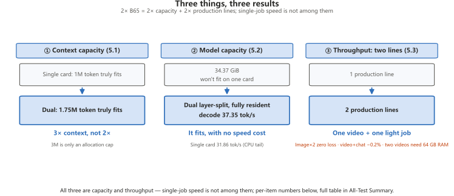
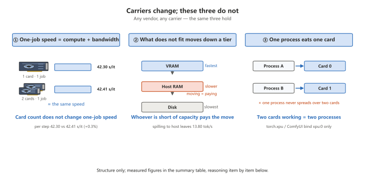
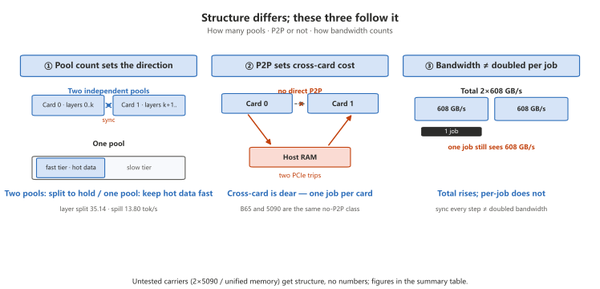

**English** · [简体中文](dual-b65-report.md)

# Dual B65 in practice: what you buy, and what you do not

> **In one line**: adding a card adds rooms, not speed — the second B65 buys **capacity and a
> second production line**, not the speed of a single task.

> **What to tell the customer (say it as-is)**
>
> People ask whether two cards means twice the speed. The answer has to be split in two.
>
> Put the second card in and VRAM goes from 31 GB to 62 GB. A model that did not fit now fits.
> A machine that ran one clip now runs one clip with a chat model beside it. Both real changes.
>
> But ask how much faster the same clip gets — almost not at all. One card does a step in 42.30 s;
> two cards together do 42.41 s. The same. So the second card buys room, not speed — to make one
> clip faster, buy a stronger single card.
>
> If someone says two cards merge into one and double the compute: that mode was tested. It runs,
> and it is slower than one card (29.19 vs 31.86) — every layer computed needs one reconciliation
> between the cards, and reconciling costs more than it saves. The method here is each card on its
> own. A layer split is "the second card helps hold", not "helps compute": when it fits on one card,
> splitting is 5%–7% slower; when it does not fit, splitting is 17% faster.
>
> No motherboard change needed. A plain B850M is fine — card 1 alone in the x4 slot does a step in
> 42.31 s, same as x16. Only four cards or a hard tensor-parallel requirement needs an x8/x8
> workstation board; the positioning here is an ordinary computer running large models.
>
> One thing up front: two lanes at once need 64 GB of RAM; 32 GB is "one clip plus one light job".
> Said up front beats explained afterwards.

Test conditions: 2× GUNNIR B65 32G · ECC off (31.16 GiB usable per card) · driver 9150 · 32 GB RAM
(2×16 GB) · display on the motherboard iGPU · a **mainstream mATX board of the B850M tier** (not a
workstation board, cannot split x8/x8): card 0 in the CPU-attached x16 slot, card 1 in the chipset x4
slot. Unless noted, every number is measured, and **no number came from workstation hardware**.

## All-Test Summary

Every collected figure folded into one table. One result per row; the matching section holds the
detail.

**Dynamic chart**: [`assets/dual-b65-dashboard.en.html`](assets/dual-b65-dashboard.en.html) (interactive · hover for one result)

| Test item | Single B65 | Dual 2×B65 | One B70 | One result |
|---|---:|---:|---:|---|
| H3 720p·5 s end-to-end (steady state) | 394.06 s | 417.78 s | 276.68 s | dual gives no speedup, B70 is 1.42× faster |
| H3 720p per step | 42.30 s/it | 42.41 s/it | 25.30 s/it | the second card contributes 0 to one clip |
| H3 1080p·5 s end-to-end (steady state) | 1326.17 s | — | 841.55 s | B70 is 1.58× faster |
| Qwen Q4_0 decode | 50.56 tok/s | 50.47 tok/s | 77.11 tok/s | no slowdown under concurrency |
| Q8_0 34.37 GiB decode (layer split vs single fully resident) | 31.86 | 37.35 | — | split buys capacity at no speed cost (1.17×) |
| Q4_0 19.41 GiB decode (layer split vs single) | 53.63 | 49.80 | — | if it fits, do not split — splitting is 7.1% slower |
| Tensor-parallel decode | — | 28.65 tok/s | — | slower than one card, do not use |
| Usable VRAM | 31.16 GiB | 62.32 GiB | 31.16 GiB | dual buys 2× VRAM, not speed |
| Context (actually fits) | 1M token | 1.75M token | 1M token | quote 1.75M externally; 3M is only an allocation ceiling |
| Image gen steady state | 16.20 / 16.31 s | 16.00 ~ 16.18 s | — | dual instances, zero loss |
| Video + chat | — | 12/12 correct, decode −0.2% | — | holds |
| Video + video | — | 2/2 crash | — | does not hold (32 GB RAM wall) |
| Full-load power P90 | 205.5 W | 400.8 W | 290.4 W | additive, no mutual throttling |
| Two 5 s clips per hour | — | 18.3 clips/h | 13.0 clips/h | dual wins 1.40× |
| Price | ¥9,999 | ¥19,998 | ¥18,999 | nearly level: B70 buys speed, dual buys capacity + output |

## 1. Four questions, four answers

| Question | Answer |
|---|---|
| Does a dual card mean "double the compute"? | **No.** See the first two summary rows — not one step faster. |
| Then what does the dual card buy? | **Capacity + output** (see the summary). ⚠️ With 32 GB of RAM "two video lanes" does not hold (§5.3); the real result is "one video + one light task". |
| Can one B65 make an H3 video alone? | **Yes.** 720p·5 s steady state about 6 min 34 s; measured up to 720p 24 s (83 min per clip) — the question is "how long you wait", not "how many seconds it can make" (see `cards/B65-README.md` §6). |
| One B70 and two B65s (nearly the same price): what differs? | **B70 buys speed, dual buys capacity + output.** See the last summary row. |

## 2. Why "dual card = double the compute" does not hold

The card is not the problem. Both software paths **refuse to split one task across two cards**:

1. **ComfyUI / `torch.xpu` uses the first card only.** The process binds `xpu:0` on startup; the second
   card does not exist inside that process. To make the second card work, start another process and pin it
   with `ONEAPI_DEVICE_SELECTOR=level_zero:1`.
2. **llama.cpp "multiple devices" is layered loading, not parallel compute.** `-dev SYCL0,SYCL1 -sm layer`
   spreads different layers of the model over the two cards; while one layer computes, the other card
   waits — layers have to synchronise, and the number of synchronisations grows with the layer count.

Measured evidence is the first two summary rows plus the Q8_0 / Q4_0 rows (per step +0.3%, decode −0.2%, layer split 1.17×, if it fits do not split) — all four at noise level or negative.

One result: **the "two chips as one, double compute" expectation does not hold on either stack** — the correct expectation is two independent production lines. (The earlier "layer split loses 4.84×" was a collection error from misreading llama-bench's `-dev` semantics, corrected; process in `bench/notes/dual-b65-prep.md`.)

Three questions to answer before adding a second card:

1. **Do you want "one faster" or "two at once"?** The former: buy a stronger single card. Only the latter needs a second card.
2. **Is your RAM 32 GB or 64 GB?** At 32 GB two video lanes do not run (§5.3) — only "one video + one light task".
3. **Is there a model that does not fit on one card?** If not, a second card will not make any existing task faster.

## 3. Can a single B65 make an H3 video on its own

**Yes, and this is the most practical way to run it.** One machine, one B65, no second card, no code changes, MiniMax H3 inside ComfyUI:

| Duration | Frames | End-to-end (cold) | Per step (cold) | End-to-end (steady state) | Per step (steady state) |
|---:|---:|---:|---:|---:|---:|
| 5 s | 124 | 437.11 s | 42.44 s/it | 394.06 s | 42.30 s/it |
| 10 s | 243 | 1166.44 s | 151.47 s/it | — | — |
| 15 s | 362 | 2149.75 s | 314.22 s/it | — | — |
| 17 s | 413 | 2689.48 s | 405.19 s/it | — | — |

The 5 s tier has more than one reading; do not mix them (the steady-state column above takes fresh): cold 437.11 s (full load included) / fresh 394.06 s / cached 382.92 s.
From 10 s up only cold was measured (first run on a freshly started server), so **there is no steady-state reading** — that column is "—", not zero.

| Resolution (5 s) | End-to-end (steady state) | Per step |
|---|---:|---:|
| 1280×720 | 394.06 s | 42.30 s/it |
| 1920×1088 | 1326.17 s | 188.64 s/it |

Conclusions:

1. **720p · 5 s · 6 steps: steady state 394.06 s, about 6 min 34 s.** The comfortable tier for one B65 — DiT 19.53 GiB fully resident, no weights move per step.
2. **720p is measured up to 24 s (about 83 min per clip — the highest pixel×frame pass point in the whole table)**; integer-second ceilings: 480p ≤ 50 s / 720p ≤ 24 s / 1080p ≤ 10 s / 1440p ≤ 5 s, 22 of 30 tiers pass. All 8 failures are XPU OOM (the transient peak does not fit — not host memory, not compute). Full ladder in `cards/B65-README.md` §6.
3. **1080p · 5 s also works**: steady state 1326.17 s (about 22 min 06 s), per step 188.64 s/it. The price is DiT offloading 7,564 MB every round. **1080p is the edge for a 32 GB card, not the comfortable zone.**
4. **Duration costs more than resolution.** At the same 720p, 5 → 15 s raises end-to-end 4.92× with no change in pixels — more frames, and the latent buffer grows with them.
5. Harness conditions: `--reserve-vram 4`, `OMNI_ATTN_BACKEND=sdpa`, int8 DiT + nvfp4 text encoder. **Changing the reserve changes loading behaviour** — quote numbers with their conditions.
6. The full four-card comparison across resolutions is in [`comfyui-h3.md`](comfyui-h3.en.md); this document covers single B65 and dual B65 only.

## 4. Dual card vs single card, item by item

Speed/capacity rows live in the summary (dual vs single is all there). This section adds only the three rows the summary does not carry:

| Dimension | Figure | One result |
|---|---:|---|
| Image gen first round (loading) | single 34.37 s / dual 57.31 s, 44.79 s | concurrent page-cache contention, first round not comparable |
| Card 1 (x4 slot) solo H3 | steady 458.46 s, per step 42.31 s/it | matches card 0; not attributable to PCIe width (no swap test) |
| Where the +6.0% end-to-end comes from | after warm-up 406.29 s (+3.1%) | not lost compute — concurrent page-cache contention; warm up before taking numbers |

One result: **dual gives zero uplift to a single task** (per step +0.3%, decode −0.2%, both at jitter level); the 6.0% end-to-end gap is fixed overhead from concurrent page-cache contention, narrowing to 3.1% after warm-up — **whenever dual looks slower, warm up first**; full-load power adds up without mutual throttling (pair total 400.8 W), and an 850 W PSU is enough with the GPU side budgeted at 400 W class.

### 4.1 The inter-card path: a lower-level copy did not help either

Between the two cards there is **only PCIe** — no NVLink or Xe-Link class of dedicated interconnect. So can a lower-level inter-card copy speed things up?
llama.cpp offers three modes; all three ran in the same batch, under the same harness (`GGML_SYCL_DEV2DEV_MEMCPY`):

| Inter-card copy mode | Tensor parallel decode | Tensor parallel prefill | Layer split decode | Layer split prefill |
|---|---:|---:|---:|---:|
| 0 · SYCL direct copy (default) | 29.08 | 47.34 | 37.29 | 61.77 |
| 1 · Level Zero direct copy | 29.19 | 44.80 | 36.81 | 60.15 |
| 2 · Forced through host memory | 29.50 | 42.17 | 37.38 | 59.90 |

(Q8_0 34.37 GiB · `-ts 50,50` · decode tok/s, prefill tok/s, median of 3 runs each)

One result: **a lower-level copy path does not rescue tensor parallel** — decode spread across the three modes is 1.5% (inside noise); the bottleneck is sync count, not inter-card copy, so stop tuning this direction; a dual card does not need a different motherboard for PCIe topology (x4 slot per step 42.31 matches x16's 42.41); only four cards or a hard tensor-parallel requirement needs x8/x8 — that is a workstation board.

## 5. What the second card really buys: three things



The three results unpacked in 5.1 / 5.2 / 5.3.

### 5.1 Capacity: context 1M → 1.75M token (3M is only an allocation ceiling)

| Form | Configuration | Actually fits | VRAM per M token | Left at the ceiling |
|---|---|---:|---:|---:|
| Single card | default | **1M token** (4 full-length sessions) | 12.8 GiB | 0.03 GiB |
| Dual card | default (`kv_unified=true`) | 1.75M token | 22.4 GiB | 2.01 / 2.83 GiB |
| Dual card | explicit `--parallel` (`kv_unified=false`) | **3M token** (12 full-length sessions) | 14.5 GiB | 0.19 / 0.22 GiB |

One result: **it is 3× not 2×** (weights are no longer duplicated) — the precondition is an explicit `--parallel` (without it only 1.75× and 2M goes straight to OOM).
🔴 **3M is only an allocation ceiling**: a long prompt's prefill hangs the whole machine (host memory exhausted, no dump) — **quote only single-card 1M / dual-card default 1.75M externally**.
🔴 **Virtual memory, settled: initial = maximum = 32768 MB** — an oversized page file turns "the process reports OOM and exits" into "the machine hangs"; locked down, an over-limit request makes the process report OOM and exit while the machine stays usable.
One line for the customer: **buying capacity means buying host RAM, not just VRAM.** Incident forensics in `bench/notes/ctx3m-hang-2026-10-24.md`.

### 5.2 Capacity: fitting one 34.37 GiB model

| Configuration | Where the VRAM goes | Prefill tok/s | Decode tok/s |
|---|---|---:|---:|
| Q8_0 single card `-ngl 37` | 30.78 GiB on card, about 4 GiB of layers on CPU | 56.54 | **31.46** |
| Q8_0 single card `-ngl 99` | VRAM full at 31.14 GiB (0.02 GiB left); weights 34.37 GiB, ≥ 3.2 GiB not on card | 6.96 | 13.80 |
| Q8_0 dual card `-sm layer` | **33.53 GiB fully resident** (card 0 17.47 / card 1 16.06) | 59.40 | **35.14** |
| Q8_0 dual card `-sm tensor` † | 33.65 GiB split evenly (card 0 16.92 / card 1 16.73) | 45.44 | 28.65 |
| Q4_0 single card `-ngl 99` | 18.32 GiB fully resident (12.84 GiB left) | 86.40 | **53.63** |
| Q4_0 dual card `-sm layer` `50,50` | 17.96 GiB fully resident (card 0 9.39 / card 1 8.57) | 80.45 | 49.80 |
| Q4_0 dual card `-sm layer` `90,10` | 17.96 GiB fully resident (card 0 17.09 / card 1 0.87) | 86.96 | 50.95 |

One result: **if it fits, do not split; split only when it does not fit.** Q4_0 already fits on one card and splitting costs 7.1%; Q8_0 does not fit on one card, and a fully resident layer split is 1.17× faster than one card (2.55× faster than spill) — the split buys capacity and costs no speed.
⚠️ The `-ts` ratio has no measurable effect on decode (four settings, 0.3% spread); the same configuration can differ 6% across sessions — read direction only, never trend; `-sm row` does not run on this build, `-sm tensor` is slower than one card (28.65 tok/s) — **layer split is the only cooperation mode that costs no speed**. Harness: llama-server (19/128, median of 3), do not interleave with llama-bench.

### 5.3 Throughput: one production line per card

| Combination | Form | Result |
|---|---|---|
| Image + image | two ComfyUI instances, one card pinned each | steady state 16.00 ~ 16.18 s/image, **level** with 16.20 / 16.31 on a single card in the same batch |
| Video + chat | card 0 on H3, card 1 on llama.cpp | 12/12 answered correctly, decode 114.79 vs 115.02 tok/s (−0.2%) |
| Video + video | two ComfyUI instances each running H3 | **does not hold**: 2/2 crashed at the same point, page file peak 48.7 GB |

- The third row is **a 32 GB RAM wall, not a GPU shortfall**: one H3 instance needs about 25 GB of virtual memory, two need 50 GB, and 32 GB of physical RAM cannot carry it.
  Isolating the SYCL caches on both sides still crashed → not a cache conflict. **On a 32 GB machine a dual card does "one video + one light task" only; two video lanes need 64 GB of RAM.**

## 6. One B70 vs two B65 (same-price match-up)

Prices (official JD store, checked 2026-10-26): **B70 ¥18,999**, B65 ¥9,999. **Two B65s come to ¥19,998 — ¥999 more than one B70, nearly level.** So this is the right way to work out "one B70 = two B65" — the same money buys two different things.

| | One B70 32G | Two B65 32G |
|---|---:|---:|
| Price | **¥18,999** | **¥19,998** |
| Cores / bandwidth / VRAM | 32 cores · 608 GB/s · 31.16 GiB | 2×20 cores · 2×608 GB/s · 62.32 GiB |
| H3 720p · 5 s end-to-end (steady state) | **276.68 s** | 394.06 s (each) |
| H3 per step | **25.30 s/it** | 42.30 s/it |
| H3 1080p · 5 s end-to-end (steady state) | **841.55 s** | 1326.17 s |
| Qwen Q4_0 decode | **77.11 tok/s** | 50.56 tok/s |
| Full-load power (P90) | 290.4 W | 400.8 W (both cards) |
| H3 clips at once | 1 | **2** |
| 34.37 GiB Q8_0 | also 31.16 GiB, by capacity it does not fit; **Q8_0 on a single B70 was not measured** | fits, decode 35.14 tok/s |

One result: **nearly the same price, two ways to buy — B70 buys single-job speed (1.42× / 1.67× faster), two B65s buy capacity + output (2× VRAM, 3× context, 18.3 clips/h on two lanes, holds a 34.37 GiB model)**. "Double compute" holds on neither side (B70 is only 1.42× faster, dual leaves a single job unchanged); B70 does not buy capacity either (34.37 GiB does not fit there as well; single-B70 Q8_0 not measured, so no number).

| Your situation | Pick | Why |
|---|---|---|
| One clip, fast, 1080p as the norm | **B70** | 1.42× faster at 720p, 1.58× at 1080p; nothing replaces it for single-task work |
| Two clips at once / one video plus one Q&A | **2× B65** | nearly the same price, 1.40× the output (18.3 vs 13.0 clips/h) |
| A model above 34 GiB, or the largest context | **2× B65** | capacity doubles; but the expectation is "it fits", not "it runs faster" |
| Budget pinned at the 32 GB VRAM tier | **B65** | same VRAM, about ¥9,000 cheaper, 1.42× slower |

## 7. Carriers compared: what is the same for AI inference, what is not

> This section is about structure, not parameters. **Only two carriers were measured on this machine: one
> card, and two B65s.** The other two rows in the table were never on this machine, so **they get no numbers
> at all** — only what their structure implies.

| Carrier | VRAM | Inter-card path | Measured here |
|---|---|---|---|
| 1× B65 | one pool, 31.16 GiB | — | ✅ |
| **2× B65** (this document) | two independent pools, 31.16 GiB each | PCIe (card 1 in the chipset x4 slot here); **no P2P**, cross-card only through host memory | ✅ |
| 2× RTX 5090 | two independent pools, 32 GB each | PCIe; **consumer cards have no P2P either**, cross-card only through host memory | ⛔ not measured |
| Unified-memory platform (DGX Spark class) | **one pool**, the GPU addresses the whole machine's memory | the concept of "moving between cards" does not exist | ⛔ not measured |

### The same in three ways



1. **Single-task speed is set by compute and bandwidth, not by card count.** Measured in the summary's first two rows. Any vendor's card, any carrier, this holds.
2. **What does not fit has to go down a level, and going down costs a move.** VRAM is fastest, host RAM next, disk slowest; whoever is short of capacity pays for that level of moving.
3. **One process uses one card.** `torch.xpu` and ComfyUI both bind the first card and do not spread out on their own. To get both cards working, the easy route is **start two processes**, not one process using two cards.

### Different in three ways



1. 🔴 **How many pools there are decides where the bottleneck sits, and it flips the optimisation direction.**
   - **Two independent pools** (this document's case): cut a large model up and place layers on both cards, and layers have to synchronise.
     Measured, Q8_0 34.37 GiB with a layer split, fully resident, decodes at **35.14 tok/s**; one card with about 4 GiB of CPU tail at **31.46**;
     one card forced to spill at **13.80** —
     **the split costs no speed and avoids the single-card spill tier (2.55× tok/s).** With two pools the direction is not "never split", it is "**a split is fine, but do not expect it to make a single task faster**" — single-task speed is still set by one card's compute and bandwidth.
   - **One pool** (unified memory): the question "which layer goes on which card" does not exist; fast and slow layers sit continuously in the same pool.
     The direction inverts — what you do is **keep hot data in the fast segment**, not spread load over more cards.
2. **Whether P2P exists decides how expensive "cross-card" is.** The two B65s here have no P2P; cross-card data lands in host memory and is fetched back, two PCIe trips each way. Consumer cards (the 5090 tier) have no P2P either — on "cross-card is expensive", the two carriers are **the same class**, and both suit "one card, one job" better.
3. **Bandwidth does not double with card count.** Two B65s together are 2×608 GB/s in total, but one task runs only on the card it sits on, so what it can use is still 608 GB/s. Cutting a model in half across two cards trades "cross-card sync every step" for "half a model per card": total bandwidth rises, bandwidth per task does not.

### Into card selection

| Your situation | What to do | Why |
|---|---|---|
| Two unrelated jobs | **one instance per card** | measured, image + image and video + chat do not lose speed; the most reliable dual-card use |
| One model does not fit | **dual card `-sm layer` split** | measured, buys capacity at no cost in speed (37.35 vs 31.86 fully resident single card, same session); `-sm row` does not run on this build, `-sm tensor` runs but is slower than one card |
| The model already fits on one card | **do not split, stay on one card** | Q4_0, same session: dual card 49.80 vs single card 53.63, splitting is 7.1% slower |
| One task needs to be faster | **buy a stronger single card**, not another card | the second card contributes 0 to one task, on any carrier |
| Does not fit and you do not want to split | unified-memory platform (not measured here) | one pool: if it fits, the whole model stays resident, and cross-card sync does not exist |

## 8. Working parameters (copy these)

### 8.1 Two ComfyUI instances: one card each

```bash
# instance 1 (card 0, CPU-attached x16)
COMFY_PORT=8190 ONEAPI_DEVICE_SELECTOR=level_zero:0 \
  SYCL_CACHE_DIR=<tools dir>/_sycl_cache_c0 \
  <ComfyUI dir>/python_embeded/python.exe <ComfyUI dir>/main.py \
    --listen 127.0.0.1 --port 8190 --reserve-vram 4

# instance 2 (card 1, chipset x4) — start it 20 s later, so they do not load at the same time
COMFY_PORT=8191 ONEAPI_DEVICE_SELECTOR=level_zero:1 \
  SYCL_CACHE_DIR=<tools dir>/_sycl_cache_c1 \
  <ComfyUI dir>/python_embeded/python.exe <ComfyUI dir>/main.py \
    --listen 127.0.0.1 --port 8191 --reserve-vram 4
```

- **Pinning a card has exactly one layer: `ONEAPI_DEVICE_SELECTOR=level_zero:N`.** ComfyUI's `main.py` has no
  "assert index" parameter of its own; copying the bench collector's `--expect-index` (that is a
  `bench_f_h3.py` argument) fails on the parameter and the process never starts.
- **Check it once yourself after startup**: read VRAM occupancy for each instance. Both rising means each is
  holding its own card; only one rising means both landed on the same card.
- **`SYCL_CACHE_DIR` must be separate for each**, sharing one means the kernel caches overwrite each other.
- Ports 8190 / 8191. **8188 is the always-on instance — do not take it, do not kill it.**
- `--reserve-vram 4` is the collection condition behind this set of numbers; changing it changes loading
  behaviour.

### 8.2 llama.cpp on two cards: multiple devices + layered loading

```bash
# SYCL runtime DLLs live in python_embeded and must be prepended, or the exe dies with 0xC0000005
PATH=<python_embeded dir>/Library/bin:<llama.cpp bin dir>:$PATH
ONEAPI_DEVICE_SELECTOR=level_zero:0,1 \
  llama-server -m <model dir>/Qwen_Qwen3.6-35B-A3B-Q4_0.gguf \
    -dev SYCL0,SYCL1 -sm layer \
    -c 3145728 --parallel 12 \
    --host 127.0.0.1 --port 8099
```

- 🔴 **`-c` must line up with `--parallel`**: `--parallel = ctx / 262144`. Out of line, the log shows
  `kv_unified=true`, each M token takes 22.2 to 22.4 GiB, and 2M goes straight to OOM; lined up,
  `kv_unified=false` and each M token takes only 14.5 to 15.6 GiB.
- **To run on one card only, write `-dev SYCL0` (or `SYCL1`)** and narrow `ONEAPI_DEVICE_SELECTOR` to the
  same card as well, otherwise the device enumeration order changes.
- 🔴 **`PATH` must be prepended with `python_embeded\Library\bin`** (the SYCL runtime DLLs are in there).
  Without it the symptom is **exit code `0xC0000005`, a crash within 1 s, empty stderr** — it looks like a
  model problem, but the runtime simply was not found.

### 8.3 Three checks

| What to check | How | Why |
|---|---|---|
| Did it start | wait for `model loaded` in the log, then send one `/v1/chat/completions` | a working TCP port does not mean it can answer |
| Did it fit | look at **whether VRAM occupancy scales with `-c`** | single card `-c 1572864` / `2097152` both start and answer, but occupancy equals 1M (12.68 / 12.63 vs 12.81 GiB) — the extra context was never allocated |
| Is it worth it | look at **how fast it runs** | Q8_0 single card `-ngl 99` does not fit, yet still reports `model loaded` + probe 200; the remainder just sits on the CPU |

### 8.4 Two small settings that make the numbers fake

- **`cache_prompt` must be off** (`cache_prompt: false` in the multimodal comparisons). Left on, firing the
  same image repeatedly hits the prompt cache, wall clock drops to 0.1 s and decode reports 115 tok/s — that
  is cache, not compute.
- **Warm up before taking numbers.** The same H3 job: page cache cold 501.72 s, warm 406.29 s — a 23.5 percentage-point gap. For any "how much does the dual card slow things down", run one warm round first.

## 9. Pitfall list

| # | Pitfall | Symptom | Fix |
|---:|---|---|---|
| 1 | Assuming a dual card doubles compute | per step 42.30 → 42.41 s/it, not one step faster | `torch.xpu` uses the first card only; llama.cpp multiple devices is layered loading |
| 2 | Assuming a layer split always costs speed | dual card 33.53 GiB fully resident, decode 37.35 tok/s | same-session measurement says it costs nothing: 1.17× faster than 31.86 fully resident on one card, 2.55× faster than 13.80 spilling on one card. `-sm row` is the one that really does not run |
| 7 | Assuming tensor parallel accelerates | `-sm tensor`, two cards, decode 29.08 to 29.50 tok/s | slower than 31.86 fully resident on one card: the per-layer cross-card sync costs more than the second card contributes. For cooperation use the layer split, not tensor |
| 15 | Assuming a larger context is always better | 3M allocates fine, long-prompt prefill stalls at 8192 token | 14 minutes later the machine hangs silently (no dump, no blue screen). 3M is an allocation ceiling only; usable ceilings are 1M single card / 1.75M dual card |
| 16 | Assuming a bigger page file is safer | 64 GB page file, system promises 95.11 GiB | promised too much, so what should be an OOM in the process becomes a machine hang. The page file wants "enough, with headroom" |
| 17 | Assuming "start it small" locks it down | initial 32 GB / maximum 64 GB, Windows grew it to ≈56 GB while loading 3M | commit limit climbs back to 86.97 GiB, commit 98.9%, the same hang danger zone. **Initial and maximum must be equal (32768)** |
| 18 | Assuming virtual memory has to be set large to be safe | initial = maximum = 32768 locked, 3M load exits on its own at 20.4 s, commit peak 55.4%, limit never grows | a request over the ceiling makes the process report OOM and exit, machine stays usable. Virtual memory, settled: **fixed at 32 GB (initial = maximum)** |
| 14 | Assuming a lower-level inter-card copy rescues tensor parallel | three copy paths (SYCL direct / Level Zero direct / forced through host memory) decode 29.08 / 29.19 / 29.50 tok/s | all three inside the noise. Inter-card copy is not the bottleneck, sync count is. Stop tuning in this direction |
| 3 | Taking a starting process as proof it fit | `-c 1.5M` / `2M` start and answer, VRAM not a byte higher | switch to "does VRAM scale with `-c`" |
| 4 | Taking "does not fit" as "will not start" | Q8_0 single card `-ngl 99` still returns 200 | switch to "how fast does it run" |
| 5 | `-c` not aligned with `--parallel` | 22.2 to 22.4 GiB per M token, 2M OOM | `--parallel = ctx / 262144`, confirm `kv_unified=false` in the log |
| 6 | Two instances generating video at once | 2/2 crash after `loads=2`, `0xC0000005`, page file peak 48.7 GB | 32 GB RAM wall; on a dual card do "one video + one light task" only |
| 7 | Taking numbers from the first round | first round 543 s, 406 s after warm-up, same configuration | run one warm round first; the first round includes concurrent loading and is not comparable |
| 8 | Attributing power to the wrong card | H3 running hard, sampler reports 42 to 46 W | the sampler reads Sysman device 0 only, and **Sysman order ≠ `level_zero:N`** (here Sysman dev0 = bus 16 = card 1). For dual-card power use a collector that enumerates per card and attributes by PCI bus |
| 9 | Starting llama.cpp without prepending `PATH` | `0xC0000005`, crash within 1 s, empty stderr | prepend `<python_embeded dir>/Library/bin` |
| 10 | Passing `-c` to `llama-bench` | `invalid parameter for argument: -c` | `llama-bench` takes `-p` / `-n`, it does not know `-c` |
| 11 | Piping output and then reading numbers | a pipe only flushes when the process ends, nothing visible in between | write straight to `>> logfile 2>&1` |
| 12 | Sharing one `SYCL_CACHE_DIR` | the two instances overwrite each other's kernel cache | give each its own; but note: that crash after isolation was not a cache problem |
| 13 | Assuming no power draw because the collector never started | the power field in the record is empty | without an explicit start it degrades silently to "power not recorded", which is not zero power |

## 10. Where the data comes from

- Dates: **2026-10-23** (dual-card H3, image generation, capacity, power — all measured); single-card
  baselines from **2026-10-21** (H3, image generation, Qwen) and **2026-10-22** (H3 duration ladder);
  **2026-10-24** three batches: tensor parallel and the inter-card copy paths (§4.1, §9 items 7 and 14),
  the `-ts` fine sweep and the Q4_0 dual/single same-session comparison (§5.2), and whether 3M context runs
  (§5.1, §9 items 15 and 16). ⚠️ **The Q4_0 comparison and the single-card `-ngl 37` re-run in §5.2 were run
  back to back in one window (17:37 to 17:47)** — the tightest same-session comparison available; the dual-card
  numbers from the 12:39 and 16:10 sessions differ by 6%, so **across sessions treat them as reference only**.
- Raw records: json files named by date under `bench/data/`, each carrying workload, samples, summary, notes.
  Every table in this document is generated by `bench/harness/gen_dual_report_en.py` (shared data layer
  `bench/harness/dual_data.py`) straight from those json files — **no number was retyped by hand**.
- Records used:

  - `2026-10-21_b65-32g_minimax-h3-int8_convrot-b65h3-1280x720-comfyui.json`
  - `2026-10-21_b65-32g_minimax-h3-int8_convrot-b65h3-1920x1088-comfyui.json`
  - `2026-10-22_h3_1280x720_b65d10.json`
  - `2026-10-22_h3_1280x720_b65d15.json`
  - `2026-10-22_h3_1280x720_b65d17.json`
  - `2026-10-22_h3_1280x720_b65d20.json`
  - `2026-10-19_h3_1280x720_b70scan.json`
  - `2026-10-19_h3_1920x1088_b70scan.json`
  - `2026-10-19_h3_1280x720_b70pw.json`
  - `2026-10-20_b70-q4-0-sycl-l0.json`
  - `2026-10-23_h3_1280x720_duald1.json`
  - `2026-10-23_h3_1280x720_duald4b.json`
  - `2026-10-23_h3_1280x720_duald6.json`
  - `2026-10-23_h3_1280x720_dualc1.json`
  - `2026-10-23_h3_1280x720_dualc1b.json`
  - `2026-10-23_b65-32g-q4_0-dual-c1.json`
  - `2026-10-23_b65-32g-q4_0-dual-c1-concurrent.json`
  - `2026-10-23_dual-a4-vision-under-h3.json`
  - `2026-10-23_b65-32g_qwen-image-2.1-int8_convrot-duala2solo-comfyui.json`
  - `2026-10-23_b65-32g_qwen-image-2.1-int8_convrot-duala2c0-comfyui.json`
  - `2026-10-23_b65-32g_qwen-image-2.1-int8_convrot-duala2c1-comfyui.json`
  - `2026-10-23_b65-32g_qwen-image-2.1-int8_convrot-c3s0-comfyui.json`
  - `2026-10-23_b65-32g_qwen-image-2.1-int8_convrot-c3s1-comfyui.json`
  - `2026-10-23_b65-32g_qwen-image-2.1-int8_convrot-c3b0-comfyui.json`
  - `2026-10-23_b65-32g_qwen-image-2.1-int8_convrot-c3b1-comfyui.json`
  - `2026-10-23_b65-32g_q4_0-ctxcap-dual.json`
  - `2026-10-23_b65-32g-q8_0-dual-layer-qwen3.6-35b-a3b.json`
  - `2026-10-23_b65-32g-q8_0-single-spill-qwen3.6-35b-a3b.json`
  - `2026-10-23_b65-32g-q8_0-single-ngl37-qwen3.6-35b-a3b.json`
  - `2026-10-24_b65-32g-q8_0-dual-tensor-scan.json`
  - `2026-10-24_b65-32g-q8_0-dual-dev2dev-scan.json`
  - `2026-10-24_b65-32g-dual-ts-scan2.json`
  - `2026-10-24_b65-32g-q4_0-solo.json`
  - `2026-10-24_b65-32g-q8_0-solo37-recheck.json`
  - `2026-10-24_b65-32g-q4_0-ctx3m-probe.json`
  - `2026-10-24_b65-32g-q4_0-ctx262144-single-ctrl.json`
  - `2026-10-24_b65-32g-q4_0-ctx3m-loadonly-pfmax64.json`
  - `2026-10-24_b65-32g-q4_0-ctx3m-loadonly-pf3232.json`

- Related documents: the cross-slot comparison table [`slot-comparison.md`](slot-comparison.en.md) §6, H3 on
  four cards [`comfyui-h3.md`](comfyui-h3.en.md), power [`comfyui-power.md`](comfyui-power.en.md), common pitfalls
  [`pitfalls.md`](pitfalls.en.md).
- The full record of debugging and missteps is in `bench/notes/dual-b65-prep.md`; **that file is engineering
  notes, not product documentation** — the conclusions live in this document and in `docs/`.
- Complete forensics on the 3M context machine hang (dump criteria, single-variable controls, page file
  analysis) is in `bench/notes/ctx3m-hang-2026-10-24.md`.
