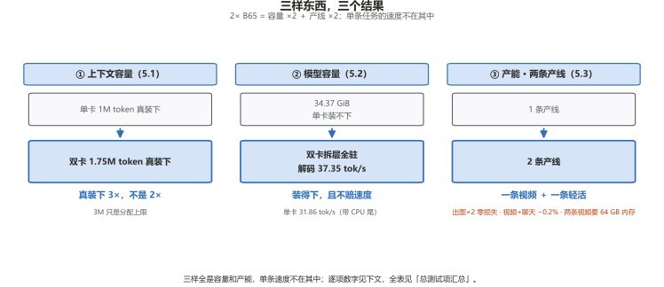
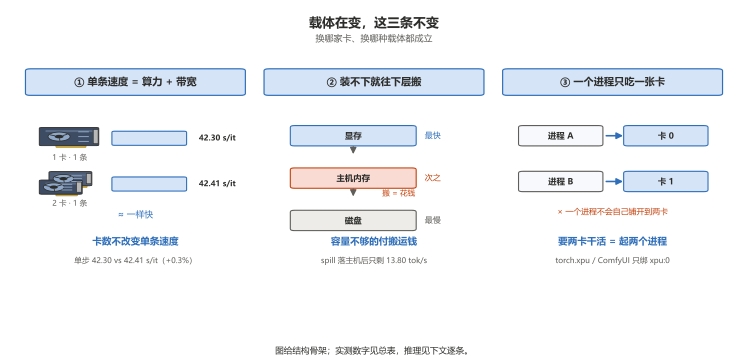
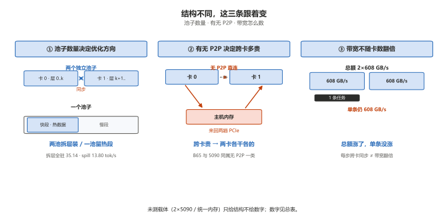

# Dual B65 in practice: what you buy, and what you do not

> **一句话**：加卡是加房间，不是加速度——第二张 B65 买到的是**容量和第二条产线**，不是单条任务的速度。

> **说给客户听（可以直接照着讲）**
>
> 有人问我，插两张卡是不是就两倍快。这个得分开说。
>
> 第二张卡插上去，显存从 31 GB 变 62 GB。原来装不下的模型，现在装得下了；
> 原来只能跑一条片子，现在一条片子开着，旁边再挂个聊天。这都是实打实的变化。
>
> 但你要问同一条片子能快多少——几乎不快。单卡一步 42.30 秒，两张卡一起干 42.41 秒，一样。
> 所以第二张卡买的是地方，不是速度——想让一条片子快，换更强的单卡。
>
> 有人跟你说「两张卡能并成一张使、算力翻倍」：那种模式我们试过，能跑但比单卡还慢
> （29.19 对 31.86）——每算一层两张卡要对一次账，对账比省下来的还多。我们的办法是各干各的。
> 拆层是「第二张卡帮忙装」不是「帮忙算」：单卡装得下时拆开反而慢 5%~7%，装不下时拆开快 17%。
>
> 主板不用换。普通 B850M 就行，卡 1 在 x4 槽单跑一步 42.31 秒，跟 x16 的一样。
> 只有上四卡或非做张量并行才要 x8/x8 工作站板——我们定位就是普通电脑跑大模型。
>
> 有件事先说：想同时开两条线要 64 GB 内存，32 GB 是「一条片子加一个轻活」。先说，比事后解释好。

实测条件：2× GUNNIR B65 32G · ECC 关（每卡可用 31.16 GiB）· 驱动 9150 · 32 GB 内存（2×16 GB）·
显示器接主板核显 · 主板是 **B850M 这一级的主流 mATX 板**（不是工作站板，做不了 x8/x8 拆分）：
卡 0 在 CPU 直连 x16 槽、卡 1 在芯片组 x4 槽。除另注外，全部数字都是实测，**没有靠工作站硬件撑出来的成绩**。

## 总测试项汇总

各收录数据按总测试项收进一张表。每项只给一个结果，展开见对应章节。

**动态图**：[`assets/dual-b65-dashboard.html`](assets/dual-b65-dashboard.html)（可交互 · 悬停看一个结果）

| 测试项 | 单卡 B65 | 双卡 2×B65 | 一片 B70 | 一个结果 |
|---|---:|---:|---:|---|
| H3 720p·5 s 端到端（稳态） | 394.06 s | 417.78 s | 276.68 s | 双卡不提速，B70 快 1.42× |
| H3 720p 单步 | 42.30 s/it | 42.41 s/it | 25.30 s/it | 第二张卡对单条贡献 0 |
| H3 1080p·5 s 端到端（稳态） | 1326.17 s | — | 841.55 s | B70 快 1.58× |
| Qwen Q4_0 解码 | 50.56 tok/s | 50.47 tok/s | 77.11 tok/s | 并发不掉速 |
| Q8_0 34.37 GiB 解码（拆层 vs 单卡全驻） | 31.86 | 37.35 | — | 拆层买容量不赔速度（1.17×） |
| Q4_0 19.41 GiB 解码（拆层 vs 单卡） | 53.63 | 49.80 | — | 装得下别拆，拆开慢 7.1% |
| 张量并行解码 | — | 28.65 tok/s | — | 比单卡慢，别用 |
| 可用显存 | 31.16 GiB | 62.32 GiB | 31.16 GiB | 双卡买到 2× 显存，不是速度 |
| 上下文（真装下） | 1M token | 1.75M token | 1M token | 对外说 1.75M，3M 只是分配上限 |
| 出图稳态 | 16.20 / 16.31 s | 16.00 ~ 16.18 s | — | 双实例并发零损失 |
| 出视频 + 聊天 | — | 12/12 答对，decode −0.2% | — | 成立 |
| 出视频 + 出视频 | — | 2/2 崩 | — | 不成立（32 GB 内存墙） |
| 满载功耗 P90 | 205.5 W | 400.8 W | 290.4 W | 叠加不互压 |
| 两条 5 秒片产能 | — | 18.3 条/时 | 13.0 条/时 | 双卡赢 1.40× |
| 价格 | ¥9,999 | ¥19,998 | ¥18,999 | 几乎同价：B70 买速度，双卡买容量+产能 |

## 一、四个问题，四个答案

| 问题 | 答案 |
|---|---|
| 双卡是不是「算力翻倍」？ | **不是。** 数字见总表前两行，一步都没快。 |
| 那双卡买什么？ | **容量 + 产能**（见总表）。⚠️ 32 GB 内存下「两条视频线」不成立（§5.3），实际是「一条视频 + 一条轻任务」。 |
| 单卡 B65 能单独做 H3 视频吗？ | **能。** 720p·5 s 稳态约 6 分 34 秒；实测最高 720p 24 秒（83 分钟一条）——是「要等多久」不是「能出几秒」（见 `cards/B65-README.md` §6）。 |
| 一片 B70 和两片 B65（几乎同价），差什么？ | **B70 买速度，双卡买容量+产能。** 见总表末行。 |

## 二、为什么「双卡 = 算力翻倍」不成立

不是这张卡不行，是这两条软件路径都**不把一个任务拆到两张卡上**：

1. **ComfyUI / `torch.xpu` 只用第一张卡。** 进程起来就绑 `xpu:0`，第二张卡在这个进程里不存在。
   想让第二张卡干活，只能再起一个进程、用 `ONEAPI_DEVICE_SELECTOR=level_zero:1` 把它钉过去。
2. **llama.cpp 的「多设备」是分层装载，不是并行计算。** `-dev SYCL0,SYCL1 -sm layer` 把模型的不同层
   分到两张卡上，算一层的时候另一张卡在等 —— 层与层之间要同步，同步次数随层数涨。

实测证据就是总表的前两行与 Q8_0 / Q4_0 两行（单步 +0.3%、解码 −0.2%、拆层 1.17×、装得下别拆）——四条都在噪声内或负收益。

一个结果：**「双芯运作、算力翻倍」预期在这两套软件上不成立**——正确的预期是两条独立的产线。（早先「拆层赔 4.84 倍」是 llama-bench `-dev` 语义误读的采集错误，已更正，过程见 `bench/notes/dual-b65-prep.md`。）

打算上第二张卡之前，先答三个问题：

1. **你要的是「一条更快」还是「两条一起」？** 前者换更强的单卡，后者才上双卡。
2. **你的内存是 32 GB 还是 64 GB？** 32 GB 下两条视频线跑不起来（§5.3），只能「一条视频 + 一条轻任务」。
3. **有没有一个模型单卡装不下？** 没有的话，双卡不会让你现有任何一个任务变快。

## 三、单卡 B65 能不能单独做 H3 视频

**能，而且这是目前最实用的用法。** 一台机器一张 B65，不用第二张卡、不用改代码，ComfyUI 里跑 MiniMax H3：

| 时长 | 帧数 | 端到端（cold） | 单步（cold） | 端到端（稳态） | 单步（稳态） |
|---:|---:|---:|---:|---:|---:|
| 5 秒 | 124 | 437.11 s | 42.44 s/it | 394.06 s | 42.30 s/it |
| 10 秒 | 243 | 1166.44 s | 151.47 s/it | — | — |
| 15 秒 | 362 | 2149.75 s | 314.22 s/it | — | — |
| 17 秒 | 413 | 2689.48 s | 405.19 s/it | — | — |

5 秒档的读数不止一个，别混用（上表「稳态」列取的是 fresh）：cold 437.11 s（含完整装载）/ fresh 394.06 s / cached 382.92 s。
10 秒起只测了 cold（新起服务第一条），**没有稳态读数**，所以那一列是「—」，不是零。

| 分辨率（5 秒） | 端到端（稳态） | 单步 |
|---|---:|---:|
| 1280×720 | 394.06 s | 42.30 s/it |
| 1920×1088 | 1326.17 s | 188.64 s/it |

结论：

1. **720p · 5 秒 · 6 步：稳态 394.06 s，约 6 分 34 秒。** 这是单卡 B65 最舒服的一档 —— DiT 19.53 GiB 完整驻留显存，每步不搬权重。
2. **720p 实测到 24 秒（约 83 分钟一条，全表最高像素×帧通过点）**；整数秒上限 480p ≤ 50 秒 / 720p ≤ 24 秒 / 1080p ≤ 10 秒 / 1440p ≤ 5 秒，30 档 22 过。失败 8 档全是 XPU OOM（瞬时峰值装不下，不是主机也不是算力）。阶梯全表见 `cards/B65-README.md` §6。
3. **1080p · 5 秒也能出**：稳态 1326.17 s（约 22 分 06 秒），单步 188.64 s/it。代价是 DiT 每轮要卸 7,564 MB。**1080p 是 32 GB 卡的边界，不是舒适区。**
4. **时长比分辨率更贵。** 同样 720p，5 → 15 秒端到端涨 4.92×，像素一点没变 —— 帧数变多，潜在空间 buffer 跟着涨。
5. 采集条件：`--reserve-vram 4`、`OMNI_ATTN_BACKEND=sdpa`、int8 DiT + nvfp4 文本编码器。**改预留值会影响装载行为**，数字要连条件一起引。
6. 跨分辨率的完整四卡对照见 [`comfyui-h3.md`](comfyui-h3.md)；本文只讲单卡 B65 与双卡 B65。

## 四、双卡 vs 单卡：逐项对照

速度/容量各行见总表（双卡 vs 单卡全列在那里）。本节只补总表没有的三条：

| 维度 | 数字 | 一个结果 |
|---|---:|---|
| 出图首轮（装载） | 单卡 34.37 s / 双卡 57.31 s, 44.79 s | 并发抢页缓存，首轮不可比 |
| 卡 1（x4 槽）单跑 H3 | 稳态 458.46 s，单步 42.31 s/it | 与卡 0 一致，不归因 PCIe 宽度（无互换对照） |
| H3 端到端 +6.0% 的来源 | 热车后 406.29 s（+3.1%） | 不是算力损失，是并发抢页缓存；先热车再取数 |

一个结果：**双卡对单条任务零提升**（单步 +0.3%、解码 −0.2%，均在抖动量级）；端到端那 6.0% 是并发抢页缓存的固定开销，热车后收窄到 3.1%，**凡比双卡拖慢先热车再取数**；满载功耗相加不互压（合计 400.8 W），850 W 电源按显卡侧 400 W 级算。

### 4.1 卡间通道：把拷贝做得更底层，也没能提速

两张卡之间**只有 PCIe**，没有 NVLink / Xe-Link 那类专用互联。那换个更底层的卡间拷贝方式能不能提速？
llama.cpp 有三个档位可选，我们同一批、同一口径各跑三档（`GGML_SYCL_DEV2DEV_MEMCPY`）：

| 卡间拷贝方式 | 张量并行 解码 | 张量并行 预填充 | 拆层 解码 | 拆层 预填充 |
|---|---:|---:|---:|---:|
| 0 · SYCL 直拷（默认） | 29.08 | 47.34 | 37.29 | 61.77 |
| 1 · Level Zero 直拷 | 29.19 | 44.80 | 36.81 | 60.15 |
| 2 · 强制走主机内存 | 29.50 | 42.17 | 37.38 | 59.90 |

（Q8_0 34.37 GiB · `-ts 50,50` · 解码 tok/s、预填充 tok/s，各跑 3 次取中位数）

一个结果：**换更底层的拷贝路径救不了张量并行**——三档解码极差 1.5%（噪声内），卡间拷贝不是瓶颈、同步次数才是，这条路不用再试；双卡不需要为 PCIe 拓扑换主板（x4 槽单步 42.31 与 x16 的 42.41 一致）；只有上四卡或非做张量并行才要 x8/x8，那是工作站板。

## 五、双卡真正买到的三样东西



三个结果分别展开见 5.1 / 5.2 / 5.3。

### 5.1 容量：上下文 1M → 1.75M token（3M 只是分配上限）

| 形态 | 配置 | 真装下 | 每 M token 占显存 | 上限处剩余 |
|---|---|---:|---:|---:|
| 单卡 | 默认 | **1M token**（4 个满长会话） | 12.8 GiB | 0.03 GiB |
| 双卡 | 默认（`kv_unified=true`） | 1.75M token | 22.4 GiB | 2.01 / 2.83 GiB |
| 双卡 | 显式 `--parallel`（`kv_unified=false`） | **3M token**（12 个满长会话） | 14.5 GiB | 0.19 / 0.22 GiB |

一个结果：**是 3 倍不是 2 倍**（权重不再重复占位）——前提是显式 `--parallel`（不写只有 1.75 倍且 2M OOM）。
🔴 **3M 只是分配上限**：长 prompt prefill 会把整机跑挂（主机内存顶穿、无 dump），**对外只说单卡 1M / 双卡默认 1.75M**。
🔴 **虚拟内存定案：初始 = 最大 = 32768 MB**——页面文件过大反而把「进程自己退」变成「整机卡死」；锁死后超限请求进程自报 OOM 退出、机器照常用。
对客一句话：**买容量要看主机内存，不只是显存。** 事故取证见 `bench/notes/ctx3m-hang-2026-10-24.md`。

### 5.2 容量：装下一个 34.37 GiB 的模型

| 配置 | 显存去向 | 预填充 tok/s | 解码 tok/s |
|---|---|---:|---:|
| Q8_0 单卡 `-ngl 37` | 30.78 GiB 上卡、约 4 GiB 层落 CPU | 56.54 | **31.46** |
| Q8_0 单卡 `-ngl 99` | 显存占满 31.14 GiB（剩 0.02 GiB）；权重 34.37 GiB，未上卡的 ≥ 3.2 GiB | 6.96 | 13.80 |
| Q8_0 双卡 `-sm layer` | **33.53 GiB 全驻显存**（卡 0 17.47 / 卡 1 16.06） | 59.40 | **35.14** |
| Q8_0 双卡 `-sm tensor` † | 33.65 GiB 均摊两卡（卡 0 16.92 / 卡 1 16.73） | 45.44 | 28.65 |
| Q4_0 单卡 `-ngl 99` | 18.32 GiB 全驻（剩 12.84 GiB） | 86.40 | **53.63** |
| Q4_0 双卡 `-sm layer` `50,50` | 17.96 GiB 全驻（卡 0 9.39 / 卡 1 8.57） | 80.45 | 49.80 |
| Q4_0 双卡 `-sm layer` `90,10` | 17.96 GiB 全驻（卡 0 17.09 / 卡 1 0.87） | 86.96 | 50.95 |

一个结果：**装得下就别拆，装不下才拆。** Q4_0 单卡本来就装得下，拆开慢 7.1%；Q8_0 单卡装不下，拆层全驻比单卡快 1.17×（比 spill 快 2.55×）——拆层买到的是容量，速度不赔。
⚠️ `-ts` 比例对解码无影响（四档极差 0.3%），跨场次同配置能差 6%、只看方向不看趋势；`-sm row` 本 build 跑不起来，`-sm tensor` 比单卡还慢（28.65 tok/s）——**拆层是唯一不赔速度的协同模式**。口径：llama-server（19/128、3 次取中位），别与 llama-bench 混排。

### 5.3 吞吐：两张卡各一条产线

| 组合 | 形态 | 结果 |
|---|---|---|
| 出图 + 出图 | 两个 ComfyUI，各钉一张卡 | 稳态 16.00 ~ 16.18 s/张，与同批单卡 16.20 / 16.31 **持平** |
| 出视频 + 聊天 | 卡 0 跑 H3，卡 1 跑 llama.cpp | 12/12 答对，decode 114.79 vs 115.02 tok/s（−0.2%） |
| 出视频 + 出视频 | 两个 ComfyUI 各跑 H3 | **不成立**：2/2 在同一处崩溃，页面文件峰值 48.7 GB |

- 第三条是 **32 GB 内存墙，不是显卡不够**：单实例 H3 约要 25 GB 虚拟内存，两个 50 GB，物理内存 32 GB 顶不住。
  隔离两侧的 SYCL 缓存后照崩 → 不是缓存冲突。**32 GB 机器上双卡只能「一条视频 + 一条轻任务」；两条视频线要 64 GB 内存。**

## 六、一片 B70 vs 两片 B65（同价对决）

价格口径（2026-10-26 确认）：**B70 ¥18,999**、B65 ¥9,999。**两片 B65 ¥19,998，比一片 B70 贵 ¥999，几乎同价。**
所以这就是「一片 B70 = 两片 B65」这道题的正确算法 —— 同样的钱，买到的是两种不同的东西。

| | 一片 B70 32G | 两片 B65 32G |
|---|---:|---:|
| 价格 | **¥18,999** | **¥19,998** |
| 核心 / 带宽 / 显存 | 32 核 · 608 GB/s · 31.16 GiB | 2×20 核 · 2×608 GB/s · 62.32 GiB |
| H3 720p · 5 s 端到端（稳态） | **276.68 s** | 394.06 s（每张） |
| H3 单步 | **25.30 s/it** | 42.30 s/it |
| H3 1080p · 5 s 端到端（稳态） | **841.55 s** | 1326.17 s |
| Qwen Q4_0 解码 | **77.11 tok/s** | 50.56 tok/s |
| 满载功耗（P90） | 290.4 W | 400.8 W（两卡合计） |
| 同时跑几条 H3 | 1 | **2** |
| 34.37 GiB 的 Q8_0 | 同为 31.16 GiB，按容量推装不下；**B70 上单卡 Q8_0 没测** | 装得下，解码 35.14 tok/s |

一个结果：**同价两种买法——B70 买单条速度（快 1.42× / 1.67×），两片 B65 买容量+产能（显存 2×、上下文 3×、双线 18.3 条/时、装得下 34.37 GiB）**。算力翻倍两边都不成立（B70 只快 1.42×，双卡单任务不变）；B70 不买容量（34.37 GiB 同样装不下，B70 单卡 Q8_0 未测、不给数字）。

| 你的场景 | 选 | 理由 |
|---|---|---|
| 一条片子要快、要 1080p 常态 | **B70** | 720p 快 1.42×、1080p 快 1.58×，单任务无替代 |
| 同时出两条片子 / 一条视频一条问答 | **2× B65** | 同价，产能 1.40×（18.3 vs 13.0 条/时） |
| 要装 34 GiB 以上的模型、要 3M token 上下文 | **2× B65** | 容量翻倍；但预期是「装得下」，不是「跑得快」 |
| 预算卡在 32 GB 显存这一档 | **B65** | 同显存、便宜约 ¥9,000，慢 1.42× |

## 七、不同搭配载体在 AI 推理上的相同与不同

> 这一节讲结构，不讲参数。**本机实测过的载体只有「一张卡」和「两张 B65」**；表里另外两种本机没有，
> 所以**不给它们任何数字**，只讲结构决定了什么。

| 载体 | 显存 | 卡间通道 | 本机实测 |
|---|---|---|---|
| 1× B65 | 一个池子，31.16 GiB | — | ✅ |
| **2× B65**（本文） | 两个独立池子，各 31.16 GiB | PCIe（本机卡 1 在芯片组 x4 槽）；**无 P2P**，跨卡只能经主机内存 | ✅ |
| 2× RTX 5090 | 两个独立池子，各 32 GB | PCIe；**消费级卡同样没有 P2P**，跨卡也只能经主机内存 | ⛔ 没测 |
| 统一内存平台（DGX Spark 这类） | **一个池子**，GPU 直接寻址整机内存 | 不存在「卡间搬运」这个概念 | ⛔ 没测 |

### 相同的三件事



1. **单条任务的速度由算力和带宽决定，不由卡的数量决定**（实测见总表前两行）。换哪家卡、换哪种载体，这条都成立。
2. **装不下就得往下层放，放下去就要搬。** 显存最快、主机内存次之、磁盘最慢；
   谁的容量不够，谁就要付这一层搬运的钱。
3. **一个进程只吃一张卡。** `torch.xpu` 和 ComfyUI 都只绑第一张卡，不会自己铺开。
   要让两张卡都干活，最省事的是**起两个进程**，不是一个进程用两张卡。

### 不同的三件事



1. 🔴 **池子有几个，决定瓶颈在哪，也决定优化方向正好相反。**
   - **两个独立池子**（本文这种）：把一个大模型切开、分层放到两张卡上，层与层之间要同步。
     实测 Q8_0 34.37 GiB 拆层全驻显存解码 **35.14 tok/s**，单卡带约 4 GiB CPU 尾 **31.46**、单卡硬塞 spill **13.80** ——
     **拆层既不赔速度，还避开了单卡 spill 那一档（2.55× tok/s）。** 两池子的方向不是「别拆层」，
     而是「**拆层可以，但别指望它把单条任务变快**」—— 单条任务的速度仍由单卡的算力与带宽决定。
   - **一个池子**（统一内存）：没有「哪层放哪张卡」这个问题，快层和慢层在同一个池子里连续。
     方向反过来了 —— 要做的是**把热数据留在快的那一段**，而不是想办法把负载铺到更多卡上。
2. **有没有 P2P，决定「跨卡」有多贵。** 本文两张 B65 之间没有 P2P，跨卡数据要落主机内存再取，
   来回两趟 PCIe。消费级卡（5090 这一档）同样没有 P2P —— 就「跨卡很贵」这一点，两种载体是**同一类**，
   都更适合「两张卡各干各的」。
3. **带宽不随卡数翻倍。** 两张 B65 合起来是 2×608 GB/s 的**总额**，但一条任务只跑在它所在的那张卡上，
   能动用的还是 608 GB/s。把模型切两半摊到两张卡，等于用「每步跨卡同步」换掉「每张卡装一半」——
   带宽总量涨了，单条任务能用的没涨。

### 落到选型

| 你的情况 | 怎么做 | 为什么 |
|---|---|---|
| 两件互不相干的活 | **两张卡各起一个实例** | 实测出图+出图、出视频+聊天都不掉速，这是双卡最稳的用法 |
| 一个模型装不下 | **双卡 `-sm layer` 拆层** | 实测买容量不赔速度（37.35 vs 单卡全驻 31.86，同场次）；`-sm row` 在本 build 上跑不起来，`-sm tensor` 跑得通但比单卡还慢 |
| 模型单卡就装得下 | **别拆层，老实单卡** | Q4_0 档同场次：双卡 49.80 vs 单卡 53.63，拆开慢 7% |
| 想让单条任务更快 | **换更强的单卡**，不是加卡 | 加卡对单条任务的贡献是 0，哪种载体都一样 |
| 装不下又不想拆层 | 统一内存平台（本机没测） | 一个池子，装得下就整块驻留，不存在跨卡同步 |

## 八、跑通的参数（可以直接抄）

### 8.1 ComfyUI 双实例：两张卡各一个

```bash
# 实例 1（卡 0，CPU 直连 x16）
COMFY_PORT=8190 ONEAPI_DEVICE_SELECTOR=level_zero:0 \
  SYCL_CACHE_DIR=<工具目录>/_sycl_cache_c0 \
  <ComfyUI 目录>/python_embeded/python.exe <ComfyUI 目录>/main.py \
    --listen 127.0.0.1 --port 8190 --reserve-vram 4

# 实例 2（卡 1，芯片组 x4）—— 错开 20 秒再起，避开同时装载
COMFY_PORT=8191 ONEAPI_DEVICE_SELECTOR=level_zero:1 \
  SYCL_CACHE_DIR=<工具目录>/_sycl_cache_c1 \
  <ComfyUI 目录>/python_embeded/python.exe <ComfyUI 目录>/main.py \
    --listen 127.0.0.1 --port 8191 --reserve-vram 4
```

- **钉卡只有一层：`ONEAPI_DEVICE_SELECTOR=level_zero:N`。** ComfyUI 的 `main.py` 本身没有「断言索引」这个参数，
  照抄台架采集器的 `--expect-index`（那是 `bench_f_h3.py` 的参数）会直接报参数错误起不来。
- **起好之后自己核一次**：两个实例各看一次显存占用，两个都涨才是各占一张卡；只有一个涨，就是都落到了同一张。
- **`SYCL_CACHE_DIR` 必须各给一份**，共用一个会互相覆盖内核缓存。
- 端口用 8190 / 8191。**8188 是常驻实例，不要抢、不要杀。**
- `--reserve-vram 4` 是这套数字的采集条件，改它会影响装载行为。

### 8.2 llama.cpp 双卡：多设备 + 分层装载

```bash
# SYCL 运行时的 DLL 在 python_embeded 里，必须前置，否则 exe 起来就 0xC0000005
PATH=<python_embeded 目录>/Library/bin:<llama.cpp bin 目录>:$PATH
ONEAPI_DEVICE_SELECTOR=level_zero:0,1 \
  llama-server -m <模型目录>/Qwen_Qwen3.6-35B-A3B-Q4_0.gguf \
    -dev SYCL0,SYCL1 -sm layer \
    -c 3145728 --parallel 12 \
    --host 127.0.0.1 --port 8099
```

- 🔴 **`-c` 必须与 `--parallel` 对齐**：`--parallel = ctx / 262144`。不对齐时日志里 `kv_unified=true`，
  每 M token 要 22.2~22.4 GiB，2M 直接 OOM；对齐后 `kv_unified=false`，每 M token 只要 14.5~15.6 GiB。
- **只在一张卡上跑就写 `-dev SYCL0`（或 `SYCL1`）**，并把 `ONEAPI_DEVICE_SELECTOR` 一起收窄到同一张，否则设备枚举顺序会变。
- 🔴 **`PATH` 必须前置 `python_embeded\Library\bin`**（里面有 SYCL 运行时的 DLL）。不加的表现是
  **退出码 `0xC0000005`、1 秒内崩、stderr 全空** —— 看着像模型问题，其实是运行时没找到。

### 8.3 三条判断

| 查什么 | 怎么做 | 为什么 |
|---|---|---|
| 起没起 | 等日志出现 `model loaded`，再发一次 `/v1/chat/completions` | TCP 通不等于能提问 |
| 装没装下 | 看**显存占用有没有随 `-c` 按比例涨** | 单卡 `-c 1572864` / `2097152` 都能起能答，但占用与 1M 一样（12.68 / 12.63 vs 12.81 GiB）—— 多出来的上下文没真分配 |
| 值不值得 | 看**跑得多快** | Q8_0 单卡 `-ngl 99` 装不下却照样 `model loaded` + 探针 200，只是余下层落 CPU |

### 8.4 两条会让数字假掉的小设置

- **`cache_prompt` 必须关**（多模态对照里是 `cache_prompt: false`）。不关的话同一张图连打会命中提示词缓存，
  墙钟掉到 0.1 s、decode 报 115 tok/s —— 那是缓存，不是算力。
- **先热车再取数**。同一条 H3，页缓存冷 501.72 s、热 406.29 s，差 23.5 个百分点。凡「双卡拖慢多少」，先跑一轮热的。

## 九、坑清单

| # | 坑 | 表现 | 处理 |
|---:|---|---|---|
| 1 | 以为双卡算力翻倍 | 单步 42.30 → 42.41 s/it，一步没快 | `torch.xpu` 只用第一张卡；llama.cpp 多设备是分层装载 |
| 2 | 以为拆层一定赔速度 | 双卡 33.53 GiB 全驻，解码 37.35 tok/s | 同场次实测不赔：比单卡全驻 31.86 快 1.17×、比单卡 spill 13.80 快 2.55×。`-sm row` 才真跑不起来 |
| 7 | 以为张量并行能加速 | `-sm tensor` 两卡解码 29.08~29.50 tok/s | 比单卡全驻 31.86 还慢：每层跨卡同步的代价超过第二张卡的贡献。要协同走拆层，别走张量 |
| 15 | 以为上下文写得越大越好 | 3M 分配成功，长 prompt prefill 卡在 8192 token | 14 分钟后整机静默卡死（无 dump、无蓝屏）。3M 只是分配上限；可用上限单卡 1M / 双卡 1.75M |
| 16 | 以为页面文件越大越保险 | 64 GB 页面文件，系统承诺 95.11 GiB | 承诺太满，本该进程报 OOM 变成整机卡死。页面文件要「够用且留余量」 |
| 17 | 以为「初始调小」就锁住了 | 初始 32 GB / 最大 64 GB，3M 装载时 Windows 扩到 ~56 GB | commit limit 涨回 86.97 GiB、提交 98.9%，同卡死危险区。**初始与最大必须同值（32768）** |
| 18 | 以为虚拟内存要设很大才安全 | 初始 = 最大 = 32768 锁死后，3M 装载 20.4 s 进程自己退、提交峰值 55.4%，limit 全程不扩 | 超上限的请求进程自己报 OOM 退出、机器照常用。虚拟内存定案：**32 GB 固定（初始 = 最大）** |
| 14 | 以为换更底层的卡间拷贝能救张量并行 | 三档拷贝路径（SYCL 直拷 / Level Zero 直拷 / 强制走主机内存）解码 29.08 / 29.19 / 29.50 tok/s | 三档在噪声内。卡间拷贝不是瓶颈，同步次数才是。别再往这个方向调 |
| 3 | 进程起得来就当真装下了 | `-c 1.5M` / `2M` 能起能答，显存一点没多占 | 改看「显存有没有随 `-c` 按比例涨」 |
| 4 | 装不下就认定起不来 | Q8_0 单卡 `-ngl 99` 照样 200 | 改看「跑得多快」 |
| 5 | `-c` 与 `--parallel` 不对齐 | 每 M token 22.2~22.4 GiB，2M OOM | `--parallel = ctx / 262144`，确认日志 `kv_unified=false` |
| 6 | 双实例同时出视频 | 2/2 崩在 `loads=2` 之后，`0xC0000005`，页面文件峰值 48.7 GB | 32 GB 内存墙；双卡只做「一条视频 + 一条轻任务」 |
| 7 | 首轮直接取数 | 首轮 543 s、热车后 406 s，同一个配置 | 先跑一轮热车；首轮含并发装载，不可比 |
| 8 | 功耗归错卡 | H3 跑得正旺，采样器报 42~46 W | 采样器只读 Sysman 第 0 个设备，且 **Sysman 顺序 ≠ `level_zero:N`**（本机 Sysman dev0 = 总线 16 = 卡 1）。双卡功耗改用按卡枚举、按 PCI 总线归属的采集器 |
| 9 | `PATH` 没前置就起 llama.cpp | `0xC0000005`，1 秒内崩，stderr 全空 | 前置 `<python_embeded 目录>/Library/bin` |
| 10 | `llama-bench` 传 `-c` | `invalid parameter for argument: -c` | `llama-bench` 用 `-p` / `-n`，不认 `-c` |
| 11 | 输出接管道再取数 | 管道要等进程结束才吐字，中途一个字都看不到 | 直接 `>> 日志文件 2>&1` |
| 12 | 共用 `SYCL_CACHE_DIR` | 两个实例互相覆盖内核缓存 | 各给一份；但注意：隔离后照崩的那次不是缓存问题 |
| 13 | 采集器没启动就以为没功耗 | 记录里功耗字段是空的 | 不显式启动就静默降级成「不记功耗」，不是零功耗 |

## 十、数据从哪来

- 时间：**2026-10-23**（双卡 H3、出图、容量、功耗全部实测）；单卡基线取 **2026-10-21**（H3、出图、Qwen）与
  **2026-10-22**（H3 时长阶梯）；**2026-10-24** 三批：张量并行与卡间拷贝路径（§4.1、§九第 7/14 条）、
  `-ts` 细扫与 Q4_0 档双卡/单卡同场次对照（§5.2）、3M 上下文跑不跑得动（§5.1、§九第 15/16 条）。
  ⚠️ **§5.2 的 Q4_0 对照与单卡 `-ngl 37` 重跑是同一时段（17:37~17:47）连跑的**，是目前最紧的同场次比较；
  12:39 与 16:10 两个场次的双卡数字相差 6%，**跨场次只当参考**。
- 原始记录：`bench/data/` 下按日期命名的 json，每条含 workload、samples、summary、notes。本文所有表格由
  `bench/harness/gen_dual_report.py` 从这些 json 直出，**没有手抄数字**。
- 用到的记录：

  - `2026-10-21_b65-32g_minimax-h3-int8_convrot-b65h3-1280x720-comfyui.json`
  - `2026-10-21_b65-32g_minimax-h3-int8_convrot-b65h3-1920x1088-comfyui.json`
  - `2026-10-22_h3_1280x720_b65d10.json`
  - `2026-10-22_h3_1280x720_b65d15.json`
  - `2026-10-22_h3_1280x720_b65d17.json`
  - `2026-10-22_h3_1280x720_b65d20.json`
  - `2026-10-19_h3_1280x720_b70scan.json`
  - `2026-10-19_h3_1920x1088_b70scan.json`
  - `2026-10-19_h3_1280x720_b70pw.json`
  - `2026-10-20_b70-q4-0-sycl-l0.json`
  - `2026-10-23_h3_1280x720_duald1.json`
  - `2026-10-23_h3_1280x720_duald4b.json`
  - `2026-10-23_h3_1280x720_duald6.json`
  - `2026-10-23_h3_1280x720_dualc1.json`
  - `2026-10-23_h3_1280x720_dualc1b.json`
  - `2026-10-23_b65-32g-q4_0-dual-c1.json`
  - `2026-10-23_b65-32g-q4_0-dual-c1-concurrent.json`
  - `2026-10-23_dual-a4-vision-under-h3.json`
  - `2026-10-23_b65-32g_qwen-image-2.1-int8_convrot-duala2solo-comfyui.json`
  - `2026-10-23_b65-32g_qwen-image-2.1-int8_convrot-duala2c0-comfyui.json`
  - `2026-10-23_b65-32g_qwen-image-2.1-int8_convrot-duala2c1-comfyui.json`
  - `2026-10-23_b65-32g_qwen-image-2.1-int8_convrot-c3s0-comfyui.json`
  - `2026-10-23_b65-32g_qwen-image-2.1-int8_convrot-c3s1-comfyui.json`
  - `2026-10-23_b65-32g_qwen-image-2.1-int8_convrot-c3b0-comfyui.json`
  - `2026-10-23_b65-32g_qwen-image-2.1-int8_convrot-c3b1-comfyui.json`
  - `2026-10-23_b65-32g_q4_0-ctxcap-dual.json`
  - `2026-10-23_b65-32g-q8_0-dual-layer-qwen3.6-35b-a3b.json`
  - `2026-10-23_b65-32g-q8_0-single-spill-qwen3.6-35b-a3b.json`
  - `2026-10-23_b65-32g-q8_0-single-ngl37-qwen3.6-35b-a3b.json`
  - `2026-10-24_b65-32g-q8_0-dual-tensor-scan.json`
  - `2026-10-24_b65-32g-q8_0-dual-dev2dev-scan.json`
  - `2026-10-24_b65-32g-dual-ts-scan2.json`
  - `2026-10-24_b65-32g-q4_0-solo.json`
  - `2026-10-24_b65-32g-q8_0-solo37-recheck.json`
  - `2026-10-24_b65-32g-q4_0-ctx3m-probe.json`
  - `2026-10-24_b65-32g-q4_0-ctx262144-single-ctrl.json`
  - `2026-10-24_b65-32g-q4_0-ctx3m-loadonly-pfmax64.json`
  - `2026-10-24_b65-32g-q4_0-ctx3m-loadonly-pf3232.json`

- 相关文档：跨卡对照总表 [`slot-comparison.md`](slot-comparison.md) §6、H3 四卡实测 [`comfyui-h3.md`](comfyui-h3.md)、
  功耗 [`comfyui-power.md`](comfyui-power.md)、常见坑 [`pitfalls.md`](pitfalls.md)。
- 调试过程与踩坑的完整记录在 `bench/notes/dual-b65-prep.md`，**那份是工程笔记，不是产品文档**；对外结论以本文和 `docs/` 为准。
- 3M 上下文把整机跑挂的完整取证（含转储判据、单变量对照、页面文件分析）在 `bench/notes/ctx3m-hang-2026-10-24.md`。
