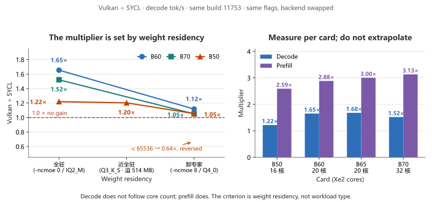

**English** · [简体中文](server-config.md)

# server delivery configuration: the 16 GB tier stacks three mistakes, the 24 GB tier only lacks "fits"

> This document is about the **real delivery configuration** — the command line a customer installs, runs, and sees.
> Not parameters hand-assembled in a lab.
>
> **16 GB tier (§1–§6)**: 19.41 GiB of weights do not fit in 15.51 GiB of VRAM, and this command line measures **5.76 tok/s**.
> Split the three variables apart and fix them one at a time and it becomes **×6.2 → 35.5 to 37.6 tok/s**. Basis for the split: §5.1.
>
> **24 GB tier (§7)**: the same command line with only `-ncmoe` changed from 8 to 0 (the weights now fit) gives
> **50.94 tok/s**; `-c` from 16K to 256K leaves throughput flat, and the vision tower costs nothing. See §7.
>
> **Backend switch (§8)**: not one character of the command changes. Swap the binary for the Vulkan build, same card,
> same build, and decode goes **51.79 → 85.59 tok/s**. The largest single-item gain measured so far. See §8.

---

## 1. The delivery configuration: a command line that looks normal and is the worst one available

```
llama-server.exe -m Qwen_Qwen3.6-35B-A3B-Q4_0.gguf \
  --host 127.0.0.1 --port 8080 \
  -ngl 999 --cache-type-k q8_0 --cache-type-v q8_0 \
  -c 262144 --parallel 1 --jinja \
  -lm dio --mmproj mmproj-Qwen3.6-35B-A3B-Q8_0.gguf \
  --image-min-tokens 1024 --api-key local
```

The weights are **19.41 GiB → they fit neither VRAM nor host RAM**.

**Throughput measured with this parameter set in two machine states (basis B, `/completion`, prompt 13 token / generation 104 token)**:

| Machine state | Slot | Free RAM | decode | prefill | Single-request wall clock |
| --- | --- | ---: | ---: | ---: | ---: |
| Ample RAM | **Primary slot PCIe 5.0 x8** (CPU-attached) | 20.9 GB | **5.76 tok/s** | — | — |
| RAM tight | **Secondary slot PCIe 4.0 x4** (chipset) | **5.2 GB** | **2.47 tok/s** | 7.97 tok/s | 43.36 s |

> The two rows differ by **2.3×**, and slot and free RAM **differ at the same time**, so the gap **cannot be attributed to a single variable**.
> Every multiple below starts from the **5.76** in the "ample RAM · primary slot x8" row.

> On the second row: `docs/slot-comparison.md` measured "the slot causes no measurable loss",
> but that was measured **with `-ncmoe ≥ 8` (experts already offloaded)**.
> This section's configuration leaves `-ncmoe` at its default, which means **whole-layer offload** — the weights for every token cross PCIe.
> In that shape the x8 vs x4 difference **is very likely no longer negligible**. The two findings do not conflict; they cover different conditions.

## 2. Three problems stacked, and what each one is worth

| Problem | Measured | Standalone contribution (split within one session) |
|---|---|---|
| No `-ncmoe`: `-ngl 999` does not fit in 16 GB, so llama.cpp falls back to whole-layer offload — with `-ncmoe 0` it pushes **18,731 MiB onto a 15,882 MiB card**, the ≈2.8 GiB excess stays resident in host RAM and every token pulls it back | **3.06 tok/s** | ×**1.79** (5.76 → 10.30) |
| `-c 262144`: 263K of KV cannot stay resident in 16 GB, so the run pages to disk continuously (process working set 19.3 GB) | see §5.2 | the big one |
| `--mmproj` vision tower resident alongside the text weights | decode **−11.5%**, prefill **−35%**; VRAM cost only **+204 MB** discrete, **+606 MB** shared | paid for nothing, not a fit problem |

- **The three changes cannot be added together**; adding them yields an inflated multiple.
- Shrinking `-c` is not the answer: at 16384 an agent load of 190K token is rejected outright (HTTP 400) → **a B50 16G cannot serve this load; move up a tier**.
- Do not attach `--mmproj` by default for text-only work; for multimodal, start a separate instance.

---

## 3. Fixes (by priority; multiples split within one session)

| Priority    | Change                                            | Standalone contribution (measured in one session)                                    |
| ------ | --------------------------------------------- | ---------------------------------------------- |
| **P0** | `-ngl 999` → `-ngl 999 -ncmoe 8`              | **×1.79** (5.76 → 10.30)                        |
| **P0** | `-c 262144` → **lowering the number does not fix it**                 | **×3.05** (10.30 → 31.45); but see mistake two: clamping to 16384 gets long-context loads rejected — a tier problem, not a parameter problem |
| **P1** | drop `--mmproj` for text-only work                            | **×1.13** (31.45 → 35.55)                       |
| P2     | on machines with only 32 GB RAM, set the page file to **64 GB initial / 128 GB maximum** | the only "memory" that scales; a hard delivery item                              |

> **The three changes together: ×6.2** (5.76 → 35.55). No single parameter earns that.
> Per-step contributions: the same-session split table in §5.1.

**On a customer machine with 32 GB RAM + 16 GB VRAM, the correct configuration looks like this**:

```
llama-server.exe -m <model>.gguf \
  --host 0.0.0.0 --port 8080 \
  -ngl 999 -ncmoe 8 \
  --cache-type-k q8_0 --cache-type-v q8_0 \
  -c 16384 --parallel 1
```

> **`-c 16384` ships together with its limitation**: `-c` is a **tier**, not a knob.
> On a 16 GB card it blocks the agent load itself (a 190K token requirement), not just "does not fit".
> For a long-context agent, the correct move is **to step up to B60/B65/B70**, not to shrink `-c`.

---

## 4. How to reproduce and verify

### 4.1 Clear the field before measuring

This machine runs a keep-alive script: every 15 seconds it probes `127.0.0.1:8080` and starts `llama-server` if nothing is serving.
`Stop-Process` gets **resurrected 15 seconds later** — you think you have the GPU to yourself while a 20 GB service holds VRAM.

**Correct shutdown**: use the bundled `stop_model.ps1` (the same thing as double-clicking `停止本地模型.bat`).
It clears `llama-server.exe`, the watchdog's `cmd.exe`, and `wscript` in one pass, and drops `model_off.flag` (**6 hour TTL**).
The bundled `切到千问.bat` restarts the watchdog, so **clear again before every measurement run**.

### 4.2 Measurement method

`bench/harness/probe_server.py` measures **the running server itself**.
No need to stop and rebuild the service, no need to guess parameters — what it measures is what the customer will actually hit.
For batch configuration sweeps use `bench/harness/ctx_sweep.py --api-key <key>`.

```bash
python bench/harness/probe_server.py --port 8080 --api-key local --n-predict 256
```

**Auth (each variant tried on 2026-10-16; do not guess)** — with `--api-key local` on the server:
`Authorization: Bearer local` ✅ / `X-Api-Key: local` ✅ /
`bearer local` (**scheme must be uppercase**) ❌ / `api_key` in the body ❌ / no credentials ❌. The last three all return 401.

> **This cost a wasted run**: `--api-key local` was set on the server side only,
> never passed to the probe, so all 4 configurations came back **401 with every speed field empty**,
> while the load log and the VRAM readings looked perfectly normal — **it looked like a pass**.
> When sweeping configurations, pass `--api-key` to both server and client.

The script puts `Authorization: Bearer <key>` in the request header (llama-server only reads the header),
and returns `predicted_per_second` / `prompt_per_second` / `prompt_n` / `predicted_n` / `wall_s`.

**Report speed from this method only**: measured on **a configuration the customer can copy and run**,
not the peak numbers from a lab `llama-bench`. It sits closer to the customer's real experience than any benchmark.

> **But "closer" is not "citable as-is"**: this method measures **one specific process at one specific moment**,
> and session-to-session spread is about **±5%** (§5.1).
> Quote "about 37 tok/s", not a figure with one decimal place.

---

## 5. Measured results

**Test conditions**: Intel Arc Pro B50 LP 16G (`DEV_E212` / `SUBSYS_25221EF7`, GUNNIR 蓝戟) ·
**primary slot PCIe 5.0 x8 (CPU-attached)** · ECC off · driver 32.0.101.8976 ·
RAM 31.1 GiB + 64 GB page file · llama.cpp build 11431 / `c25030496` · SYCL ·
model `Qwen_Qwen3.6-35B-A3B-Q4_0` (19.41 GiB) · 1 warm-up + 4 samples per group.

Data: `bench/data/2026-10-16_b50-16g-q4_0-*.json` /
logs: `bench/logs/2026-10-16_*.log`

### 5.1 The §3 corrected configuration: **≈37.5 tok/s**

The §3 corrected configuration (text only, no `--mmproj`):

```
-m <Q4_0> -ngl 999 -ncmoe 8 -lm dio --fit off --jinja --api-key local --parallel 1 \
  --cache-type-k q8_0 --cache-type-v q8_0 -c 16384
```

> The configuration carries `--fit off`: `--fit` is **on** by default and first runs a trial load,
> which writes a fake `buffer size` of 0.00 into the log. To read the real VRAM ledger you must turn it off
> explicitly (see `docs/pitfalls.md` 4.5).

| Item | Value |
| --- | --- |
| **decode** | **37.45 / 37.55 tok/s** (two separate sessions, no `-v`) |
| prefill | 46.52 / 48.60 tok/s |
| loading | 19.1 s / 16.5 s |
| Third session (with `-v`, per-token logging) | 35.55 tok/s (range 3.5%) |

> **Session-to-session spread is about ±5%**: same configuration, same parameters, same card,
> and three sessions give 35.55 / 37.45 / 37.55. Within a session the range is only 0.7 to 3.5%.
> So **quote "about 37 tok/s", not a figure with one decimal place**.

**What each of the three changes is worth (split within one session)**:

| Step | Configuration | decode | vs. previous step |
| --- | --- | ---: | ---: |
| Delivery configuration baseline | `c 262144` + `--mmproj` + `-ncmoe` default | **5.76** | — |
| + `-ncmoe 8` | `c 262144` + `--mmproj` | **10.30** | **×1.79** |
| + `-c` down to 16384 | `c 16384` + `--mmproj` | **31.45** | **×3.05** |
| + drop `--mmproj` | `c 16384` | **35.55** | **×1.13** |
| | | | **total ×6.2** |

→ **`-c` is the big one; `-ncmoe` accounts for less than half of it.**

### 5.2 The real ceiling for `-c`: **no spill up to 32K, decay starts at 64K**

Q4_0 (19.41 GiB, must be offloaded) + `-ncmoe 8` + text only, changing only `-c`:

| `-c` | KV buffer | Discrete MB | Shared MB | **True spill after subtracting the host buffer** | decode | prefill |
| ---: | ---: | ---: | ---: | ---: | ---: | ---: |
| 16384 | 170 MiB | 15,945 | 3,848 | **≈39 MB** | 35.55 / 37.45 / 37.55 | 46.5 |
| 32768 | 340 MiB | 16,132 | 3,864 | **≈55 MB** | **37.57** | 46.51 |
| 65536 | 680 MiB | 16,194 | 4,206 | **≈397 MB** | **26.62 (−29%)** | 26.84 |
| 262144 | 2,720 MiB | 16,030 | 7,160 | **≈3,351 MB** | **10.35 (−72%)** | 24.01 |

**Conclusions**:

1. **The knee sits between 32K and 64K.** From 16K to 32K spill stays under 55 MB (noise level) and speed is full.
   At 64K spill reaches 0.4 GB and decode drops **−29%** outright; `-c 262144` (the value in the delivery command)
   spills 3.35 GB and decode drops **−72%**.
2. **`-c` is paid for, not free.** This does **not contradict** the "only 1.6% loss across a 64× context range"
   that `docs/vram-16gb.md` D.1 measured on **IQ2_M fully resident**:
   IQ2_M has 4.78 GiB of VRAM headroom, so 2.7 GiB more KV still fits;
   **Q4_0 depends on offload and the on-card portion already sits against the 15.9 GiB edge**, so every KV increment
   turns straight into spill.
   → **"`-c` is free" is a conclusion for the case where the model fits; it does not carry over to a tier where it does not.**
3. **Again: this is not something shrinking `-c` solves.** Full speed at 16K–32K is a technical fact.
   A real agent load needs 190K token, and on the 16 GB tier that requirement has **no feasible solution**.

> ⚠️ **The trap when reading `vram_shared_mb`**:
> `-ncmoe 8` puts 3808.81 MiB of expert weights into `SYCL_Host` **on purpose**.
> That **counts toward `vram_shared_mb`, but it is not spill**.
> The "true spill" column above is `shared − 3808.81`.
> Read shared as spill and the 16K row looks like "already spilling 3.8 GB".
> See `docs/pitfalls.md`.

### 5.3 Text only vs `--mmproj`: decode **−11.5%**, prefill **−35%**

Same session, same `-c 16384`, same `-ncmoe 8`; the only variable is `--mmproj`:

| | Discrete MB | Shared MB | decode | prefill |
| --- | ---: | ---: | ---: | ---: |
| No `--mmproj` | 15,944.6 | 3,848.1 | **35.55** | 42.93 |
| With `--mmproj` | 16,183.1 | 4,454.1 | **31.45** | **27.94** |
| Delta | +238.5 | +606.0 | **−11.5%** | **−34.9%** |

- **Cost of keeping the vision tower resident (measured delta): +204 MB discrete, +606 MB shared.**
- The cost is not only VRAM: **prefill drops 35%**. Even when the request is text only, attaching mmproj
  takes prefill from 42.93 down to 27.94. That a text request still walks the extra part of the graph is
  **speculation**; the mechanism is unexplained. The drop itself is measured.
- → **Do not attach `--mmproj` by default for text-only work**; for multimodal, start a separate instance or switch on demand.

### 5.4 Vision tower and 16 GB of main weights resident at once: **yes, and image understanding actually ran**

**Can the B50 run multimodal?** **Yes**, at a cost.

**Residency**:

| Item | Value |
| --- | --- |
| Log evidence | `load_model: loaded multimodal model, 'mmproj-Qwen3.6-35B-A3B-Q8_0.gguf'` |
| Load time | 21.1 s |
| Discrete | 16,148.6 MB (15,944.6 for the same text-only configuration → **vision tower +204 MB**) |
| Shared | 4,434.1 MB |

**It actually saw the image** (a live service alone does not count):

Send one 640×360 PNG (white background, left to right: red square / green circle / blue square) and ask
"list the shapes in the image and their colours". **Only one answer is correct: 3 shapes, red, green, blue.**

| Round | Wall clock | image prompt tokens | Answer |
| ---: | ---: | ---: | --- |
| 1st | **102.9 s** | **1113** | `red square, green circle, blue square` ✅ |
| 2nd | **0.44 s** | 4 (cache hit 1109/1113) | same ✅ |
| 3rd | 0.44 s | 4 (same) | same ✅ |

- **The image is encoded into 1113 prompt token** (`--image-min-tokens 1024` takes effect),
  and **the first image takes ≈103 s** — that span is image prefill, at only **10.8 tok/s**.
- **Asking again about the same image is free** (0.44 s): the llama-server prompt cache holds the image token too.
- Generation-side decode is **30.52 tok/s**, the same order as text only.

**→ In one line**:

> "The B50 16G runs multimodal. The cost is not VRAM (the tower adds +0.2 GB discrete and +0.6 GB shared),
> it is **the wait for the first image** — every new image goes through the vision tower once, about 100 seconds
> (the image is encoded into 1024 to 1113 token, and image prefill runs at only 10.8 tok/s).
> Asking again about the same image is instant (0.44 s). Processing a stream of different images is what needs a higher tier."

**⚠️ The trap when judging this (nearly misread as "multimodal does not run")**:

The first run used `max_tokens: 96` and returned `completion_tokens: 96` with **`content` an empty string** —
all 96 token were eaten by the reasoning model's thinking phase, which hit the cap before any answer text.
**It looks exactly like "multimodal does not run"**: the service is healthy, speed has a value, nothing errors.

The fix: give enough budget (512), or send `chat_template_kwargs: {"enable_thinking": false}`.
With thinking off, **9 token were enough to answer correctly**.
→ Verified: `bench/harness/vision_probe.py` (sends the image + checks the unique answer + snapshots VRAM).

---

## 6. Open questions

| # | Question | Symptom | Status |
| --- | --- | --- | --- |
| 1 | The two `-ncmoe 0` numbers differ by 2.6× | `llama-server` basis **10.71** (c16384+mmproj) vs. **4.14** on the llama-bench basis in `docs/vram-16gb.md` section B | Unexplained. Suspected link to `-lm dio` (the first carries dio, the second is mmap with `load_mode = auto`; under whole-layer offload, swapped-out mmap pages mean continuous disk reads) — **unverified**, not part of any conclusion |
| 2 | `-c 32768` (37.57) is slightly faster than `-c 16384` (35.55) | A 5.7% gap within one session, larger than either range (1.9% / 3.5%) | Unexplained. Repeat runs show 16384 can also reach 37.45/37.55, **so this looks more like session-to-session spread than a `-c` effect**, and is treated as such |
| 3 | `vram_shared_mb` cannot be used directly as spill | After subtracting the `SYCL_Host model buffer`, the remainder still does not match "the part that exceeds card capacity" (0.8 to 1.4 GB off in this case) | Unexplained. Where the difference comes from is unknown and **not explained**. **Registry rule: any spill figure must come with the subtraction basis plus the raw VRAM/shared values** |

---

## 7. 24 GB tier (B60): one parameter changed on the same command line, 1.4× throughput, `-c` up to 256K costs nothing

The B60 24G exposes **23.33 GiB** and the **19.41 GiB** of Q4_0 weights fit — `-ncmoe` goes from 8 to **0**,
everything else word-for-word identical to the §3 16 GB delivery configuration:

```
llama-server.exe -m Qwen_Qwen3.6-35B-A3B-Q4_0.gguf \
  --host 127.0.0.1 --port 8080 \
  -ngl 999 -ncmoe 0 \
  -fa on --cache-type-k q8_0 --cache-type-v q8_0 \
  -c 16384 --parallel 1 --jinja \
  -lm dio --api-key local
```

**Test conditions**: Intel Arc Pro B60 24G (`DEV_E211` / `SUBSYS_25421EF7`, GUNNIR 蓝戟) ·
**CPU-attached slot** · ECC off · driver 32.0.101.9150 · RAM 31.1 GiB + 64/128 GB page file ·
llama.cpp build 11431 / `c25030496` · SYCL · 1 warm-up + **4 samples** per group (`n_predict 128`).

> The numbers were taken under `--fit off`: `--fit` on by default first runs a trial load and writes
> a fake `buffer size` of 0.00 into the log (`docs/pitfalls.md` 4.5); to read the real VRAM ledger you have to turn it off.
> The customer configuration does not need this flag.
>
> `-c 16384` is there to be word-for-word comparable with the §3 16 GB tier. **On the B60 this value can go to 262144 freely**
> — §7.1 measures throughput unchanged, and the only cost is VRAM.

### 7.1 `-c` from 16K to 256K: throughput unchanged, VRAM up 3.3 GB

| `-c` | KV buffer | Model (real VRAM) | compute | **Discrete MB** | Shared MB | **decode** | Range |
| ---: | ---: | ---: | ---: | ---: | ---: | ---: | ---: |
| 16384 | 170 MiB | 18,731 MiB | 104 MiB | 19,235 | 326 | **50.94** | 2.1% |
| 32768 | 340 MiB | 18,731 MiB | 152 MiB | 19,453 | 342 | 50.73 | 5.4% |
| 65536 | 680 MiB | 18,731 MiB | 248 MiB | 19,889 | 374 | **51.54** | 0.3% |
| 131072 | 1,360 MiB | 18,731 MiB | 440 MiB | 20,761 | 438 | 50.94 | 2.8% |
| 262144 | 2,720 MiB | 18,731 MiB | 824 MiB | 22,506 | 566 | 51.35 | 2.1% |

(prefill 47.8 to 54.7 tok/s, loading 14.5 to 19.1 s)

> **Conclusion: on the B60, `-c` is a pure capacity knob, not a performance knob.**
> 16K → 256K is sixteen times, and decode spans **50.73 to 51.54 (1.6%)**, inside the within-session range.
> The only cost is VRAM: 19,235 → 22,506 MB (+3.3 GB), shared stays 326 to 566 MB — **the spill line is never crossed**.

This forms a control group against the §5.2 16 GB tier: the same variable gives opposite conclusions on the two tiers:

| `-c` | 16 GB tier decode (`-ncmoe 8`) | 24 GB tier decode (`-ncmoe 0`) |
| ---: | ---: | ---: |
| 16384 | 35.55 | 50.94 |
| 32768 | **37.57** | 50.73 |
| 65536 | **26.62** | **51.54** |
| 262144 | **10.35** | **51.35** |

The 16 GB tier collapses from 64K on (−29% → −71%), because shared spill climbs with it from 3,848 to 4,206 / 7,160 MB;
the 24 GB tier still shows only 566 MB of shared at 256K. **Spill volume decides speed, not the `-c` number.**

### 7.2 Vision tower: free on the 24 GB tier, first-image wait 103 s → 17 s (both cold)

Same command line plus `--mmproj …Q8_0.gguf --image-min-tokens 1024`:

| Configuration | decode | Discrete MB | Shared MB |
| --- | ---: | ---: | ---: |
| Text only · c16384 | 50.94 | 19,235 | 326 |
| **With vision · c16384** | **51.24** | 20,151 | 332 |
| Text only · c16384 (16 GB tier control, `-ncmoe 8`) | 35.55 | 15,945 | 3,848 |
| With vision · c16384 (16 GB tier control, `-ncmoe 8`) | **31.45** | 16,183 | 4,454 |

→ **24 GB tier: +0.6% (inside the 2.1% range, i.e. free)**, at 917 MB more VRAM and 6 MB more shared.
→ 16 GB tier: **−11.5%**, because the vision tower pushes another 606 MB to the host side (3,848 → 4,454).

**But "fits" only counts as working when it "actually saw" the image.** Send an image with one correct answer
(white background + red square / green circle / blue square) and check what came back — when the vision tower fails
to decode, the model returns a fluent, entirely invented description, and tok/s still has a value:

| | B50 16G (`-ncmoe 8`) | **B60 24G (`-ncmoe 0`)** |
| --- | ---: | ---: |
| VRAM / shared spill | 16,149 MB / **4,434 MB** | 20,097 MB / **332 MB** |
| **First-image wall clock** | **102.93 s** | **17.28 s** (5.96×) |
| Image prefill (1113 image token) | **10.85 tok/s** | **65.21 tok/s** (6.0×) |
| decode (3 runs) | 29.72 / 31.08 / 30.76 → **30.52** | 48.09 / 50.77 / 51.14 → **50.0** |
| Repeat question on the same image | 0.44 s | **0.24 s** |
| Answer | `red square, green circle, blue square` ✅ | `red square, green circle, blue square` ✅ |

**That 103 → 17 seconds for the first image is the most valuable number in this section**: image token sit in the
**prefill** phase, and on the 16 GB tier both the vision tower and the experts live on the host side, so every image
token reads weights back across PCIe; on the 24 GB tier everything is in VRAM. The reasoning model's thinking phase
eats token, so turn it off when measuring (`chat_template_kwargs: {"enable_thinking": false}`), otherwise `content`
comes back an empty string — which looks like "multimodal does not run" (`docs/pitfalls.md`).

> ⚠️ **Both first-image numbers in the table are "cold" (that backend's first run on this machine), so the column compares directly.**
> Run the same backend a second time and the first image gets noticeably faster: on the B60, **17.28 s → 7.0 s**
> (see the cold/warm table in §8.3).
> The B50 warm state has **no data** (the card is out of the machine), so "B60 warm 7 s" cannot be set against
> "B50 cold 103 s" — that would book a one-time cost as a card gap. Compare across cards only within the same state.
>
> Data: `bench/data/2026-10-20_b60-24g-q4_0-vision-cold.json` (cold, the one used here) ·
> `2026-10-20_b60-24g-q4_0-vision-nothink.json` / `2026-10-20_b60sy-vision-warm2.json` (warm ×2) ·
> logs: `bench/logs/2026-10-20_b60-24g-q4_0-vision-nothink.log`

**In one line**:

> "On the B60 the vision tower needs no separate configuration — it fits, so it just costs 0.9 GB more VRAM and speed
> does not change. **The first new image takes about 17 seconds; after that each new image takes about 7 seconds, and
> asking again about the same image is instant (0.2 s)**.
> On the B50 the same thing takes 103 seconds the first time, so on that card two configurations (text and
> multimodal) are advisable; the B60 does not need them."

### 7.3 `-ncmoe`: offloading experts on the 24 GB tier is a pure loss

Same command line with only `-ncmoe` changed from 0 to 8:

| Configuration | Model (real VRAM) | Model (host side) | Discrete MB | **Shared spill** | decode |
| --- | ---: | ---: | ---: | ---: | ---: |
| `-ncmoe 0`, fully resident | 18,731 MiB | 273 MiB | 19,235 | **326 MB** | **50.94** |
| `-ncmoe 8`, 8 expert layers offloaded | 15,195 MiB | 3,809 MiB | 15,990 | **3,862 MB** | **45.89** (−9.9%) |

The llama-bench basis moves the same way, measured with the same build 11753 before and after:
**52.25 → 46.78 (−10.5%, `-r 3`)**.
⚠️ Two corrections: ① the 44.40 that `scan_ncmoe.py` measured earlier with its default `-r 1` **cannot be used as a control**
(single sample reads 5.4% low, see `docs/pitfalls.md` 1.5); ② this row does not use 11431's 52.43 as the minuend — a
same-build pair is cleaner, the 2% between the two builds was already inside the noise, and switching to 52.25 leaves
the direction unchanged with a magnitude of −10.5% instead of −10.8%.
`-ncmoe` pays off only **when the model does not fit** (16 GB tier ×1.79); when it fits, it is a pure loss.

### 7.4 Across cards: the 1.4× from B50 to B60 comes from "fits", not from compute

Same harness, **same llama.cpp build 11431**, same model, same prompt, `n_predict 128`, 4 samples:

| Card | Visible VRAM | Delivery configuration | Model residency | Shared spill | **decode** |
| --- | ---: | --- | --- | ---: | ---: |
| B50 16G | 15.51 GiB | `-ncmoe 8` | partial | 3,848 MB | 35.55 / 37.45 / 37.55 |
| **B60 24G** | **23.33 GiB** | **`-ncmoe 0`** | **fully resident** | **326 MB** | **50.94** |

→ **1.36 to 1.43×**. VRAM bandwidth differs by 2.04× (456 / 224 GB/s), yet speed does not differ that much, because the
3,848 MB of spill on the B50 makes every token read expert weights back across PCIe — the bandwidth advantage is eaten.

> ⚠️ **The B70 is not in this table and cannot be placed beside it**: the library holds only 2 samples of B70 on
> basis B, taken at `-c 8192` / `n_predict 512` / prompt 48 token / 13% sample range,
> which is **not the same condition** as this table (`-c 16384` / `n_predict 128` / prompt cache hit / 4 samples).
> To place it side by side, the B70 needs one more run with this table's parameters.

Data: `bench/data/2026-10-20_b60-servercfg*.json` (7 records) ·
logs: `bench/logs/2026-10-20_b60-c*.log`

---

## 8. Backend: not one character of the command changes, Vulkan is 1.2 to 1.7× faster than SYCL

All seven sections above ran on the SYCL backend. **Switching backends is not tuning; it swaps one backend
implementation for another**: same delivery command line, same llama.cpp build, only `llama-server.exe` replaced
by the Vulkan build:

| Card | SYCL | Vulkan | |
| --- | ---: | ---: | --- |
| B60 24G | 51.79 | **85.59** | **1.65×** |
| B65 32G *(per `llama-bench`)* | *53.09* | ***89.27*** | ***1.68×*** |
| B65 32G (Q3_K_S, fully resident) | 57.62 | **71.36** | **1.24×** |
| **B70 32G** | 75.23 | **113.18** | **1.50×** |
| **B50 16G** (IQ2_M 10.73 GiB, fully resident) | 46.25 | **56.69** | **1.23×** |
| **B50 16G** (Q4_0 19.41 GiB · `-ncmoe 8`) | 38.08 | **41.81** | **1.10×** |
| **B50 16G** (Q3_K_S 14.30 GiB, 514 MB spill) | 39.73 | **47.55** | **1.20×** |

⚠️ The B60 / B70 / B50 rows are on the **delivery command line** basis (`llama-server`, 4 samples, `n_predict 128`);
the B65 IQ2_M row exists only on the **`llama-bench`** basis, and its Q3_K_S row is the delivery basis (2026-10-22) —
never subtract across bases, only compare sideways within one. **The Vulkan multiple follows the quant level: on the B65,
Q4_0 is 1.68× and Q3_K_S is 1.23×** — it is not constant on one card, so report per quant.
⚠️ **The B50 needs two rows**: 16 GB cannot hold the 19.41 GiB Q4_0, so the fully-resident row has to use the 10.73 GiB
IQ2_M, and the difference between the rows is not "spread within one quant" but **whether experts get offloaded** (see §8.5).

This is the largest gain of any single-variable change so far, and far larger than `-ncmoe`, `-c` and the vision tower combined.

⚠️ **Two things to hold onto, or this multiple will get misused:**

1. **It depends on "weights fully resident, `-ncmoe 0`".** The moment experts go to the CPU it collapses (on the B60 only
   Vulkan 52.25 = SYCL 52.25 without offload remains; on the B70 it is worse, only **1.05×**) — the 16 GB tier is exactly
   the tier that must offload experts, so read **§8.5** before choosing a backend.
2. **The multiple is measured card by card; do not extrapolate**: four cards, B60 / B65 both 1.68×, B70 1.50×,
   **B50 only 1.23×** — "more cores, bigger multiple" fails on the B50, see **§8.6**. A given card's multiple holds only
   in its own configuration and **cannot be extrapolated into "what Arc can do"**.

### 8.1 Both sides on the same build (b11753)

`llama-bench` basis (`-p 512 -n 128 -r 3`, `-ngl 999 -fa on -ctk q8_0 -ctv q8_0 -ncmoe 0`):

| Card | Backend | Device pinning | prompt tok/s | decode tok/s |
| --- | --- | --- | ---: | ---: |
| B60 | **Vulkan** | `-dev Vulkan1` | **1934.28 / 1923.88** | **86.42 / 86.98** |
| B60 | SYCL | `opencl:0` | 670.47 | 52.25 |
| B60 | SYCL | `level_zero:0` | 648.55 | 50.69 |
| **B70** | **Vulkan** | `-dev Vulkan1` | **3165.37** | **115.56** |
| **B70** | SYCL | `opencl:0` | 1010.38 | 75.97 |
| **B70** | SYCL | `level_zero:0` | 999.72 | 77.11 |
| **B65** | **Vulkan** | `-dev Vulkan1` | **2013.51** | **89.27** |
| **B65** | SYCL | `opencl:0` | 670.06 | 53.09 |
| *B65* | *Vulkan (Q3_K_S)* | *`-dev Vulkan1`* | *1944.59* | ***72.74*** |
| *B65* | *SYCL (Q3_K_S)* | *`opencl:0`* | *663.96* | *59.20* |
| **B50** | **Vulkan** | `-dev Vulkan1` | **1282.94** | **57.78** |
| **B50** | SYCL | `opencl:0` | 494.92 | 47.38 |
| *B50* | *Vulkan (Q3_K_S)* | *`-dev Vulkan1`* | *1266.05* | ***48.08*** |
| *B50* | *SYCL (Q3_K_S)* | *`opencl:0`* | *506.00* | *39.97* |
| *B50* | *Vulkan (Q4_0 · `-ncmoe 8`)* | *`-dev Vulkan1`* | *447.62* | ***39.75*** |
| *B50* | *SYCL (Q4_0 · `-ncmoe 8`)* | *`opencl:0`* | *337.31* | *37.70* |
| *B60* | *SYCL (build 11431, reference)* | *`opencl:0`* | *961.22* | *52.43* |

→ B60: decode **1.68×**, prefill **2.93×**; B65: decode **1.68×** (Q4_0) / **1.23×** (Q3_K_S), prefill **3.00× / 2.93×**;
B70: decode **1.51×**, prefill **3.13×**.
**B50**: with a fit (IQ2_M · `-ncmoe 0`) decode **1.22×**, prefill **2.59×**; near-full residency (Q3_K_S, 514 MB spill)
decode **1.20×**, prefill **2.50×**; no fit (Q4_0 · `-ncmoe 8`) decode **1.05×**
— for that last one the prompt column has a 40% / 48% range across three samples, and **the whole column is dropped
per the discipline in §8.5**.
🔴 **The multiple is measured per card; do not extrapolate**: B60 and B65 share 20 cores → identical (1.68×), yet B70
(32 cores) is 1.52× and **B50 (16 cores) only 1.22×** — core count alone does not explain these four cards. See §8.6.

Two basis notes: **decode differs by only 2% between 11431 and 11753** (52.43 / 52.25), so the build is not a variable;
under the same SYCL build, `opencl:0` and `level_zero:0` are two runtimes **3% apart** (opencl slightly faster), and both run.

### 8.2 Real server basis: 85.59 (B60) / 113.18 (B70) on the delivery configuration

`llama-bench` is a peak basis; what gets reported must be measured on the delivery command line (method in §4.2).
Same command line (`-fa on -ctk q8_0 -ctv q8_0 -lm dio --fit off --jinja --parallel 1`),
`-ncmoe 0`, `n_predict 128`, 4 samples:

| Card | Backend | `-c` | decode | Discrete MB | Shared spill |
| --- | --- | ---: | ---: | ---: | ---: |
| B60 | **Vulkan** | 16384 | **85.59** (84.34 to 86.15) | 19,144 | **4.9 MB** |
| B60 | Vulkan | 65536 | 85.19 (82.27 to 86.27) | 19,703 | 4.9 MB |
| B60 | Vulkan + `--mmproj` | 16384 | 84.90 (83.93 to 85.89) | 19,979 | 4.9 MB |
| B60 | SYCL | 16384 | 51.79 (50.57 to 52.62) | 19,306 | 390 MB |
| B60 | SYCL | 65536 | 52.24 (51.31 to 52.59) | 19,961 | 438 MB |
| **B70** | **Vulkan** | 16384 | **113.18** (range 0.6%) | 19,166 | **2.6 MB** |
| **B70** | Vulkan | 65536 | 113.55 (0.7%) | 19,725 | 2.6 MB |
| **B70** | Vulkan + `--mmproj` | 16384 | 113.40 (0.4%) | 20,002 | 2.6 MB |
| **B70** | SYCL | 16384 | 75.23 (5.7%) | 19,224 | 358 MB |
| **B70** | SYCL | 65536 | 76.57 (2.8%) | 19,878 | 406 MB |
| **B70** | SYCL + `--mmproj` | 16384 | 77.01 (1.0%) | 20,140 | 390 MB |

Three things hold on both cards at once:

1. **B60 is 1.65× (16K) / 1.63× (64K), B70 is 1.50× / 1.48×** — all in the same range as their `llama-bench` multiples
   (1.68× / 1.51×), so the gap is not a "bench vs. server" artifact.
2. **`-c` still costs nothing** (B60 −0.5%, B70 +0.3%, both inside the sample range), at a cost of only +0.5 to 0.65 GB VRAM.
3. **The vision tower still costs nothing** (B60 −0.8%, B70 +0.2%), at a cost of +0.8 to 0.9 GB VRAM.

### 8.3 Multimodal: first image 1.45× faster than SYCL (B60) / 1.83× (B70)

Attaching the vision tower is not the same as seeing (`pitfalls.md` records it: when the tower fails to decode, the model
still returns a fluent but invented description). So this tier really sends images and really checks the answers.
Test image 640×360, expected answer "the frame holds red / green / blue", **all four correct**.

⚠️ **The first image must be split into "cold / warm"**: run the same backend twice in a row on this machine and the
first-image wall clock differs by **2.4×** (SYCL 17.28 → 7.0 s, Vulkan 11.34 → 4.8 s). The mechanism behind this one-time
cost **is not known** (no JIT / compile / cache line appears in either log), so both states are listed below rather than one.

| | SYCL cold | SYCL warm | Vulkan cold | Vulkan warm | Warm ratio |
| --- | ---: | ---: | ---: | ---: | --- |
| **First-image wall clock** | 17.28 s | **7.0 / 7.1 s** | 11.34 s | **4.8 / 4.9 s** | **1.45×** |
| **Image prefill** (1113 token) | 65.21 | **164.3 / 161.8** | 99.29 | **237.9 / 234.8** | **1.45×** |
| decode (first round) | 48.09 | 47.8 / 47.5 | 78.01 | 76.7 / 70.0 | — |
| decode (repeat question, same image) | 50.77 / 51.14 | — | 80.59 / 80.59 | — | 1.58× |
| Loading | 19.1 s | 19.1 / 20.1 s | 15.1 s | 14.6 / 16.6 s | — |
| VRAM / shared spill | 20,097 / 332 MB | 20,017 / 334 MB | 19,978 / 2.6 MB | 19,978 / 2.6 MB | — |
| Answer check | PASS | PASS | PASS | PASS | — |

The cold and warm **ratios are nearly the same (1.52× / 1.45×)**, which says the one-time cost has nothing to do with the
backend and does not affect the §8.1–§8.2 conclusions. But **absolute seconds must state which state** — 17.3 s alone makes
Vulkan look slow too, and 4.8 s alone makes it look like that speed is there right after install.

Image token go through the **prefill phase**, so the first-image gap matches the image prefill gap exactly (both 1.45×);
the 1.58× on decode is a different matter (a different limiting dimension, see §8.4).

**The same tier on the B70** (same build, same image, same prompt, `-ncmoe 0`, `-c 16384`):

| | SYCL cold | SYCL warm | Vulkan cold | Vulkan warm | Warm ratio |
| --- | ---: | ---: | ---: | ---: | --- |
| **First-image wall clock** | 19.19 s | **7.59 s** | 7.88 s | **4.15 s** | **1.83×** |
| **Image prefill** (1111 token) | 67.2 | **104.2** | 127.6 | **185.3** | **1.78×** |
| decode | 76.2 | 76.7 | 109.2 | 106.9 | 1.40× |
| Loading | 19.1 s | 18.6 s | 16.6 s | 14.6 s | — |
| Answer check (`--no-think`) | PASS | — | PASS | — | — |

Two things move the same way as on the B60: **the one-time cost exists on both sides** (SYCL 2.5×, Vulkan 1.9×), and
**the warm ratio is larger than on the B60** (1.83× vs 1.45×) — consistent with §8.6: the bigger the card, the more
Vulkan's advantage shows in a compute-bound phase like prefill.

**The B50 16G is another order of magnitude** (Q4_0 · `-ncmoe 8` · `-c 16384` · same image, same prompt, answer check **4/4 PASS**):

| | SYCL cold | SYCL warm | Vulkan cold | Vulkan warm | Warm ratio |
| --- | ---: | ---: | ---: | ---: | --- |
| **First-image wall clock** | 87.16 s | 75.46 s | 15.60 s | **8.95 s** | **8.4×** |
| **Image prefill** (1113 token) | 12.81 | 14.81 | 72.48 | **128.12** | **8.65×** |
| decode (first-image round) | 29.46 | 30.98 | 36.76 | 36.39 | 1.17× |
| Loading | 21.1 s | 20.6 s | 16.6 s | 16.6 s | — |
| VRAM / shared spill | 16,167 / **4,506 MB** | 16,167 / 4,506 MB | 16,130 / **590 MB** | 16,130 / 590 MB | — |

🔴 **8.4× is not an extension of "bigger card, better" — it is an order of magnitude unique to the 16 GB tier.** On the same
B50, the two records from 10-16 show SYCL first-image times of 102.93 / 114.24 s, the same order as today's 75.46 / 87.16 —
**reproduced, not a one-off wobble**. The mechanism stops at the juxtaposition "SYCL spills 4.5 GB, Vulkan 590 MB";
**no single-variable control was run, so no cause is given**.
The practical meaning in one sentence: **to do image-to-text on a 16 GB card, switch to Vulkan** (decode is only 1.3× faster;
the first image is where the gain is).

> ⚠️ **Answer checking on this tier must add `--no-think`.** All 4 groups in the first round came back `pass=false`, which
> looks like broken vision; in fact `-n 96` was entirely eaten by the thinking phase and `content` was empty
> (`finish_reason: length`), while the model had in fact read "red square / green circle / third one not finished".
> That is a **capture parameter** problem, see `pitfalls.md` 1.11.

### 8.4 Where the gap sits: not VRAM, but kernel efficiency

This section **rules out**; it does not attribute. §7.3 concludes that "on the B60 the only attribution axis is shared VRAM
spill", and it is tempting to carry that over — it does not fit:

| Observation | Value |
| --- | --- |
| B60 `-ncmoe 8`: 3,862 MB spill | decode **−9.9%** |
| SYCL backend: 390 MB spill | decode **−40%** |
| Vulkan backend: 4.9 MB spill | decode baseline |

**The run with 10× the spill lost only 9.9%; the run with 80× less spill lost 40%** — spill is not the explanatory variable here.
Add that **prefill also differs by 2.93×**: prefill is compute-bound (512 token computed in one go, almost no bandwidth), so a
VRAM/bandwidth problem would not cost prefill that much. Two dimensions off at once → **backend kernel efficiency**.

Capabilities the Vulkan backend enumerates on the Arc B60 (`--list-devices`, verbatim):

```
matrix cores: KHR_coopmat
```

The corresponding SYCL-side capability was not captured on this machine, so "does the gap come from coopmat" is
**unverified and no conclusion is drawn**. What is certain: no parameter was set wrong here, and no amount of tuning recovers it.

### 8.5 `-ncmoe`: 1.5 to 1.65× only when it fits, down to 1.05 to 1.12× when it does not

Every number above is `-ncmoe 0` (weights fully resident in VRAM). Once `-ncmoe` really offloads experts, **the two backends
swap places**. Same build 11753, same B60, same `llama-bench` parameters (`-p 512 -n 128 -r 3`), four points:

| Card | Backend | `-ncmoe 0` | `-ncmoe 8` | Its own drop |
| --- | --- | ---: | ---: | ---: |
| B60 | **Vulkan** | 86.42 (84.79 / 87.18 / 87.30) | **52.25** (51.71 / 52.67 / 52.37) | **−39.5%** |
| B60 | SYCL (`opencl:0`) | 52.25 (51.80 / 52.71 / 52.25) | **46.78** (46.73 / 46.42 / 47.19) | **−10.5%** |
| B60 | **Vulkan / SYCL** | **1.65×** | **1.12×** | |
| **B70** | **Vulkan** | 115.56 (114.86 / 115.56 / 116.27) | **65.47** (65.35 / 65.48 / 65.57) | **−43.3%** |
| **B70** | SYCL (`opencl:0`) | 75.97 (73.54 / 77.33 / 77.04) | **62.34** (62.06 / 62.30 / 62.65) | **−17.9%** |
| **B70** | **Vulkan / SYCL** | **1.51×** | **1.05×** | |



**Chart note: Vulkan's gain depends on weight residency — once experts are offloaded the advantage vanishes, and longer `-c` can even reverse it.**

**Read the chart: switch to Vulkan while the weights fit; offload the experts and the gain goes to zero, and a longer `-c` reverses it** (the prompt columns jitter 58%–94% and are dropped; the mechanism is inference only).

### 8.5b B50 16G measured: the predicted 1.12× lands at 1.05 to 1.10×, but a longer `-c` reverses it

Same build 11753 · driver 9150 · Q4_0 · `-ncmoe 8` · 4 samples:

| `-c` | Backend | decode | Range | Discrete MB | Shared spill |
| --- | --- | ---: | ---: | ---: | ---: |
| 16384 | **Vulkan** | **41.81** | 0.6% | 15,882 | **6.1 MB** |
| 16384 | SYCL | 38.08 | 1.7% | 16,022 | 3,926 MB |
| 65536 | **Vulkan** | 17.25 | 0.5% | 16,033 | 414 MB |
| 65536 | **SYCL** | **26.88** | 1.5% | 16,198 | 4,358 MB |
| 16384 + vision tower | **Vulkan** | **41.83** | 1.4% | 16,132 | 592 MB |
| 16384 + vision tower | SYCL | 31.90 | 1.1% | 16,173 | 4,646 MB |

**1.10× at 16K, reversed to 0.64× at `-c` 65536; the exception is the multimodal first image at 8.4× (§8.3).**

### 8.6 The multiple is measured card by card: **four cards, four numbers**

Four cards, one build (11753), one set of `llama-bench` parameters:

| | B50 16G | B60 24G | B65 32G | B70 32G |
| --- | ---: | ---: | ---: | ---: |
| Xe2 cores | **16** | 20 | 20 | **32** |
| VRAM bandwidth | **224 GB/s** | 456 GB/s | 608 GB/s | 608 GB/s |
| Vulkan decode (bench) | 57.78 ★ | 86.98 | 89.27 | **115.56** |
| SYCL decode (bench, `opencl:0`) | 47.38 ★ | 52.25 | 53.09 | **75.97** |
| **Vulkan / SYCL** | **1.22×** | **1.68×** | **1.68×** | **1.52×** |
| Prefill ratio (bench) | 2.59× ★ | 2.93× | 3.00× | **3.13×** |
| First-image warm ratio (multimodal) | **8.4×** ★ | 1.45× | not measured | **1.83×** |

★ **The B50 column is IQ2_M (10.73 GiB · `-ncmoe 0`)**; the other three are Q4_0 — the B50 cannot hold Q4_0, so this column
has **no same-quant point** and is the table's only cross-quant comparison. Carry that note whenever you use it.

**Read the chart: the decode multiple follows neither cores nor bandwidth, only prefill follows cores — measure the multiple per card, and never quote one card's number as "what Vulkan can do".**

### 8.7 Costs and limits (read before choosing a backend)

| Item | Fact | Impact |
| --- | --- | --- |
| **Device enumeration** | Under Vulkan, device 0 is the **iGPU** (AMD Radeon Graphics, `uma: 1`, reporting a fake 16,185 MiB) | Must pin with `-dev Vulkan1`. **Unpinned it lands on the iGPU and the log still looks like a run** |
| **bf16 / fp4** | Vulkan reports `bf16: 0`, `fp4: 0`; fp16 is supported | This round uses Q4_0 weights, unaffected; **bf16-weight models must be verified separately on Vulkan**, do not reuse these results |
| **Coverage** | All four cards were tested (B50 16G / B60 24G / B65 32G / B70 32G) × Qwen3.6-35B-A3B; the B50 additionally covers IQ2_M fully resident and Q4_0 with experts offloaded | The B65 has only the `llama-bench` basis; its delivery command line was not measured. Other quant levels and other models were not measured |
| **`-ncmoe`** | Supported, but **the advantage goes to zero once experts are offloaded** (B60 1.65×→1.12×, B70 1.51×→1.05×, **B50 measured 1.10×, and 0.64× reversed at `-c 65536`**) | **Switching to Vulkan on the 16 GB tier is worth only 5%–10%; image-to-text is the exception (8.4×)**, see §8.5 / §8.3 |
| **The multiple is not a property of the card** | The four cards are 1.22× / 1.68× / 1.68× / 1.52×; the prefill ratio rises with core count, the first-image ratio follows spill volume | Report per card and per phase, see §8.6 |
| **`-c` / vision tower** | Same direction as SYCL: neither costs anything | No extra cost |

### 8.8 Installation

Use the official prebuilt package; no Vulkan SDK is needed (the `vulkan-1.dll` in the system comes with the GPU driver, and
driver 9150 on this machine already supports up to Vulkan 1.4.359):

```bash
# Grab the Windows x64 Vulkan package from the llama.cpp nightly release and unzip it into its own directory
# Note: do not mix it into the same directory as the SYCL package; the DLL names overlap
cd <extract dir>
./llama-bench.exe --list-devices     # check that Vulkan1 really is the Arc before running anything
```

⚠️ **Run it from inside the extracted directory**: these builds resolve `*-impl.dll` from the current directory, and calling the
exe from elsewhere fails with `error while loading shared libraries` (exit code 127).

---

## 9. 32 GB tier (B65): all four quant levels fit, so decode follows quant decompression

The B65 and B70 are the **same BMG-G31 die**, the same build 11753 (`d8d92973c`), the same command line and the same model
family; only the card changed: 31.16 GiB visible VRAM, driver 9150, selector `opencl:0`.

| Weight level | Size | Prefill tok/s | Decode tok/s | Decode / Q4_0 |
|---|---:|---:|---:|---:|
| Q4_0 | 19.4 GB | 670.06 | **53.09** | 100% |
| Q3_K_S | 14.3 GB | 646.37 | **59.36** | 112% |
| IQ2_M | 10.7 GB | 636.93 | **63.96** | 120% |
| Q4_0 + `-ncmoe 8` | 19.4 GB (8 layers offloaded) | 300.42 | **45.84** | 86% |

**Three points:**

1. **On the 32 GB tier `-ncmoe` is a pure loss**: 8 expert layers offloaded costs 55% of prefill and 14% of decode — the same
   direction as the B60 conclusion in §7.3. **If it fits, do not offload**; on the B50 it is mandatory, because 16 GB genuinely
   does not fit (§1).
2. **The more aggressive the quant, the faster the decode, and prefill barely moves**: 19.4 → 10.7 GB (−45%) buys +20% decode and only
   −5% prefill. → **The weight volume read per token sits on the decode path; prefill is compute-bound.**
3. **The gap to the B70 cannot be found on the command line**: same command, same build, B70 is 75.97 / 1,010.38 and B65 is
   53.09 / 670.06 = **0.70× / 0.66×**. The root cause is **Xe2 core count, 20 vs 32** (see [`cards/B65-README.md`](cards/B65-README.en.md) §3.2),
   not the backend, and not the 200 W power limit.

4. **Long context costs nothing** (`ctx_sweep`, four groups, Q4_0 · `-ncmoe 0`): `-c` 4096 → 16384 gives decode **52.89 → 53.30**
   (+0.8%); switching KV to `q8_0` also costs nothing (0.7 to 3.3% off, all inside the sample range); all four groups report
   `status` `active`. Per-group numbers in [`cards/B65-README.md`](cards/B65-README.en.md) §3.3.

**Basis**: **buying a B65 for the 32 GB tier is about "fits + cheap"; expect B60-class speed (53 vs 52 tok/s, essentially level)** —
do not compute it as "a B70 minus 30%", that is wrong: decode is 0.70× of the B70.

---

Data: `bench/data/2026-10-20_b60-q4-0-vulkan*.json` (2 llama-bench records) ·
`2026-10-20_b60vk-servercfg_*.json` (3 server records) · `2026-10-20_b60vk-vision-*.json` (3 records: cold / warm ×2) ·
`2026-10-20_b60sy11753-servercfg_*.json` (2 same-build SYCL controls) ·
`2026-10-20_b60sy-vision-warm2.json` + `2026-10-20_b60-24g-q4_0-vision-*.json` (3 SYCL vision records: cold / warm ×2) ·
`2026-10-20_b60-q4-0-sycl-{l0,ocl}.json` (2 llama-bench records, same-build SYCL) ·
`2026-10-20_b60-q4-0-vulkan-ncmoe8.json` + `2026-10-20_b60-q4-0-sycl-ncmoe8-r3.json` (the two `-ncmoe 8` points in §8.5, both `-r 3`)
· **same round on the B70**: `2026-10-20_b70-q4-0-{vulkan,vulkan-ncmoe8,sycl-ocl,sycl-ocl-ncmoe8,sycl-l0}.json` (5 llama-bench records) ·
`2026-10-20_b70vk-servercfg_*.json` (3 server records) · `2026-10-20_b70sy11753-servercfg_*.json` (3 same-build SYCL records) ·
`2026-10-20_b70vk-vision-{cold,warm2,nothink}.json` + `2026-10-20_b70sy-vision-{cold,warm2,nothink}.json` (6 vision records) ·
**same round for the §9 B65**: `2026-10-21_b65-{q4-0-base,q3ks-base,iq2m-base,q4-0-ncmoe8}.json` (4 llama-bench records, build 11753 SYCL) ·
**the two B65 cells in §8.6**: `2026-10-21_b65-q4-0-vulkan.json` (Vulkan 89.27) ·
**the §9 point 4 long context**: `2026-10-21_b65-ctx_{c4096,c16384}-{default,faON-q8}.json` (4 `ctx_sweep` records, 3 samples each)
